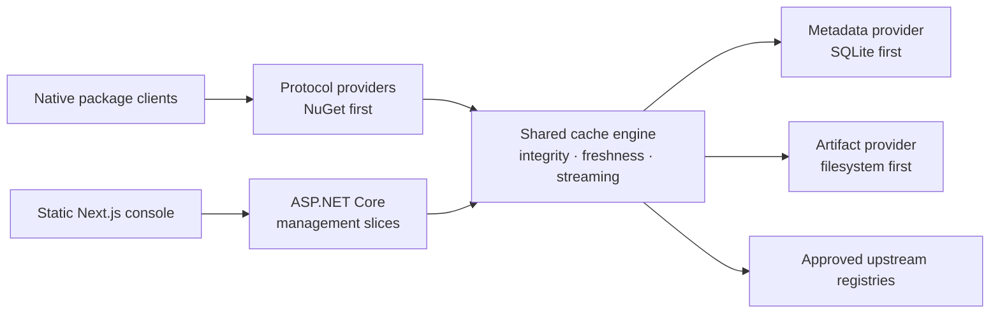

<p align="center">
  
</p>

<p align="center">
  <a href="LICENSE"></a>
  
  <a href="docs/ARCHITECTURE.md"></a>
  <a href="CONTRIBUTING.md"></a>
</p>

# Hoard

### Fetch once. Build forever. 📦

**One local destination for the dependencies your tools already use.**
Hoard is an MIT-licensed, self-hosted pull-through package cache being designed
for developer laptops, shared teams, and CI runners. Native package managers,
less repeated downloading, and a clear view of what's cached—without turning
dependency management into another full-time job.

> [!IMPORTANT]
> **Foundation only.** This repository currently contains product/design documents,
> development workflows, repository tooling, .NET provider contracts and a tested
> fixture-only module lifecycle, configuration, protected discovery boundaries,
> opt-in metadata operations with SQLite/memory qualification fixtures,
> and fixture-qualified artifact storage with independent local and simulated-object mechanisms,
> plus an operator-run Azure identity bootstrap.
> There is no runnable cache, production provider, UI, container, or published package.
> Everything in the product overview below describes the planned experience.

[Explore the vision](docs/PRODUCT_VISION.md) ·
[Read the architecture](docs/ARCHITECTURE.md) ·
[Follow the backlog](docs/HOARD_SPECKIT_MASTER_BACKLOG.md) ·
[Contribute](CONTRIBUTING.md)

The in-progress F-07 legacy adapters now retain interactive process-group
ownership through actual descendant settlement and bind metadata replay to the
selected provider/configuration. Fresh metadata recovery and six Local artifact
crash/reopen journeys pass as non-qualifying diagnostics. Large-transfer replay
is currently blocked by local scratch capacity; complete profiles and independent
verification remain unfinished. See the [implementation checkpoint](specs/007-provider-conformance/plan.md#reviewed-legacy-ownership-and-provider-attribution).
The independent metadata inventory decoder now also requires the actual legacy
transport input; resealed command graphs cannot omit it.
The separate forwarding contributor package now demonstrates good/faulty/corrected
execution of one unchanged metadata assertion, plus genuine legacy/reopen controls.
It wraps Memory and is not a third provider; the full CLI contributor journey
and complete applicable-suite acceptance remain unfinished.
The public `--profile metadata` and `--profile artifacts` commands now execute
their complete built-in native category batches on supported Linux hosts.
Reports remain non-qualifying and the CLI returns `EvidenceIncomplete` (exit 2)
until independent evaluation is delivered. Focused/custom-binding runs and the
other profiles remain guarded; neither a reduced inventory nor another provider
is substituted.
At `ef82218`, both isolated Linux public-category jobs pass their complete
component checks: 179 inherited applicable passes and thirteen authorized
durability exclusions, plus thirteen category quality checks. Reports remain
`Incomplete`/non-qualifying; full acceptance, portable proof retention and
independent evaluation are separate unfinished gates.
Architecture regressions additionally exercise every production SDK boundary,
complete/malformed scan inventories, and actual Identity-to-Core routes in both
edge orders. Malformed scan entries now produce the expected inspection error.
The two baseline/replacement composition component rows now consume the separately
packed test Host, rather than compiling its source into the consumer. Both pass
with one unchanged consumer image and fresh-cache locked build replay. This
does not yet provide a qualifying composition profile. These two rows now emit
bounded snapshots bound to the actual packaged Host owner; independent ingestion
admits their six observed stages and rejects false readiness/cleanup or replay.
Partial failed attempts retain their original proofs without claiming success.
Complete component replay passes all 155 discovered packaged composition/version
rows, alongside 148 source-mode rows; declaration, optional-target and version
fixture implementation is verified without claiming profile qualification.
Shared packaged Host callbacks now exercise all seven cancellation/retained/
late-fault ownership rows. The catalog explicitly includes both initializer
fault parameters and all three shutdown variants. These seven rows now admit
thirteen owner-linked safe snapshots, preserving actual task faults and retained
incomplete roots after settlement. Together with both baseline rows, nine safe
proofs and nineteen snapshots pass independent ingestion. Native containment and
full ownership/profile acceptance remain unfinished.
The initializer-failure row now also emits safe fault/rollback/cleanup snapshots:
ten actual package proofs and twenty-one snapshots pass independent ingestion.
The dedicated `conformance_composition_checks.py` diagnostic builds seventeen
archives, fresh-cache locked-replays the consumer, and binds these rows to an
owned native command. Its first Linux attempt rejects writable command inputs;
the sealing repair subsequently reaches launch but rejects test output through
the build projector. The corrected test projector passes actual Linux execution
of all thirteen selected proofs/thirty-three snapshots at exact `e9a1589`.
Process-resource release remains
explicitly separate from module-root qualification.
Schema-denial/recovery repairs now bind each phase to its distinct actual
composition owner. All thirteen selected package proofs/thirty-three snapshots
pass independent ingestion, including failed-prefix retention and real worker
entry before observing successful repair. Full profile acceptance remains open.
Native composition diagnostics now have an independent workflow so a short
component replay does not wait behind longer baseline/category diagnostics.
SQLite version/provenance remains explicitly unobserved in this component scope;
the platform and component environment files are separately bound inputs.
The independent Linux replay at exact `f6e9db4` verifies this environment/input
boundary and all thirteen cases with actual process-resource release, closing
T044. Shared packaged Host admission/request controls now close T045: actual
authority/guarantee denials precede store I/O, and active requests drain before
explicit restart. Three assembly-owner checks first fail, then all four package
cases pass. Implementation remains in progress at 48/86 tasks; complete safe
composition transport, inherited inventories and profile acceptance remain open.
CP-19/20 now also emit safe owner-bound store/request/restart observations.
Fresh package execution independently admits seventeen proofs/fifty-one
snapshots; optimistic I/O, hot replacement, lost requests and reused repair/
restart owners reject. Native replay of this expanded scope is pending.
Exact `cb8d6eb` subsequently passes the seventeen-row Linux replay with all
fifty-one snapshots and actual process-resource release. Safe component scope
now covers every CP-01..20 row: thirty-six actual parameter identities and
110 snapshots pass fresh package replay/independent ingestion. Four previously
omitted endpoint-declaration parameters are now explicit in the catalog.
Exact `59d9eff` passes the expanded Linux replay with all 36 proofs/110
snapshots and actual process-resource release. Inherited configuration
transport now independently admits twenty unchanged historical theory cases
without retaining their private argument displays. Because xUnit truncates
those displays into only twelve unique names, opaque identities bind both
the actual adapter case ID and display; changed IDs/arguments and ambiguous
literal aliases reject. Complete inherited inventories/profile acceptance
remain open; these component checks do not qualify a profile.
The committed safe discovery client now independently admits all 509 inherited
composition parameters against an immutable F-06 source/count catalog. Six
additional architecture methods/16 parameters and prepared controller journeys
remain separate, required obligations; discovery is not test execution.
Its first Linux attempt rejects the oversized direct input list before child
launch; the repair preserves the recorder limit with a verified closure manifest,
not a larger or weakened input budget.
Exact `6178a77` now passes that Linux replay, including all 509 discovery
identities, 36 CP proofs/110 snapshots and actual process-resource release.
Scoped legacy-controller adapters subsequently prepare fresh Core/provider/
CustomHost evidence, retained binaries, lifecycle/configuration/discovery
journeys and graph scans without raw diagnostic persistence. A local diagnostic
independently admits all 509 inherited composition parameters and 16 boundary
parameters in 58 exact class scopes, preserving the two-minute child timeout.
The committed native diagnostic now stages both inherited assemblies, prepares
all four borrowed controller families and attempts the complete 525-parameter
union through exact owned class scopes. Exact `f319b77` passes Linux
run40451900182: 525 parameters/58 native parent receipts, 696 unchanged private
inputs, CP36/110 and actual process release. Borrowed preparation is still not
native controller acceptance.
Borrowed recipes use writable owned copies, leaving immutable source snapshots
sealed; the native-only read-only-copy regression is reproduced and repaired.
Controller boundary checks explicitly bind the prepared SDK archive and logger,
rather than discovering an unrelated parent feed or building in the checkout.
The public `--profile composition` route now attempts these same observations,
but still returns `Incomplete`/`EvidenceIncomplete` (exit 2), never qualification.
Public-entry Linux run40453911841 at `5d2e959` passes the complete observed scope,
source/input checks and process release, while preserving exit 2 and false
qualification. The next continuation prepares the
registration, configuration and discovery historical binaries from frozen F-06
recipes before creating the candidate feed or launching candidate commands.
Sealed sources, project outputs, assets and archives are verified before/after
use; candidate dependencies replace only writable replay copies, never the
sealed originals. Public Linux run40455993703 at `f602db4` passes this ordering,
CP36/110, inherited525/58, all 2,011 bound inputs and real process release.
Complete
controller/mutation acceptance and profile evaluation remain open; T046 is
still unchecked.
Historical and controller preparation now also attempt separate owned native
child scopes, with sealed requests/results, exact native parent receipts and
closed progress projection. Native confirmation of those new scopes is pending;
their batch containment is not complete per-obligation controller acceptance.
The isolated-entry repair reaches the native child, but run40457814600 still
fails. Borrowed preparation now reuses its admitted native leader's guarded
group instead of attempting forbidden nested sessions; standalone legacy
commands keep their independent groups. Actual outer-group exit remains
mandatory, and the repaired native replay is not yet verified.
Run40458672367 verifies the historical native batch and reaches CP runtime
ingestion, then fails controller preparation with `OutputLimitExceeded`; it
does not verify the full continuation. The next increment runs the unchanged
BCL-only discovery reference consumer on an actual serialized fixture response,
validates its complete fixed presentation before retaining module identities,
and freezes its source/image/response inputs. Local six-module JSON execution
passes; native confirmation and all other controller obligations remain open.
Run40459781590 still fails in lifecycle preparation before reference-consumer
execution. Failure diagnostics now preserve closed conformance codes and
allowlisted script/line locations, not private tracebacks. Discovery mutation
workspaces also retain the complete current project/contract closure; fresh
source restore/build, seven positive guard cases and formatting pass after
declaring the source test's directly consumed Abstractions/Versioning inputs.
No actual mutation or full-controller acceptance is inferred from that setup.
Run40461182891 locates the lifecycle failure in bounded legacy evidence reads.
Legacy transport now checks closed logger admission failures before requiring
completion, preserving the actual safe failure code instead of masking it as
an output limit. A real local single-boundary transport passes; the Linux
failure and complete controller acceptance remain unresolved.
Run40462305943 preserves the logger's `EvidenceIncomplete` with zero observations.
Controller preparation now prepares lifecycle graphs without duplicating
boundary execution inside that batch. The complete native runtime still
requires all sixteen unchanged architecture parameters; standalone lifecycle
validation still executes and validates its nine boundary parameters.
All 545 tooling tests pass with twenty native skips; Linux replay is pending.
The Linux unit job executes 433 tests without failures, errors or skips but
rejects uncaptured expected progress from a test. That test now captures and
asserts the exact events; the safe runner's output rejection is unchanged.
Native checkpoint `cd91029` now passes
[run40463591718](https://github.com/Stonefly-Labs/Hoard/actions/runs/40463591718):
historical and four-family preparation (including the real JSON consumer),
CP36/110, all 525 inherited parameters/58 scopes, 2,022 unchanged bound inputs
and actual process release. The command still exits 2 as explicitly incomplete;
full-controller, mutation and qualification gates remain open.
The next closure repair also binds owned ancestor MSBuild/central-package/SDK
files and project lockfiles; changed metadata and symlinked context reject.
That enlarged closure passes at exact `8f46a2c` in
[run40465825066](https://github.com/Stonefly-Labs/Hoard/actions/runs/40465825066):
CP36/110, inherited525/58, all 2,124 unchanged bound inputs and actual release.
Prepared-project formatter commands now require individual native receipts and
unchanged generated NuGet imports/assets as well as the full private input map.
Their native confirmation is pending; solution-wide formatting and the remaining
full-controller obligations are not inferred from prepared-project formatting.
Formatter rehashing reuses the bounded descriptor-relative input reader;
same-byte symlink substitutions reject instead of borrowing an unbound file.
At exact `78a8486`, [run40467841673](https://github.com/Stonefly-Labs/Hoard/actions/runs/40467841673)
now verifies all forty prepared formatter commands (7/9/12/12 by family),
CP36/110, inherited525/58, 2,281 unchanged bound inputs and actual release.
The next increment prepares missing solution-project assets in locked mode,
includes the previously unbuilt contributor package in the private candidate
feed, and binds every tracked source input before a separate whole-solution
native formatter command. That increment now passes at exact `cfb20eca20f41d0a85b1f7c0adb76baf89ef20d8`,
[run40471161893](https://github.com/Stonefly-Labs/Hoard/actions/runs/40471161893),
job122080437087: all 41 formatter commands, including the whole source solution,
CP36/110, inherited525/58, all 3,181 unchanged bound inputs and actual release.
`solutionFormatting=true`; full-controller acceptance and qualification remain false.
The next discovery-mutation prerequisite admits an inherited wrapper assertion
only when its symbol exactly equals the selected composition test method.
Actual assertion prefixes and stack frames remain mandatory; sibling methods,
unrelated namespaces and unknown failures cannot borrow assertion provenance.
That prerequisite alone does not execute the mutation negatives or complete T046.
Actual local, non-native mutation execution now exposes and repairs an opaque
adapter-headline correlation defect: only the hash of an admitted actual failed
result's display can discharge its `[FAIL]` headline, in either event order.
The original `catalog-bound` mutation then produces all seven intended assertion
failures with complete safe transport. The two original `source-identity` and
`path-protection` negatives dereference missing failure/header state before an
assertion. Their exact method/matrix/binding scopes now admit distinct `Guard`
failures: failed, incomplete, never assertion or passing evidence. Unknown
messages still reject. All twelve real local negatives and twelve repairs now
execute through the reusable controller (29 parameters each), retaining original
sources, sealed mutant bytes and staged runtime inputs with final revalidation.
Historical read maps are distinguished from retained immutable inputs; restored
mutable source paths are not claimed unchanged. The native mutation phase and
strict completeness checks are integrated, with Linux confirmation pending.
Native full-controller acceptance and T046 remain open.
Opaque discovery now also retains each actual VSTest case GUID. The four
mandatory adapter scenarios are corroborated by recomputing the existing
GUID/display hash from their frozen literal displays, without persisting raw
displays or deriving invented labels. Actual local discovery confirms all four;
the inherited inspector joins all 137 discovery parameters, every original
suite class across ten groups and D01..D40 to independently admitted witnesses.
Missing/substituted case GUIDs, duplicate parameters and failed scopes reject
or remain incomplete. Native confirmation of this increment is pending.
Native mutation integration at `750e4d9`,
[run40480747075](https://github.com/Stonefly-Labs/Hoard/actions/runs/40480747075),
fails the original-source comparison before any negative executes. The prepared
build tree can contain independently admitted acceptance-lock derivations and
must not be treated as the original snapshot. Mutation execution now gets a
separate descriptor-relative immutable source snapshot and the actual staged
discovery driver; no changed-source exception is introduced.
Controller-bound full tooling now runs as trusted supervisor logic, not inside
a provider child whose native guard intentionally forbids nested sessions.
Every declared/started test and complete tracked test-module set are retained
with source/run/root binding. Skips, omitted tests, unexpected diagnostics and
stale inputs cannot pass. This tooling control explicitly makes no native
containment claim and does not relax provider-child confinement. Exact
`1606a44` now passes Linux
[run40484685752](https://github.com/Stonefly-Labs/Hoard/actions/runs/40484685752):
CP36/110, inherited525/58, all twelve negatives/repairs with 29 parameters each,
137 discovery parameters/four adapter scenarios/ten suites, 41 formatter
commands, 3,181 unchanged bound inputs and actual release. Controller-bound
tooling admits all 557 tests with no skips or unexpected diagnostics.
Full-controller acceptance and qualification remain false; T046 stays open.
Discovery now also reuses the original material-verification gate for all
eleven immutable feed archives, three retained binaries, eighteen graphs,
nine package journeys and current-run performance. The controller manifest is
hash-bound before admission. Each negative and repair scope is independently
re-admitted and must contain exactly its method's actual positive parameter
identities; failed-name lists and counters cannot substitute for those results.
Local retained execution confirms twelve negative/repair pairs over 29
scoped parameters; a separately built positive assembly corroborates their
28 unique selected identities, not the complete native positive inventory.
Full local tooling observes 560 tests without failures/errors or
unexpected diagnostic bytes, but twenty native skips keep it incomplete.
Exact `a42d083` now passes their native replay in
[run40487687455](https://github.com/Stonefly-Labs/Hoard/actions/runs/40487687455):
all material gates and cross-scope parameter joins, 560 controller-bound
tooling tests, 3,186 unchanged bound inputs and actual release. T046 remains
open; batch containment is not per-inner-command native provenance.
Compatibility controls now invoke the unchanged existing binary consumer
against explicitly built same-name/version broken and compatible contracts.
Actual loaded SHA-256/MVID evidence prevents accidental old-DLL resolution,
and replacing an already loaded baseline with actual candidate bytes rejects.
Portable PDB attribution additionally requires each actual PE/PDB pairing and
the compiler's source SHA-256 frozen from F-06 Git bytes. A behavior-preserving
source-comment change fails that attribution. All seven controls pass in
source mode and an isolated redirected package-mode build, completing T051's
test controls. These are controlled fixtures, not completed historical
source/binary compatibility acceptance.

The clean whole-solution build now explicitly includes all four compatibility
fixture projects. A cached project build had masked their absence from the
solution; a fresh snapshot first failed `MSB3030`, then built successfully and
passed all seven controls after the graph repair. Exact `1f94d19` now passes
[native run40493145991](https://github.com/Stonefly-Labs/Hoard/actions/runs/40493145991),
including all controller preparation, 561 tooling tests and actual release.
The earlier `022f5f8` and `ed04d63` native failures remain failures.

T054 now compiles 24 unchanged source recipes: twenty F-06 API consumer,
marker and provider-implementer projects plus the four current SDK bindings
(not historical SDK releases). An actual isolated local replay builds all
eighteen candidate packages afresh, then completes all 48 locked source
restore/build commands. Historical source/binaries remain sealed and
unchanged. This completes source recipes, not retained-binary candidate
execution, compiler-break/profile acceptance or qualification; no new public
CLI is claimed.

T055 now has actual local unchanged-binary execution for nine predecessor/
F-06 scenarios against candidate platform assemblies, with forty loaded-byte/
MVID observations. The two markers remain marker-only; operational F-06
consumers exercise memory/SQLite and local/object-semantics journeys without
claiming the full common suites. Actual hash and old-location challenges fail
even when the application exits zero. Native command/output binding is wired
into the all-SDK diagnostics; exact `87e9399` now confirms all nine scenarios,
forty loaded assemblies, 24 source recipes and actual owned cleanup in
[run40501112699](https://github.com/Stonefly-Labs/Hoard/actions/runs/40501112699),
closing T055 without claiming a complete compatibility profile or qualification.
The next controlled source challenge now reproduces actual `CS0535` for
`RequiredContract.IProvider.Required()` with the unchanged historical
implementer; restoring only the compatible contract passes with the same
source and output assembly bytes. Other member names cannot borrow that
compiler code. A separate bounded Linux compatibility diagnostic now exercises
source/retained replay and owned cleanup without replacing the full SDK job;
exact `87e9399` now also passes the precise source break/repair and all three
native binary controls, closing T056's isolated control scope. Implementation
continues at 52/86; full compatibility/composition profiles and independent
evaluation remain unfinished.
The next T046 increment replays the unchanged standalone BCL discovery consumer
inside a separately owned native reference phase, without rebuilding it.
The parent binds its original discovery manifest, complete frozen input map,
argv/cwd digests and exact child output to the settled native command record.
Missing or changed source/runtime inputs, dependency additions, foreign paths
and substituted output reject. Native confirmation of this new component is
pending; it does not supply individual receipts for every other inner controller
command. T046 stays unchecked and full-controller/profile qualification stays
false.
The follow-up reference receipt now observes the actual launched child's PID/
kernel-start identity, borrowed guarded group, argv/cwd, supplied stdin digest
and reaped exit. Parent admission cross-checks the group's PID/start against its
original native execution record instead of accepting command hashes alone.
The group remains explicitly borrowed until the parent proves actual settlement.
Native confirmation of this stricter receipt is pending; T046 remains open.
Exact `8bdce75` now confirms the earlier reference-phase component in
[run40579834470](https://github.com/Stonefly-Labs/Hoard/actions/runs/40579834470):
six original modules, eighteen unchanged inputs and actual release. It does not
confirm the later child-identity/journal extensions. The next increment journals
actual bounded and interactive launches across the native controller phases,
binding the closed observations to their original parent/output packets.
Publication still inspects staging before killing the original child.
Per-command input closure and T046/full-profile acceptance remain unfinished.
Exact `42115be` now confirms the actual reference-child/group receipt in
[run40581441462](https://github.com/Stonefly-Labs/Hoard/actions/runs/40581441462).
Exact `c72ba97` also confirms all four bounded native launch journals in
[run40584775906](https://github.com/Stonefly-Labs/Hoard/actions/runs/40584775906):
45 historical, 230 controller, one reference and 73 mutation launches, independently
bound to original parent/output records with actual release.
The next internal transport version pairs each launch with selected declared
file hashes checked before launch and after settlement. It rejects changed inputs
but explicitly does not claim complete compiler/runtime I/O closure. Local safe
tooling observes 572 tests with no failures/errors or unexpected diagnostic bytes;
twenty native macOS skips remain incomplete, not acceptance. Linux confirmation
of these new selected-input snapshots is pending; T046 remains unchecked, 52/86.
The first v3 native attempt at `c7dcb73` fails historical preparation because
the generic nonempty proof-manifest helper rejects a legitimately empty selected
file map. A focused regression reproduces that exact schema error; the repair
retains an explicit empty partial snapshot for commands without selected files,
without weakening nonempty input checks. Full local safe tooling now observes
573 tests with zero failures/errors and twenty native skips. Native replay of
the repair remains pending; the failed attempt is not acceptance.
The next selected-input increment follows the original safe logger's settings
to its owned runtime manifest, owner, run-input document, assembly images and
SDK archive. Their declared hashes join the same before/after launch checks;
substitutions, foreign/escaping roots and unknown logger settings reject.
Local safe tooling observes 574 tests without failures/errors or unexpected
diagnostic bytes, with twenty explicit native skips. Complete input closure
and T046 acceptance remain open.
The empty-map repair at `b5d6319` reaches mutation discovery, then fails because
the selector mistakes the installed SDK's supplementary VSTest path for the
owned driver's executable. The repair preserves foreign executable/project
rejection while distinguishing that SDK data argument. Selected inputs also
follow literal linked source, project references, imports and assembly hints,
and include nested admitted Hoard package files. Dynamic MSBuild evaluation
remains outside this partial claim. Local safe tooling remains 574 tests with
zero failures/errors and twenty native skips; native confirmation is pending.
Exact `cf6a9a6` now passes native v3 replay in
[run40594189002](https://github.com/Stonefly-Labs/Hoard/actions/runs/40594189002),
job122505782182. All 45 historical, 230 controller, one reference and 73 mutation
launches retain independently admitted original journals and selected-input
snapshots after actual release. The run observes CP36/110, inherited525/58,
all twelve original negative/repair pairs, discovery137/four adapters/ten suites,
574 tooling tests, 41 formatters and 3,272 unchanged bound inputs.
Selected declarations remain partial: this is not complete dynamic MSBuild,
SDK or runtime I/O closure, full-profile acceptance or qualification.
T046 remains unchecked, 52/86, implement/running.
Report schema admission now independently checks composition case/matrix keys
and exact CP parameter sets. A passing row cannot omit a theory parameter,
duplicate its label under a new execution ID, substitute a foreign parameter
or exclude mandatory composition coverage. Failed prefixes and interrupted
attempts remain nonqualifying evidence. These are schema controls, not runtime
good controls or the final evaluator; T048 and T071 remain open.
Full local safe tooling observes 576 tests with zero failures/errors or unexpected
diagnostic bytes and twenty explicit native skips.
The repaired Linux safe-unit wrapper also passes at `8f46a2c`: 433 tests,
zero failures/errors/skips. The wrapper now supports `--all-tooling`, and CI
selects that complete scope instead of only `test_conformance_*.py`.
Local full-scope execution observes 548 tests, no failures/errors or unexpected
diagnostic bytes, and twenty explicit native skips; fresh full-scope Linux
confirmation remains pending and these skips are not acceptance.
The full tooling scope is now independently green at exact `7ff5499`,
[run40468960470](https://github.com/Stonefly-Labs/Hoard/actions/runs/40468960470),
job122073676284: all 548 tests execute with zero failures/errors/skips or
unexpected diagnostic bytes. This does not yet supply controller-bound
tooling acceptance or complete T046.
The internal inherited-runtime inspector now re-admits raw logger transport
against both complete discovery inventories and exact class partitions. It
rejects omitted boundaries/theory parameters, replayed attempts/executions and
mixed source, owner or per-assembly inputs; failed witnesses remain failed.
This inspection alone does not establish native/controller qualification.
Its retained case coverage now derives every CFG/D row from the pinned
method assignments and all actual parameters; failed or incomplete contributing
scopes cannot produce a passed case. This is not full-controller acceptance.
Initial fresh lifecycle preparation fails its unchanged deadline because
framework configuration watchers consume the observation budget. Conformance
children now disable unused framework appsettings reload; the same unmodified
baseline/custom host binaries then pass in about 150 ms. This does not disable
Hoard configuration/restart checks or turn the earlier receipt into a fresh run.
Fresh execution at `5359f57` subsequently passes all four preparation families,
all 36 CP proofs/110 snapshots in one scope, and all 525 inherited parameters.
That local run is non-native; its complete scope union is independently admitted.
At exact `22ddff9`, all five existing Linux diagnostic jobs pass after an
unchanged-source failed-job retry. The original lock-preparation
`CleanupIncomplete` remains recorded; this is not full-profile qualification
or evidence that its underlying cleanup cause was fixed.

## ✨ The idea

| For your laptop | For your team |
| --- | --- |
| SQLite + filesystem, with no required cloud account | The same product, with explicit TLS and authentication |
| Loopback-first defaults and a lightweight runtime | A shared cache for developer machines and CI |
| Native package-manager configuration | Provider choices without a separate enterprise edition |

**NuGet comes first.** Go, Maven, npm, PyPI, and Cargo follow the
[dependency-ordered specification backlog](docs/HOARD_SPECKIT_MASTER_BACKLOG.md).
Hoard is a cache, **not a private package publishing registry**.

## 🧭 How it will fit together



The planned implementation is a **.NET 10 / ASP.NET Core composable modular
monolith** with independently distributed NuGet providers. Management workflows
and protocol endpoints use vertical slices; shared correctness invariants stay
in the cache engine. The **Next.js App Router / TypeScript / Tailwind / shadcn/ui**
console is statically exported and served by .NET—no mandatory Node server.

Read the [architecture](docs/ARCHITECTURE.md) for dependency boundaries,
module lifecycle, trust boundaries, and deferred capabilities.

## 🛠️ Start here today

```bash
git clone https://github.com/Stonefly-Labs/Hoard.git
cd Hoard
git switch -c chore/your-change

# Standard-library tests for the repository tools; no application build.
python3 -m unittest discover -s tests/tooling -v

# .NET 10 foundation/solution acceptance; old package examples stay compile-only.
bash scripts/validate-foundation.sh

# Fixture-only lifecycle, in-process HTTP, package/restart and compatibility proof.
bash scripts/validate-lifecycle.sh

# Fixture-only configuration, local secrets and original-preserving conversion.
bash scripts/validate-configuration.sh

# Protected discovery, JSON consumer, private loopback adapters and compatibility.
bash scripts/validate-discovery.sh

# Metadata semantics on independent packages, real SQLite crash/recovery proof.
bash scripts/validate-metadata.sh
```

For repository work, use Git, GitHub CLI, Python 3.11+, and a stable .NET 10 SDK
matching `global.json`. The foundation check restores pinned dependencies from
nuget.org and builds temporary local packages; it requires network access.
OpenTofu and Azure CLI
are needed only when working on the [Azure bootstrap](infra/bootstrap/README.md).
There is no runnable cache or Node project yet. The lifecycle harness uses only
in-memory TestServer, never a listening product service. Dedicated discovery
adapter tests additionally open and close private ephemeral loopback Kestrel/TLS
listeners. Hosting and Application consumers now
require the ASP.NET Core shared framework. See the
[foundation quickstart](specs/001-provider-contracts/quickstart.md) and
[provider author guide](docs/PROVIDERS.md) for the exact supported scope.

Repository-scoped [MCP settings](docs/DEVELOPMENT.md#local-mcp-servers) connect
Copilot CLI and VS Code to Microsoft Learn, Context7, Next.js DevTools, shadcn,
Playwright, read-only Azure MCP, Docker MCP Gateway, and NuGet MCP. These are
optional contributor tools, not application dependencies; no global MCP
settings are changed.

### Repository map

```text
.github/             Copilot instructions/skills/agents, templates, tag releases
.specify/            Installed Spec Kit and shared Hoard flow checkpoint
apps/web/            Reserved for the statically exported management console
docs/                Product intent, architecture, workflow, and release guidance
infra/bootstrap/     Operator-run Azure OIDC identity + GitHub environment setup
scripts/             Small, dependency-free repository tools
specs/               Reviewable feature specifications; not delivered capabilities
src/                 Four platform library boundaries; production Host/providers reserved
tests/               Tooling, foundation unit/architecture/composition checks, fixtures
examples/CustomHost/ Package-only compile proof; never starts a host
examples/LifecycleHost/ Package-only lifecycle fixtures; in-process TestServer only
```

## 🤝 Build with us

All work happens on `chore/`, `feature/`, `bugfix/`, `docs/`, or another
purpose-named branch—not directly on `main`. Commit coherent changes, **push
after each commit**, and open a PR when the work is ready. Update the README
and affected documentation **before merging**, with an explicit explanation
when a document is unaffected.

The [contributor guide](CONTRIBUTING.md) covers setup and PR expectations.
The [development workflow](docs/DEVELOPMENT.md) documents the checkpointed
`hoard-speckit` skill, architecture reviewer, release skill, and quality gates.
Each implementation invocation completes all remaining spec tasks without
per-task or per-phase approval, unless blocked by a question, required approval,
failure, or interruption. The one-stage boundary still applies.
The initial [constitution](.specify/memory/constitution.md) is version 1.0.0;
its adoption has merged. The first feature specification,
[platform package boundaries and provider contracts](specs/001-provider-contracts/spec.md),
defines the compile-only foundation, not a runnable cache.
Its initial [clarification review](specs/001-provider-contracts/spec.md#clarifications)
found no critical ambiguities requiring questions; a later
[approved follow-up](specs/001-provider-contracts/spec.md#approved-follow-up-2026-10-20)
resolves the optional-dependency ambiguity found during checklist review. Its
[implementation plan](specs/001-provider-contracts/plan.md) now documents
provider-neutral declarations, explicit registration, compatibility policy,
and package-only composition and boundary acceptance evidence. Its historical
design is retained separately from measured implementation results. The custom
[architecture](specs/001-provider-contracts/checklists/architecture.md) and
[compatibility](specs/001-provider-contracts/checklists/compatibility.md)
requirements-quality checklists have received an explicitly requested delegated
review: all 38 criteria are satisfied after the user-approved
[optional-dependency policy clarification](specs/001-provider-contracts/checklists/compatibility.md#rq-01-incompatible-present-optional-dependency).
Enabled optional dependencies must be compatible; installed/registered but
disabled targets are unavailable and confer no integration/capability support.
This is requirements review, not implementation evidence or authorization;
the [implementation task list](specs/001-provider-contracts/tasks.md) maps
all 17 requirements and six outcomes to dependency-ordered work.
F-01 now provides immutable declarations and family markers in
`Hoard.Abstractions`, empty provider-free Core/Application boundaries, and
registration-only Hosting APIs. The acceptance command builds five independent
fixture packages, four family consumers plus the second artifact consumer,
and both [custom-host variants](examples/CustomHost/README.md). It exercises
all eight architecture rejection rules and 23 compatibility classifications.
Registration records metadata/types without constructing, enabling, validating,
or activating providers. These are local compile proofs, not released packages,
working stores/protocols/authentication, native-client evidence, or certification.
The original implementation includes architecture-review corrections and the
support-claim audit. Convergence then identified a false rejection of permitted
Identity-to-Hosting references when Hosting transitively reaches Core.
[Task T058](specs/001-provider-contracts/tasks.md#phase-8-convergence) corrects
that check using distinct Hosting-mediated and other dependency paths, with
positive and negative regressions preserving forbidden-edge detection.
The follow-up convergence assessment found no remaining gaps across all
17 requirements, six outcomes, acceptance scenarios, plan decisions, and
58 tasks. Fresh locked acceptance passed all 86 .NET tests and 17 tooling tests;
the specification, plan, tasks, and reviewer-owned checklists stayed unchanged.
Finalization acceptance is recorded in the
[plan](specs/001-provider-contracts/plan.md#finalization-acceptance-2026-10-20);
[PR #4](https://github.com/Stonefly-Labs/Hoard/pull/4) merged into `main` on
2026-10-20. The separate `await_merge` completion checkpoint records F-01 as
complete, retaining its feature directory, PR, and verified merge commit.
The progress checkpoint merged through
[PR #5](https://github.com/Stonefly-Labs/Hoard/pull/5), satisfying the next-spec
merge gate. The subsequent
[F-02 specification: module registry, composition and lifecycle](specs/002-module-lifecycle/spec.md)
defines startup selection and dependency validation, disabled-module isolation,
route ownership, readiness, bounded initialization/cleanup, safe diagnostics,
and explicit restart/custom-distribution journeys. Its
[built-in quality checklist](specs/002-module-lifecycle/checklists/requirements.md)
passes all 16 specification-quality criteria, not implementation or
reviewer-owned approval.
The [clarification review](specs/002-module-lifecycle/spec.md#clarifications)
found no critical ambiguities across all ten review categories: zero questions
and no requirement or scope changes. The built-in checklist remains 16/16;
exact lifecycle APIs, finite budget defaults, and ordering details remain
planning decisions under the existing requirements at that review.
The subsequent [F-02 implementation plan](specs/002-module-lifecycle/plan.md)
now proposes an opt-in Hosting adapter, metadata-only validation, deterministic
ordering, owned-route conflict checks, supervised build/initialization and
bounded cleanup, safe readiness/results, and fixed-selection restart journeys.
Its research, in-memory model, public/lifecycle/acceptance contracts and
[validation quickstart](specs/002-module-lifecycle/quickstart.md) map all
22 requirements, seven outcomes and 20 story scenarios to 40 fixture-only proof
cases. Architecture review led to explicit build supervision, protection of
resources still used after drain timeout, and precise worker admission semantics.
These are design obligations, not measured runtime evidence.
The subsequent checklist stage generated separate
[composition](specs/002-module-lifecycle/checklists/composition.md) and
[lifecycle](specs/002-module-lifecycle/checklists/lifecycle.md)
requirements-quality checklists with 20 criteria each. These standard-depth
reviews are for maintainers and provider reviewers before implementation
authorization; all 40 items remain unchecked and reviewer-owned. They cover
selection/compatibility and route ownership, plus admission, readiness, bounded
coordination, resource retention, cleanup, and safe diagnostics. Generation is
not requirements approval or runtime evidence.
The subsequent [implementation task list](specs/002-module-lifecycle/tasks.md)
contains 72 unchecked tasks across shared setup/safety primitives, five story
phases and cross-cutting acceptance. It maps all 22 requirements, seven outcomes
and 40 acceptance cases to implementation and focused proof, with explicit
prerequisites and file-disjoint parallel opportunities. Tests precede changed
behavior; supervised build, response/resource retention, root disposal, old
binary compatibility and package graphs remain proof obligations, not results.
At task generation, all 40 custom checklist items remained untouched and
reviewer-owned.
The subsequent read-only cross-artifact analysis found no actionable duplication,
ambiguity, underspecification, inconsistency, constitutional conflict or coverage
gap. All 22 requirements and seven buildable outcomes have implementation and
proof assignments; all 72 tasks map to requirements or shared acceptance
prerequisites. The complete acyclic prerequisite graph, 40 LC cases, 20 story
scenarios and 12 edge cases were checked. The analysis report is recorded in
the draft feature PR; feature artifacts and all checklist markers are unchanged.
The later explicitly requested checklist review initially satisfied 19/20
composition and 19/20 lifecycle criteria, 38/40 total. It identified
[timed-out cleanup resource retention](specs/002-module-lifecycle/checklists/lifecycle.md#rq-01-explicitly-retain-resources-for-timed-out-cleanup-callbacks)
as needing an explicit pending-callback rule and focused proof obligation, and
[baseline/custom package manifests](specs/002-module-lifecycle/checklists/composition.md#rq-02-baseline-and-custom-artifact-package-lists-disagree)
as needing consistent journey instructions. The user approved both corrections;
the spec, model, contracts, acceptance cases, tasks and quickstart now include
pending StopAsync retention and consistent baseline/custom recipes. Re-evaluation
satisfies all 40/40 custom criteria without waivers. Fresh read-only analysis
and a bounded architecture review found no actionable findings; runtime proof
remains outstanding.
Those specification/design/review stages introduced no lifecycle runtime.
The subsequent authorized implementation adds opt-in metadata validation,
ordinal dependency ordering, supervised composition/build/initialization,
owned route checks, readiness, worker/request admission and bounded cleanup in
Hosting. Old `AddHoard`/`AddModule` calls remain inert. Six independent fixture
packages and the [lifecycle example](examples/LifecycleHost/README.md) exercise
bundled protocol changes, custom artifact addition, explicit recovery and
retained-old-binary registration compatibility.

The external composition lease alone stops the framework host and disposes its
root, after module cleanup and quiescence. `IHoardLifecycle.StopAsync` reports
module coordination; `NotAttemptedOwnerPending` does not claim root release.
Inspect the lease's final `StopResult`. A timeout is bounded waiting, not forced
termination: outstanding work retains resources and can require process exit.
See the [implementation evidence](specs/002-module-lifecycle/plan.md#implementation-evidence)
for exact acceptance results and review limits. Fixtures prove neither real
providers/native clients nor TCP/TLS/proxy drain. Configuration/secrets,
management discovery, caching, conformance, a curated product host and UI remain
later work. Convergence and finalization are separate driver stages.
The subsequent F-02 convergence assessment found one **CRITICAL** shutdown
coordination gap: worker failure invokes synchronous host-stop notification
while holding the lifecycle state lock. A held `ApplicationStopping` callback
blocked both stop and snapshot access beyond the configured shutdown budget.
[Phase 9 / T073](specs/002-module-lifecycle/tasks.md#phase-9-convergence)
records the separately authorized correction: host notification now runs outside
the state lock, tracked before stop begins so pending callbacks protect all
module/root resources. Deterministic regressions cover responsive snapshots,
the original shutdown deadline, once-only cooperative cleanup, and incomplete
cleanup without late retry/disposal. See the
[follow-up evidence](specs/002-module-lifecycle/plan.md#t073-implementation-follow-up).
Fresh convergence verified the T073 notification/deadline/resource boundary but
found one **HIGH** partial diagnostics gap: exceptions from supervised lifetime
and timeout cancellation tasks are consumed without being reported. A
public-API probe invoked a throwing stop-token callback once, yet module stop,
final lease disposal and the final snapshot all contained zero diagnostics.
[Phase 10 / T074](specs/002-module-lifecycle/tasks.md#phase-10-convergence)
now records the separately authorized correction. Lifetime, readiness-timeout
and cleanup-timeout cancellation share off-lock supervision that records safe
additional `CancellationFailure` diagnostics before releasing tracked activity.
Completed faults do not imply pending resource use; late faults appear only in
later snapshots, without changing returned results or triggering deferred cleanup.
Throwing/cooperative and held late-fault regressions preserve primary errors,
deadlines and once-only ownership. See the
[T074 evidence](specs/002-module-lifecycle/plan.md#t074-implementation-follow-up).
The subsequent fresh convergence assessment verified T074 but found one
**HIGH** partial gap in eventual-fault reporting. A readiness callback that
faults after its assessment times out has no diagnostic owner; a timed-out
cleanup fault is also omitted if it occurs before the shared stop completes.
Two isolated public-API probes confirmed the missing safe failure categories,
without changing resource-release outcomes or exposing provider payloads.
[Phase 11 / T075](specs/002-module-lifecycle/tasks.md#phase-11-convergence)
now records the separately authorized correction. Supervised callbacks publish
one safe owner/phase diagnostic before releasing tracked activity, regardless
of whether stop has finished. Direct failures are not duplicated; late faults
do not rewrite returned outcomes or retry cleanup. The implementation review
also identified and corrected omitted worker faults during shutdown and root
disposal dispatch after budget expiry, with failing-then-passing regressions.
See the [T075 evidence](specs/002-module-lifecycle/plan.md#t075-implementation-follow-up).
The subsequent fresh convergence assessment verified T073..T075 but found one
**CRITICAL** response-completion ownership gap. The admission endpoint releases
its request lease before an earlier host-middleware `OnCompleted` callback
finishes: a held callback had no tracked request activity while protocol and
prerequisite cleanup already reported Completed. The paired callback registered
inside the handler correctly retained those resources.
[Phase 12 / T076](specs/002-module-lifecycle/tasks.md#phase-12-convergence)
now records the separately authorized correction. Supervised host build installs
the request-completion boundary before host startup filters and middleware;
admission transfers the request lease to that boundary instead of releasing it
from an endpoint-registered callback. Normal and handled-error regressions prove
owner/prerequisite/root retention after drain expiry, independent safe cleanup,
and cooperative once-only release through all host/handler completion callbacks,
including a throwing callback. Host middleware and access policy still apply.
See the [T076 evidence](specs/002-module-lifecycle/plan.md#t076-implementation-follow-up).
The subsequent fresh convergence assessment found no actionable gaps across
all 22 requirements, seven outcomes, 20 story scenarios, 12 edge cases,
40 acceptance cases, 20 plan obligations and 76 tasks under the eight
constitutional principles. No convergence tasks were appended; the spec, plan,
tasks and reviewer-owned checklists remain unchanged. The next separately
authorized stage at that checkpoint was `finalize`. See the
[convergence checkpoint](docs/DEVELOPMENT.md#f-02-clean-convergence)
for the assessment.
Finalization now verifies the bounded acceptance, unchanged reviewer-owned
gates and implementation architecture-review evidence in the
[plan](specs/002-module-lifecycle/plan.md#finalization-acceptance-2026-10-21-utc).
[PR #6](https://github.com/Stonefly-Labs/Hoard/pull/6) merged into `main` on
2026-10-21 (UTC) at `b80c69fc386541be4f56f6ef2edeca40f43a0e1c`.
The separate `await_merge` stage verified that merge in fetched main and all
76 completed tasks, then recorded F-02 as complete with its directory, PR and
merge commit. The completion checkpoint merged through
[PR #7](https://github.com/Stonefly-Labs/Hoard/pull/7), satisfying the next-spec
gate. The subsequent
[F-03 specification: provider configuration and activation validation](specs/003-provider-configuration/spec.md)
defines deterministic source precedence, explicit provider choices, active option
validation, disabled-module isolation, environment/file secret references, safe
diagnostics, fixed-state restart and reviewed configuration conversion/recovery.
It consumes the existing lifecycle composition gate rather than creating another
activation path. Five prioritized stories, 26 requirements and eight outcomes
have a [built-in specification-quality checklist](specs/003-provider-configuration/checklists/requirements.md)
passing 16/16 criteria; the bounded architecture review found no actionable
findings. These are requirements only: no configuration parser, resolver,
migration tool, new runtime API, discovery endpoint or UI was implemented.
Custom reviewer approval and runtime proof remain later gates.
The subsequent [clarification review](specs/003-provider-configuration/spec.md#clarifications)
found no critical ambiguities across all ten review categories: zero questions,
with requirements, acceptance criteria and scope unchanged. The built-in
checklist remains 16/16, with no newly passing, regressed or unchecked items.
Exact syntax, option contracts, version mappings and finite budget values remain
planning decisions under the specified behavior.
The subsequent [implementation plan](specs/003-provider-configuration/plan.md)
resolves these choices into strict JSON sources, whole-selection replacement,
Hosting-owned option contracts, private single-use validation proofs and
owner-scoped environment/file secrets. Its
[research](specs/003-provider-configuration/research.md),
[state/ownership model](specs/003-provider-configuration/data-model.md),
[contracts](specs/003-provider-configuration/contracts/configuration-format.md)
and [validation guide](specs/003-provider-configuration/quickstart.md) define
36 planned proof cases, including original-preserving synthetic conversion,
bounded pending-work safety and retained binary compatibility.
The bounded planning architecture review found no confirmed contradictions;
actual lifecycle integration, diagnostic remapping and platform publication
remain implementation proof obligations. No runtime API, parser or new check
command is implemented by planning, and existing specification/checklist bytes
remain unchanged.
The subsequent checklist stage generated separate
[configuration](specs/003-provider-configuration/checklists/configuration.md) and
[safety](specs/003-provider-configuration/checklists/safety.md)
requirements-quality checklists with 20 criteria each. These standard-depth
reviews are for maintainers and provider-contract reviewers before implementation
authorization. The 40 reviewer-owned criteria cover
source/option/composition clarity and compatibility, plus secrets, diagnostics,
bounded ownership, restart and original-preserving conversion. Generation is
not requirements approval, implementation authorization or runtime evidence.
At the user's explicit follow-up request, Copilot evaluated all 40 criteria:
configuration 20/20 and safety 20/20 satisfied, with no unresolved writing gaps
or decisions needing user attention. Both checklists record the evidence.
This satisfies the custom requirements-review gate only, not implementation
authorization or runtime acceptance. The specification, design and built-in
16/16 checklist remain unchanged. That review did not start task generation
or implementation.
The subsequent [implementation task list](specs/003-provider-configuration/tasks.md)
originally contained 69 unchecked tasks: shared setup/bounded ownership primitives, five
story phases and cross-cutting acceptance. Source inspection is the first MVP;
composition, secrets, restart/distribution and synthetic conversion follow with
paired tests. Every requirement, outcome and planned CFG-01..36 proof case has
task assignments, including retained binaries, atomic ownership races and
platform publication/interruption. Independent tests/readers may run in parallel;
shared evaluator/lifecycle/orchestrator edits are ordered explicitly.
Specification/design and all checklist bytes remain unchanged. No configuration
API, parser, resolver, converter or validation command is implemented by task
generation.
The subsequent installed read-only analysis found no actionable duplication,
ambiguity, underspecification, inconsistency, constitution conflict or coverage
gap. All 26 requirements and eight buildable outcomes have implementation/proof
tasks; all 69 tasks map to requirements or shared acceptance prerequisites.
The 36 planned cases retain coverage of all 22 scenarios and 13 edge cases,
with complete acyclic prerequisites and ordered shared-file edits.
The report is recorded in [draft PR #8](https://github.com/Stonefly-Labs/Hoard/pull/8)
and completion evidence in the shared checkpoint. Specification, design, task
and checklist bytes remain unchanged; no remediation or implementation occurred.
At that checkpoint, the next separately authorized stage was `implement`, with
the existing 40/40 custom requirements-review gate satisfied. Analysis is not
runtime acceptance.

F-03 now implements strict versioned JSON sources, inert option metadata,
active ordinary checks and local environment/mounted-file secret references.
`EvaluateConfigurationAsync` delegates selection to F-02 and returns a private
single-use proof only after every active check succeeds. Configured adapters
receive fixed owner-only values immediately before service configuration;
legacy compose cannot bypass an enabled opt-in registration. Disabled modules
perform no operational checks or secret reads. No ambient process credentials,
hidden defaults, reload, provider download or fallback are introduced.

Explicit synthetic `fixture-v0` conversion offers secret-free preview, exact
session approval, full validation and complete fresh-file publication without
overwriting the original or an existing/racing destination. A pending bounded
wait is not a rollback guarantee. This is not support for a released old format,
illustrative product YAML, provider-data migration or universal filesystem
power-loss recovery.

`bash scripts/validate-configuration.sh` runs the complete fixture acceptance:
source/option/ownership tests, real packed graphs, unchanged old binaries,
package-only TestServer restart/custom-distribution journeys and actual child
interruption at publication boundaries. Partial `--filter`/`--baseline-only`
modes remain explicitly partial. See the
[implementation evidence](specs/003-provider-configuration/plan.md#complete-implementation),
[provider API guide](docs/PROVIDERS.md#f-03-configuration-boundary) and
[quickstart](specs/003-provider-configuration/quickstart.md).
Publication is measured on this macOS local volume; Linux and other
filesystems are not certified by that run. No runnable cache, production
provider, native-client or conformance claim follows.

The first F-03 convergence assessment reproduced two **HIGH** diagnostic gaps
despite passing existing acceptance: secret failures lost their known setting
identity, and option-check failures discarded the declared rule and winning source.
[Phase 9 / T070–T071](specs/003-provider-configuration/tasks.md#phase-9-convergence)
records the follow-up without changing the original 69 tasks, specification
or reviewer-owned checklists. The separately authorized implementation now
preserves each secret's canonical setting/source through failure, cancellation
and late faults. Option rejections expose only a validated declared `OptionRule`,
the effective field's source and host-owned guidance; unsupported active option
versions identify their own setting/source. No values, locators or provider
messages are exposed, and F-02 remains the sole activation authority.
The subsequent fresh convergence assessment found no actionable gaps across
all 26 requirements, eight outcomes, 22 scenarios, 13 edge cases, 12 grouped
plan decisions, 71 tasks and eight constitutional principles, including
T070/T071. No tasks were appended or artifacts/checklists rewritten.
See the [clean convergence checkpoint](docs/DEVELOPMENT.md#f-03-clean-convergence)
for evidence and measured scope. The separately authorized
[finalization acceptance](specs/003-provider-configuration/plan.md#finalization-acceptance-2026-10-21)
verifies the complete configuration and retained lifecycle/foundation checks,
unchanged requirements-review gates and implementation architecture-review
evidence. [PR #8](https://github.com/Stonefly-Labs/Hoard/pull/8) merged into
`main` on 2026-10-21 (UTC) at
`7fd73267a5154583363c94e9e85b9bac7d4a16b3`. The separate `await_merge` stage
verified that merge in fetched main and all 71 completed tasks, then recorded
F-03 as complete with its directory, PR and merge commit. The progress-only
completion checkpoint merged through
[PR #9](https://github.com/Stonefly-Labs/Hoard/pull/9), satisfying the next-spec
merge gate. No new specification or implementation ran in that completion stage.

The subsequent [F-04 specification: module capabilities and management
discovery](specs/004-module-discovery/spec.md) defines read-only inspection of
known distribution inventory, registration, enablement, support and observed
readiness. Five journeys, 22 functional requirements and eight measurable
outcomes require truthful route/service capability claims, management-read
protection, secret-free descriptive metadata, coherent bounded observations and
safe unavailable-state guidance. Its presentation contract distinguishes
unsupported, disabled, unknown, stale and temporarily not-ready states and
constrains consumer action eligibility without treating capability availability
as execution permission. Reference-consumer proof is in scope; rendered product
screens remain later console work.
The [built-in quality checklist](specs/004-module-discovery/checklists/requirements.md)
passes all 16 specification-quality criteria with no unresolved clarification
markers. This is requirements review only, not custom reviewer approval,
implementation authorization, a discovery endpoint or a delivered UI.
The [clarification review](specs/004-module-discovery/spec.md#clarifications)
found no critical ambiguities across all ten review categories: zero questions
and no requirement or scope changes. The built-in checklist remains 16/16;
exact contract shapes, limits and observation mechanics remain planning
decisions. The subsequent
[F-04 implementation plan](specs/004-module-discovery/plan.md) proposes an
explicit public catalog, atomic lifecycle observations, actual route/service
binding evidence and two protected read-only management routes in Application.
Its research, model, OpenAPI/library/presentation contracts and
[validation guide](specs/004-module-discovery/quickstart.md) map all requirements
and outcomes to 40 future fixture proof cases, including a JSON-only reference
consumer and bounded loopback exposure-adapter tests. Architecture review led
to explicit failure context and a Hosting-owned app/lease/source guard.
These are design obligations, not implemented endpoints or passing runtime
evidence. The subsequent requirements-quality checklist stage generates
[discovery](specs/004-module-discovery/checklists/discovery.md) and
[management](specs/004-module-discovery/checklists/management.md) reviews with
20 criteria each. These standard-depth reviews are for maintainers,
provider/composition reviewers and management-API/consumer reviewers before
implementation authorization. They cover inventory/support truth, coherent
bounded observations, protected disclosure and safe presentation/action rules.
All **40 criteria were generated unchecked and reviewer-owned**; generation
neither evaluates requirements nor supplies runtime evidence. At the user's
explicit follow-up request, the assisted review records **discovery 20/20 and
management 20/20 satisfied**, with no unresolved finding, waiver or decision
requiring maintainer attention. Criterion-level evidence is in each checklist.
The specification, planning artifacts and built-in 16/16 checklist are
unchanged. This satisfies requirements-quality review only, not runtime
acceptance or implementation completion. No task list or implementation was
created by that review.
The subsequent [task-generation stage](specs/004-module-discovery/tasks.md)
produces **78 unchecked tasks**: shared setup/publication primitives, five
story phases and cross-cutting acceptance/documentation work. All 22
requirements, eight outcomes and 40 paired cases have implementation and proof
assignments, with explicit prerequisites and file-disjoint parallel groups.
The work preserves inherited composition/lifecycle authorities, introduces both
HTTP routes only with shared protection, and requires actual binding evidence,
JSON-consumer decisions, loopback exposure adapters, bounded observations and
package/retained-binary proofs. These are future obligations, not passing runtime
results. Existing specification/design/checklist bytes remain unchanged.
At task generation, the next separately authorized stage was read-only
`analyze`, not implementation; the proposed discovery runner still does not exist.
The subsequent installed read-only analysis found no actionable inconsistencies,
ambiguities, coverage gaps or constitutional conflicts. All 22 requirements and
eight buildable outcomes have implementation and focused proof assignments;
all 78 tasks map to requirements or shared acceptance prerequisites. The complete
dependency graph is acyclic, including ordered shared-file edits, and all
40 cases, 22 scenarios and 13 edge cases retain their proof obligations.
The report is recorded in draft
[PR #10](https://github.com/Stonefly-Labs/Hoard/pull/10). All 14 feature files,
including task checkboxes and existing 40/40 custom checklist approvals, remain
unchanged. At that checkpoint the next separately authorized stage was `implement`; analysis
introduces no runtime behavior or passing product evidence.

F-04 now implements opt-in immutable discovery catalogs, the lifecycle owner's
atomic observations, actual route/service binding evidence and protected
`GET /api/v1/discovery` and `GET /api/v1/discovery/openapi.json` slices in
Application. Registration precedes configuration/composition snapshots;
`BindHoardDiscovery` verifies the exact retained app/root/lease and
`MapHoardDiscovery` precedes module mapping. Explicit verified direct-local or
authenticated TLS/trusted-proxy posture is mandatory. Metadata is allowlisted;
reads never resolve secrets, activate providers or refresh readiness.
The BCL-only reference consumer exercises semantic state/action/freshness rules,
not a delivered console.
Usability never grants execution permission.
See the [implemented validation guide](specs/004-module-discovery/quickstart.md)
and [evidence report](specs/004-module-discovery/plan.md#implementation-evidence).
The implementation checkpoint was distinct from convergence, finalization,
merge and release; [PR #10](https://github.com/Stonefly-Labs/Hoard/pull/10)
remained draft at that stage.
The resumed convergence review identified two consumer gaps:
[Phase 9 / T079-T080](specs/004-module-discovery/tasks.md#phase-9-convergence).
Unknown or terminal owner/dependency phases can leave actions enabled when
other fields still claim readiness/usability; fixture evidence text also
replaces the distinct supported/unsupported/unverified label. The follow-up
implementation completes both tasks: owner/dependency phases must be
`assessing-readiness` or `running` alongside ready state, and support text
precedes a separate evidence-scope label. Paired wire regressions reproduce
the original failures and now pass; locked discovery acceptance includes all
15 added scenarios without lock changes. That checkpoint scheduled fresh
`converge`; specification and reviewer approvals remained unchanged.
The subsequent [clean convergence assessment](docs/DEVELOPMENT.md#f-04-clean-convergence)
finds no remaining gaps across all 22 requirements, eight outcomes, 22 scenarios,
13 edge cases and 80 tasks, including both consumer corrections. Fresh locked
discovery acceptance passes 137 tests, all 40 cases, nine package journeys,
18 graph scans and 12 runtime mutations, with no skips or lock changes.
The specification, plan, tasks and reviewer-owned checklists remain unchanged.
That convergence checkpoint scheduled **`finalize`**, not merge, and kept
[PR #10](https://github.com/Stonefly-Labs/Hoard/pull/10) draft.
F-04 [finalization](docs/DEVELOPMENT.md#f-04-finalization) now verifies all
80 completed tasks, unchanged reviewer approvals, prior architecture reviews
and fresh locked acceptance. A second fresh run replays the originally frozen
pre-F-04 lifecycle/configuration/options binaries without recompiling them.
README, affected guides and feature statuses now reflect the accepted
fixture-backed scope. [PR #10](https://github.com/Stonefly-Labs/Hoard/pull/10)
merged into `main` on 2026-10-21 at
`287c7b65a068b50e672d92f2d535ef79c910ac0b`.
The separate `await_merge` stage verified that merge, all 80 completed tasks
and the published [v0.0.4-alpha source prerelease](https://github.com/Stonefly-Labs/Hoard/releases/tag/v0.0.4-alpha)
at that exact commit, including generated notes and both source archives.
It records F-04 complete with its feature directory, PR, merge commit and release
evidence. [PR #12](https://github.com/Stonefly-Labs/Hoard/pull/12) merged the
running checkpoint before the completion changes were committed. The follow-up
completion checkpoint merged through
[PR #13](https://github.com/Stonefly-Labs/Hoard/pull/13), satisfying the next-spec
merge gate.
No new specification, implementation, package publication or deployment ran
in this completion stage; the prerelease contains source only.
The subsequent [F-05 specification: metadata persistence provider
contract](specs/005-metadata-persistence/spec.md) defines isolated durable state,
atomic related changes, explicit concurrency/retry outcomes, reference and lease
safety, controlled schema upgrades, backup/recovery and provider-neutral
qualification. Five journeys, 23 scenarios, 24 requirements and eight measurable
outcomes pass the 16-item [built-in specification-quality
checklist](specs/005-metadata-persistence/checklists/requirements.md).
These are future acceptance obligations: bounded SQLite durability proof and
an independent alternative fixture do not claim the later production provider,
generic certification, cross-store transactions or multi-node safety.
No persistence code, schema or new validation command exists from this stage;
the subsequent [clarification review](specs/005-metadata-persistence/spec.md#clarifications)
finds all ten review categories clear, with zero questions and no requirement,
acceptance or scope changes. The built-in quality checklist remains 16/16 with
no marker changes; this is not custom reviewer approval or runtime evidence.
The subsequent [implementation plan](specs/005-metadata-persistence/plan.md),
[logical model](specs/005-metadata-persistence/data-model.md) and
[public contract](specs/005-metadata-persistence/contracts/metadata-api.md)
resolve operation shapes, common limits/budgets, 24-hour operation tickets,
publication guards, reference generations and fenced leases without changing
existing provider markers. The [recovery design](specs/005-metadata-persistence/contracts/recovery.md)
defines controlled schema admission, real process-crash boundaries and verified
backup restoration; [48 planned proof cases](specs/005-metadata-persistence/contracts/acceptance.md)
separate SQLite durability from independent memory-fixture semantics.
The [validation quickstart](specs/005-metadata-persistence/quickstart.md) clearly
labels new commands as future implementation work. Bounded architecture review
found no design findings; no API, fixture, schema, qualification or production
support is delivered by planning. The subsequent checklist stage adds standard-depth
[metadata contract](specs/005-metadata-persistence/checklists/metadata.md) and
[recovery](specs/005-metadata-persistence/checklists/recovery.md)
requirements-quality checklists, with 20 criteria each for maintainer/provider
reviewers. At the user's request, an assisted assessment finds written coverage
for all 40 criteria, with no unresolved finding or decision needing maintainer
attention. Generated markers remain unchecked: the assessment is not formal
checklist approval or implementation evidence. The subsequent
[task-generation stage](specs/005-metadata-persistence/tasks.md) defines 83
unchecked tasks: shared setup/foundation, five story increments and cross-cutting
acceptance. All 24 requirements, eight outcomes, 23 scenarios, 14 edge cases and
48 planned proof cases map to implementation and focused checks, with explicit
prerequisites and independent provider lanes. Existing specification/design and
checklist bytes remain unchanged; no product implementation or qualification
occurs. At that checkpoint, read-only `analyze` was the next separate stage.
The subsequent installed read-only analysis finds no actionable duplication,
ambiguity, underspecification, inconsistency, coverage gap or constitutional
conflict. All 24 requirements and eight buildable outcomes have tasks; all 23
scenarios, 14 edge cases and 48 proof cases retain focused mappings. The
83-task, 107-edge prerequisite graph is complete and acyclic. The
[analysis report](https://github.com/Stonefly-Labs/Hoard/pull/14#issuecomment-6329405510)
records the assessment; feature artifacts and every checklist marker remain
unchanged. The subsequently requested assisted checklist review evaluates and
marks **metadata 20/20 and recovery 20/20 satisfied**, with criterion-group
evidence in each checklist and no unresolved finding or decision needing
maintainer attention. This satisfies the custom requirements-quality review
gate; **`implement`** remains next through a separate invocation. The checkpoint,
all 83 tasks and the specification/design remain unchanged. Requirements review
and artifact analysis are not persistence, durability or production-support
evidence.
The separately authorized implementation delivers the operational contract and
fixture qualification. Setup
T001..T006 added the deterministic harness, independently packed fixture
scaffolds, pinned private SQLite dependency, retained pre-F-05 binary recipe
and fail-closed [metadata evidence command](scripts/validate-metadata.sh).
The subsequent implementation adds BCL-only records and separate store/schema/
publication interfaces without changing the marker. Independently packaged
SQLite and copy-on-write memory fixtures exercise transactions, receipts,
references, leases, admission and bounded cleanup. The runner uses one common
test/consumer binary for both compositions, real parent-terminated SQLite
children, verified isolated restore, actual package scans and the frozen old
marker binary. Its complete manifest requires all 39 logical cases for both
providers and nine SQLite-only durable cases; memory durability is explicitly
not applicable. Preparation and focused selectors never claim full qualification.
The [quickstart](specs/005-metadata-persistence/quickstart.md) documents commands,
retained private evidence, recovery and fixture-only limits. Implementation
does not deliver a production persistence provider or runnable cache.
Complete locked qualification passes all 87 applicable provider/case entries;
the nine memory durability entries are explicitly non-applicable. Existing
foundation/lifecycle/configuration/discovery acceptance and repository tooling
also pass with unchanged lock hashes. The feature remains a draft in
[PR #14](https://github.com/Stonefly-Labs/Hoard/pull/14); separate `converge`
and `finalize` stages remain before any merge gate.
The subsequent convergence assessment appends one HIGH-priority correction,
[Phase 9 / T084](specs/005-metadata-persistence/tasks.md#phase-9-convergence):
both fixture providers classify a null decoded continuation key as
`InternalFailure/OperatorRecovery` instead of `InvalidInput/CorrectInput`.
Fresh locked qualification still passes its existing cases; the additional
probe exposes a missing malformed-cursor regression, not a clean convergence
result. Product code, specification, plan and existing task completions are
unchanged. That checkpoint returned to **`implement`** for T084.
The subsequent implementation correction is complete: both fixtures reject
null/omitted decoded keys safely, and six paired malformed-field regressions
preserve valid resumption and complete dataset traversal. Full locked
qualification passes 65 common tests per provider, all 87 applicable entries
and nine explicit memory durability exclusions. See the
[correction evidence](specs/005-metadata-persistence/plan.md#t084-malformed-continuation-correction).
Fresh **`converge`** is next, followed by finalization; PR #14 remains draft.
That fresh assessment finds one HIGH partial gap in SQLite page reads:
a stored registry with a null label is incorrectly classified as
`InvalidInput/CorrectInput`, while grouped reads correctly return
`CorruptState/OperatorRecovery` for the same record.
[Phase 10 / T085](specs/005-metadata-persistence/tasks.md#phase-10-convergence)
records the correction and missing regression; no implementation changes occur
in convergence. Fresh full locked qualification passes its existing cases but
does not cover or waive this additional runtime-proven gap. The next stage is
**`implement`** for T085, then fresh convergence; PR #14 stays draft.
The T085 correction is now complete: SQLite pages reuse the corruption-aware
stored-record decoder and return `CorruptState/OperatorRecovery` for damaged
payloads, while bad caller input retains `InvalidInput/CorrectInput`.
Paired regressions prove complete failure, sanitized diagnostics, unchanged
damaged data and exact valid-page recovery. Full locked qualification passes
66 common tests per provider and all 87 applicable entries, with nine explicit
memory durability exclusions. See [T085 evidence](specs/005-metadata-persistence/plan.md#t085-stored-page-corruption-correction).
All 85 tasks are complete; fresh **`converge`** is next, then finalization.
PR #14 remains draft; no merge is requested.
The subsequent fresh convergence finds two HIGH partial corruption gaps in
SQLite: a damaged authorization-partition field is silently omitted from a
filtered page, and reconciliation returns a successful committed receipt with
an invalid null target. Both are reproduced against freshly packed binaries;
restoring the synthetic data recovers valid results and integrity.
[Phase 11 / T086 and T087](specs/005-metadata-persistence/tasks.md#phase-11-convergence)
append the correction and regression work without changing application code,
the specification, plan, previous tasks or checklist markers. Full locked
qualification passes its existing 66 tests per provider and 87 applicable
entries, but does not cover or waive these newly demonstrated paths.
The next stage is **`implement`** for both tasks, followed by fresh convergence;
PR #14 stays draft, with no merge requested.
Both corrections are now complete. SQLite validates page candidates before
payload-based filters and uses one bounded ledger/receipt decoder for replay,
reconciliation and schema integrity. Paired regressions preserve damaged data,
query isolation, original-ticket recovery and nonduplicate effects. Full locked
qualification passes 72 common tests per provider and all 87 applicable entries,
with nine explicit memory durability exclusions. See
[T086/T087 evidence](specs/005-metadata-persistence/plan.md#t086t087-filtered-page-and-receipt-corruption-corrections).
All 87 tasks are verified complete; fresh **`converge`** is next, then
finalization. [PR #14](https://github.com/Stonefly-Labs/Hoard/pull/14) remains
draft; no merge is requested.
The subsequent installed convergence assessment finds no actionable gaps across
all 24 requirements, eight outcomes, 23 scenarios, 14 edge cases and 87 tasks.
Fresh full locked qualification passes 72 common tests per provider and all
87 applicable entries, with nine explicit memory durability exclusions.
Tasks, specification, plan, checklists, product/tooling sources and all 88 locks
remain unchanged. See the [clean convergence evidence](docs/DEVELOPMENT.md#f-05-clean-convergence).
The next separately invoked stage is **`finalize`**; PR #14 remains draft,
and no merge is requested.
Finalization now verifies all 87 completed tasks, clean convergence, unchanged
requirements/checklist approvals, applicable architecture reviews and current
documentation. Fresh full locked qualification passes 72 common tests per
provider, all 87 applicable entries and nine explicit memory durability
exclusions, with all 88 locks unchanged. See the
[finalization evidence](docs/DEVELOPMENT.md#f-05-finalization).
[PR #14](https://github.com/Stonefly-Labs/Hoard/pull/14) merged into `main` at
`81e2e8d41e08aafc9e89f388dab78e7509227dd5`. The separate **`await_merge`** stage
verified that merge and published
[`v0.0.5-alpha`](https://github.com/Stonefly-Labs/Hoard/releases/tag/v0.0.5-alpha)
at that exact commit. Its successful source-release run, generated notes,
annotated remote tag and both automatic source archives are verified; no
runtime binaries or packages are published. See the
[merge/release evidence](docs/DEVELOPMENT.md#f-05-merge-completion-and-alpha-source-release).
[Completion-checkpoint PR #15](https://github.com/Stonefly-Labs/Hoard/pull/15)
merged into `main`, recording F-05 complete with release metadata.
**F-06 is merged and its alpha source release is published; the completion
checkpoint awaits maintainer merge.**
The additive BCL-only storage contracts have independent Local and simulated
ObjectSemantics fixtures for verified streaming/publication, protected reads,
exact-ticket reconciliation, bounded recovery and reference-safe deletion.
The current locked run contains **96 attributed entries: 92 passes and exactly
four Object AS-41..44 exclusions**, on macOS 26.5 arm64, .NET 10.0.7 and APFS.
Actual 256 MiB/4 GiB write/read runs on each fixture stayed below 64 MiB
incremental OS peak RSS; all six local SIGKILL/fresh-process barriers passed.
The same compiled consumer exercises all 16 common operations on both choices.
Eight resolved graphs, compiled leak/consumer controls and the original
pre-F06 marker binary preserve package independence and compatibility.

Both fixtures declare the required baseline and become ready only after
successful explicit admission. Missing guarantees/version/authority reject
before root I/O; disabled selections remain inert. Existing F-02/F-03
composition tests demonstrate startup/stop and explicit restart: Local reopens
its exact known identity; Object replacement starts a fresh root and epoch.
Cancellation cannot discard a successfully handed-off ticket/read session.
Unclaimed results are reclaimed under retained ownership; expired staging is
matched by exact generation, and failed unclaimed-result reclamation blocks admission/readiness
until an exact bounded shutdown retry succeeds.

The full verifier requires every AS case's exact parameterized runtime witnesses,
actual context/package/lock hashes, paired passed TRX names and durations,
four measurements, six crash proofs and materialized public qualification records.
Executed mutation pairs and 29 altered-full-manifest checks reject false claims.
All four focused modes remain `qualification: false`; their passes never
substitute for full acceptance. All five predecessor gates pass separately
with tracked locks; only 15 local fixture-package hashes in six locks changed
in the final checkpoint, preserving versions, graphs, external hashes and the
frozen baseline. See the [follow-up evidence](specs/006-artifact-storage/plan.md#convergence-follow-up-implementation-2026-10-22)
and [qualification guide](specs/006-artifact-storage/quickstart.md).
These are test-only fixtures, not a working cache, production provider, remote
service, power-loss certification or generalized F-07 conformance.

The subsequent convergence assessment reproduced two **HIGH partial gaps** on
both fixtures despite a fresh passing full locked run.
[Phase 9 / T087-T088](specs/006-artifact-storage/tasks.md#phase-9-convergence)
recorded the remaining work: failed staging reclamation reported release/readiness
but strands bytes and reserved capacity even after access returns; sequential
recovery paging exhausted the 32 retained cursor slots before finishing a stable
35-row inventory. The follow-up implementation completes both tasks on both
fixtures: failed prefixes retain exact cleanup ownership, block readiness/new
admission and support bounded maintenance or shutdown retry without reopening
finalized tickets. Settled commit receipts remain reconcilable while residual
staging is reclaimed, with committed bytes untouched. Consumed recovery cursors
are retired; 32 independent scans each traverse all 35 rows and free their
terminal handles. Fresh locked qualification passes 237 logical/crash tests,
all transfer/crash/package proofs and the exact 92-pass/four-exclusion matrix.
All 88 tasks are checked; reviewer-owned checklists remain unchanged.
See the [follow-up checkpoint](docs/DEVELOPMENT.md#f-06-convergence-follow-up-implementation).
That implementation checkpoint scheduled fresh **`converge`**;
[PR #16](https://github.com/Stonefly-Labs/Hoard/pull/16) remains draft.
No clean-convergence, finalization, merge or release is claimed.

Fresh convergence verifies those two corrections but reproduces a separate
ObjectSemantics unpublished-assembly leak:
[Phase 10 / T089](specs/006-artifact-storage/tasks.md#phase-10-convergence).
Failed unlink after assembly leaves another untracked payload on each commit
retry while reporting released cleanup and readiness. Abandonment releases its
reservation and shutdown reports release without reclaiming those objects.
The writable-directory control leaves no residual payloads. A fresh full locked
run passes the existing matrix, but does not cover or waive this new failure
path. That assessment scheduled **`implement`** for T089, then fresh convergence.
See the [assessment and reproduction](docs/DEVELOPMENT.md#f-06-fresh-convergence-unpublished-object-cleanup).
The subsequent implementation completes T089: unselected assemblies are owned
before creation, count/byte bounded and retained on failed unlink. Incomplete
cleanup blocks readiness and retries until exact maintenance or shutdown
reclaims the payload; selected objects and settled reuse receipts survive.
Fresh locked full qualification passes 243 logical/crash checks and the exact
92-pass/four-exclusion matrix, including partial/complete assembly failures,
cancellation, repeated denial and restored capacity.
All 89 tasks are checked. See the
[implementation evidence](specs/006-artifact-storage/plan.md#unpublished-object-cleanup-implementation-2026-10-22).
The next stage is fresh **`converge`**; PR #16 stays draft, with no finalization,
feature completion or release claim.

The preceding convergence verifies T089's cleanup correction but finds that both
evidence validators fail to quarantine a detected-truncated incarnation.
After validation returns `CorruptContent`, opens still succeed; externally
restoring the bytes lets the same evidence validate and duplicate publication
return `AlreadyPresentVerified`, without explicit recovery.
[Phase 11 / T090](specs/006-artifact-storage/tasks.md#phase-11-convergence)
records the HIGH partial correction and paired regression work. A fresh full
locked run still passes its existing 92-pass/four-exclusion matrix; it does not
cover or waive this validation-first corruption path. That assessment scheduled
T090 implementation. See the
[assessment and reproduction](docs/DEVELOPMENT.md#f-06-fresh-convergence-corruption-quarantine).

The subsequent implementation completes T090 and all **90 tasks**. Every
committed-content detection path quarantines the exact incarnation; external
byte restoration cannot revive opens, evidence validation or duplicate reuse.
Local quarantine persists across reopen, including bounded shutdown persistence
retry after a denied record write. Object quarantine remains process-local.
Delayed opens and unresolved reconciliation recheck quarantine before settlement;
access failures remain distinct, and authorized delete/recreate gets a new stamp.
Original finalized receipts remain reconcilable historical decisions, not health
certificates. Fresh locked qualification passes 261 logical/crash checks and the
exact 92-pass/four-exclusion matrix with all transfer/crash/package proofs.
See the [implementation evidence](specs/006-artifact-storage/plan.md#corruption-quarantine-implementation-2026-10-22).
The next stage is separately invoked fresh **`converge`**; PR #16 stays draft.
No finalization, feature completion, merge or release is claimed.

The subsequent installed convergence assessment finds no actionable gaps across
all 25 functional requirements, eight success criteria, 23 acceptance scenarios,
15 edge cases, eight plan decisions, 90 existing tasks and eight constitutional
principles. T087..T090 remain satisfied, including retained failed cleanup,
consumed-cursor retirement and exact-incarnation corruption quarantine.
No tasks are appended; all feature artifacts and reviewer-owned checklists
remain unchanged. Fresh default locked full qualification again passes 261
logical/crash checks, all transfer/crash/package proofs and the exact
92-pass/four-exclusion matrix. See the
[clean convergence checkpoint](docs/DEVELOPMENT.md#f-06-clean-convergence).
That checkpoint scheduled **`finalize`** and kept PR #16 draft;
convergence alone did not establish merge readiness or feature completion.

The subsequent finalization verifies all 90 completed tasks, unchanged reviewer
approvals and corrected architecture findings, and repeats full locked artifact
qualification and tooling regressions. README, development guidance and feature
status now record the [finalization evidence](docs/DEVELOPMENT.md#f-06-finalization).
[PR #16](https://github.com/Stonefly-Labs/Hoard/pull/16) subsequently merged at
`9389016c0285c79f6f515f59805a5a41c69b0767`. The separate **`await_merge`** stage
verified that merge and published
[`v0.0.6-alpha`](https://github.com/Stonefly-Labs/Hoard/releases/tag/v0.0.6-alpha)
at that exact commit. Its successful source-release run, annotated remote tag,
generated notes and both automatic source archives are verified. The helper
records F-06 complete with release metadata in
[completion-checkpoint PR #17](https://github.com/Stonefly-Labs/Hoard/pull/17).
That completion checkpoint subsequently merged through PR #17, enabling the
separately invoked F-07 specification stage below.
See the [merge/release evidence](docs/DEVELOPMENT.md#f-06-merge-completion-and-alpha-source-release).
No runtime binaries, packages, containers, infrastructure action or deployment
are included; no new spec or PR merge runs in this invocation.

The separately invoked **`specify`** stage creates the
[F-06 artifact blob storage provider contract](specs/006-artifact-storage/spec.md)
on `feature/006-artifact-storage`. Five journeys cover complete verified
publication, bounded multi-GB streaming, interrupted-work recovery, reader-
and reference-safe deletion, and provider-neutral qualification without assuming
atomic rename. Its [built-in quality checklist](specs/006-artifact-storage/checklists/requirements.md)
passes all 16 criteria across 25 requirements and eight measurable outcomes,
including the required 4 GiB transfer proof within 64 MiB incremental transfer
memory. At that specification checkpoint the fixtures were later proof
obligations, not delivered providers or remote-service support. See the
[stage scope](docs/DEVELOPMENT.md#f-06-artifact-storage-specification).
The subsequent [clarification review](specs/006-artifact-storage/spec.md#clarifications)
finds all ten ambiguity categories clear, with zero questions and no requirement
or scope changes. The built-in quality checklist remains 16/16; exact budgets
and proof mechanics remain constrained planning decisions. See the
[review evidence](docs/DEVELOPMENT.md#f-06-artifact-storage-clarification).
The subsequent [implementation plan](specs/006-artifact-storage/plan.md)
defines additive BCL-only operations, exact finite budgets, protected full-read
completion, ticket/incarnation recovery and one shared authority for metadata
publication and safe deletion. Its [acceptance matrix](specs/006-artifact-storage/contracts/acceptance.md)
traces all 25 requirements/eight outcomes to 48 planned cases, including actual
256 MiB/4 GiB and peak-RSS proof on both independent fixtures. Local process-crash
qualification remains distinct from simulated object semantics and power-loss
or production-provider claims. Architecture review's guard-recognition omission
is addressed by authority-owned retention without reentering admission.
See the [planning scope](docs/DEVELOPMENT.md#f-06-artifact-storage-planning)
and [qualification guide](specs/006-artifact-storage/quickstart.md).
Those were planning-only artifacts; the implementation evidence above records
the subsequently delivered APIs and acceptance command.
The subsequent checklist stage generates standard-depth
[storage](specs/006-artifact-storage/checklists/storage.md) and
[recovery](specs/006-artifact-storage/checklists/recovery.md) requirements-quality
checklists for maintainer/provider review, with 20 initially unchecked items each.
At the maintainer's explicit request, a separate assisted review evaluates every
item, initially satisfying storage **20/20**, recovery **19/20**. The
[high-priority consistency issue](specs/006-artifact-storage/checklists/recovery.md#rq-01-finite-release-versus-non-cooperative-work)
identified a conflict: the specification promised finite resource release in all
failure cases, while the plan permits non-cooperative I/O to retain bounded
resources and block readiness until actual settlement. At that checkpoint,
recovery CHK012 remained unchecked and blocked implementation approval,
not task generation; no requirement change or waiver was presumed.
See the [review scope](docs/DEVELOPMENT.md#f-06-artifact-storage-checklists-and-assisted-review).
The subsequent [implementation task list](specs/006-artifact-storage/tasks.md)
initially contained **86 unchecked tasks**: shared setup/contracts, five story phases and
cross-cutting acceptance. All 25 requirements, eight outcomes, 23 scenarios,
15 edge cases and 48 acceptance cases have implementation/proof assignments,
with explicit prerequisites and file-disjoint parallel opportunities. US1 is
the verified-publication/read MVP, not complete qualification or a runnable cache.
Actual four size/provider transfer measurements, six local crash barriers,
shared reference/deletion authority, independent packages and exact 96-entry
qualification were future obligations at task generation. Task generation left all existing
requirements, design artifacts and checklist markers unchanged; planned tasks
did not resolve RQ-01 or bypass the requirements-review gate.
See the [task-stage scope](docs/DEVELOPMENT.md#f-06-artifact-storage-task-generation).
The subsequent [maintainer-approved RQ-01 clarification](specs/006-artifact-storage/spec.md#approved-follow-up-2026-10-22-rq-01-resource-ownership)
aligns US2 scenario 3, FR-009 and SC-006 with the existing design: finite caller
return and cleanup attempts, finite actual resource release for cooperative
I/O, and bounded retained ownership/incomplete cleanup/blocked admission and
readiness for non-cooperative work until settlement or owner-controlled process
termination. No live-resource release, forced borrowed-stream disposal or false
cleanup/rollback is allowed. The separate recovery CHK012 re-review now satisfies
**all 40/40 custom criteria without waivers**; AS-39 remains mandatory and all
86 implementation tasks remained unchecked at that clarification checkpoint. See the
[follow-up evidence](docs/DEVELOPMENT.md#f-06-approved-rq-01-clarification-and-re-review).
At that checkpoint, the next separately authorized stage was read-only **`analyze`**.
No analysis, implementation or qualification execution occurred in the approved
clarification/re-review; satisfied criteria establish requirements quality,
not delivered behavior or permission to skip the analysis gate.
The subsequent installed read-only analysis finds no actionable duplication,
ambiguity, underspecification, constitutional conflict, coverage gap or
inconsistency. All 25 requirements and eight buildable outcomes have
implementation/proof tasks; all 86 tasks map to requirements or shared acceptance
prerequisites. The complete prerequisite graph is acyclic, shared-runner edits
are serialized and retained baseline capture precedes public API changes.
The approved RQ-01 distinction remains consistent with required AS-39.
All 12 feature artifacts, 86 then-unchecked tasks and existing checklist markers
remained unchanged by analysis. The full report is recorded in draft
[PR #16](https://github.com/Stonefly-Labs/Hoard/pull/16); see the
[analysis scope](docs/DEVELOPMENT.md#f-06-artifact-storage-read-only-analysis).
That checkpoint scheduled **`implement / ready`** for a separate invocation,
with the existing 40/40 custom-review gate satisfied. Analysis supplies no
runtime evidence and executes no implementation or qualification.

The separately invoked **F-07 `specify`** stage creates the
[provider conformance, compatibility and composition specification](specs/007-provider-conformance/spec.md).
Five journeys define reusable category checks, safe host compositions, version
and consumer compatibility, contributor templates, and attributable local/CI
reports. Its [built-in quality checklist](specs/007-provider-conformance/checklists/requirements.md)
passes 16/16 criteria across 24 requirements and eight measurable outcomes.
The planned baseline uses the existing independent metadata/artifact fixtures,
keeping logical, durable-local and simulated qualification distinct. It does
not deliver a harness, CI workflow, production provider or certification result;
operational protocol/identity and native-client checks remain separately scoped.
See the [stage scope](docs/DEVELOPMENT.md#f-07-provider-conformance-specification).
The subsequent [clarification review](specs/007-provider-conformance/spec.md#clarifications)
found no critical ambiguities across all ten review categories: zero questions
and no requirement or scope changes. The built-in checklist remains 16/16;
custom reviewer approval and qualification evidence are not implied.
Exact interfaces, report formats, budgets and the bounded matrix remain
planning decisions. See the [review scope](docs/DEVELOPMENT.md#f-07-provider-conformance-clarification).
The subsequent [implementation plan](specs/007-provider-conformance/plan.md)
defines a test-only shared SDK, explicit provider bindings, five local/CI
profiles, a finite composition/version matrix and fail-closed evidence.
It retains all 192 inherited metadata/artifact entries and adds 48 focused
proof obligations, including contributor red/green examples and exact runtime
witness attribution. Real durable-local, simulated and unqualified service
scopes remain separate. These are design artifacts, not implemented commands,
CI, approved custom checklists or certification results. See the
[planning scope](docs/DEVELOPMENT.md#f-07-provider-conformance-planning).
The subsequent checklist stage creates standard-depth
[conformance](specs/007-provider-conformance/checklists/conformance.md) and
[evidence](specs/007-provider-conformance/checklists/evidence.md)
requirements-quality checklists, 20 criteria each, for maintainer review before
implementation. The requested assisted assessment finds written support for all
40 criteria and no unresolved requirements blocker or product decision.
All 40 reviewer-owned markers remain unchecked; assessment is not approval.
Preserving inherited assertion coverage, actual large-transfer/recovery proof,
CI scratch capacity and sanitation before diagnostic persistence remain
implementation obligations. See the
[assessment scope](docs/DEVELOPMENT.md#f-07-provider-conformance-checklists-and-assisted-assessment).
The subsequent [task list](specs/007-provider-conformance/tasks.md) defines 86
unchecked tasks across setup, shared foundations, five story increments and
final acceptance. It maps all 24 requirements, eight outcomes and QC-01..48
to implementation and focused proof, preserving all inherited cases and
subvariants. Explicit prerequisites serialize shared tooling edits and seal
old binaries before candidate builds. The MVP is complete category-scoped US1,
not full five-profile qualification. No implementation or qualification ran.
The subsequent read-only analysis finds no actionable cross-artifact or
constitutional findings. All 24 requirements and eight outcomes have
implementation and focused proof tasks; all 86 tasks have complete acyclic
prerequisites. Feature artifacts and checklist markers remain unchanged.
At that analysis checkpoint, **`implement`** required reviewer approval or
explicit authorization for the 40 unchecked custom checklist items.
Analysis supplies no runtime qualification. See the
[analysis scope](docs/DEVELOPMENT.md#f-07-provider-conformance-analysis).

Implementation subsequently began with explicit maintainer authorization;
the reviewer-owned checklist markers remain unchanged. Partial test SDK,
catalog, baseline-preparation and evidence/execution foundations are checked in,
but no common-suite extraction or five-profile qualification is delivered.
Implementation continues under the maintainer's direction to resolve issues
autonomously. The Memory fixture now has bounded, targeted corruption controls
and real stored-payload/receipt validation without a dependency on the SDK.
Witness binding/matrix admission and initial ownership/cleanup fixes are
implemented; full acceptance and final architecture review remain outstanding.
Native execution admission now requires both inherited Linux confinement and
kernel PID-handle group signalling, verified before the target is released;
unsupported hosts fail admission rather than claiming unsafe settlement.
The corrected directory-ownership implementation passed 28 native checks without
skips. The SDK now also has owned-resource allocation and a bounded VSTest logger;
composition/version fixtures exercise existing Hosting APIs. These remain
non-qualifying foundations, not shared provider suites or a completed CLI.
Under the maintainer's autonomous-continuation direction, CP-11/FR-007 now
explicitly preserve the existing lifecycle: declarations reject before
construction; actual route conflicts reject during mapping before publication,
initialization, readiness or admission. No product route-contract redesign or
duplicate-ID substitute is used. See the
[implementation checkpoint](specs/007-provider-conformance/plan.md#partial-implementation-checkpoint).

Setup tasks T001..T006 are now complete, including all six historical revision
pins and strict required-field/extension checks for every evidence entity.
Actual safe-logger records can now be ingested with exact manifest/proof/
completion relationships; proof walking rejects symlinked roots and bounded
overflow. A separate diagnostic Linux SDK/logger job seals historical baselines
before candidate compilation. Its [Linux run](https://github.com/Stonefly-Labs/Hoard/actions/runs/39913608773)
passed all six allocator facts and five logger smoke scenarios, including the
required negative/incomplete classifications. None of this
completes the remaining foundations or grants provider qualification.

The SDK also supplies a bounded safe fault-observation buffer with immutable
snapshots; observations are setup evidence, never provider-selected pass results.
T007's typed contracts and strict entities are complete; category adapters,
runtime attribution, independent evaluation and the remaining foundations are
not.
Cross-platform historical archive preparation is explicit and non-qualifying:
alternate locks preserve the original dependency graph/source locks and bind
the platform-built bytes before any candidate compilation.
All 144 distinct composition/version/classification runtime identities now match
actual package-mode discovery. A separate tracked composition package lock was
prepared against the sealed historical feed and replayed in an independent fresh
cache without changing predecessor locks. This verifies discovery, not behavior
or loaded-provider attribution. The logger and Python ingestion preserve finite
version-range parameter punctuation while still rejecting paths and free text;
55 current source SDK checks pass, not a current package-acceptance result.
The catalog also maps 41 architecture/inspection identities and ten SDK catalog
admission identities, all matched against actual discovery. QC-01..48 now name
their individual required subproofs instead of one aggregate label. These are
expectations, not executed control results. Strict SDK catalog admission rejects
unknown profiles, malformed/duplicate fields, missing profiles and overflowing
results without returning a shortened catalog.
T009's owned-execution regression inventory also passes on Linux, including
concurrent private caches and containment that leaves the other run alive.
Cleanup now removes only settled synthetic stores, feeds and caches, retaining
proofs, safe diagnostics and the ownership ledger. Live work and failed ledger
publication remain `Retained`; explicit retries preserve earlier cleanup failures.
T010's controller helper/private ledger passed all 70 native foundation checks;
end-to-end profile integration remains unfinished. Diagnostic capture now also
checks the 1 KiB event limit before JSON expansion, bounds raw line buffering,
and preserves safe prefixes plus closed failure codes. T011 passed all 72 native
foundation checks in run `39918257385`; its SDK/logger diagnostic also passed.
This is not completed-profile evidence.

The next supervisor increment counts admission work in command deadlines,
reserves termination/cleanup time, and bounds control/barrier scopes. Native
artifact/baseline allocation now checks both actual capacity and a finite local
filesystem allowlist before creating a workspace; path-free preflight facts are
retained separately from synthetic stores. Run `39920220726` passed all 79
native foundation checks plus its six-baseline SDK/logger diagnostic. A further
one-writer gate rejects overlapping commands, cleanup and state publication
before admission. Insufficient scratch now reports explicit `Incomplete`, not
a reduced run; evidence violations retain `Failed`. Run `39921337767` at
`b9d335a` passed all 82 native foundation checks and seven SDK scenarios/15
observations. A subsequent parent-substitution regression exposed allocation
following a swapped ancestor after preflight. Capacity/filesystem probes and
workspace creation now use pinned directory descriptors; parent substitution
or traversal rejects without writing to the outside sentinel.
The current changes pass 190 tooling checks with ten native skips on macOS.
Run [39924374116](https://github.com/Stonefly-Labs/Hoard/actions/runs/39924374116)
at `79663dd` then passed all 85 native foundation checks without skips and eight
SDK diagnostic scenarios/25 observations, including the ten catalog cases.
T008/T012 are complete within their catalog/supervisor foundation scope.
Immutable complete input snapshots, loaded-provider attribution and profile
integration remain unfinished; no qualification is claimed.

The next T013 increment shares descriptor-anchored read-only source snapshots
with the SDK diagnostic, including example projects and build/ignore settings.
Aliased/replaced roots, changed ancestors and unlisted special files reject
without redirecting writes. Real Git identity distinguishes dirty local bytes
from a clean CI checkout pinned to the exact workflow SHA, without ambient Git
overrides. SDK smoke preparation now uses a separate alternate lock; frozen
source locks are never rewritten. Run
[39927534630](https://github.com/Stonefly-Labs/Hoard/actions/runs/39927534630)
at `4e17986` verified this path: 91 native foundation checks without skips,
eight SDK scenarios/25 observations, and all six historical baselines.
The following input-sealing increment captures package metadata/archive/runtime
hashes from one bounded byte sequence, verifies actual synthetic source mapping,
and recomputes complete SDK diagnostic inputs after execution. Free space remains
an admission measurement, not a supposedly immutable value. Run
[39929542533](https://github.com/Stonefly-Labs/Hoard/actions/runs/39929542533)
at `44881ff` verified 99 native foundation checks and eight SDK scenarios.
The next increment adds immutable typed binding snapshots and shared profile
capture of actual source, packages, locks, declarations, runtime files,
synthetic source policy and verified historical baselines. It passes 207 local
tooling checks (ten native skips) and 57 source SDK tests; native verification
is recorded below. Actual loaded-provider attribution remains T014 work.
An additional mutation challenge exposed unbound generated runtime configuration.
SDK capture now includes dependency/runtime configuration files alongside DLLs;
changing them after admission also rejects.
Run [39932469750](https://github.com/Stonefly-Labs/Hoard/actions/runs/39932469750)
at `525bdf0` verified that repair and shared capture: 102 native checks without
skips, nine SDK scenarios/27 observations and all six historical baselines.
T013's input-capture foundation is complete; implementation continues with T014,
not qualification or merge readiness.

T014's first repair admits bounded enum parameter tokens in both runtime
transports while retaining exact independently expected identities. Local
regressions pass, and a tenth native diagnostic scenario now selects the two
actual enum theory rows. Run
[39933805476](https://github.com/Stonefly-Labs/Hoard/actions/runs/39933805476)
at `a1fe180` verified 103 native checks without skips and ten scenarios/
29 observations. Actual-instance assembly capture and strict runtime/package
correspondence also passed run
[39934964377](https://github.com/Stonefly-Labs/Hoard/actions/runs/39934964377)
at `0a0b1d1`: 105 native checks without skips, eleven scenarios/31 observations
and all six baselines. The next local increment separates exact discovery from
execution and binds completion to the captured record bytes; actual portable
VSTest discovery and run
[39936903326](https://github.com/Stonefly-Labs/Hoard/actions/runs/39936903326)
at `6a04293` passed: 108 native checks without skips, twelve scenarios/
35 discovery records/35 execution observations and all six baselines. A
catalog-owned append-only runtime case-history API also passed run
[39938028171](https://github.com/Stonefly-Labs/Hoard/actions/runs/39938028171)
at `a9039fa`: 111 native checks without skips and the same twelve diagnostic
scopes/35 observations. The next increment adds typed observed metadata/artifact
sessions: actual factory invocation, cached consumer/component references,
reopen lineage, actual .NET runtime/architecture and independently checked
role-specific assembly/package correspondence. Run
[39940194762](https://github.com/Stonefly-Labs/Hoard/actions/runs/39940194762)
at `457c4e5` verified 114 native checks without skips, thirteen scopes/
38 observations and all six baselines after repairing a diagnostic source-routing
failure. The current increment carries bounded hash-only session observations
through actual VSTest result proofs, binding them to exact case/execution/
attempt/group/input/owner provenance and independent role assignments. Local
regressions pass. Run
[39943968117](https://github.com/Stonefly-Labs/Hoard/actions/runs/39943968117)
at `0687888` verified all 116 native checks without skips, fifteen scopes/
46 discoveries/46 executions and all six baselines. T014/T015 are complete within
their foundation scope. Actual SQLite environment production
and full controller/profile integration remain unfinished.

The T016 preparation entry point now exists as
`bash scripts/validate-conformance.sh --update-locks --evidence <fresh-private-path>`.
It is explicitly non-qualifying: it seals six historical baselines first, builds
the current package graph, and requires a second fresh source/cache/feed locked
replay before publishing only the reviewable conformance locks. Native run
[39947737831](https://github.com/Stonefly-Labs/Hoard/actions/runs/39947737831)
at `585970d` verified identical bytes for all 18 packages and 13 locks across both
fresh builds. The reviewed inventory adds seven locks and updates only local-archive
hashes in three existing F-07 variants; all dependency graphs and 20 third-party
identities are unchanged. T016 is complete; default profile/verify/aggregate CLI
behavior is not implemented yet. The dedicated CI preparation job retains source
locks only, not raw test output or synthetic store data.
The initial native preparation failed safely on a missing embedded F-04 OpenAPI
contract (`CS1566`); a red snapshot regression confirmed the omission. That exact
compiled resource is now included in source fingerprints/snapshots; the repaired
native replay passed.

The T017 foundation admits exact profile/catalog selectors, mutually
exclusive preparation/verification/aggregation requests, explicit category project
paths and fresh private evidence destinations. `--help` describes the current
boundary. Only preparation executes; admitted runtime/verify/aggregate requests
currently return sanitized `Incomplete`/`EvidenceIncomplete`, exit `2`, without
creating an evidence root. They do not fall back to a different profile or qualify
from an optimistic report. Native run
[39949986671](https://github.com/Stonefly-Labs/Hoard/actions/runs/39949986671)
verified the real CLI-to-preparation route and both fresh locked-build graphs.
T017/T018 complete the foundation gate only; profile implementations and the
independent evaluator remain mandatory later tasks, not delivered behavior.

Initial T019/T020 guards now compare the compiled SDK catalog against the frozen
192-entry inventory, including every parameter/control and the 13 exclusions.
Safe discovery challenges reject missing/altered metadata rows, foreign artifact
provider rows and shortened owned manifests. These are pre-extraction regression
guards, not execution of shared assertions against the four adapters; T019/T020
remain open for their complete extraction tests.

Native run [39953736120](https://github.com/Stonefly-Labs/Hoard/actions/runs/39953736120)
verified those guards: 127 foundation checks without failures/errors/skips,
seventeen scopes/69 discoveries/69 executions, all six historical baselines and
byte-identical replay of eighteen packages/thirteen locks.

The SDK now contains fifty-three executable metadata consumers: entity round trips,
registry/authorization isolation, graph deletion, reference replacement/ABA,
telemetry rollback, aggregate bounds, all seven page queries and oversized/
bounded paging, competing creates, revision/delete-recreate races and lease
fences, exact canonical text, opaque continuation scope/epoch binding, exact
ticket expiry and clock rollback, fourteen receipt-corruption shapes, page/group
corruption and all five query-dimension corruptions, atomic/grouped snapshots,
faulted candidates, lost acknowledgments, distinct contribution replay,
writer-contention uncertainty, publication evidence/protection and replay
without authority reacquisition, lease-generation overflow/final-decision expiry,
writer deadlines, cancellation decisions, queue bounds, disposal ownership and
known exception classification, storage/ledger capacity, explicit admission,
invalid budgets, incomplete cleanup, sanitized diagnostics and explicit schema
upgrade/rejection with unchanged-state and reopen checks, and malformed
continuation components with exact valid resume. They
accept public store/authority contracts, a harness-owned clock or typed boundary/corruption
control where needed and cancellation; expected outcomes stay in the SDK.
A focused source probe executes all fifty-three
against unchanged Memory source, and a contradictory-success store fails the
competing-create assertion. This is partial extraction: existing
wrappers, full shared suites and complete typed adapters remain outstanding.
Native run [40059814134](https://github.com/Stonefly-Labs/Hoard/actions/runs/40059814134)
verified all fifty-three against the actual Memory package, plus explicit legacy
factory/genuine settlement prerequisites: all three jobs passed, with
131 foundation checks and 34 scopes/150 exact observations. No category/profile
qualification is claimed.
Observed metadata factories now expose explicit legacy-session setup without
case-ID routing, and Memory exposes its genuine pending-work task separately
from bounded settlement observers. The first concrete Memory adapter now has
explicit current/legacy factories, typed controls, atomic logical reopen and
actual-work ownership integration; its 20 focused adapter rows also passed in
native run [40061416909](https://github.com/Stonefly-Labs/Hoard/actions/runs/40061416909):
all three jobs, 131 foundation checks and 37 scopes/170 exact observations.
The initial SQLite binding now adds explicit current/legacy factories, actual
same-database reopen with exclusive directory handoff, verified backup-based
upgrade authorization and typed raw-state controls. The package-only graph
passes 179 selected checks across Memory and SQLite, including native storage
types, cancellation/late cleanup and real 30-second incomplete cleanup.
These are focused local package checks, not complete category, Linux-supervisor
or profile qualification. An owned SQLite environment probe captures actual
PRAGMAs/native version and verifies the loaded library against locked archive
bytes. Native run [40066075996](https://github.com/Stonefly-Labs/Hoard/actions/runs/40066075996)
passed all three jobs, 134 foundation checks without skips and 50 scopes/254 exact
observations, including all 84 SQLite identities and actual SQLite 3.53.3 loading.
All SQLite cases require actual environment and native-runtime admission.
Native run [40067365972](https://github.com/Stonefly-Labs/Hoard/actions/runs/40067365972)
at `7530cad` also verified the isolated, controller-owned native non-cooperation
child: 136 foundation checks without skips, the same 50 scopes/254 observations,
and matching producer/containment receipts. The five-minute native stall never
runs inside the test process, and retention is not release.
All 53 current shared logical metadata assertion methods now execute through
the SQLite binding too. These local checks are not the catalog's 179 applicable
category results or proof of complete frozen-wrapper parity.
Twenty-two original wrappers across MP-01..13/23..27/31 now delegate to
the same packaged SDK
assertions without changing their frozen names or original fixture lifecycle.
The package-only predecessor suite passes all 72 tests against each actual
provider. Its preparation includes eight archives; this is separate from the
seven-archive binding diagnostic. The next ten delegates pass all 21 affected
tests against each provider. Five further control-dependent wrappers now share
atomicity/publication consumers through scoped observation registration.
Unregistering a hook neither removes a newer owner nor settles an active
callback. Full wrapper extraction/parity is unfinished.
The shared schema-exclusion consumer now preserves the original SQLite U1
writer-held boundary through a distinct `SchemaCandidatePrepared` observation;
the existing pre-transaction U0 hook is unchanged. A real second connection
must observe SQLite BUSY (5). Focused final-package checks pass 180 binding/SDK
tests and 11 original schema/observer tests per provider, without skips.
Native run [40070802352](https://github.com/Stonefly-Labs/Hoard/actions/runs/40070802352)
at `3bca09c` verified the expanded 50-scope/255-observation vector, including
the writer-held regression, native containment and all three successful jobs.
This is not category qualification.
The six original malformed-continuation rows now share the SDK corruption
consumer through fixture-private encoding controls (23 delegated methods).
An actual-cursor parity check proves every original field is covered without
changing unrelated fields; all 79 current predecessor tests pass against each
provider using identical SDK/suite bytes. Full extraction remains unfinished.
Six further admission, capacity and lease-fencing wrappers now share existing
consumers (29 delegated methods). Their 16 affected class tests pass against
each provider; fresh unadmitted stores, original controls and disposal remain
fixture-owned, with no SDK/provider package changes.
Three clock-dependent wrappers now share consumers through callbacks that
drive the original store clock (32 delegated methods). Existing SDK clock
signatures remain available. All 80 predecessor tests pass on each provider,
alongside 180 SDK/binding tests; complete extraction/origin import is unfinished.
Eleven further deadline/reconciliation wrappers now share consumers through
original writer/settlement controls (43 delegated methods). All 81 current
predecessor tests pass on each provider, including real 30-second incomplete
cleanup and cancellation that cannot release another writer's ownership.
Four further corruption wrappers now share consumers (47 delegated methods),
retaining every original corruption parameter. Fixture-owned scopes reject
overlap and closure races, retain failed restoration for recovery and reject
stale replacements without rolling back an intervening commit. Independent
native readers preserve committed-row visibility while a candidate is held.
All 87 current predecessor tests pass on each provider; 181 selected SDK/binding
tests pass locally. Native run
[40097647586](https://github.com/Stonefly-Labs/Hoard/actions/runs/40097647586)
at `84e8a4b` verified 50 scopes/256 observations (86 SQLite identities), native
containment and identical eighteen-package/thirteen-lock replay.
The original diagnostics wrapper now also shares consumers (48 delegated
methods) through an additive overload that retains its original failure hook
and canary. All 88 current predecessor tests pass on each provider and 181
SDK/binding tests pass locally. The native checkpoint predates this diagnostics
increment and does not execute the original wrapper suite.

All five original schema wrappers now also delegate (53 methods total), using
a narrow schema-only projection of their original fixtures, real recovery
authorizations, same-database reopen and actual settlement. SQLite preserves
physical database/WAL byte checks through worker-owned streamed fingerprints;
Memory observes its actual logical image. In-flight stream cancellation now
settles without a false internal-failure diagnostic. All 89 current predecessor
tests pass on each provider and 183 selected SDK/binding tests pass locally.
Fresh independent locked replay reproduces eight archives and exact DLLs.
Native run [40098981184](https://github.com/Stonefly-Labs/Hoard/actions/runs/40098981184)
at `11875e5` verified the preceding diagnostics checkpoint (50 scopes/256
observations). Schema run
[40100325269](https://github.com/Stonefly-Labs/Hoard/actions/runs/40100325269)
at `82a9b09` subsequently verified all 50 scopes/258 observations, including
physical fingerprints and in-flight stream cancellation, with native containment.
Neither native checkpoint executes the original wrapper suite; exact frozen
parity/controller-origin integration and full feature acceptance remain open.

The Linux diagnostic now also builds the actual original metadata test assembly
against its existing seven-package graph and selects all 63 frozen runtime
identities independently for Memory and SQLite. Safe discovery must match before
execution; shortened/renamed scopes and replaced SDK/logger bytes reject.
Native run [40101331484](https://github.com/Stonefly-Labs/Hoard/actions/runs/40101331484)
at `8065dfc` verified all 52 scopes/384 exact discoveries and executions,
including all 63 frozen identities per provider, with actual native containment.
This is diagnostic transport, not category qualification or completed session-
origin/controller integration; the legacy metadata acceptance import remains
unfinished.

Five original artifact publication wrappers now share provider-free SDK
assertions for absence/empty content, real EOF, every expectation, unsupported
requests and fully verified duplicates. Existing helper signatures and the
short-read stream surface remain available to all other wrappers. Actual Local
and ObjectSemantics stores reject a substituted duplicate source at the shared
EOF assertion and pass without that mutation. Fresh eleven-archive locked replay
and 250 non-external-proof artifact tests pass. Seventeen process/transfer-proof
tests still require their actual prepared runners and evidence; this is not
artifact qualification. The legacy artifact preparation/import path, complete
bindings, recovery and large transfers remain unfinished.
The owned Linux diagnostic now requests the original publication assembly too:
all twelve frozen publication parameters plus both source-substitution pairs,
with exact discovery and byte-verified dependencies. Its expanded 53-scope/
398-observation request is pending Linux execution; it does not supply those
missing process/transfer proofs or complete session-origin attribution.
Three more original artifact wrappers now share protected-read/deletion
assertions, preserving borrowed stream ownership, exact receipts, stale
incarnation fencing and held-reader exclusion. The reader is released exactly
once before awaiting deletion, including when an assertion fails. All 37
affected class tests and 250 non-external-proof artifact tests pass, alongside
89 metadata tests per provider and fresh eleven-archive replay. Their six frozen
parameters expand the native request to 54 scopes/404 observations, pending.
Exact receipt/protection and permanent quarantine assertions are now shared
too, retaining Local-only durable reopen checks outside the common SDK.
Both actual validators reject a wrong-receipt mutation through the unchanged
consumer; corrected validators pass. Fresh replay passes 252 non-external-proof
artifact tests. Native
[40105402168](https://github.com/Stonefly-Labs/Hoard/actions/runs/40105402168)
verifies 55 scopes/427 observations, including original evidence/quarantine and
both wrong-receipt mutation parameters, with all three jobs passing.
The preceding publication transport is verified on Linux:
[40103524667](https://github.com/Stonefly-Labs/Hoard/actions/runs/40103524667)
passed all three jobs, including 53 scopes/398 exact observations and actual
original publication/mutation execution; this is not complete category evidence.
The owning controller's observed-barrier stop path and all ten actual SQLite
mutation/upgrade/restore kill/readback rows, plus the real backup/restore
walkthrough, passed on Linux at
[40107305423](https://github.com/Stonefly-Labs/Hoard/actions/runs/40107305423).
All three jobs passed, including 151 foundation checks and 55 scopes/427
observations. This is recovery diagnostic evidence, not complete category proof.
The same parent receipt gate now requests Local B0..B3/D0..D1 crash/readback
rows through the actual artifact runner. Two fresh locked builds reproduce
identical runner bytes and nine dependency images; all six safe-mode local
readbacks pass on macOS. Linux owning-controller execution subsequently passed
at [40107826472](https://github.com/Stonefly-Labs/Hoard/actions/runs/40107826472):
all three jobs, 152 foundation checks, all six Local and ten SQLite rows.
The transfer diagnostic now requests actual paced, generated, non-seekable
256 MiB/4 GiB reads/writes for both artifact providers. Parent-controlled
handshakes bracket independent Linux kernel RSS/high-water measurements and
enforce the 64 MiB incremental peak bound. Two locked builds and all four real
macOS transfer rows pass, including actual `getrusage` peaks. Linux owned
measurement passed all four rows at
[40109299238](https://github.com/Stonefly-Labs/Hoard/actions/runs/40109299238).
The artifact runner now also requests two actual live inspections of retained
source, destination and native workers on both providers before parent-owned
termination. Linux inspection/termination passed all six rows at
[40110165383](https://github.com/Stonefly-Labs/Hoard/actions/runs/40110165383),
with all three jobs, 165 foundation checks and 55 scopes/427 observations.
This is explicitly not durable crash evidence.
The diagnostic now also requests all seventeen original external-proof artifact
wrappers (sixteen frozen identities plus the existing cross-process root-owner
fact) and four bounded child-capture tests. Two fresh-cache locked builds pass
all 21 cases with identical normalized assembly bytes and ten verified dependency
images. Linux execution passed at
[40111391053](https://github.com/Stonefly-Labs/Hoard/actions/runs/40111391053):
all three jobs, 167 foundation checks, 56 scopes/448 exact observations and all
21 external/capture identities. Complete legacy/session/category attribution
remains unfinished.
Current artifact package preparation now builds current metadata plus the shared
SDK, rather than applying today's SDK recipe to pre-F-06 source. Strict private
lock derivations preserve tracked locks and external dependency graphs. Two
fresh-cache locked preparations reproduce eleven archives and verify ten loaded
artifact dependency images; actual functional execution passes all 273 artifact
cases and 89 metadata cases on each provider. This is non-qualifying preparation,
not a rebuild/replacement of sealed historical binaries or full profile evidence.
Three original publication-race methods now forward to shared provider-free
consumers, preserving all six frozen parameters, concurrent admission ordering,
conflicting-length rejection and permanent corrupt-content quarantine. Actual
fixture observers and payload mutation stay outside the SDK. A real-store
forged-length mutation fails the named unchanged consumer on both providers;
the genuine stores pass. Two fresh-cache locked builds reproduce eleven
archives and each pass 275 artifact cases plus 89 metadata cases per provider.
The expanded native request adds those six witnesses and two mutation rows.
It passed at `91da8f4`, run
[40113497329](https://github.com/Stonefly-Labs/Hoard/actions/runs/40113497329):
all three jobs, 169 foundation checks and 57 scopes/456 exact observations.
Private staging and all four original reconciliation methods now also delegate
to shared consumers, retaining their ten frozen parameters and fixture-side
barrier, clock and lost-acknowledgment controls. A real-store foreign-receipt
mutation fails the unchanged receipt-equality assertion on both providers;
genuine stores pass. Run
[40114439905](https://github.com/Stonefly-Labs/Hoard/actions/runs/40114439905)
at `517b911` passed all three jobs, 170 foundation checks and 58 scopes/466
observations, including eight reconciliation witnesses and two mutation rows.
This remains partial implementation, not complete category/profile qualification.
All three original direct/listing visibility bodies also now execute shared
consumers with real fixture-side hold/release controls. A genuine pending Local
commit paired with a premature acknowledgment fails the unchanged shared
pending-task assertion; the genuine store passes. The expanded native request added
three frozen visibility witnesses and that mutation (59 scopes/470 observations) and
passed at `793ad65`, run
[40115175363](https://github.com/Stonefly-Labs/Hoard/actions/runs/40115175363),
with all three jobs, 171 foundations and 59 scopes/470 observations.
Five original history/budget methods now also use shared checks, preserving
eight frozen category witnesses plus eight additional existing fixture cases.
Actual clocks, authority setup and candidate observers remain fixture-side.
Real-store hidden-candidate-failure mutations fail the unchanged shared type
assertion on both providers; genuine stores pass. The next native request adds
all sixteen original rows plus two mutations. It passed at `37ec19a`, run
[40116055015](https://github.com/Stonefly-Labs/Hoard/actions/runs/40116055015):
all three jobs, 172 foundations and 60 scopes/488 observations. Remaining
budget and ownership cases are not claimed complete.
Four cooperative/noncooperative stream-ownership methods now also use shared
checks with all eight frozen parameters and all three stream-helper bodies
preserved. Real-store optimistic-cleanup mutations fail the unchanged retained-
ownership assertion on both providers; actual work settles after real release,
and genuine stores pass. The next ten-row native scope requests
61 scopes/498 observations. It passed at `5974f38`, run
[40116943400](https://github.com/Stonefly-Labs/Hoard/actions/runs/40116943400):
all three jobs, 173 foundations and the exact requested scope, not complete
category/profile acceptance.
Three original cancellation/current-owner bodies now also use shared checks,
retaining two frozen category witnesses plus eight additional existing cases.
A real-store mutation waits for actual rejected-work settlement, then abandons
the current verified owner; the unchanged pending-state assertion fails on
both providers and genuine stores pass. The next twelve-row native scope
requests 62 scopes/510 observations. It passed at `631f9c4`, run
[40118166329](https://github.com/Stonefly-Labs/Hoard/actions/runs/40118166329):
all three jobs and 174 foundations. Full feature acceptance remains unfinished.
Four original result-handoff/expiry bodies now also execute shared checks,
preserving twelve frozen parameters and fixture-side completion/release barriers.
A real reserved ticket deliberately hidden after cancellation fails the
unchanged success assertion; that same actual ticket still publishes, and
genuine stores pass. The next fourteen-row native request is
63 scopes/524 observations, pending, not complete feature acceptance.
The six remaining original budget bodies now also delegate to shared checks,
preserving sixteen frozen parameters for failed cleanup, terminal cancellation,
queue/capacity, authority deadlines and cooperative cancellation. A genuine
input-limit failure deliberately mislabeled as capacity fails the unchanged
code assertion; genuine stores pass. The next eighteen-row native request is
64 scopes/542 observations. It passed at `70dfdf6`, run
[40119412481](https://github.com/Stonefly-Labs/Hoard/actions/runs/40119412481):
all three jobs, 176 foundations and both handoff/budget scopes. Complete
bindings/profiles remain unfinished.
Six original authority bodies now also run shared interface-only checks,
preserving three frozen witnesses, three additional existing facts and the
copied-guard helper. Repairing an actually rejected copied handle into a real
recognized retention fails the unchanged failure-type assertion; the genuine
authority passes. The seven-row native request passed at `7ee1c61`, run
[40120167356](https://github.com/Stonefly-Labs/Hoard/actions/runs/40120167356):
all three jobs, 177 foundations and 65 scopes/549 observations.
Handoff-only run `40118782562` was canceled while pending, not accepted;
later expanded requests include its scope.
Both original capability bodies now also execute shared interface-only checks,
preserving sixteen frozen gap parameters and two additional existing complete-
profile cases. Actual injection, provider creation, filesystem/readiness
observation and private-root cleanup remain fixture-side. The next eighteen-row native
request passed at `2a7be14`, run
[40120937967](https://github.com/Stonefly-Labs/Hoard/actions/runs/40120937967):
all three jobs, 178 foundations and 66 scopes/567 observations, not complete
qualification.
Four original metadata/artifact integration bodies now also run shared checks
on all four SQLite/Memory and Local/ObjectSemantics combinations, preserving
sixteen frozen parameters. Real reference-denial mutations fail the unchanged
expected-code assertion on each combination; genuine stores pass unchanged.
The twenty-row native request passed at `4c87667`, run
[40121897879](https://github.com/Stonefly-Labs/Hoard/actions/runs/40121897879):
all three jobs, 179 foundations and 67 scopes/587 diagnostic observations;
complete typed bindings, category/session imports and feature gates remain open.
Three original metadata-bridge bodies now also run interface-only shared checks,
preserving the frozen mismatched-authority witness and two additional existing
facts. Actual bridge/validator construction, encoding, expiry and ownership
counters remain fixture-side; recognized-reference checks are shared unchanged.
The bridge-only native request was canceled while pending; its three rows are
included in the expanded lifecycle request below, not separately accepted.
These host-bridge unit checks are not complete provider/category qualification.
Three remaining original lifecycle bodies now use shared interface-only checks,
preserving four frozen parameters and two additional composed-shutdown cases.
Actual reference queries, slow guard release, native I/O holds and settlement
remain fixture-side. The six-row native request passed at `f2cc84d`, run
[40123477371](https://github.com/Stonefly-Labs/Hoard/actions/runs/40123477371):
all three jobs, 181 foundations and 69 scopes/596 observations, not complete
bindings/category/profile qualification.
Two original storage-failure/reconciliation bodies now also use shared checks,
preserving four frozen parameters and fixed sanitizer/source behavior. Genuine
access-denied failures mislabeled as unavailable fail the unchanged code
assertion; genuine stores pass. The six-row native request passed at `ff50acd`,
run [40124374635](https://github.com/Stonefly-Labs/Hoard/actions/runs/40124374635):
all three jobs, 182 foundations and 70 scopes/602 observations, not complete
category/profile qualification.
Three original prefix-cleanup bodies now also share six frozen parameters and
their original stop/reopen checks. Actual permissions, observers, filesystem
snapshots and Local-only durable reopen remain fixture-side. The six-row native
request passed at `871e3a8`, run
[40125248164](https://github.com/Stonefly-Labs/Hoard/actions/runs/40125248164):
all three jobs, 183 foundations and 71 scopes/608 observations, not full
qualification.
Both remaining original object-cleanup bodies now also use shared checks with
five frozen parameters. Actual Unix permissions, observers, filesystem sizes
and worker settlement remain fixture-side. The next five-row native request is
72 scopes/613 observations, pending; full binding/category/profile gates remain
open.
Configured publication, compatible reopen and fresh-epoch artifact checks now
also share interface-only consumers. Actual host/DI/mapping/readiness/restart
and missing-guarantee checks remain in the hosting fixture. The next four-row
native request passed at `9ce6b25`, run
[40127065375](https://github.com/Stonefly-Labs/Hoard/actions/runs/40127065375):
all three jobs, 185 foundations and 73 scopes/617 observations, not complete
binding/category/profile qualification.

An opt-in authority shutdown fence now joins recognized/retained guards, queued
admissions and actual retained reference queries before allowing reopen. Local
and Object binding packages compile the same authority source as internal types,
without adding Hosting or the other provider to their dependency closures.
This is an owned-session prerequisite, not a complete binding. Three new shared
checks requested 74 scopes/620 observations. Run `40128473761` failed before
authority discovery because its scope lacked the original-artifact routing
prefix; that transport is corrected, not accepted as a passing run. The
preceding object-cleanup run `40126135553` at `3de87aa` passed all three jobs,
184 foundations and 72 scopes/613 observations, not full qualification.

An explicitly partial owned Local assertion session now supports typed real
observers, compatible reopen and joined provider/authority settlement. Stale
sessions cannot dispose replacements; retries preserve the same actual task and
pending allocator observation, including callback failure. Separate callback
ownership keeps idle/stop honest without changing frozen public result-handoff
or capacity behavior on either artifact provider. Fifteen package-only Local
cases include real native-allocator overlap rejection and concurrent registration
of every typed observer; two common Local/Object checks hold actual release
callbacks through stop. Six further common checks now observe real persisted
receipts, opened-read failure reclamation and verified reconciliation on both
providers, without aliasing Object's distinct transitions to `object.direct`.
Closed supported-point sets bound observer registration, not an arbitrary
sixteen-slot limit.

Native run `40131392286` at `88c5d01` passed 190 foundations and lock replay but
failed before runtime scopes with `ProofMismatch`; it is not admitted. Runtime
input enumeration now hashes consumed managed images, active-architecture
native assets and locks within unchanged bounds, not unrelated copied build
assets; full-tree symlink/type/race checks and default full-manifest limits
remain. Replacement run `40133457888` at exact `c58978e` passed all three jobs,
191 foundations without skips and strict 76-scope/643-observation admission.
The earlier failed run is not retroactively admitted.

Both partial artifact projections now use one internal, provider-free,
source-linked lifecycle coordinator while constructing their own independent
providers. Object logical restart joins the old provider and authority before
admitting an empty private child with a fresh epoch/authority; it is not durable
recovery. Old identity/authority remain immutable, and failed or canceled
replacements remain owned through original-session cleanup. Sixteen Object
package-only cases cover actual observations, publication, restart, callback
failure, stale disposal and allocator retry alongside the fifteen Local cases.
Their exact native transport passed at `36481c0`, run `40134767571`: all three
jobs, 192 foundations without skips and strict 77-scope/659-observation admission.

Typed `ArtifactAssertionOptions` now supplies actual limits and live reference
queries without case-ID setup switches or SDK provider dependencies. Both real
providers enforce configured limits before/after reopen and consult the current
query under their real authority. Missing/unavailable queries remain fail-closed;
timed-out query work stays owned through reopen/final cleanup. Eleven additional
package-only rows cover this setup. Exact `853c669`, run `40136186008`,
passed all three jobs, 193 foundations without skips and strict
78-scope/670-observation admission.

Both partial projections now damage an exact current payload through their own
provider's actual worker supervisor, not untracked binding-side file writes.
The typed damage boundary holds a real native file handle; canceled callers
cannot let reopen/final settlement release that work early. Twenty-three
package-only cases cover real truncation/byte corruption, quarantine, observer
failure, stale sessions/epochs/incarnations, empty payloads and conflicting open
handles. Fresh replay passes all 65 Consumer cases and reproduces fifteen
archives. Payload run `40137341231` at exact `1367a51` passed all three jobs,
194 foundations without skips and strict 79-scope/693-observation admission.
The original damaged-read case now also uses a provider-free consumer with all
four frozen parameters and mechanically identical assertions/order. Actual
capture, damage and restoration stay fixture-side; two genuine-validator
mutation pairs prove the shared check rejects revived corrupt evidence.
Fresh replay passes 308 artifact and 65 Consumer cases. Run `40138438076` at
exact `4a907c5` passed all three jobs, 195 foundations without skips and strict
80-scope/699-observation admission.
The original admitted-open and overlapping read/reconciliation quarantine races
also now use provider-free consumers with identical checks/public-operation
order and original fixture-side barriers. Both fresh preparations pass all
308 artifact and 65 Consumer cases. Run `40139402208` at exact `f05851a`
passed all three jobs, 196 foundations without skips and strict
81-scope/702-observation diagnostic admission.
All six original committed-detection variants now also use one provider-free
consumer with identical checks/order. Their inherited durability expectation
is fixed by the independent test variant, never provider-advertised capability.
Fresh replay passes 308 artifact and 65 Consumer cases; the newest native
run `40140436330` at exact `e089042` passed all three jobs, 197 foundations
without skips and strict 82-scope/708-observation diagnostic admission.
Transitive review found that three earlier extractions omitted the original
Local quarantine stop/reopen check. That complete helper is now shared and
restored in all three paths, with fixture-only construction and identical
lifecycle/assertion order. Three actual reopened-store mutation pairs and a
frozen helper/ownership guard protect it; earlier helper-normalization parity
claims did not establish this durable check. Fresh replay passes 311 artifact
and 65 Consumer cases. Run `40141545447` failed closed with `UnknownDiagnostic`
in the new quarantine scope; it is not admitted. Actual method-level discovery
selected fifteen rows, not its nine-row Local-only declaration. The declaration
now includes every selected parameter, with prelaunch closure protection.
The remaining nine original evidence-validation parameters now also execute
provider-free consumers, preserving failed-persistence retention, real access
faults, permanent quarantine, replacement incarnation and original receipt
checks. Physical controls remain fixture-side. Fresh replay passes 311 artifact
and 65 Consumer cases. Quarantine callers must now explicitly supply their
durable context or select logical-only scope. Native run `40143552793` passed
all three jobs, 200 foundations and 84 scopes/732 observations at `c1d2a6b`,
including the corrected fifteen-row quarantine scope. Six original recovery methods (twelve
Local/Object parameters) now share provider-free cursor, inventory and
generation-fencing assertions. Fixed original variants retain their distinct
enumeration consistency; clock control and driver lifetime stay fixture-side.
Fresh independent replay passes 311 artifact and 65 Consumer cases.
Native run `40144435943` at `ffec99a` passed all three jobs, 201 foundations
and 85 scopes/744 observations.
Five further recovery methods now share admitted-history/generation-race and
progress checks across ten parameters. The unchanged managed barrier body and
its source/barrier lifetime order live in the SDK; physical fault registration
stays fixture-side. Fresh independent replay passes 311 artifact and 65 Consumer
cases. Native run `40145322908` at `9d19bd1` passed all three jobs,
203 foundations and 86 scopes/754 observations.
The remaining object-stop and two real Local-reopen bodies now also use common
checks, preserving retry, exact ownership, 105 retired incarnations, rollback
readback and the borrowed source spanning stop/reopen. Physical permissions,
fresh construction and root-cleanup authorization stay fixture-side.
Fresh independent replay passes 311 artifact and 65 Consumer cases.
Native run `40146117625` at `994f9fb` passed all three jobs, 204 foundations
and 87 scopes/757 observations; full bindings/category/profile acceptance
remains unfinished.
Six original admission methods now share interface-only checks across eleven
identities, retaining actual initialization holds, exclusive create, corrupt
manifest non-reset, fixed Local/Object reopen scope and symlink sentinel checks.
Physical construction, manifest/sentinel I/O and root cleanup stay fixture-side;
native concurrency and cross-process ownership helpers remain unchanged.
Fresh independent replay passes 311 artifact and 65 Consumer cases.
Its native request `40146850203` was canceled before any jobs ran; its scope
is retained in the latest expanded request.
The two remaining deletion methods now also forward all four original parameters
to common checks, preserving uncertain removal, actual reclamation, exact receipt
continuity and live/unavailable reference denial. Fault registration and actual
reference controls stay fixture-side. Fresh independent replay passes 311 artifact
and 65 Consumer cases. Native run `40147381011` at `992b4a5` passed all three
jobs, 206 foundations and 89 scopes/772 exact discoveries/executions, including
the previously canceled admission scope and all prerequisite proofs.
Typed direct-verification observations now cover both new and verified-duplicate
publications on both actual providers, without treating selection as verification
or holding a selected pointer as proof of independent readability.
Fresh independent replay passes 311 artifact and 69 Consumer cases. Native run
`40148199370` at `6d1f73b` passed all three jobs, 207 foundations and
90 scopes/776 exact discoveries/executions with every actual prerequisite.
This is diagnostic evidence, not full qualification.
Scoped capacity injection now throws an actual ENOSPC-shaped exception after
each provider's genuine prefix write. Only that registration's exact injected
exception avoids observer-failure poisoning; ordinary same-code exceptions still
fault final settlement. Four package-only rows prove repeated failure, full
single-ticket capacity restoration, exact reconciliation, stale-scope disposal,
successful publication/readback and genuine successful or faulted settlement.
Fresh package preparations pass 311 artifact, 73 Consumer and 89+89 metadata
cases. Native run `40148998281` at `53b1433` passed all three jobs,
208 foundations and 91 scopes/780 exact discoveries/executions with every
actual prerequisite.
This injects storage failure, not actual disk exhaustion.
Scoped unclaimed-result cleanup injection now retains genuinely indexed
reservation/read handoffs, fences admission/readiness, and reports retained
ownership through a failed stop. Removing the scope permits the real cleanup
retry and actual successful final settlement. Four new package-only rows pass;
fresh replay covers 311 artifact, 77 Consumer and 89+89 metadata cases.
Native run `40149692533` at `1acdeb0` passed all three jobs, 209 foundations
and 92 scopes/784 exact discoveries/executions. This does not
replace physical permission-failure checks or complete mandatory fault drivers.
Owned synchronous holds now use Local's actual record-write and Object's actual
delete callbacks, with deletion reserved before arming and explicit reference
authority. Two package-only rows retain real workers, authority protection and
failed-stop ownership until explicit release, then require actual settlement.
These are controlled synchronous fixture boundaries, not stalled filesystem
syscalls or replacements for the original cross-process containment proof.
Fresh replay covers 311 artifact, 79 Consumer and 89+89 metadata cases;
native run `40150871211` at `f68812e` passed all three jobs, 210 foundations
and 93 scopes/786 exact discoveries/executions, including every prerequisite.
Full Local/Object binding factories now preserve actual provider components and
connect all ten mandatory controls to genuine work. Exact-stamp damage cannot
select a hidden last payload; borrowed source/sink streams remain caller-owned
through actual worker settlement. Twenty-four package-only rows cover the controls,
actual origin capture/reopen, stale fencing and independent concurrent release.
The architecture review's release-lock deadlock was reproduced on both providers
and fixed without changing provider mechanisms or stable settlement promises.
Fresh replay covers 311 artifact, 103 Consumer and 89+89 metadata cases.
Native run `40153251707` at `f73a55a` passed all three jobs, 211 foundations
and 94 scopes/810 exact discoveries/executions with every prerequisite.
Full category/profile qualification and remaining implementation tasks are unfinished.
The full-binding diagnostic now emits 26 actual component origins across those
24 rows, including two genuine reopen lineages. Parent ingestion pins every role
to its independently selected runtime DLL and package; the logger manifest also
admits the four real binding/provider images. Fresh local observation matches all
208 role/image/archive correspondences with an independent runtime cache.
Origin-enabled run `40154183825` at `d1fd43d` passed all three jobs,
212 foundations and 94 scopes/810 exact discoveries/executions with every
prerequisite. These diagnostics do not establish complete category/profile qualification.
Six additional metadata rows now execute unchanged capacity, writer-budget and
publication-protection consumers through observed Memory/SQLite factories.
Their six actual origins match all 36 role/image/archive correspondences; parent
ingestion uses independent binding declarations, actual component images and
archive-bound runsettings, retaining SQLite environment admission. Fresh replay
covers 311 artifact, 109 Consumer and 89+89 metadata cases. The expanded native
request passed as run `40155045988` at `9034153`: all three jobs,
214 foundations and 95 scopes/816 exact discoveries/executions with every
prerequisite. Other origin/profile imports remain open.
Two further metadata rows now corroborate actual compatible reopen with grouped
public readback, preserved epoch/authority and stale-control fencing. The eight
metadata rows produce ten actual origins, including both real child lineages;
Memory uses its closed logical image, not durable restart. Fresh replay covers
311 artifact, 111 Consumer and 89+89 metadata cases. The expanded native request
passed as run `40155922560` at `4548183`: all three jobs, 214 foundations
and 95 scopes/818 exact discoveries/executions with every prerequisite.
Complete category/profile imports remain open.

Twenty further actual metadata rows now import unchanged entity/relationship,
final-graph, independent-candidate, faulted-atomic-candidate, grouped-read and
lease overflow/fence/decision-expiry consumers through both observed factories.
The scope is 28 rows/30 origins/180 actual role/image/archive matches. Fresh
preparation/replay pass 311 artifact, 131 Consumer and 89+89 metadata cases;
its native request passed as run `40156840261` at `2beff54`: all three jobs,
214 foundations and 95 scopes/838 exact discoveries/executions with every prerequisite.
This remains diagnostic work, not complete category/profile qualification.

Thirty further observed rows now import unchanged canonical identity, registry/
authorization isolation, reference replacement/ABA/rollback, create/revision races,
reconciliation and malformed-schema consumers. All 58 metadata rows produce
60 genuine origins/360 actual role/image/archive matches. Fresh preparation/
replay pass 311 artifact, 161 Consumer and 89+89 metadata cases; the next native
request passed as run `40157571215` at `8fed412`: all three jobs,
214 foundations and 95 scopes/868 exact discoveries/executions with every prerequisite. Metadata reference ABA
is not artifact-incarnation/shared-authority qualification.

Eight further observed schema rows execute unchanged upgrade, invalid-upgrade,
upgrade-exclusion and future/corrupt-schema consumers. A transparent recorder
captures the actual factory sessions and every genuine reopen, preserving common
assertions and cleanup ownership. All 66 metadata rows produce 82 origins/
492 actual role/image/archive matches. Fresh preparation/replay pass 311 artifact,
169 Consumer and 89+89 metadata cases; the next native request is
215 foundations and 95 scopes/876 observations, not yet admitted.
Memory upgrades/reopens remain logical, not durable recovery or full qualification.

Forty-two more actual rows import unchanged bounds, paging, clock rollback,
cancellation/queue/exception, ledger/diagnostic, publication, corruption, admission
and disposal consumers. Store-level disposal keeps its outer session owner;
origins are captured while live and emitted only after assertions succeed.
All 108 metadata rows emit 124 origins/744 actual role/image/archive matches.
Fresh preparation/replay pass 311 artifact, 211 Consumer and 89+89 metadata cases;
the next native request is 215 foundations and 95 scopes/918 observations,
not yet admitted or complete category/profile qualification.

Twenty-four further actual rows cover all six continuation-corruption shapes,
the five supported query-dimension corruptions and independent foreign-store
epochs. All 132 metadata rows emit 150 genuine origins/900 role/image/archive
matches; fresh preparation/replay pass 311 artifact, 235 Consumer and 89+89
metadata cases. The next native request is 215 foundations and 95 scopes/942
observations, not yet admitted. Schema run `40158238921` at `9399c3c` passed all
three jobs, 215 foundations without skips and 95 scopes/876 observations with
every prerequisite; it does not verify subsequent controls/cursor increments.

The package-only Consumer now executes 32 exact authority-integration rows
across SQLite/Memory and Local/ObjectSemantics, using the actual evidence bridge
and unchanged common reference, uncertain-outcome, reader, incarnation and
foreign-handle assertions. A separate qualification-close helper joins real
authority holdings, metadata worker settlement and both disposals; the unit
owner alone reclaims its root after successful settlement. Fresh preparation/
replay pass 267 Consumer, 311 artifact and 89+89 metadata cases. This remains
diagnostic, not completed T033/category qualification. Controls run `40158951602`
at `3fb2705` passed all three jobs, 215 foundations without skips and
95 scopes/918 observations; the new native request is 216 foundations and
96 scopes/974 observations, not yet admitted.

The opt-in category-mutation Consumer now exercises stale metadata replay and
premature artifact publication against both independent providers per family.
Four faulty rows fail the named unchanged SDK assertions; four corrected rows
pass the same callers and assertions. Fresh preparation/replay reproduce all
eight outcomes and fourteen actual Hoard image/archive matches. Intentional
failures are absent from ordinary Consumer builds. The next native request is
218 foundations and 100 scopes/982 observations, not yet admitted; T034 and
complete category/profile qualification remain open.

The runtime launcher now separately admits the exact paired scopes for their
own package family; reduced, duplicate and cross-family selections reject
before launch. This repairs a launch guard missed by the earlier selection
mocks; no native mutation result is admitted from the earlier head.

Cursor native run `40159593512` at `5c7522f` passed all three jobs,
215 foundations without skips and 95 scopes/942 exact observations with every
prerequisite. It predates authority integrations and category mutations.

Explicit category input assignments now connect the four frozen catalog slots
to their existing fixture declarations without renaming providers or rewriting
declaration bytes. Category/descriptor/package mismatches and duplicate
declarations reject. Actual factory/reopen observation and independent replay
each verify four cases, eight origins and 56 role/image/archive matches.
This is input wiring, not an executable qualification profile. Authority run
`40160483040` at `eeaa6bf` passed all three jobs, 216 foundations without skips
and 96 scopes/974 exact observations with every prerequisite; it predates
mutations and category-slot input wiring.

Category batch ingestion now requires each binding's complete frozen runtime
inventory, preserves shared execution/proof identities and all 192 inherited
keys, and keeps missing controller/QC proofs incomplete. It is not yet wired
to executable profiles. Before execution, that complete inventory can be
partitioned into immutable disjoint scopes with independent attempt UUIDs.
Import is atomic across all scopes: a missing/changed scope or execution/origin
replay admits none of the batch, while observed assertion failures retain their
actual proofs and affect only their mapped obligations.
The same immutable primary-case selection is available
before manifest construction. A synthetic positive-origin regression also
rejects cross-binding execution-ID replay without changing accepted evidence;
it does not establish real wrapper provenance.
The six frozen inspection witnesses and sixteen crash/retention/transfer
producers now have a separate closed non-session classification. An unrelated
valid provider session cannot qualify them; missing independent inspection/
controller admission rejects, including with a `none` binding. Diagnostic
packets remain non-qualifying and ordinary typed consumers keep their existing
requirements.
The actual boundary inspectors now support optional bounded exact-read capture
of selected JSON, project/nuspec XML, feature sources and PE bytes. Hash-only
packets are written only after assertions complete and selected inputs reverify.
These packets cannot qualify a category or invent a provider session.
The three literal-only metadata inspection facts now have a separately selected
diagnostic scope in their actual architecture assembly. Its parent receipt
joins exact current source packets to safely admitted runtime proofs and
requires the frozen empty external-file assignment.
Prepared-graph plumbing now supports a bounded MSBuild metadata probe and an
owned-child resolver that supplies actual assembly/assets paths to the existing
graph constructor, without persisting raw tool output. The predecessor graph
recipes are reused without changing their default runners. The three prepared
facts now have a separate diagnostic scope with exact independently selected
file inventories, configuration-bound input fingerprints and execution-only
capture. Parent admission joins their actual packets to current runtime proofs.
The native diagnostic path prepares the missing locked projects without adding
an Application package, selects the sealed family-specific predecessor images,
and independently recollects inspected bytes for completion recomputation.
Actual local execution and a fresh locked build replay pass all three facts;
the replay uses the production dispatcher/parent and matches 367 metadata,
336 artifact consumer-body and 376 full artifact input files. These are
non-qualifying local observations, not native containment or complete historical
compatibility/profile acceptance. Native run
[40183443219](https://github.com/Stonefly-Labs/Hoard/actions/runs/40183443219)
at exact `d59c1d9` subsequently passes all three jobs, 258 foundation checks
without skips and 109 scopes/1,323 exact discoveries/executions, including
separate literal/prepared three-source receipts. This admits that diagnostic
snapshot, not subsequent changes or qualifying categories.
Extraction transport guards also exercise every applicable frozen parameter
family, including families with one selected row, against complete, missing
and changed/foreign discovery controls for both options. These remain transport
guards, not proof that the common provider assertions or profiles completed.
Category history also supports an independently frozen joint binding/scope map
so mixed-provider parameter families need not be split or rewritten after
execution. Whole-profile import is atomic and attributes shared identities to
their actual binding. This is a synthetic history-model capability; its actual
profile runner and source/controller qualification remain unfinished.
The real transport now also accepts only those exact catalog scopes and frozen
binding/primary-case assignments. A category dispatcher uses the predeclared
attempt UUID and already-written category input document without relabeling
earlier proofs. Prepared scopes execute only their catalog-selected facts while
binding the complete inspected-input fingerprint; existing standalone scopes
still require all three prepared facts. Actual local execution passes all six
category inspection scopes (twelve source executions), with independently
recaptured package/lock/runtime/file fingerprints and binding-specific parent
receipts. Unexecuted category scopes remain explicitly incomplete; this is not
native containment, whole-profile execution or source/controller qualification.
Category launches now also request an opt-in owned-executor record: bounded
argument/working-directory hashes join the actual PID/start identity, command
sequence, timing, exit and whole-group settlement. Raw arguments and paths are
not persisted. Native record assertions passed at `216413a`; this plumbing
does not open the source/controller qualification gate.
Category parents now independently join each available native record to the
exact command, settings, manifest, inputs and settled owned root. Changed,
foreign, writable or incomplete records reject; non-native diagnostic adapters
produce no native receipt. These invocation receipts do not attest assertions
or open qualification. Their native execution passed at `ac561f2`, run
[40188204924](https://github.com/Stonefly-Labs/Hoard/actions/runs/40188204924):
all three jobs and 269 foundations without failures/errors/skips.
The native diagnostic path now captures/recomputes a separate metadata input
document, predeclares all six category scopes, and submits their 134 untouched
transports together to joint history admission. Its private 102-entry snapshot
contains all 96 inherited category cases and six qualification obligations and
retains failures and explicitly leaves unverified parent controls incomplete.
Its complete Linux execution is admitted at `216413a`, run
[40187523765](https://github.com/Stonefly-Labs/Hoard/actions/runs/40187523765):
all three jobs and 268 native foundations without skips, plus all six metadata
scopes/134 exact witnesses. The 102 entries retain 71 passes, 22 incomplete
obligations (six QC plus sixteen inherited parent controls) and nine exclusions.
This is not a qualifying metadata profile or admission of the later independent
command-parent implementation.
The same batch engine now also wires all six artifact scopes/227 witnesses
under independently captured/recomputed artifact inputs. Its four paced
256 MiB/4 GiB parent transfers re-execute in a separate store/cache/proof
namespace; neither controller settings nor packet admission borrow the earlier
harness measurements. Both profiles retain every inherited/QC entry and
incomplete control. Exact `b72829c`, run
[40190769309](https://github.com/Stonefly-Labs/Hoard/actions/runs/40190769309),
now admits both complete diagnostic batches: all three jobs, 270 foundations
without skips and 121 scopes/1,684 exact witnesses in total. Artifact history
retains 92 Passed/7 Incomplete/4 NotApplicable/0 Failed. This is not qualifying
category/profile acceptance or admission of later metadata-control changes.
Runtime transport now also supports an explicitly non-qualifying immutable
inspection envelope for parent corroboration. It shares every structural,
hash, provenance, timing and completion check with normal admission; normal
qualification still requires its original origins and rejects unadmitted
inspection/controller witnesses. This staging prerequisite does not open a
qualification backend or turn a runtime pass into a qualifying case.
Metadata category execution now also reruns the real SQLite native-stall
control and all ten recovery barriers plus walkthrough under its own captured
inputs, with fresh category stores/cache/proofs. Legacy harness receipts are
not relabeled. Seed/readback command records are independently checked too;
these controls remain non-qualifying until category admission is implemented.
Their first native run (`40192845240` at `fffaf6f`) reached metadata batching
but ended `EvidenceIncomplete`; it is not admitted. Native category failures
now distinguish scope execution from joint admission and retain only closed
codes/counts and up to four mismatched test-identity hashes, never raw messages.
The subsequent exact `564c67f`, run
[40193163127](https://github.com/Stonefly-Labs/Hoard/actions/runs/40193163127),
now independently admits both complete batches and the fresh metadata-input
stall plus ten recovery barriers/walkthrough. All obligations remain diagnostic.
A later run failed earlier in original-wrapper execution; the CLI now preserves
the same bounded unexpected-result context outside category batches too.
Run [40197707264](https://github.com/Stonefly-Labs/Hoard/actions/runs/40197707264)
at `4e6f03b` identifies the ObjectSemantics native-boundary deadline test:
182 original-wrapper witnesses passed and one failed. A delayed-entry local
regression reproduces expiry before the intended native stall. That fixture
now advances a test-only deadline clock after physical boundary entry, retaining
the unchanged common deadline/ownership/stop assertions and waiting for actual
settlement before disposing its blocking event. All twelve artifact
noncooperation cases pass locally. Exact `0107db5`, run
[40199986870](https://github.com/Stonefly-Labs/Hoard/actions/runs/40199986870),
also passes all three Linux jobs, 273 foundations without skips and the complete
121-scope/1,684-witness diagnostic chain, including fresh category controls.
This does not admit the failed run or advance qualification obligations.
Category inspection/controller receipts now additionally join their exact
frozen binding/case/runtime execution to the independently admitted owned
execution parent, read-only command record and unchanged settings. Missing
native parents fail explicitly; non-native fixtures remain labeled as such.
Safe summaries expose only parent counts/digests. These links remain
non-qualifying: they do not import missing controls or open source admission.
Their later implementation is not covered by the `0107db5` receipt.
Exact `78c5919`, run
[40202060742](https://github.com/Stonefly-Labs/Hoard/actions/runs/40202060742),
now independently admits all four metadata/three artifact source parents, all
121 scopes/1,684 witnesses and the fresh category controls. All three Linux jobs
and 273 foundations without skips pass; category qualification remains closed.
Checkpoint `d06f256` additionally requires the executor's retained original
receipt bytes, not merely a read-only file and matching caller-supplied hash.
Explicit command sequences survive later commands without relying on the latest
counter. Exact [40204781861](https://github.com/Stonefly-Labs/Hoard/actions/runs/40204781861)
independently passes all three Linux jobs, 273 foundations without skips and the
121-scope/1,684-witness chain. That snapshot does not open source qualification.

A later inspection-origin path now independently corroborates complete native
source graphs against freshly captured qualification inputs and executor-held
pre/post input snapshots. It preserves source parents in case evidence and
retains sanitized source packets outside disposable stores. A separate complete
metadata admission execution is wired; its six-scope path is independently
confirmed at `602fa44` below. Complete controller/profile qualification remains
unfinished; later limited control imports are described separately.

Recovery execution now also anchors the exact barrier/controller receipt bytes
to the executor's original native record, rather than matching only PID/start
and exit. Actual metadata seed/kill/readback commands capture their assembly and
current input document before/after execution. This prepares independent control
corroboration; it does not admit those controls or promote incomplete cases.

The qualification-input metadata path now reruns all 31 recovery commands in a
separate namespace and independently retains their complete native graph in
case evidence. At this checkpoint control-only cases still remained incomplete:
no runtime execution UUID was fabricated from a controller label or receipt hash.
The earlier `d0b6bd3` foundation job reported one
`OwnershipInvalid` in release-publication retry; that run is not admitted.
Its SDK and lock jobs subsequently succeeded, including 127 scopes and 1,818
actual witnesses; that partial result does not admit the failed overall run.
Later native foundations pinpointed a recovery-result field mismatch. Recovery
now checks the actual `CommandResult.execution_record_sha256`, with a portable
regression using that real result type. The later `602fa44` run confirms this
correction; no full-profile gate is promoted by that earlier receipt.

A package-only metadata recovery source fact and its bounded source decoder now
exist. The decoder checks all 65 current-input, graph, summary, controller and
native proof files before publishing a create-new hash-only consumption packet.
Its five modeled cases and all 119 SDK source tests pass. A later increment now
dispatches it as the seventh qualification-input metadata scope, independently
joins its consumed-file packet to the original native command and recovery
graph, and attributes only the logger's actual execution UUID to eligible cases.
Bare controller graphs, unrelated sessions and unparented witnesses cannot pass.
Exact `2ac4ed6`,
[run40215065690](https://github.com/Stonefly-Labs/Hoard/actions/runs/40215065690),
now passes all three Linux jobs: 280 foundations without skips, fresh
13-lock/18-package replay and 128 scopes/1,819 witnesses. Qualification-input
metadata has seven scopes/135 witnesses/five parents and 79 Passed/14
Incomplete/9 NotApplicable. This confirms actual recovery-witness dispatch
and post-timeout input checks, not later MP-37/output or MP-43 admission.

The native-stall control now also records its original owned execution and
immutable assembly/current-input snapshots. A settled expected timeout receives
a bounded post-containment input check; changed or rewritten inputs remain
`InputChanged`, not a successful expected-timeout proof. A fresh qualification
stall runs inside the joint attempt and its independently corroborated graph
joins MP-37's two original runtime witnesses, never the unrelated recovery
fact's UUID. The executor itself seals and hashes the producer's actual output
after settled containment; consistently rehashed replacement packets reject.
That increment's modeled metadata target is 80 Passed/13 Incomplete/9
NotApplicable; native confirmation of this import remains pending.

MP-43 now also runs a fresh competing process while the real SQLite owner is
held, then kills that owner at its observed barrier and successfully reopens
the same database. Independent admission joins the seven-file ownership graph,
actual distinct probe/owner PIDs, original executor-sealed probe bytes and both
owned command records to the joint attempt. Its existing frozen runtime
witnesses remain mandatory. The new modeled target is 81 Passed/12 Incomplete/9
NotApplicable, with unchanged seven scopes/135 witnesses/five source parents.
Fresh locked package preparation and a real two-process macOS diagnostic pass;
neither supplies Linux containment or a qualifying profile receipt.

MP-46 reuses the prepared-inspection build and runs the same package-only
consumer binary against both explicit bindings in separate owned stores. Its common assertion body is
unchanged; opt-in safe events use provider/database argv instead of ambient
selection, while legacy invocation/output remains unchanged. Independent
six-file graph admission requires both original native executions and the same
immutable assembly/current inputs inside the joint attempt. Missing, reordered
or relabeled compositions reject. Both explicit and legacy modes pass on both
providers locally; the modeled target is 83/10/9/0, with native confirmation and
full-profile qualification still pending.

MP-47 additionally stages the already sealed pre-F-05 marker and its original
runtime metadata with current Abstractions/Core/Hosting copies, without
rebuilding or changing retained files. Exact legacy output has a closed
projector, not raw-log retention. Its four-file graph independently binds
baseline/current image hashes, complete runtime input snapshots and original
owned execution. The unchanged marker runs against current platform assemblies
locally; the modeled target is 85/8/9/0. Exact Linux confirmation is recorded below.

MP-48 adds actual complete unchanged verifier-suite execution before and after
the original failed-case-refusal mutation. The same private adapter is repaired,
not the assertions; the named red must be an assertion, not setup/import failure.
A bounded runner retains only closed diagnostics, sealed source snapshots and
hash-only native provenance. Fourteen-file authority requires original inputs,
argv/cwd, ordered settled commands and joint bounds. Two binding-specific runtime
facts consume the actual graph; neither can borrow recovery's execution UUID.
Its initial modeled target is 87/6/9/0 across eight scopes/137 witnesses/seven
source parents. Qualification joint-plan regression subsequently exposed an
unguarded lookup for the QC-only `none` binding; source facts now select only
real provider bindings. Native inventory admission is still pending.

QC-06/07/08 now compose the complete frozen logical, uncertainty/ownership and
schema/recovery bases across both metadata bindings. They retain original
execution UUIDs and runtime/controller/source proof hashes, never relabeling a
provider execution as `none` or inventing a QC execution. Report admission
recomputes these exact same-attempt unions; missing cases/parameters/controls,
foreign witnesses, wrong timing and changed memory durability exclusions reject
or remain incomplete. This narrowly permits only these three independently
fixed cross-binding QC relationships. Failed attempts survive; exceeding the
unchanged 128-proof limit on retry explicitly rejects rather than truncating.
The initial modeled target is 90/3/9/0 across eight scopes/137 witnesses.
Exact `ee1e7358a71d39294d911f369c49e4db40dc5ea9`,
[run40224149195](https://github.com/Stonefly-Labs/Hoard/actions/runs/40224149195),
now independently passes all three Linux jobs, 298 foundations without skips,
13-lock/18-package replay and 129 aggregate scopes/1,821 witnesses. Actual
qualification-input metadata reaches 90/3/9/0 with eight scopes/137 witnesses/
**six** source parents: the two inventory facts share one joint native parent,
correcting the earlier modeled seven-parent expectation. QC-02/04/05 and full
qualification remain incomplete. Failed `a19d2a9`/run40222425942 was the
QC-only `none`-binding lookup already repaired in this admitted checkpoint,
not the unrelated older MP-19 failure.

The artifact diagnostic controller now requests bounded actual-byte capture
from its original six crash, six retained-work and four transfer facts. Hash-only
packets join exact original runtime UUIDs and source bytes; immutable native
inputs include the context, actual runner and current transfer proofs. Legacy
and discovery paths do not request capture. All 408 tooling checks pass with
18 native skips, 131 source SDK checks pass, and the original artifact package
acceptance project compiles against freshly rebuilt SDK/provider/adapter
fixtures. These are not fresh native artifact receipts: independent
control/source admission still needs implementation, so artifact
qualification remains closed and its diagnostic states remain 92/7/4/0.
The original publisher now emits one aggregate hash-only index only after the
complete selected source set publishes. The ordinary native command predeclares
that index as its only output and seals it after actual owned exit; independent
admission checks its original executor hash, exact immutable context and all
sixteen original packet hashes. Twelve inputs plus one output preserve the
unchanged combined sixteen-file bound. Rehashed replacement indexes, mutable
outputs and malformed output maps reject. Current local checks pass 410 tooling
tests with 19 explicit native skips and 133 source SDK tests; actual Linux
execution of this output-sealing increment remains pending.

The preceding byte-capture checkpoint `cf4a70f278d9e5542cc344e9cd4aa77d78273b40`,
[run40227343651](https://github.com/Stonefly-Labs/Hoard/actions/runs/40227343651),
now independently passes all three Linux jobs: 300 foundations without skips,
13-lock/18-package replay and 129 aggregate scopes/1,821 witnesses. Metadata
remains 90/3/9/0 and artifacts 92/7/4/0. This admits original native byte capture,
not the later complete-set output seal, measurement-record changes or full
artifact qualification.

The paced transfer controller now also snapshots its actual runner and current
inputs for each native measurement, retaining its original command sequence and
executor-authenticated controller digest. Changed controller bytes, substituted
command-result digests and foreign input/assembly identities reject; the shared
measurement validator retains all size, pacing-protocol, peak-memory and settled
exit requirements. All 411 local tooling tests pass with 19 native skips.
The following producer-output increment adds an optional safe-mode proof path
to the actual transfer runner. Its original bounded JSON is written create-new
before settlement, then sealed as the measured native command's one declared
output. Original input/controller/output maps and returned command digest must
all agree; reserializing even semantically identical producer JSON rejects.
Legacy five-argument behavior remains unchanged. Actual local 256 MiB runs on
both options confirm matching original output bytes without native-containment
or OS-peak claims. An independent reader now reselects each original
runner/input/recipe/controller/producer/composite and executor-held command,
including after later commands. Ingestion and source-parent admission recheck
all four transfer graphs; rewired current hashes cannot replace original native
input/output/control maps. All 414 tooling checks pass with 19 native skips.
Private qualification-origin transfer paths now require artifact qualification
inputs; diagnostic/category paths and receipts cannot be relabeled into them.
Crash/retained-child validators are shared with independent source admission
without changing their assertions. Qualification-origin transfer admission
requires all four original graphs in serial sequence inside one observed joint
window, with disjoint proof paths; rejection prevents publishing a transfer
summary. At that checkpoint, fresh native qualification execution and complete
crash/retention controller corroboration remained unbuilt.

The controller source reader now independently joins all twelve original
crash/retained-child observations, all four transfer graphs, sixteen consumed
source packets and the original command's complete-set output index. Child
run-ID reuse and nonempty recovery errors reject. Explicit original command
sequences remain authoritative after later scopes. Native factory/history
admission additionally checks exact settings, twelve immutable inputs, the
sole index output, argv/cwd, owner and witness timing. SDK diagnostics now
schedule a separate artifact qualification-input admission batch with fresh
qualification-origin transfers and completion-time input recomputation; its
summary remains explicitly non-qualifying. All 417 local tooling checks pass
with 19 native skips. Actual Linux replay of this increment is pending; artifact
QCs, full profile/evaluator work and the implementation stage remain incomplete.

Current quality composition derives QC-10 from the four source-parented
AS-11/12 transfer cases and QC-11 from Local AS-41..44 plus exactly four
ObjectSemantics exclusions. Missing source parents, shortened/foreign bases
and borrowed durability reject; retries preserve failed attempts. Diagnostic
mode cannot promote these QCs. All 419 tooling checks pass with 19 native
skips; actual Linux validation is pending, and QC-03/04/05/09/12 remain
incomplete. Producer run40230791595 independently resolves to the same
empty-frozenset-versus-tuple assertion at its original line 413, already fixed
without changing native ownership behavior; that failed run is not admitted.

QC-09 now retains all 84 inherited logical case/binding rows and their complete
current-attempt runtime/proof closure in a canonical private basis receipt
(217 observations in the model). Its bounded direct projection uses ten exact
source anchors, not a shortened underlying inventory. Report admission
recomputes the complete receipt and its hash; missing/changed receipts,
shortened cases and foreign anchors reject. Original receipt bytes survive
retries, and file/byte budget failures commit no partial passing basis.
All 427 tooling checks pass with 19 native skips. QC-03/04/05/12 and full
profile/evaluator acceptance remain incomplete. The preceding f1ba Linux replay
passes 311 foundations but fails the qualification-origin artifact controller
with `WitnessMissing`; it is not admitted. The controller now uses validated
transport inspection before mandatory independent source admission, matching
the other source-only controllers. Category errors expose at most four
static source-role/line locations, never raw tracebacks or exception messages,
to support the next replay.

Category manifests now identify the actual selected provider archive per binding,
not the SDK wrapper package. A shared frozen-slot selector binds archive identity
and hash to captured inputs; independent source admission rechecks the complete
package set and each witness's binding/package association. Distinct-package
models admit the correct reports and reject cross-provider borrowing without
weakening report package equality. Actual native replay remains pending.

SDK completion now admits four explicitly non-qualifying category reports only
after input recapture, original history-hash checks, exact frozen case/exclusion
validation and rehashing every retained proof file. Runtime proof links use the
actual owned logger directories without rewriting bytes. Reports remain
`Incomplete`; their hashes do not claim full profile/evaluator acceptance.

QC-12 now names all 32 actual authority-integration rows in the independent
Python and embedded SDK catalogs: eight consumers for each of the four
metadata/artifact pairings. SDK diagnostics use that same exact selection and
reject a missing pairing, consumer or parameter row before launch. Cross-binding
quality witnesses do not enter ordinary provider execution scopes. A separate
qualification-only `original-integration` scope now executes all 32 rows from
the package-only Consumer. Each emits the actual metadata, artifact-store and
composition loaded images. Independent source admission reconstructs the full
matrix, six-image manifest, original executor-held command, immutable input map,
settings/context, argv/cwd and settled execution bounds before admitting one
source parent for all rows. QC-12 derives only from that current complete set
and its parent; missing, borrowed or previous-attempt rows cannot qualify.
Local checks pass 433 tooling tests (19 native skips), 133 source SDK tests and
32 actual package-only integration rows with all three image observations.
The latter is non-native validation, not qualification. The unchanged-head Linux
retry recorded below now admits this integration scope, not full profile/
evaluator acceptance.

QC-04 now has a separate qualification-only `mutation-repair` scope for each
category. It executes both faulty bindings first, requires the exact named
assertion failures, then runs both corrected bindings through the unchanged
consumer. Independent source admission re-ingests the original negative
transport and executor-held command, checks the shared six-image/package/input
closure, ordered settled times and fixed settings/argv, and retains the negative
proofs under one current corrected source parent. Setup failures, replaced
records, missing rows and prior-attempt borrowing cannot qualify. Local checks
pass 437 tooling tests (19 native skips) and 133 source SDK tests. Native pair
admission was pending at that checkpoint; exact `58a9495` now establishes it. A fresh private package-only
restore with the current SDK also executes all eight actual mutation rows:
four corrected passes and four faulty failures, each at its fixed shared
assertion frame. This local non-native check does not admit source parents.
No task/checklist advances.

Exact `426511a`/run40246023608 passes all 329 native foundations without skips
and locked replay, but its SDK job fails fresh metadata mutation source
reconstruction: original logger witness files were not sealed read-only.
The bounded source locations identify the readonly check; this is not a named
consumer assertion failure. The supervisor now seals validated runtime source
bytes only after child settlement, rechecking them before sealing. Live work
and changed output reject; the independent readonly requirement is unchanged.
Local regression checks pass; exact `58a9495` now admits the repair on Linux,
as recorded below.

Metadata qualification-input diagnostics now execute a fresh F-07 package-only
shared consumer, separately from the older metadata marker consumer retained
for MP-47. Its closed private scope requires all 132 exact rows, both actual
bindings, original `full-metadata-binding` session context and six loaded
images. Independent reconstruction re-ingests every original readonly proof,
checks per-row typed session origins and their image/descriptor/lineage
correspondence, and joins the original held native command, owner, settings,
argv/cwd, full input map and settled bounds. The Consumer and frozen metadata
wrappers must use identical SDK image bytes from the admitted package; the
wrapper SDK is also pinned in the native command input map.
The source control remains private
evidence, not 132 public QC witnesses or completed QC-02 extraction parity.
Local tooling passes 439 checks with 19 explicit native skips; exact `58a9495`
now admits this additional control on Linux. No C# or tracked lock
changes were needed for that source-control checkpoint; no task/checklist
advances or qualification claims followed.

The existing metadata `admission` and artifact `PublicationBoundary` Consumer
rows now also remove each mandatory logical hook from the actual binding's
declaration and require rejection before any factory dispatch or resource
allocation. Metadata checks both ordinary and legacy opening. Each row then
opens its unchanged actual binding and executes the existing common assertion,
retaining its original typed origin. These are stronger checks within the
existing 132 metadata/24 artifact rows, not new public witnesses or completed
QC-05 qualification. SDK/public contracts, provider sources and tracked locks
are unchanged.
Both entry paths also reject a missing binding explicitly. Every hook omission
is repeated with a claimed logical exclusion (`MP-21` or `AS-15`); that claim
must not bypass admission or activate a factory.
An isolated local replay freshly packs all 14 Consumer dependencies from the
current source. Removing mandatory-hook validation, permitting a claimed logical
exclusion to bypass it, or removing null-binding validation each produces four
named assertion failures and 114 other passes without skips. The unchanged SDK
passes all 156 metadata/artifact binding rows without
skips, with unchanged Consumer sources. This is non-native diagnostic evidence,
not completed category qualification.

Dedicated hook-admission theories now expose complete two-provider method
families per category with `QC-05` session contexts. The diagnostic runner
selects these four rows separately, pins the SDK plus actual Consumer/binding/
provider images, and rejects reduced or foreign selections before dispatch.
The existing 132 metadata/24 artifact identities are preserved. A fresh-package local replay
rejects all four dedicated rows for each of the three SDK mutations above;
the unchanged SDK passes all 160 original-plus-dedicated rows without skips.
Qualification-input batches now execute each complete family once in a
predeclared `hook-admission` scope and retain its original native source
control per category. Independent
reconstruction checks the original readonly transport, exact typed origins,
six loaded images and held native command/settings/input closure. History
retains these original packets within its existing proof bounds. Public QC-05
composition requires both original provider executions, their single native
graph parent and all four independently reconstructed hook/binding/logical/
durability obligation controls. Missing rows, parents or controls remain
`Incomplete`; original execution IDs and runtime proofs are not relabeled.
This wiring still awaits exact-head Linux admission and does not qualify a
complete category.

Exact `97b6d0b`,
[run40252743943](https://github.com/Stonefly-Labs/Hoard/actions/runs/40252743943),
passes 332 native foundations and locked replay, but its SDK job fails one
existing SQLite/Local lost-metadata-acknowledgment row in the 183-row original
artifact scope (`UnknownDiagnostic`, 182 Passed/1 Failed), after the new hook
diagnostics. Three unchanged local four-row acknowledgment-family replays and
one complete 183-row artifact replay pass without skips; no cause is
established and no assertion or budget changes. Exact `b0852b7`,
[run40253289352](https://github.com/Stonefly-Labs/Hoard/actions/runs/40253289352),
now independently passes all three Linux jobs: 332 native foundations without
skips, fresh 13-lock/18-package replay and the complete dedicated hook
diagnostics. Its ordinary SDK diagnostic summary has 111 scopes and 1,327
discoveries/executions; all four public category reports remain `Incomplete`.
The unchanged-runtime success does not establish the earlier failure's cause
or admit the newer private hook-source wiring at `93e5fe6`.
The source-control increment passes all 124 evidence and 147 SDK tooling
checks. An earlier full-suite attempt hit the real 24 GiB artifact-scratch gate
with about 22 GiB free because small ownership unit fixtures defaulted to the
full baseline profile. Those fixtures now explicitly use the harness profile;
artifact capacity, filesystem and parent-race tests model their own capacity
inputs, retaining below-threshold rejection before root creation and exact
24 GiB admission checks for both artifact/baseline profiles. All 443 local
tooling tests now pass with 19 explicit native skips. Production capacity
checks and actual observed free-space reporting are unchanged; real artifact
runs still require adequate local scratch. No retained evidence was deleted.

Packaged admission also independently checks both complete 48-case category
binding sets and exact durability exclusions: only the nine frozen memory
cases and four ObjectSemantics restart cases may be excluded, with their exact
rules. Every other category/QC entry must remain unexcluded. These expectations
are owned by the Consumer, not selected from provider capabilities.
Fresh-package intended-red controls show three SDK-catalog mutations previously
passed all four dedicated rows: logical exclusions, durable-provider
reclassification and removal of authorized exclusions. The strengthened
Consumer rejects each with four named catalog assertion failures and no skips;
the unchanged SDK passes all 160 rows. This is local diagnostic evidence;
new native admission remains pending.

Exact `93e5fe6`,
[run40255871799](https://github.com/Stonefly-Labs/Hoard/actions/runs/40255871799),
passes 333 native foundations without skips and locked replay, but metadata
source aggregation rejects the identical original owner packet retained by
both shared-consumer and hook controls. An intended-red regression reproduces
that `ProofMismatch`. Source packets now merge only when overlapping bytes
are identical; conflicting bytes and duplicate control names still reject.
The public QC-05 path passes modeled producer/history/composition checks,
including missing obligations/rows/parents and foreign origin rejection.
All 444 tooling tests pass with 19 native skips, and all 133 SDK contract
tests pass without skips. A fresh 14-package replay with the updated embedded
catalog rejects all three catalog mutations with four named failures each;
the unchanged Consumer passes all 160 rows. These are local diagnostics, not
native admission or full qualification; no task/checklist markers advance.

Actual artifact bindings now also execute the unchanged shared empty/absence,
unknown-length/real-EOF, complete-expectation, unsupported-operation and verified-
duplicate consumers. Their complete ten-row family extends the artifact binding
diagnostic scope from 24 to 34 rows; original identities and frozen inventories
are preserved, and all six Consumer/SDK/binding/provider images are pinned.
A fresh 14-package replay passes all 170 metadata/artifact Consumer rows and
retains all three four-failure catalog controls. Separately, both actual
bindings and both corresponding frozen wrappers pass all ten publication rows
with identical loaded SDK bytes. One isolated shared-assertion mutation produces
the same two named duplicate failures/eight passes in each family without
editing Consumer/wrapper sources. This establishes local publication assertion
parity, not full QC-03 extraction or native/category qualification.

The next complete ten-row actual-binding family covers borrowed destination
failure, exact acknowledged retries, conflicting staged length, safe
deletion/recreation and held-reader exclusion. It extends the preserved scope
from 34 to 44 rows, retaining the same six-image pinning and typed origins.
A fresh 14-package replay passes all 180 Consumer rows and retains the three
catalog rejection controls. Both new actual-binding and frozen-wrapper families
pass all ten rows with identical SDK bytes; an isolated shared staged-stamp
assertion mutation gives each exactly two named failures/eight passes without
changing Consumer/wrapper sources. This is bounded local assertion parity,
not complete extraction, native admission or task completion.

Eight further actual-binding boundary rows now cover private staging, equivalent
concurrent writers, lost acknowledgments, Local visibility before acknowledgment
and Object direct availability. Two same-message ordinary observer-error controls
also preserve failed settlement, taking the diagnostic scope to 54 rows.
Expected acknowledgment loss uses an explicit typed, exact-exception injection;
arbitrary observer errors still block successful cleanup. Fresh packages pass
all 190 Consumer rows. Complete eight-row boundary/frozen-wrapper parity includes
the same two named concurrent-receipt assertion failures in each family.

Exact `2f5841b`,
[run40259904782](https://github.com/Stonefly-Labs/Hoard/actions/runs/40259904782),
independently admits the earlier public QC-05/source-packet repair on Linux:
336 foundations without skips, locked replay and all SDK diagnostics pass.
Metadata has 92 Passed/1 Incomplete/9 NotApplicable and artifacts 98/1/4;
all public reports remain `Incomplete`. It does not admit the subsequent
read/retry/deletion or boundary-control changes.
An interim architecture review identifies remaining metadata corruption-scope
ownership/CAS and artifact payload/progress control gaps; extraction is not done.
The older missing-exclusion catalog attack rejected during SDK initialization,
not a named assertion. The updated structurally valid unauthorized-durability
claim now produces four actual catalog assertion failures.

The metadata ownership/CAS findings are now repaired locally. Both actual
bindings own each record or epoch/operation target through application and exact
restoration, reject overlapping scopes and closure, and fence later corruption
once closure is admitted. Memory now uses its real compare-exchange controls;
conflicted captures never restore stale bytes over an intervening commit.
Canceled applications restore before releasing ownership; failed restoration
retains an explicitly recoverable owner. Twenty new actual-binding rows extend
the closed metadata scope to 152; fresh packages pass all 210 selected
metadata/artifact Consumer rows. Each provider's six-row record/closure family
and original wrappers pass with identical SDK bytes; an isolated SDK assertion
mutation produces the same one named failure/five passes in all four families.
These are local repairs and assertion parity, not native admission or complete
QC-02/QC-03. Complete extraction and the remaining stage tasks are unfinished.

The artifact payload/progress control gap is now repaired locally. Both
providers independently implement bounded exact-stamp capture, replacement and
removal, without exposing private paths. Eight additional actual-binding rows
cover damaged reads, permanent quarantine, progressing commits and payload
target/capacity/ABA controls; the artifact scope grows to 62 rows. Local damaged
reads include genuine compatible reopen; Object remains simulation-only.
The progress observer is installed when the common assertion requests it,
after setup publication, and the controlled clock advances monotonically.
Payload controls retain the actual authority's read protection across stamp
selection and I/O; controlled races require deletion to wait, preventing
replacement from resurrecting already-reclaimed bytes.
Fresh packages pass all 218 selected Consumer rows. Actual/frozen damaged-read
and progress families have matching named SDK-only assertion failures, and
original negative consumers also reject loss of quarantine after async reopen.
These remain local diagnostics, not complete QC-03 or stage completion.

Thirty further actual-binding rows now execute unchanged recovery, receipt,
expiry, cooperative/non-cooperative stream and canceled-descriptor consumers
against both providers. The artifact diagnostic scope grows to 92; no earlier
identity is removed. Fresh packages pass 248 selected Consumer rows. The
complete thirty-row actual/frozen-wrapper families pass with identical SDK
bytes and share the same two named recovery-page assertion failures under an
SDK-only mutation. This is additional local extraction parity, not native
admission or a completed implementation stage.

Earlier Linux runs at `9f3035d` and `a3e765e` failed candidate compilation:
the package-only `MemorySchemaProbe` lacked the new corruption-restoration
interface member. A fresh package-mode build reproduces the exact missing
member, then passes after the probe explicitly rejects its unsupported use.
The SDK archive is unchanged between trials. Exact `ef680f3`,
[run40270185078](https://github.com/Stonefly-Labs/Hoard/actions/runs/40270185078),
subsequently passed strict native admission of the 92-row artifact scope.

Seventeen further observed budget, cancellation, sanitized-storage-failure,
live-reference and reclaimed-history rows extend the artifact scope to 109.
Fresh packages pass 265 selected Consumer rows. Both complete seventeen-row
actual/frozen-wrapper families pass; a shared SDK-only capacity assertion
mutation gives each two named failures. These remain local diagnostics.

Twenty handoff/progress and clock-rollback rows extend the artifact scope to
129; fresh packages pass all 285 selected Consumer rows. Awaited observer
installers preserve the original synchronous wrapper entry points and common
assertions. Six intended rollback failures drove separation of UTC from
monotonic time. Complete local wrapper parity remains non-qualifying.

Twelve admitted-history, transfer-queue, shutdown, reconciliation and late-cleanup
rows now extend the artifact selection to 141. Fresh packages pass 297 selected
Consumer rows. All twelve actual/frozen-wrapper pairs pass with identical SDK
bytes; three SDK-only assertion mutations each produce the same two named
failures in both families. Awaited recovery overloads preserve original wrappers,
limits, observation boundaries and assertions. This extension remains local.

Complete local metadata parity now passes all 152 actual rows and both
63-row frozen wrapper families with identical SDK bytes. Three SDK-only
mutations produce the expected named failures in every family. Qualification-
input memory/SQLite originals now require independent native command parents,
exact role forests, sealed runtime packets and a pinned SDK image. Tooling
passes 445 tests with 19 native skips. Exact `74cf619`,
[run40279501756](https://github.com/Stonefly-Labs/Hoard/actions/runs/40279501756),
passes all three Linux jobs and 337 native foundations without skips, admitting
both original metadata parents (ten total). Earlier `bc85094`/
run40276791513 independently admits artifact141/metadata152. QC-02 and
implementation remain incomplete.

All sixteen individual metadata parameter mutations now produce exactly two
actual/one memory/one SQLite named failures each across the complete 152/63/63
families; all remaining rows pass. This local diagnostic is not a native
parameter-quality control.

Eleven history-candidate rows extend the artifact selection to 152. Owned
observation and one-shot ticket-candidate failure preserve all seven original
page-bound parameters and both resume cases. Ordinary same-shaped observer
errors still fault settlement, even with injection armed. Fresh packages pass
308 selected metadata/artifact consumers without skips. Full 304-row actual
and nine-row frozen history parity also passes; SDK-only bounds/resume mutants
give exactly seven/two named failures in both families, all other rows passing.
Actual and frozen SDK images match each corresponding archive. This extension
awaits exact-head native observation; F-07 is not ready to merge.

Ten receipt/read-opening/reconciliation rows extend the artifact selection to
162. Typed failure registration owns only the two supported callback points
and never forgives ordinary callback errors. Awaited shared overloads preserve
all six frozen observation cases and the original one-slot/no-waiter read
limits. Fresh packages pass 318 selected consumers; complete 314-row actual/
six-row frozen parity passes. Three SDK-only assertion mutants each produce
two named failures in both families, all other rows passing with matching
runtime SDK/archive images. This remains local, non-qualifying evidence.

Exact `d30271d`,
[run40286734253](https://github.com/Stonefly-Labs/Hoard/actions/runs/40286734253),
now passes all three Linux jobs and 337 native foundations without skips,
admitting artifact162/metadata152 and all ten metadata source parents. This
does not admit the later argument transport or complete F-07.

The four parameterized metadata assertions now capture closed enum/layout
arguments against actual store/schema objects. Late output drains each call
once; early original-schema output uses an explicitly disposed observation
scope, preserving its original capture order. Runtime proof schema3 binds the
argument packets to current source/component identities; schema1/2 remain
supported. Metadata category declarations, not reference-provider names,
govern argument admission. Overlap, foreign records and replay reject. These receipts alone
do not establish the still-missing native parameter-quality composition.
Independent source validators now enforce the frozen per-witness argument
map, including the exact original forest node for each lease/layout choice.
All 278 retained local SDK proofs match. The source authority now independently
re-admits both complete original scopes and pairs them with the current shared
graph before issuing QC-02 controls. Its complete 96-key primary basis retains
the nine authorized exclusions in a compact independently recomputed packet.
Native confirmation of this new composition is pending; it is not full qualification.

The subsequent deletion increment extends the artifact scope to 166 rows.
An awaited injection overload preserves the original pending-reclamation
assertions and synchronous wrapper. Owned delete-removed failure is identified
by exception reference; same-type/message ordinary callbacks still fault the
settlement ledger and retain cleanup ownership. Fresh fourteen-package replay
passes 322 selected consumers without skips. All fourteen actual observation/
callback controls and both original deletion wrappers pass; an SDK-only cleanup
assertion mutant gives both families exactly two named failures, with identical
runtime SDK/archive images. These are local diagnostics, not complete QC-03.
Exact `b66e6b0`/run40292115062 independently admits the earlier artifact162/
metadata152 sources and argument transport: all three Linux jobs and 341 native
foundations pass without skips. Frozen-map/QC-02 pairing native admission is
still outstanding; no task/checklist/stage completion is implied.

Two admitted-open quarantine races now extend the artifact scope to 168 and
fresh-package replay to 324 passing selected consumers. Awaited shared hooks
preserve both original wrappers and assertions. Exact-stamp payload replacement
allows existing readers, as the original fault did, while retaining serialized
fault work and actual deletion protection; an initial Local `Unavailable`
exposed the overly exclusive sharing mode. Both original/actual pairs pass,
and an SDK-only final quarantine assertion mutant gives exactly two named
failures per family with matching runtime SDK/archive images. QC-03 remains
unfinished. QC-02 pairing run40295489832 was canceled before jobs and is not
admitted; replacement deletion run40297863544 still awaits observation.

The following validation-first increment preserves all four missing/truncated
payload parameters and Local compatible-reopen assertions, extending the
artifact scope to 172. Fresh packages pass 328 selected consumers; all four
actual/original pairs pass, and an SDK-only incarnation assertion mutant gives
four named failures per family with matching SDK/archive images. Safe-logger
replay admits all 172 actual witnesses/178 source origins, including six reopen
edges, with exact per-witness counts and all role/image/archive matches.
Tooling452/19 native skips and source contracts152/zero skips pass. Exact
`e39b2ce`/run40293145453 now independently admits the earlier frozen metadata
argument maps on Linux: three jobs/341 native foundations pass without skips.
QC-02 pairing and the newer artifact scopes still await native observation;
full qualification and the implementation stage remain unfinished.

Artifact qualification now schedules the complete shared-consumer source command,
pins the same SDK image in Consumer/original wrappers and independently reconstructs
its owned native command, exact 250 witnesses/262 origins and six package images.
The catalog relocation preserves every identity/origin count. Tooling454
(19 native skips) passes; actual native admission and QC-03 pairing remain pending.

Original artifact source reconstruction now covers all three unchanged scopes:
183 mixed witnesses and twelve repeated witnesses per provider. It verifies exact
per-node roles/forests, readonly proof and image bytes, wrapper SDK/archive
correspondence and the owned native command, including attempt timing. Tooling455
(19 native skips) passes. This does not complete native admission, QC-03 pairing
or the feature.

Artifact parameter pairing is now source-wired into QC-03: all three original
scopes are independently re-admitted against the shared-consumer source, with
replay/instance isolation and readonly pairing material. QC-03 recomputes the
full AS-01..48 basis, retaining actual transfers, Local recovery and the four
Object exclusions. Tooling458 (19 native skips) passes. Actual native admission
and the remaining feature work are still pending; this is not qualification.

Native run `40320966626` rejects the original artifact source because its logger
proofs were not sealed. Qualification now routes all three original scopes through
the existing settled, byte-rechecked, read-only inspection path. Diagnostic mode
is unchanged; live children and changed output still reject. Exact `5ba30af` /
[run40328218160](https://github.com/Stonefly-Labs/Hoard/actions/runs/40328218160)
passes all three Linux jobs. Its qualification-input category batches admit
93 metadata passes/nine exclusions and 99 artifact passes/four exclusions,
with zero failed/incomplete cases. Reports remain explicitly `Incomplete`,
qualification false; full profile/evaluator and remaining stage work are unfinished.

Category reports now retain the actual completion `RunInputs` as a bounded,
read-only, hash-linked proof packet. Independent recomputation permits only the
existing free-space measurement variation; it never replaces the completion
hash with the admission hash. This adds inspectable evidence, not qualification.

The native SDK diagnostic command also accepts `--category metadata` or
`--category artifacts`: after shared preparation it executes only that category's
source-admitted extraction, rechecks inputs and releases synthetic resources
before publishing its still-`Incomplete` report. Separate Linux matrix jobs
exercise these paths; native confirmation is pending. Public conformance
profile/verify/aggregate commands remain guarded.

Tests-first category parity/hook admission and CP-01..20 composition coverage
are now recorded complete (T019/T020/T039/T040). Composition source/lifecycle
regressions pass; a separately derived retained-archive package replay also
passes the five CP-01/02/18/19 cases. This is component evidence, not a fresh
composition profile or full feature qualification.

The Object access-fault implementation now lives in its concrete test binding,
as the original driver-owned fault did. The provider still selects/protects the
exact stamp and captures the scope before release hooks, but contains no rename
mechanism. The unchanged prepared architecture witness fails before this repair
and passes afterward. Fresh fourteen-package replay passes 406 consumers;
16 actual/four original access cases and their SDK-only negative pass, with
250 witnesses/262 origins checked independently. Native admission remains pending.

The current artifact250 scope extracts retained prefix/object cleanup and stop
retries without changing the original assertions or synchronous APIs. Native
storage facts expose only opaque file IDs/lengths under the root owner; enumeration
is bounded across all entries and rejects directories/symlinks explicitly.
Actual directory-mode denial uses the existing pending restoration owner.
Fresh fourteen-package replay passes 406 consumers. All 24 new actual controls/
12 original wrappers pass; six SDK-only mutants give matching named failures
in both families (2/2/1/4/1/2), with verified runtime/archive SDK images.
Safe-logger replay checks 250 witnesses/262 origins and twelve reopen edges.
Six ordinary same-message callback errors remain faulted ownership, not expected
injections. Scoped review's enumeration finding is repaired; final T081,
native admission and full QC-03/feature acceptance remain unfinished.

The preceding artifact226 scope also preserves Local failed-quarantine persistence
through real decisions-directory permission denial, failed stop, permission
restoration, stop retry and compatible reopen. It shares the existing pending
access owner; Object rejects this Local-only control before allocating an owner.
Original synchronous assertions remain supported. Ordinary release errors and
cancellation retain faulted settlement after actual mode restoration; existing
delivered-success semantics are unchanged. Fresh fourteen-package replay passes
382 consumers; five actual controls/one original wrapper pass. An SDK-only
readiness mutant gives one named failure per family with matching SDK/archive
images. Safe-logger replay checks 226 witnesses/237 origins and eleven reopen
edges. Scoped review finds no actionable issues, not final T081. Full QC-03 and
feature acceptance remain unfinished.

The preceding artifact217 scope preserves all four original validation-access
cases through real Unix permission denial and payload-directory removal.
Opaque, exact-stamp scopes retain deletion protection until restoration;
pending ownership captures the actual handle before release observers can fail.
Shutdown joins application/restoration, rejects stale handoff and preserves
ordinary observer errors in faulted settlement. Fresh fourteen-package replay
passes 373 consumers; sixteen actual controls/four original wrappers pass.
An SDK-only failure-code mutant gives four named failures per family with
matching runtime/archive SDK images. Safe-logger replay checks 217 witnesses/
227 origins and ten reopen edges. Scoped review findings are repaired, not
final T081. Full QC-03 and feature acceptance remain unfinished.

The preceding artifact201 scope also preserves Local committed-decision rollback
after 105 retired histories and durable-receipt staging release through genuine
compatible reopen. An owned third-record-write interruption preserves ordinary
callback failures and cannot overwrite the synchronous hold. Object explicitly
rejects this Local-only boundary rather than borrowing physical deletion.
Fresh fourteen-package replay passes 357 selected consumers; four actual
controls/two original wrappers pass, with each SDK-only durable assertion mutant
producing one named failure in both families and matching SDK/archive images.
Safe-logger replay checks 201 witnesses/211 origins and ten reopen edges.
Scoped review's Object alias finding is repaired and a restored-alias negative
fails its named guard. Full QC-03 and feature acceptance remain unfinished.

The preceding artifact197 scope additionally preserves the Local read/
reconciliation quarantine race and all six committed-detection parameters.
Awaited overloads keep the original synchronous wrappers/assertions. Actual
selected stamps come from public recovery rows checked against the exact
ticket/store/identity, never an invented incarnation. Fresh fourteen-package
replay passes 353 selected consumers. Both seven-row actual/original families
pass; SDK-only race/detection assertion mutants produce one/six named failures
per family with matching runtime/archive SDK images. Safe-logger replay
validates 197 witnesses/205 origins and all eight reopen edges. Local open/
publication paths retain compatible reopen; Object and Local reconciliation
do not borrow one. Complete QC-03 and feature acceptance remain unfinished.

The preceding artifact190 scope also preserves all eighteen original initial-
admission parameters. Explicit typed probes construct genuinely uninitialized
Local/Object stores, expose actual root/readiness observations, and retain
owned cleanup; ordinary sessions still initialize normally. Missing guarantees
use the original default limits, complete profiles the original configured
limits, and foreign authority uses a genuinely different scope. Fresh fourteen-
package replay passes 346 selected consumers. Both eighteen-row actual/original
families pass; SDK-only no-I/O and optional-range assertion mutants produce
sixteen and two named failures respectively in each family with identical
runtime/archive SDK images. Safe-logger replay validates 190 witnesses/
196 actual origins, retaining all six reopen edges.

Exact `f4e53b4`/
[run40297863544](https://github.com/Stonefly-Labs/Hoard/actions/runs/40297863544)
now passes independent Linux admission: all three jobs and 343 native
foundations pass without failures/errors/skips. It admits artifact166 and the
metadata QC-02 pairing (93 Passed/0 Incomplete/9 NotApplicable/0 Failed).
The overall report remains `Incomplete`, qualification false. Artifact190,
complete QC-03 and the implementation stage remain unfinished.

Fresh fourteen-package replay passes 318 selected consumers. The safe logger
then passes all 152 shared/63 memory-original/63 SQLite-original witnesses,
with exactly 32/16/16 source-bound argument calls and identical SDK/archive
images. All 64 call UUIDs are distinct. Tooling451/19 native skips and source
contracts152/zero skips pass. These remain local, non-qualifying diagnostics.

Exact earlier `831b00c`,
[run40271691109](https://github.com/Stonefly-Labs/Hoard/actions/runs/40271691109),
passed all three Linux jobs and strict admission of the 129-row artifact and
152-row metadata sources: 336 native foundations without skips. Metadata still
has 92 Passed/1 Incomplete/9 NotApplicable/0 Failed and remains explicitly
non-qualifying. Neither that run nor the local extension completes F-07.

Exact `58a9495`,
[run40249387122](https://github.com/Stonefly-Labs/Hoard/actions/runs/40249387122),
passes all three Linux jobs: 331 native foundations without skips and
13-lock/18-package replay. Independent admission now establishes the settled
source-sealing repair, fresh metadata/artifact QC-04 pairs and complete
132-row shared metadata source control with identical wrapper/Consumer SDK
bytes. Qualification-input metadata has nine scopes/139 witnesses/seven source
parents and 91 Passed/2 Incomplete/9 NotApplicable/0 Failed; artifacts has eight
scopes/261 witnesses/five parents and 97/2/4/0. All four public reports remain
`Incomplete`. This exact older snapshot does not admit the newer packaged
hook/null/exclusion controls or dedicated hook diagnostic families.

Exact `a83380c`, [run40240608803](https://github.com/Stonefly-Labs/Hoard/actions/runs/40240608803),
independently admits the four public `Incomplete` category reports: all three
Linux jobs pass, with 319 native foundations without skips and 135 aggregate
scopes/2,048 witnesses. It predates the fresh QC-12/QC-04 scopes.
The first `9a5ebdb` attempt passes 325 native foundations and locked replay but
fails an earlier metadata wrapper row before reaching fresh QC-12 admission.
Its unchanged-head failed-job retry now independently passes all three jobs:
325 native foundations without skips, 13-lock/18-package replay and 136 aggregate
scopes/2,080 witnesses. Fresh QC-12 contributes its complete 32-row native source
parent; artifacts now has 96 Passed/3 Incomplete/4 NotApplicable/0 Failed, with
seven scopes/259 witnesses/four parents. Metadata remains 90/3/9/0. The first
failure's cause is not established; this does not admit the newer QC-04 pairs.

Exact `a5fe97e`, [run40238458550](https://github.com/Stonefly-Labs/Hoard/actions/runs/40238458550),
independently passes all three Linux jobs: 317 native foundations without skips,
13-lock/18-package replay and 135 aggregate scopes/2,048 witnesses including the
four category batches. Metadata has 90 Passed/3 Incomplete/9 NotApplicable;
artifacts has 95 Passed/4 Incomplete/4 NotApplicable, with no Failed cases.
This establishes the earlier controller-routing and QC-09 source-basis repair,
not the newer public-report gate or fresh QC-12 integration admission.

Exact `5f81b926ca7add6845cb19cccba200b668eb0831`,
[run40232608162](https://github.com/Stonefly-Labs/Hoard/actions/runs/40232608162),
independently passes all three Linux jobs: 306 foundations without skips,
13-lock/18-package replay and 129 aggregate scopes/1,821 witnesses. Metadata
remains 90/3/9/0 and artifact diagnostics 92/7/4/0. This admits original native
index/output and transfer-source graphs, not the later controller/QC increments
or actual qualification-origin transfer joins.

Exact source-index run40228504830 at `a9e75c8` fails one native foundation
assertion comparing an empty `frozenset` to an empty tuple; its SDK and lock jobs
succeed, but the overall run is not admitted. The test now checks no live
children without changing ownership/settlement behavior. Pending measurement
run40229217713 was superseded before execution and grants no admission.

Exact `b1bbbb63fb5687fb709c029902ba7c9caf5f28d2`,
[run40220115471](https://github.com/Stonefly-Labs/Hoard/actions/runs/40220115471),
independently passes all three Linux jobs: 291 foundations without failures/
errors/skips, 13-lock/18-package replay and 128 scopes/1,819 witnesses.
Qualification-input metadata has seven scopes/135 witnesses/five parents at
85/8/9/0. This admits ownership, unchanged consumer and frozen-binary controls
through MP-47, not later inventory/QC changes or complete profile qualification.

Exact `5bc86fe`, [run40218754070](https://github.com/Stonefly-Labs/Hoard/actions/runs/40218754070),
passes 287 native foundations without skips and lock/package replay, but its SDK
batch rejects an original MP-19 queue/held-work deadline witness with
`UnknownDiagnostic`. Its cause is not established, and this failed replay admits
neither ownership nor package-consumer controls. The later successful binary
receipt does not establish this earlier failure's cause.

Earlier exact `f038df0`,
[run40216546349](https://github.com/Stonefly-Labs/Hoard/actions/runs/40216546349),
now independently passes all three Linux jobs: 283 foundations without skips,
13-lock/18-package replay and 128 scopes/1,819 witnesses. Qualification-input
metadata remains seven scopes/135 witnesses/five parents with 80/13/9/0.
This confirms MP-37 native-stall/output anchoring, not later ownership,
consumer, frozen-binary or full-profile qualification.
The corrected producer's native foundation run then exposed a second,
test-only defect at the same assertion: the Linux-only barrier test lacked its
`hashlib` import. That import is now explicit; the failed checkpoint is not admitted.
Exact `7dc1ac8` subsequently passes all 279 native foundations without skips.
Its SDK/lock jobs expose `CS0103`: the new source fact was also picked up by the
unrelated fixture consumer's default compile glob, without its decoder. The fact
now lives in its owning SDK test project and is excluded from ordinary source
mode. All three actual MSBuild compile selections are checked. Exact
`602fa44820c68d55222971ffdd93e9c7105f3cdb`,
[run40213503846](https://github.com/Stonefly-Labs/Hoard/actions/runs/40213503846),
now independently passes all three Linux jobs: 279 foundations without skips,
13-lock/18-package replay and 127 scopes/1,818 witnesses. Qualification-input
metadata remains six scopes and 71 Passed/22 Incomplete/9 NotApplicable.
This validates compile ownership and the prior native graph, not later runtime
witness dispatch, timeout verification, MP-37 import or full qualification.
Native run `40161613939` exposed an `Assert.IsType()`
logger classification gap; the bounded allowlist repair preserves exact SDK
frame checks. Actual logger observation and independent replay now reproduce
four named mutation failures and four corrected passes. That failed run and
superseded canceled run `40162771846` are not admitted native receipts.
Replacement [40164176338](https://github.com/Stonefly-Labs/Hoard/actions/runs/40164176338)
at exact `2ecda7f` passed all three jobs, 223 foundations without skips and
100 scopes/982 exact discoveries/executions, including all four mutation scopes
and every prerequisite. This admits the repaired diagnostic run, not full
category qualification or the later `90fd088` follow-up. The original-wrapper
evidence-contract decision is now resolved by explicit witness-specific proof
kinds: original instances, session-free loaded contracts, or unchanged typed SDK
session origins. The first original MP-01/AS-01/value-test instrumentation
preserves actual owners, clocks and assertions. Actual observation and independent
fresh-cache replay each pass six executions/26 image correspondences through the
safe logger, not full qualifying inputs or complete category execution.
The next increment adds both actual frozen artifact value witnesses: observation
and independent locked replay pass eight executions/28 image correspondences.
Five native diagnostic scopes are now wired to separately captured/recomputed
full inputs with frozen binding slots, alongside unchanged typed-binding inputs.
That full-input path still requires an exact-head native receipt; complete
category/profile qualification remains unfinished.
Original metadata observation now also covers MP-02/03/13/23..27/31, preserving
the exact authority facade used by each common assertion. Actual observation
and independent locked replay pass 26 executions/118 image correspondences;
the corresponding native request is 105 scopes/1,008 observations, not a receipt.
All twelve frozen artifact publication parameters (AS-01..06 and the shared
AS-13 witness) now observe their actual original driver and interfaces through
one non-owning helper. Local observation and independent locked replay pass
36 executions/188 image correspondences using minimal diagnostic inputs.
The expanded native request requires 105 scopes/1,018 observations; it is not
yet admitted. Earlier run
[40166560899](https://github.com/Stonefly-Labs/Hoard/actions/runs/40166560899)
at `8aaa36d` passed 227 native foundations and 100 scopes/982 observations
with every prerequisite, but predates the full-input original scopes.
Original image assignments are now independently selected and frozen per exact
witness, rather than sharing one authority shape across a binding. Expanded
single-owner metadata coverage observes either the actual fixture authority
or the exact facade already used by assertions, never a new companion.
Exact corruption/continuation parameters and both direct-construction admission
witnesses are now included. Local observation/replay pass 126 executions/
638 image correspondences using minimal inputs; the new native requirement is
230 foundations and 105 scopes/1,108 observations, still pending.
Full-input run
[40167209164](https://github.com/Stonefly-Labs/Hoard/actions/runs/40167209164)
at `0005638` passed all three jobs, 229 foundations and 105 scopes/990 observations
with distinct recomputed original/typed input digests and every prerequisite.
That admits the earlier eight-original-execution diagnostic, not these later
expanded sources or qualifying profiles. Multi-owner/reopen/controller
coverage and complete qualifying profiles remain unfinished.
The following increment adds genuine multi-owner and schema-reopen forests:
62 operational metadata identities per provider now produce their independently
selected creation/reopen topology, preserving actual aliases without invented
edges. Local observation/replay pass 140 executions, 162 observation records
and 818 image correspondences. The changed SDK archive reproduces as
`032389ce6626072e1d3b455d1af77779e6656f46f5cba1187df3dbdf591922c1`.
The expanded native request requires 231 foundations and 105 scopes/1,123
observations, pending. Earlier witness-specific run
[40168790991](https://github.com/Stonefly-Labs/Hoard/actions/runs/40168790991)
at `3f1409a` passed all three jobs, 230 foundations and 105 scopes/1,082
observations with every prerequisite, not these later forest sources.
Host/controller attribution, broader artifact coverage and qualifying profiles
remain unfinished.
The next original-owner increment observes both actual configured host modules
and 38 further artifact deletion/reconciliation/read/race/failure/budget
parameters. Coverage is now 63 operational metadata identities per provider and
183 artifact witnesses, including actual metadata compositions/configured owners.
Eight actual value/qualification contracts per binding carry loaded-type proofs.
Nine genuine Local fresh-store reopens now have exact per-node image maps;
early-return reconciliation and Object rows have no invented children.
Rejected stores and decorated authorities are the actual objects used by source.
Configured owners retain two independent real module roots, not invented reopens.
Explicit owner-only proof now observes genuine authorities, the metadata bridge
and rejected modules without inventing unavailable sessions or interfaces.
Actual local observation/replay pass 333 executions, 370 records and
2,122 image correspondences with the extended private-evidence SDK.
The existing external-wrapper scope now also requires a hash-only parent receipt
linking all sixteen crash/retention/transfer producer packets to their actual
runtime executions; it invents no session or loaded-provider proof.
Native admission requires 236 foundations and 107 scopes/1,317 observations,
pending. Controller attribution, remaining artifact lifetimes and complete
qualifying profiles remain unfinished.
Earlier parameterized run
[40169478754](https://github.com/Stonefly-Labs/Hoard/actions/runs/40169478754)
at `ed235ee` is now admitted: all three jobs, 230 foundations and
105 scopes/1,108 observations with every prerequisite, not these later sources.

Isolated category run
[40341286948](https://github.com/Stonefly-Labs/Hoard/actions/runs/40341286948)
passed the three foundation jobs but failed both category reports after cleanup:
their proof registries still referenced deleted synthetic-store runsettings.
Generated runtime settings now live in the retained read-only proof directory;
creation, native command attribution and independent source admission agree on
that location. Fresh native confirmation remains pending; this is not profile
qualification or implementation-stage completion.

Legacy metadata/artifact commands now use bounded transient output and the
shared safe logger instead of retaining raw TRX/error/profiler text. Replays
require their exact runtime sidecars; runtime staging rejects unexpected
diagnostic files, and barrier children drain and reject unexpected output.
A real configured memory-provider MP-18 smoke passes with independently
rechecked attribution. Full recovery/transfer and public-profile acceptance
remain separate unfinished tasks.

Architecture inspection now distinguishes the test-only conformance SDK from
ordinary vendor-driver SDKs: production modules cannot consume it directly or
transitively. Controlled actual project/assets/compiled-assembly graph tests
preserve permitted driver paths. Complete compatibility-profile scan acceptance
is still unfinished.

The [shared checkpoint](.specify/hoard-flow.json) records the next authorized
stage; constitution and specification artifacts are not product implementation.

## 🚀 Releases are not deployments

Pushing a reviewed `vMAJOR.MINOR.PATCH` or prerelease tag publishes a GitHub
Release with generated notes and GitHub's source archives. It does **not**
build, publish packages/images, provision Azure, or deploy anything.
The Spec Kit flow has standing authorization to publish `v0.0.X-alpha` after
each feature PR merges, where X is the numeric spec-directory prefix (`001`
becomes `1`). It verifies publication at the exact feature merge commit before
recording completion; the completion checkpoint must then merge before starting
the next spec. Previously completed specs are not retroactively released.
See [release governance](docs/RELEASING.md) for the exact process.

## 📚 Project documents

| Document | What it answers |
| --- | --- |
| [Product charter](docs/PRODUCT_CHARTER.md) | Why Hoard exists, scope, and non-goals |
| [Product vision](docs/PRODUCT_VISION.md) | Intended experience and design direction |
| [Product specification](docs/PRODUCT_SPEC.md) | Planned product behavior and constraints |
| [Architecture](docs/ARCHITECTURE.md) | Boundaries, providers, and correctness invariants |
| [Master backlog](docs/HOARD_SPECKIT_MASTER_BACKLOG.md) | Feature prompts, priorities, and dependencies |
| [Constitution](.specify/memory/constitution.md) | Governing principles, compatibility, and quality gates |
| [Development workflow](docs/DEVELOPMENT.md) | Branches, Spec Kit checkpoints, and PR handoff |
| [Azure bootstrap](infra/bootstrap/README.md) | Passwordless deployment identity preparation |
| [Release guide](docs/RELEASING.md) | Tag-driven source releases, separate from CI/CD |

## License

[MIT](LICENSE) © Stonefly Labs. No required SaaS service, proprietary feature
tiers, or cloud dependency for personal use are planned.
