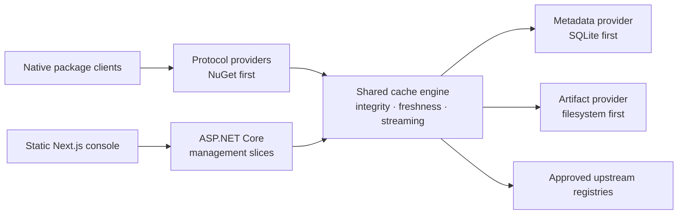

<p align="center">
  
</p>

<p align="center">
  <a href="LICENSE"></a>
  
  <a href="docs/ARCHITECTURE.md"></a>
  <a href="CONTRIBUTING.md"></a>
</p>

# Hoard

### Fetch once. Build forever. 📦

**One local destination for the dependencies your tools already use.**
Hoard is an MIT-licensed, self-hosted pull-through package cache being designed
for developer laptops, shared teams, and CI runners. Native package managers,
less repeated downloading, and a clear view of what's cached—without turning
dependency management into another full-time job.

> [!IMPORTANT]
> **Foundation only.** This repository currently contains product/design documents,
> development workflows, repository tooling, compile-only .NET provider contracts
> and composition proofs, and an operator-run Azure identity bootstrap.
> There is no runnable cache, working provider, UI, container, or published package.
> Everything in the product overview below describes the planned experience.

[Explore the vision](docs/PRODUCT_VISION.md) ·
[Read the architecture](docs/ARCHITECTURE.md) ·
[Follow the backlog](docs/HOARD_SPECKIT_MASTER_BACKLOG.md) ·
[Contribute](CONTRIBUTING.md)

## ✨ The idea

| For your laptop | For your team |
| --- | --- |
| SQLite + filesystem, with no required cloud account | The same product, with explicit TLS and authentication |
| Loopback-first defaults and a lightweight runtime | A shared cache for developer machines and CI |
| Native package-manager configuration | Provider choices without a separate enterprise edition |

**NuGet comes first.** Go, Maven, npm, PyPI, and Cargo follow the
[dependency-ordered specification backlog](docs/HOARD_SPECKIT_MASTER_BACKLOG.md).
Hoard is a cache, **not a private package publishing registry**.

## 🧭 How it will fit together



The planned implementation is a **.NET 10 / ASP.NET Core composable modular
monolith** with independently distributed NuGet providers. Management workflows
and protocol endpoints use vertical slices; shared correctness invariants stay
in the cache engine. The **Next.js App Router / TypeScript / Tailwind / shadcn/ui**
console is statically exported and served by .NET—no mandatory Node server.

Read the [architecture](docs/ARCHITECTURE.md) for dependency boundaries,
module lifecycle, trust boundaries, and deferred capabilities.

## 🛠️ Start here today

```bash
git clone https://github.com/Stonefly-Labs/Hoard.git
cd Hoard
git switch -c chore/your-change

# Standard-library tests for the repository tools; no application build.
python3 -m unittest discover -s tests/tooling -v

# .NET 10 compile/package/boundary acceptance; never starts a server.
bash scripts/validate-foundation.sh
```

For repository work, use Git, GitHub CLI, Python 3.11+, and a stable .NET 10 SDK
matching `global.json`. The foundation check restores pinned dependencies from
nuget.org and builds temporary local packages; it requires network access.
OpenTofu and Azure CLI
are needed only when working on the [Azure bootstrap](infra/bootstrap/README.md).
There is no runnable application or Node project yet. See the
[foundation quickstart](specs/001-provider-contracts/quickstart.md) and
[provider author guide](docs/PROVIDERS.md) for the exact supported scope.

Repository-scoped [MCP settings](docs/DEVELOPMENT.md#local-mcp-servers) connect
Copilot CLI and VS Code to Microsoft Learn, Context7, Next.js DevTools, shadcn,
Playwright, read-only Azure MCP, Docker MCP Gateway, and NuGet MCP. These are
optional contributor tools, not application dependencies; no global MCP
settings are changed.

### Repository map

```text
.github/             Copilot instructions/skills/agents, templates, tag releases
.specify/            Installed Spec Kit and shared Hoard flow checkpoint
apps/web/            Reserved for the statically exported management console
docs/                Product intent, architecture, workflow, and release guidance
infra/bootstrap/     Operator-run Azure OIDC identity + GitHub environment setup
scripts/             Small, dependency-free repository tools
specs/               Reviewable feature specifications; not delivered capabilities
src/                 Four platform library boundaries; production Host/providers reserved
tests/               Tooling, foundation unit/architecture/composition checks, fixtures
examples/CustomHost/ Package-only compile proof; never starts a host
```

## 🤝 Build with us

All work happens on `chore/`, `feature/`, `bugfix/`, `docs/`, or another
purpose-named branch—not directly on `main`. Commit coherent changes, **push
after each commit**, and open a PR when the work is ready. Update the README
and affected documentation **before merging**, with an explicit explanation
when a document is unaffected.

The [contributor guide](CONTRIBUTING.md) covers setup and PR expectations.
The [development workflow](docs/DEVELOPMENT.md) documents the checkpointed
`hoard-speckit` skill, architecture reviewer, release skill, and quality gates.
The initial [constitution](.specify/memory/constitution.md) is version 1.0.0;
its adoption has merged. The first feature specification,
[platform package boundaries and provider contracts](specs/001-provider-contracts/spec.md),
defines the compile-only foundation, not a runnable cache.
Its initial [clarification review](specs/001-provider-contracts/spec.md#clarifications)
found no critical ambiguities requiring questions; a later
[approved follow-up](specs/001-provider-contracts/spec.md#approved-follow-up-2026-10-20)
resolves the optional-dependency ambiguity found during checklist review. Its
[implementation plan](specs/001-provider-contracts/plan.md) now documents
provider-neutral declarations, explicit registration, compatibility policy,
and package-only composition and boundary acceptance evidence. Its historical
design is retained separately from measured implementation results. The custom
[architecture](specs/001-provider-contracts/checklists/architecture.md) and
[compatibility](specs/001-provider-contracts/checklists/compatibility.md)
requirements-quality checklists have received an explicitly requested delegated
review: all 38 criteria are satisfied after the user-approved
[optional-dependency policy clarification](specs/001-provider-contracts/checklists/compatibility.md#rq-01-incompatible-present-optional-dependency).
Enabled optional dependencies must be compatible; installed/registered but
disabled targets are unavailable and confer no integration/capability support.
This is requirements review, not implementation evidence or authorization;
the [implementation task list](specs/001-provider-contracts/tasks.md) maps
all 17 requirements and six outcomes to dependency-ordered work.
F-01 now provides immutable declarations and family markers in
`Hoard.Abstractions`, empty provider-free Core/Application boundaries, and
registration-only Hosting APIs. The acceptance command builds five independent
fixture packages, four family consumers plus the second artifact consumer,
and both [custom-host variants](examples/CustomHost/README.md). It exercises
all eight architecture rejection rules and 23 compatibility classifications.
Registration records metadata/types without constructing, enabling, validating,
or activating providers. These are local compile proofs, not released packages,
working stores/protocols/authentication, native-client evidence, or certification.
The original implementation includes architecture-review corrections and the
support-claim audit. Convergence then identified a false rejection of permitted
Identity-to-Hosting references when Hosting transitively reaches Core.
[Task T058](specs/001-provider-contracts/tasks.md#phase-8-convergence) corrects
that check using distinct Hosting-mediated and other dependency paths, with
positive and negative regressions preserving forbidden-edge detection.
The follow-up convergence assessment found no remaining gaps across all
17 requirements, six outcomes, acceptance scenarios, plan decisions, and
58 tasks. Fresh locked acceptance passed all 86 .NET tests and 17 tooling tests;
the specification, plan, tasks, and reviewer-owned checklists stayed unchanged.
Finalization acceptance is recorded in the
[plan](specs/001-provider-contracts/plan.md#finalization-acceptance-2026-10-20);
[PR #4](https://github.com/Stonefly-Labs/Hoard/pull/4) merged into `main` on
2026-10-20. The separate `await_merge` completion checkpoint records F-01 as
complete, retaining its feature directory, PR, and verified merge commit.
The progress checkpoint merged through
[PR #5](https://github.com/Stonefly-Labs/Hoard/pull/5), satisfying the next-spec
merge gate. The subsequent
[F-02 specification: module registry, composition and lifecycle](specs/002-module-lifecycle/spec.md)
defines startup selection and dependency validation, disabled-module isolation,
route ownership, readiness, bounded initialization/cleanup, safe diagnostics,
and explicit restart/custom-distribution journeys. Its
[built-in quality checklist](specs/002-module-lifecycle/checklists/requirements.md)
passes all 16 specification-quality criteria, not implementation or
reviewer-owned approval.
The [clarification review](specs/002-module-lifecycle/spec.md#clarifications)
found no critical ambiguities across all ten review categories: zero questions
and no requirement or scope changes. The built-in checklist remains 16/16;
exact lifecycle APIs, finite budget defaults, and ordering details remain
planning decisions under the existing requirements at that review.
The subsequent [F-02 implementation plan](specs/002-module-lifecycle/plan.md)
now proposes an opt-in Hosting adapter, metadata-only validation, deterministic
ordering, owned-route conflict checks, supervised build/initialization and
bounded cleanup, safe readiness/results, and fixed-selection restart journeys.
Its research, in-memory model, public/lifecycle/acceptance contracts and
[validation quickstart](specs/002-module-lifecycle/quickstart.md) map all
22 requirements, seven outcomes and 20 story scenarios to 40 fixture-only proof
cases. Architecture review led to explicit build supervision, protection of
resources still used after drain timeout, and precise worker admission semantics.
These are design obligations, not measured runtime evidence.
No lifecycle runtime, runnable product host, real provider, discovery API or UI
is introduced by planning. Existing registration APIs remain unchanged; no
custom checklist approval or implementation authorization is implied. The next
scheduled stage is `checklist`, through a separate `hoard-speckit` invocation.
The [shared checkpoint](.specify/hoard-flow.json) records the next authorized
stage; constitution and specification artifacts are not product implementation.

## 🚀 Releases are not deployments

Pushing a reviewed `vMAJOR.MINOR.PATCH` or prerelease tag publishes a GitHub
Release with generated notes and GitHub's source archives. It does **not**
build, publish packages/images, provision Azure, or deploy anything.
See [release governance](docs/RELEASING.md) for the exact process.

## 📚 Project documents

| Document | What it answers |
| --- | --- |
| [Product charter](docs/PRODUCT_CHARTER.md) | Why Hoard exists, scope, and non-goals |
| [Product vision](docs/PRODUCT_VISION.md) | Intended experience and design direction |
| [Product specification](docs/PRODUCT_SPEC.md) | Planned product behavior and constraints |
| [Architecture](docs/ARCHITECTURE.md) | Boundaries, providers, and correctness invariants |
| [Master backlog](docs/HOARD_SPECKIT_MASTER_BACKLOG.md) | Feature prompts, priorities, and dependencies |
| [Constitution](.specify/memory/constitution.md) | Governing principles, compatibility, and quality gates |
| [Development workflow](docs/DEVELOPMENT.md) | Branches, Spec Kit checkpoints, and PR handoff |
| [Azure bootstrap](infra/bootstrap/README.md) | Passwordless deployment identity preparation |
| [Release guide](docs/RELEASING.md) | Tag-driven source releases, separate from CI/CD |

## License

[MIT](LICENSE) © Stonefly Labs. No required SaaS service, proprietary feature
tiers, or cloud dependency for personal use are planned.
