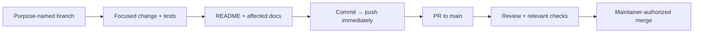
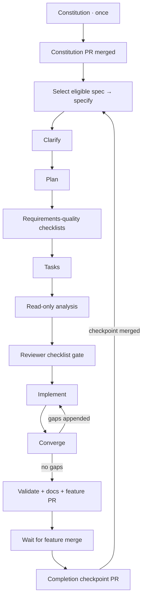

# Development workflow

## Foundation boundary

The bootstrap established contributor tools and reserved architecture boundaries.
F-01 adds four .NET library projects, immutable provider declarations, explicit
registration, and compile/package/boundary acceptance tooling. F-02 adds
opt-in fixture-tested lifecycle in Hosting. Core and Application remain empty
boundaries: no caching engine, management endpoints,
working providers, curated executable, UI, product CI/CD, or deployment exists.
Azure identity provisioning is a
separate, explicitly authorized [operator action](../infra/bootstrap/README.md).

Current technical intent is defined by the [charter](PRODUCT_CHARTER.md),
[product specification](PRODUCT_SPEC.md), [architecture](ARCHITECTURE.md),
and [modular-provider ADR](adr/0001-modular-provider-architecture.md).

## Everyday change flow



Use `feature/`, `bugfix/`, `chore/`, `docs/`, `refactor/`, `hotfix/`, or `test/`.
Never commit directly to `main`. Inspect the worktree first, preserve user work,
and honor a branch explicitly designated for the task. Do not force-push shared
history. Push after **every** commit; failures are blockers, not successful
handoffs. Open/update the PR when work is ready; do not merge without permission.

Use the [PR template](../.github/pull_request_template.md). Update the README
and affected docs on the branch before merge; explicitly justify unaffected
documents. Describe actual checks and operational/manual steps. Keep credentials,
state, tfvars, plans, build output, and runtime data out of Git; retain lockfiles.

## Local MCP servers

The repository includes `.mcp.json` for Copilot CLI and `.vscode/mcp.json` for
VS Code Copilot. Both describe the same eight servers; keep their definitions
aligned when changing them. These settings apply to this checkout, not your
user-level MCP configuration or a hosted coding agent.

| Server | Connection | Purpose |
| --- | --- | --- |
| [Microsoft Learn](https://learn.microsoft.com/en-us/training/support/mcp) | Remote HTTP | Official .NET, ASP.NET Core, and Microsoft documentation and code samples |
| [Context7](https://context7.com/docs/resources/all-clients) | Remote HTTP | Library-specific documentation and examples |
| [Next.js DevTools](https://github.com/vercel/next-devtools-mcp) | Local stdio via `npx` | Connect to a future Next.js development server for runtime errors, routes, and logs |
| [shadcn](https://ui.shadcn.com/docs/mcp) | Local stdio via `npx` | Discover components, examples, and registry items for the planned console |
| [Playwright](https://github.com/microsoft/playwright-mcp) | Local stdio via `npx` | Browser interaction and accessibility snapshots with an isolated, nonpersistent profile |
| [Azure MCP](https://learn.microsoft.com/en-us/azure/developer/azure-mcp-server/) | Local stdio via `npx` | Optional Azure resource inspection, with `--read-only` enabled |
| [Docker MCP Gateway](https://docs.docker.com/ai/mcp-catalog-and-toolkit/mcp-gateway/) | Local stdio via `docker` | Connect to the MCP servers enabled in your local Docker MCP Toolkit |
| [NuGet MCP](https://learn.microsoft.com/en-us/nuget/concepts/nuget-mcp-server) | Local stdio via `dnx` | Official NuGet package discovery, upgrade planning, and dependency vulnerability guidance |

The HTTP servers need network access but no local Node installation. Context7
can be used without a key, subject to anonymous rate limits. If authentication
or a higher quota is needed, configure credentials privately in the client;
never add keys or authorization headers to these tracked files. Documentation
queries go to the respective remote service: do not send secrets or private
source code.

The full Node-based stdio setup needs Node.js 22+ (a supported LTS release)
and npm on `PATH`; Azure MCP 3.0.0 requires Node.js 22 or newer. The servers run
publisher packages through `npx -y`, which downloads and runs code in npm's cache
on first start. The `@latest` packages can pick up
updates later. Azure MCP is instead pinned to stable `3.0.0`: at setup time,
its npm `latest` tag pointed to a prerelease. Review and trust the publishers
before starting them. Next.js DevTools and Azure MCP telemetry are disabled in
both configurations. No package manifest, local `node_modules`, or application
scaffolding is required for this MCP setup.

Playwright uses `--isolated`, so cookies and login state are not persisted or
borrowed from your normal browser. It still needs an installed supported
browser; follow its browser-install guidance if a browser launch reports one
missing. Browser automation is not a substitute for committed end-to-end tests.

Azure resource operations require your own authenticated Azure identity, for
example through `az login`, and appropriate least-privilege RBAC. This setup
does not sign in, select a subscription, or provision resources. The read-only
flag prevents write operations; sensitive-data confirmation remains enabled.
Do not remove that restriction or perform an Azure write without separate
authorization. Azure remains optional for local Hoard development.

The Azure entry is named `azure-mcp` to avoid collisions with an existing
`azure` client plugin, which can take precedence over a same-named workspace
entry. Its read-only restriction does not constrain separately installed Azure
servers. If your client already provides Azure or another server listed here,
choose which connection to use in the client to avoid duplicate tools; this
repository does not disable or modify existing plugins.

Docker Gateway requires a running Docker engine and the `docker mcp` CLI
plugin, normally supplied by Docker Desktop with **MCP Toolkit** enabled.
Check availability with `docker mcp version`. Use Docker Desktop's MCP Toolkit
to select and configure the servers you actually need; no catalog servers are
enabled by this repository. The gateway uses your existing local selection,
so avoid enabling duplicate copies of servers already connected directly here.
Credentials belong in Docker's secret storage, not Git. No TCP gateway port,
all-server catalog flag, or relaxed security settings are configured. If Docker
Desktop is stopped, the gateway cannot connect; start it before starting this
MCP entry. This setup does not start Docker Desktop, change its catalog, or run
Hoard containers.

NuGet MCP requires the .NET 10 SDK or later, including `dnx` on `PATH`.
It downloads and runs the official `NuGet.Mcp.Server` package from nuget.org
using the publisher's recommended `--source` and `--yes` arguments. No
prerelease version is requested; an unversioned package name follows stable
updates. Review the publisher before starting the server. No project, package
reference, or tool manifest is created by this configuration. Project-specific
dependency analysis awaits the feature introducing the .NET projects, and any
package changes must remain within the explicitly requested task and normal
client permissions. If `dnx` cannot load the service index, check network and
trusted proxy access to `https://api.nuget.org/v3/index.json` before retrying;
do not disable TLS or certificate validation to make the server start.

For Copilot CLI, start a new session from this checkout, review any workspace
trust prompt, and use `/mcp` to inspect the servers. `copilot mcp list` also
shows the loaded configuration and its source, but does not prove a server
connection. For VS Code, open `.vscode/mcp.json` and use its **Start** actions;
review server trust prompts and use **MCP: List Servers** for status. Existing
client permission and trust controls still apply.

Hoard has no runnable UI yet. Next.js runtime tools require a running Next.js
16+ development server, and project-specific shadcn registry configuration
belongs to the feature that creates `apps/web`. Do not scaffold an app or run
component installation just to enable these servers. The default shadcn registry
does not require a `components.json` file for discovery.

To roll back, remove the server entries from both files and restart or stop
the affected client connections. This does not alter global settings or npm's
download cache. Product specifications and architecture diagrams are unaffected:
MCP is contributor tooling, not a Hoard runtime capability.

## Checkpointed Spec Kit flow

In a Copilot surface supporting repository skills, ask:

> Use the `hoard-speckit` skill to advance the next stage.

In CLI, `/skills` shows available skills. Name `hoard-speckit` explicitly; exact
slash-command spelling can vary by Copilot surface. The entry point is
[its SKILL.md](../.github/skills/hoard-speckit/SKILL.md).

The bootstrap did not run this flow or pre-ratify the constitution. The initial
constitution stage establishes
[version 1.0.0](../.specify/memory/constitution.md), covering product boundaries,
provider composition, shared correctness/security, evidence, accessibility,
operations, and governance. It creates no feature specification or product code.
Templates remain unchanged; the installed stage skills read the constitution
at runtime.

The constitution adoption PR must merge before a new specification begins.
After merge, the next invocation selects the first dependency-ready open
specification from the [master inventory](HOARD_SPECKIT_MASTER_BACKLOG.md)
and passes its exact prompt to the installed specify skill. The tracked
checkpoint, rather than this guide, records current stage and merge progress.

The first generated feature is
[F-01: platform package boundaries and provider contracts](../specs/001-provider-contracts/spec.md).
Its [built-in quality checklist](../specs/001-provider-contracts/checklists/requirements.md)
validates the specification, not implementation or reviewer-owned custom
checklist approval. Package contracts, custom-host compilation, and architecture
checks described there were acceptance requirements at specification time;
their current bounded implementation is described below.
Its initial [clarification review](../specs/001-provider-contracts/spec.md#clarifications)
records a no-question result with no scope changes; a later user-approved
follow-up resolves the checklist review's optional-dependency ambiguity.
Exact public signatures and
build commands were proposed in the
[implementation plan](../specs/001-provider-contracts/plan.md) and
[public contracts](../specs/001-provider-contracts/contracts/public-api.md),
then delivered by the separately authorized implementation stage. The plan
retains historical design alongside current evidence and includes research,
a declaration model,
compatibility/architecture acceptance contracts, and a
[validation quickstart](../specs/001-provider-contracts/quickstart.md).
The implementation now supplies the foundation commands in that quickstart;
they prove compilation and package boundaries, not product behavior.
Planning did not generate or approve custom reviewer-owned checklists, create
tasks, scaffold projects, or authorize implementation. The subsequent checklist
stage generated separate
[architecture](../specs/001-provider-contracts/checklists/architecture.md) and
[compatibility](../specs/001-provider-contracts/checklists/compatibility.md)
requirements-quality reviews: 20 and 18 criteria respectively.
These standard-depth checklists are for maintainers and provider-contract
reviewers before implementation authorization; they assess written requirements,
not product behavior. At the user's explicit request, a delegated review
initially found architecture 20/20 and compatibility 17/18 satisfied.
The user then approved the recommendation for
[RQ-01: incompatible present optional dependencies](../specs/001-provider-contracts/checklists/compatibility.md#rq-01-incompatible-present-optional-dependency).
The spec, declaration model, and policy now classify an enabled incompatible
optional target as an unsupported composition, without automatic disablement
or substitution; installed/registered-but-disabled optional targets are
unavailable and confer no integration/capability claim. Five new classification
examples bring the written matrix to 23 cases. The delegated re-review closes
CHK014: architecture 20/20 and compatibility 18/18, all 38 criteria satisfied
without waivers. The built-in specification checklist and driver are unchanged.
The subsequent [task-generation stage](../specs/001-provider-contracts/tasks.md)
produced 57 unchecked tasks: shared setup/declarations, four story phases, and
cross-cutting acceptance/documentation work. All 17 requirements and six
outcomes are mapped to implementation and focused proof tasks. The dependency
graph serializes the shared validation script while allowing independent
fixture/test/inspector work; architecture negatives and all 23 compatibility
classifications remain future proof obligations. No product scaffolding or
implementation occurred.

The subsequent read-only cross-artifact analysis found no actionable
duplication, ambiguity, underspecification, inconsistency, constitutional
conflict, or coverage gap. All 17 functional requirements and six buildable
outcomes have implementation/proof tasks; all 57 tasks map to requirements or
shared acceptance prerequisites. The prerequisite graph is complete and
acyclic, including serialized shared-script edits. All feature artifacts and
reviewer-owned checklist markers remained unchanged. The analysis report is
recorded in the draft feature PR, with its completion evidence in the shared
checkpoint; no remediation or implementation occurred. The next scheduled
stage was implementation through a separate `hoard-speckit` invocation, with the
existing reviewer-owned 38/38 checklist gate satisfied. Artifact analysis is
not passing product evidence or permission to skip the remaining stages.

The completed implementation stage delivers declaration-only Abstractions,
provider-free Core/Application, and metadata/type registration in Hosting.
The [provider guide](PROVIDERS.md) and
[compile-only custom-host guide](../examples/CustomHost/README.md) describe
current APIs and limits. `bash scripts/validate-foundation.sh` restores/builds
with locks, checks SDK formatting/analyzers, builds Core in isolation, packs
four local platform libraries and five independent fixtures, compiles family
consumers and both hosts, and executes architecture/compatibility/registration
acceptance. The F-01 host is never run. Current solution tests also include
in-process lifecycle regressions; the dedicated lifecycle graph/distribution/
old-binary proof still requires validate-lifecycle.sh. No listener starts.
Every subprocess has a ten-minute timeout.
A Python standard-library helper owns copying, hashes, metadata manifests, and
explicit subprocess errors; Bash owns prerequisites and private-directory cleanup.
Tests consume the prepared evidence, never recursively invoke the orchestrator,
and deliberately fail when evidence is missing.

Default runs do not rewrite lockfiles. After an intentional contract/dependency
change, `bash scripts/validate-foundation.sh --update-locks` regenerates and
replays standalone locks; review and commit them before the default locked run.
Local acceptance packages omit Git revision stamps and normalize source paths,
so fresh temporary locations and checkpoint commits do not invalidate their
content hashes. This is local proof tooling, not release/package publication.
The helper also canonicalizes unsigned local SDK archive envelopes (ZIP
metadata and OPC relationship IDs/paths) without changing nuspec/assembly/core
property bytes. Focused regressions protect reproducibility and reject signed/
external inputs; no published/external package is rewritten and locked hashes
are never bypassed. Compiler/SDK changes affecting payloads need reviewed locks.
SDK package pruning is disabled in the example so its complete explicit packed
dependency graph remains available for inspection even with ASP.NET's shared
framework. Framework ownership comes from resolved reference-pack metadata,
not trusted namespace/name prefixes.
The implemented-graph architecture review identified three proof gaps, now
corrected with focused regressions: unused framework references create real
dependency edges, prohibited BCL query/connection/transaction shapes cannot
bypass public-surface checks, and all eight named platform/provider/host scans
are mandatory. See the [review and measured evidence](../specs/001-provider-contracts/plan.md#necessary-implementation-details-and-review).
The support-claim audit is complete. The subsequent installed convergence stage
assessed all 17 functional requirements, six buildable success criteria, 15
story acceptance scenarios, nine edge cases, 12 grouped plan decisions, all 57
implementation tasks, and eight constitutional principles against current
scoped code. It found one HIGH-severity partial gap: the graph inspector rejected
the permitted `Identity -> Hosting -> Core` closure under ARCH-008, although
identity providers may use the approved Hosting API and Hosting references Core.
A temporary diagnostic invoking the current compiled graph inspector reproduced
that false rejection; the original permitted fixtures did not cover this path.
[Phase 8 / T058](../specs/001-provider-contracts/tasks.md#phase-8-convergence)
recorded the correction and regression work. That convergence invocation
appended only the new task section; its passing baseline of 81 .NET tests
and 17 tooling tests did not resolve the uncovered path.

The separately authorized T058 implementation now tracks Identity paths whose
first edge reaches Hosting separately from other paths to the same dependency.
Core is permitted through that approved Hosting composition, not directly or
through an unrelated SDK-owned helper. A package-only fixture uses the actual
Hosting registration API; isolated negatives retain both forbidden routes even
when Hosting is also referenced, with normal/reversed edge-order checks.
All four new fixture projects carry locks. No platform API, provider package,
runtime behavior, or reviewer-owned checklist changed. See the
[follow-up evidence](../specs/001-provider-contracts/plan.md#t058-implementation-follow-up-2026-10-20).
The separately authorized follow-up convergence assessment found no actionable
gaps: missing 0, partial 0, contradicts 0, unrequested 0, with zero findings at
any severity. It checked all 17 functional requirements, six buildable success
criteria, 15 story acceptance scenarios, nine edge cases, 12 grouped plan
decisions, all 58 tasks (including T058), and eight constitutional principles.
Fresh default locked acceptance passed all 86 .NET tests (42 foundation,
41 architecture, three composition), zero failed/skipped, including the
permitted Identity/Hosting path and both forbidden alternatives. All 17 Python
tooling tests passed. The assessment left the spec, plan, tasks, and all
reviewer-owned/built-in checklist bytes unchanged; no empty convergence phase
or further implementation task was added. Its report is recorded in the draft
feature PR and shared checkpoint.
The separately authorized
[finalization acceptance](../specs/001-provider-contracts/plan.md#finalization-acceptance-2026-10-20)
repeated the full locked foundation check and all 17 tooling tests, refreshed
the dependency advisory assessment with no known vulnerable packages, and
verified the acceptance traceability, documentation, and existing architecture
reviews. The reviewed implementation, locks, tasks, and checklist markers
remain unchanged. At finalization,
[PR #4](https://github.com/Stonefly-Labs/Hoard/pull/4) was ready for maintainer
review, targeting `main`; the shared checkpoint recorded `await_merge` with
that PR number and no completed feature.

PR #4 subsequently merged into `main` on 2026-10-20 at
`837fdf3edf51c3df34710184d018479683c194c2`. The separate `await_merge` stage
verified the GitHub merge state, merge ancestry in fetched `origin/main`, and
all 58 completed tasks. It created `chore/spec-progress-f-01` from that main
and records F-01 in the shared checkpoint's completed entries, retaining its
directory, PR, and merge commit. At that point the checkpoint had no active
feature and scheduled `specify`; the first dependency-ready entry was
[F-02: module registry, composition and lifecycle](HOARD_SPECKIT_MASTER_BACKLOG.md#foundation-f-02).
The progress checkpoint merged through
[PR #5](https://github.com/Stonefly-Labs/Hoard/pull/5), satisfying the gate for
the subsequent specification stage.

[F-02: module registry, composition and lifecycle](../specs/002-module-lifecycle/spec.md)
now has its own requirements at `specs/002-module-lifecycle`, on
`feature/002-module-lifecycle`. Five prioritized stories, 22 functional
requirements, and seven measurable outcomes cover explicit registered-module
selection, pre-activation dependency/compatibility checks, deterministic ordering,
disabled-route/worker/connection isolation, readiness, bounded initialization,
partial-start cleanup and shutdown, sanitized diagnostics, and restart versus
custom rebuild behavior. The existing F-01 optional-dependency policy is
preserved: absent/disabled optional targets confer no integration; enabled
incompatible targets fail composition. All explicitly enabled modules must
initialize successfully; optional dependency does not mean degraded startup.
The [built-in requirements checklist](../specs/002-module-lifecycle/checklists/requirements.md)
passes all 16 specification-quality criteria, with no unresolved clarification
markers. It is not a custom reviewer-owned approval or runtime acceptance
result. The bounded architecture review found no actionable requirement-level
findings; its operational proof obligations remain future work.

The subsequent
[clarification review](../specs/002-module-lifecycle/spec.md#clarifications)
found no critical ambiguities across all ten review categories. Zero questions
were asked or answered, and no requirements, acceptance criteria, or scope
decisions changed. The built-in specification-quality checklist was revalidated
at 16/16 to 16/16: no newly passing items, regressions, or unchecked items.
Its bytes and historical specification-stage notes remain unchanged; no custom
reviewer-owned approval is implied. Exact lifecycle APIs and state
representation, route-conflict inspection, finite budget defaults, and the stable
ordering tie-break remain planning decisions under the existing requirements.
No consequential product decision blocks planning.

The subsequent [implementation plan](../specs/002-module-lifecycle/plan.md)
defines opt-in Hosting lifecycle adapters on F-01's unchanged registration
boundary. Persistence/artifact providers retain Abstractions-only dependencies
through host-side adapters. Metadata validation precedes all construction;
enabled modules follow deterministic dependency ordering, service composition,
supervised host build, owned-route analysis, initialization and complete
readiness before traffic/worker admission. Startup/stop coordination has finite
deadlines and reports incomplete cleanup rather than pretending cancellation
forcibly stops trusted in-process code.

The [research](../specs/002-module-lifecycle/research.md),
[in-memory model](../specs/002-module-lifecycle/data-model.md),
[public API](../specs/002-module-lifecycle/contracts/public-api.md),
[lifecycle](../specs/002-module-lifecycle/contracts/lifecycle.md) and
[acceptance](../specs/002-module-lifecycle/contracts/acceptance.md) contracts
resolve planning details and map all 22 requirements, seven outcomes and
20 story scenarios to 40 fixture-only proof cases. The restricted owned-route
language rejects unsupported shapes instead of claiming to analyze arbitrary
constraints. The bounded architecture review identified a missing build
supervision boundary and two resource/worker semantics questions; the plan
corrects all three with an explicit supervised build API, retained request/
dependency resource leases and protected root disposal after drain timeout,
and whole-callback worker admission. LC-20/23/26/29 retain those proof duties.
No runtime results or repeat approval are inferred from those design corrections.

The [validation quickstart](../specs/002-module-lifecycle/quickstart.md)
distinguishes current foundation/tooling commands from a proposed lifecycle
validation script, independent packed fixtures and a separate lifecycle-only
host example. Neither that script nor new runtime APIs/projects/dependencies
are created in planning. F-01's compile-only example and all checklists remain
unchanged. The ASP.NET Core shared-framework/versioning dependency impact,
source/binary registration compatibility, deadline/admission/cleanup behavior
and actual package graph still require implementation evidence.

The subsequent checklist stage generated
[composition](../specs/002-module-lifecycle/checklists/composition.md) and
[lifecycle](../specs/002-module-lifecycle/checklists/lifecycle.md)
requirements-quality reviews: 20 criteria each, all 40 unchecked and
reviewer-owned. Standard-depth scope and audience are explicit: maintainer and
provider PR review before implementation authorization. Composition covers
registry/selection, compatibility/dependencies/capabilities, route ownership,
unchanged registration compatibility, and bundled/custom restart journeys.
Lifecycle covers disabled isolation, admission/readiness, finite coordination
budgets, partial-start and normal cleanup, pending-resource protection,
concurrency, and sanitized actionable diagnostics. The planning review's build,
resource-retention, and worker-admission corrections remain written proof
obligations; checklist generation neither evaluates them nor supplies runtime
evidence. Requirements/design artifacts and the built-in 16/16 checklist remain
unchanged; no custom criterion is approved or waived.

The subsequent [task-generation stage](../specs/002-module-lifecycle/tasks.md)
produced 72 unchecked implementation tasks across eight phases: shared setup
and safety primitives (13), US1 selection/start (14), US2 enabled/ready
functionality (18), US3 failure/stop (10), US4 safe diagnostics/state (5),
US5 distribution/restart (7), and cross-cutting acceptance (5).
All 22 functional requirements, seven outcomes and 40 LC acceptance cases
have implementation and focused proof assignments; all 20 story scenarios
retain the acceptance contract's LC mapping. Explicit acyclic prerequisites
serialize shared coordinator/lease/route/tooling edits, while 29 marked tasks
identify scoped file-disjoint parallel opportunities after their prerequisites.
The endpoint-free US1 fixture proof is the first bounded increment, not a
shippable lifecycle or complete F-02.

Tasks retain supervised synchronous build, single disposal ownership, pending
request/response/worker/build protection, finite deadlines and once-only
cleanup as implementation/regression obligations. Independent fixture packages,
package-only host variants, retained old registration binaries, explicit
framework-reference impact, initial reviewed locks and fresh default locked
replay remain required evidence. Existing F-01 fixture/example sources and
compile-only scenarios must stay intact; reviewed Hosting dependency/content
changes may require affected lock refreshes, not silent hash bypasses.
No test may skip a missing package input or accept an empty proof selection.
The task-generation stage did not perform cross-artifact analysis, implement
these obligations or evaluate the custom checklists; all 40 remained unchecked
at that stage.

The subsequent installed read-only cross-artifact analysis found no actionable
duplication, ambiguity, underspecification, inconsistency, constitutional conflict
or coverage gap. All 22 functional requirements and seven buildable outcomes
have implementation and focused proof assignments; all 72 tasks map to those
requirements or shared acceptance prerequisites. The complete prerequisite graph
is acyclic, including serialized shared-file edits; 40 LC cases, 20 story
scenarios and 12 edge cases retain their proof obligations. T002's tooling
regressions and T006's composition inputs are mapped shared prerequisites,
not orphan tasks. The analysis report is recorded in the draft feature PR,
with completion evidence in the shared checkpoint. No feature artifact or
built-in/custom checklist byte changed, and no remediation was needed.

The later explicitly requested checklist review evaluated all 40 custom
criteria at baseline `c7ccde4`: composition 19/20 and lifecycle 19/20, 38/40
satisfied without waivers. Composition CHK014 was left open for
[RQ-02: inconsistent baseline/custom artifact manifests](../specs/002-module-lifecycle/checklists/composition.md#rq-02-baseline-and-custom-artifact-package-lists-disagree).
Lifecycle CHK013 was left open for
[RQ-01: timed-out cleanup callback retention](../specs/002-module-lifecycle/checklists/lifecycle.md#rq-01-explicitly-retain-resources-for-timed-out-cleanup-callbacks).
Both were MEDIUM written-requirements/documentation findings, not demonstrated
runtime defects. The initial review changed checklist markers only, not
spec/design/tasks or the driver checkpoint.

The user subsequently approved both recommendations. The follow-up explicitly
tracks a non-completed StopAsync as pending Phase activity even after its wait
times out: owner/prerequisite/root resources remain protected, independent safe
cleanup shares the original deadline, and late completion after the bounded
result cannot rewrite outcomes, retry or trigger deferred disposal. LC-28/29
and T048/T050..T053/T055 retain the A -> B plus independent C regression duty.
The baseline manifest now consistently includes the two protocols, Metadata,
Artifact.One and optional Identity; only custom adds Artifact.Two and its host
adapter. LC-35/36, T065 and the quickstart require baseline absence and
same-binary bundled protocol switching; independent packing still covers six
fixtures. All 40 custom criteria are now satisfied without waivers after
re-evaluation; the built-in checklist remains 16/16.

Fresh installed read-only cross-artifact analysis found zero actionable
findings, with all 22 requirements/seven outcomes, 72 unchecked tasks, 40 LC
cases, 20 scenarios and 12 edge cases retaining complete proof mappings and
acyclic prerequisites. All feature bytes remained unchanged during that
analysis. The bounded follow-up architecture review also found no actionable
findings or unresolved design questions; actual runtime/package/graph proof
remains an implementation obligation. The PR records both results.
The approved follow-up is not a driver stage, independent human inspection,
runtime implementation or acceptance. The checkpoint/history is byte-for-byte
unchanged; no `begin`/`finish` or progress reset was used.

Specification, clarification, planning, checklist and task generation create no
lifecycle implementation, production executable/provider, configuration parser,
management discovery endpoint, UI, or conformance certification. F-02 can
later prove lifecycle with explicit selections and instrumented fixtures;
F-03 retains configuration sources,
option/secret handling, and operator selection UX, while F-04 retains management
discovery. Read-only analysis likewise supplies no runtime implementation or
passing product evidence. The next scheduled stage was `implement` through a
separate invocation, with the custom checklist gate now satisfied and the
approved findings resolved. This follow-up does not start implementation or
mark any of its 72 tasks complete. Do not reset the checkpoint to fabricate a
scheduled analysis rerun or infer runtime acceptance from `implement` / `ready`.
Task generation and analysis do not require custom checklist approval, but the
later implementation gate does require reviewer approval or explicit reviewer
authorization; their initial generation/analysis did not supply it. The
requested review and approved follow-up now satisfy that requirements gate,
not a feature-completion or runtime-support claim.

### Implemented F-02 lifecycle boundary

The separately authorized implementation adds metadata-only registry/selection/
version/capability validation, deterministic dependency ordering, inert opt-in
adapter association, supervised service/build/route/init phases, readiness,
worker/request admission and bounded reverse cleanup in Hosting. Abstractions,
Core and Application source stay unchanged. F-03 must feed the same validator;
F-04 still owns authorized discovery/UI, not an automatically exposed health
endpoint.

```bash
bash scripts/validate-lifecycle.sh
```

This separate ten-minute-per-subprocess orchestrator packs six independent
fixtures, verifies private-feed/hash/lock provenance, runs TestServer's seven
baseline/custom distribution journeys, retains/runs an old registration binary,
and inspects ten exact project/packed/transitive/API graphs. Source-only filters,
`--packages-only` and `--journeys-only` explicitly report partial proof.
Intentional payload changes use `--update-locks`, reviewed locks and an
independent default replay. The existing foundation command retains its eight
mandatory real scans and original compile-only fixture/example sources. It
excludes only LC-38's separate prepared lifecycle manifest test; lifecycle
acceptance supplies that mandatory proof.

Hosting now propagates the ASP.NET Core shared-framework prerequisite even to
non-web registration-only consumers. Old AddHoard/AddModule APIs remain inert
and source/binary-compatible. NuGet.Versioning is internal; TestHost is test-only
and never classified as verified shared-framework provenance. See
[measured evidence and implementation adjustments](../specs/002-module-lifecycle/plan.md#implementation-evidence).

The [provider guide](PROVIDERS.md#opt-in-lifecycle) and
[example](../examples/LifecycleHost/README.md) document actual APIs and limits.
Use normal app StartAsync, explicit StopHoardApplicationAsync(lease), and sole
external lease disposal. Module-only stop can report NotAttemptedOwnerPending;
only the final lease StopResult reports root release. Shared framework stop,
synchronous notification callbacks, cancellation/deregistration, outstanding
responses/workers and non-cooperative callbacks remain supervised. A bounded
wait is not forced termination: incomplete resources may require process exit.
Later health loss changes readiness only; stop/fault closes admission.

The subsequent installed convergence assessment checked all 22 functional
requirements, seven buildable outcomes, 20 story scenarios, 12 edge cases,
12 grouped plan decisions, all 72 implementation tasks and eight constitutional
principles against current scoped code. It found one **CRITICAL** contradiction
of bounded coordination: the worker-fault branch calls
`IHostApplicationLifetime.StopApplication()` while holding the coordinator's
state lock. Synchronous `ApplicationStopping` callbacks can therefore block
stop coordination and safe state inspection indefinitely.

An isolated public-API/TestServer diagnostic held such a callback after worker
failure: neither stop nor snapshot access completed after 1,001 ms despite a
200 ms shutdown budget. The diagnostic released and observed its pending work.
Fresh default locked lifecycle acceptance passed 126 source tests, nine boundary
proofs and seven package-only journeys; foundation passed 220 .NET tests and
tooling passed 22 tests. Those passing suites do not cover the reproduced
notification path or establish compliance for it.

[Phase 9 / T073](../specs/002-module-lifecycle/tasks.md#phase-9-convergence)
appends the required lock-free supervised notification, resource-retention and
deterministic regression/review work. The existing task prefix, spec, plan and
all built-in/custom checklist bytes remain unchanged. No application code was
modified by convergence. README and this guide record the blocker; provider/
example/quickstart contracts, product intent, diagrams, governance, IaC and
release guides are unaffected because no API, intended behavior, dependency or
operational action changed. Existing implementation evidence remains historical,
not proof of the newly uncovered path.

The separately authorized
[T073 implementation follow-up](../specs/002-module-lifecycle/plan.md#t073-implementation-follow-up)
now records the worker failure and stop latch atomically, registers global
pending Phase activity before drain scheduling, and dispatches host lifetime
resolution/notification outside the state lock. Pending notification or
cancellation protects every module and the root. The existing tracker,
cleanup planner and sole composition owner provide that retention without new
APIs, dependencies or a second shutdown path.

Barrier/virtual-time regressions prove responsive snapshots, a 200 ms original
shutdown deadline, unsafe incomplete cleanup while a notification/cancellation
is held, frozen repeated results and no deferred cleanup after release.
The cooperative counterpart proves once-only notification, module cleanup and
root disposal. The bounded implementation architecture review found no
actionable findings; its static review and runtime proof limits are recorded
in the plan. A full run exposed a test synchronization race: the independent
cleanup proof must await harmless global cancellation quiescence before
advancing its virtual drain timer. That test now does so without weakening
resource-retention assertions.

The subsequent fresh convergence assessment checked all 22 functional
requirements, seven buildable outcomes, 20 story scenarios, 12 edge cases,
12 grouped plan decisions, all 73 existing tasks and eight constitutional
principles. T073's lock-free notification, original deadline and pending-resource
protection are implemented. One **HIGH partial** diagnostics gap was found:
`StopCoreAsync` and `CancelPending` pass cancellation tasks to `Observe`
without an owner, so callback exceptions are consumed without any diagnostic.
An isolated public-API diagnostic registered a throwing worker stop-token
callback. It executed once; both module cleanups completed and final lease
release was complete, but module/final/snapshot diagnostics were all empty.
Actual resource release does not excuse omission of the cancellation failure.

[Phase 10 / T074](../specs/002-module-lifecycle/tasks.md#phase-10-convergence)
appends safe cancellation-failure reporting and focused throwing/cooperative/
late-fault regression work. Existing task bytes, spec, plan and all checklist
markers remain unchanged. Fresh `bash scripts/validate-lifecycle.sh` passed
129 source tests, nine boundary proofs and seven package-only journeys, including
retained old-binary/new-source/framework proof. Fresh
`bash scripts/validate-foundation.sh` passed 223 tests (42 foundation,
49 architecture, 132 composition), zero failed/skipped, with all original
eight scans retained. The tooling suite passed all 22 tests. Those suites
do not exercise the newly reproduced cancellation-error path.

The separately authorized
[T074 implementation follow-up](../specs/002-module-lifecycle/plan.md#t074-implementation-follow-up)
now uses one off-lock cancellation supervisor for lifetime, readiness timeout
and cleanup timeout. Callback faults generate safe additional
`CancellationFailure` diagnostics with owner, originating phase, fixed action
and lifecycle correlation before their tracked activity is released. The
primary worker/startup/timeout finding remains separate. A completed fault does
not falsely retain resources: cooperative work can still finish cleanup and
root disposal, with the cancellation error reported.

Held late-fault proof retains every module/root for lifetime cancellation under
the original shutdown deadline. After bounded stop/disposal, releasing the
callback adds one safe diagnostic to a later snapshot, not to frozen results;
no cleanup retry or deferred disposal occurs. Throwing/cooperative timeout
counterparts cover readiness and module cleanup, including known errors before
result publication and zero seeded payloads in normal results/logs. The bounded
implementation architecture review found no actionable findings; measured
red/green, packed locks and complete acceptance evidence are in the plan.

That implementation checkpoint schedules fresh `converge`. README,
provider/example guides, quickstart, lifecycle
contract/model and implementation evidence document the correction. Spec,
public API/acceptance contracts and reviewer-owned checklists are unchanged.
Product intent, baseline diagrams/ADR, governance, master backlog, F-01
sources/examples, IaC and release guidance are unaffected: existing diagnostic
and resource invariants are restored without new APIs, dependencies, provider
capabilities, permissions or operational actions.

The subsequent installed convergence assessment checked all 22 functional
requirements, seven buildable outcomes, 20 story scenarios, 12 edge cases,
12 grouped plan decisions, all 74 existing tasks and eight constitutional
principles. T074's cancellation-failure reporting is implemented. One **HIGH
partial** gap remains in eventual-fault observation:
`HoardLifecycleCoordinator.Observe` reports only when given an owner and the
shared stop task has already completed. Readiness supplies no owner; timed-out
cleanup faults before stop completes also receive no safe diagnostic.

Two isolated public-API probes reproduced those omissions without a listener
or repository source changes. A readiness callback faulted after the bounded
assessment returned not ready: later snapshots and final diagnostics retained
only Timeout/NotReady. A protocol cleanup faulted after its callback timeout
while independent metadata cleanup held the shared stop open: final diagnostics
contained only Timeout. All three cleanup callbacks ran once, the protocol's
outcome stayed TimedOut, the remaining module cleanups and root disposal
completed, and no seeded payload appeared in snapshots. The diagnostic used
real-time budgets and a 200 ms observer grace; deterministic barrier/virtual-time
regressions belong to the implementation follow-up, not this assessment.

[Phase 11 / T075](../specs/002-module-lifecycle/tasks.md#phase-11-convergence)
appends once-only owner-aware eventual-fault reporting and its focused proof.
The task also requires auditing existing supervised startup/readiness/cleanup
and framework-stop/root-disposal observers for the same timing/ownership
omission, without claiming those additional paths were dynamically reproduced.
Normal awaited failures must not become duplicate diagnostics; eventual faults
must not rewrite results, retry cleanup or trigger deferred disposal.

Fresh `bash scripts/validate-lifecycle.sh` passed 136 source tests, nine boundary
proofs and seven package-only journeys, with six independent packages and
retained old-binary/new-source/shared-framework proof. Fresh
`bash scripts/validate-foundation.sh` passed 230 tests (42 foundation,
49 architecture, 139 composition), zero failed/skipped, retaining the original
eight scans. The tooling suite passed 22 tests. Those passing baselines do not
exercise the newly reproduced omissions and do not resolve F1.

Only the new Phase 11/T075 section was appended to tasks; all previous task
bytes, spec, plan and built-in/custom checklists remain unchanged. No
implementation or checklist approval occurred. README and this guide record
the blocker; provider/example/quickstart contracts, product intent, diagrams,
governance, F-01 sources/examples, IaC and release guidance are unaffected
because no API, intended behavior, dependency or operational action changed.
The next separately authorized stage is `implement` for T075, followed by fresh
convergence. Keep PR #6 draft: finalization, merge, feature completion and
dependency availability remain separate gates.

The separately authorized
[T075 implementation follow-up](../specs/002-module-lifecycle/plan.md#t075-implementation-follow-up)
now binds fault observation to each supervised callback's owner and originating
phase. Safe normal failures or additional `LateCallbackFailure` diagnostics
are recorded inside tracked activity before release, not in a continuation
conditioned on terminal stop. Startup, readiness, cleanup, framework stop and
root disposal share the mechanism; directly awaited faults are not duplicated,
and cooperative cancellation does not become a new eventual fault. Known
errors can appear in the shared stop result; faults after bounded results
appear only in later snapshots, without outcome changes, retry or deferred
disposal. T074 cancellation supervision and the sole lease owner remain intact.

The bounded architecture review found a HIGH omitted worker-fault path during
shutdown and a MEDIUM missing deadline recheck between framework stop and root
disposal. Focused red regressions reproduced both. Workers now record safe
additional failures during drain or after bounded stop, without requesting a
second shutdown. Root disposal is explicitly NotAttemptedBudgetExhausted when
the existing deadline expires before dispatch. Review scope, the corrections'
proof, package locks and full acceptance are recorded in the plan; the review
itself ran no tests and did not re-review the corrections.

README, provider/example guides, quickstart, lifecycle contract/model and task
checkpoint document the corrected behavior. Requirements, public API/acceptance
contracts and reviewer-owned checklist bytes remain unchanged; product intent,
baseline diagrams/ADR, governance, backlog, F-01 sources/examples, IaC and release
guidance are unaffected because no public API, dependency, product capability,
permission or operational action changes. This finishes only implementation;
fresh `converge` is next, and PR #6 remains draft.

The subsequent installed convergence assessment checked all 22 functional
requirements, seven buildable outcomes, 20 story scenarios, 12 edge cases,
12 grouped plan decisions, all 75 existing tasks and eight constitutional
principles against current scoped code. T073..T075's notification, cancellation
and eventual-fault corrections are implemented. One **CRITICAL contradiction**
remains in request resource retention: the admission endpoint registers its
lease-release `OnCompleted` callback after upstream host middleware. Reverse
callback order releases that lease before the earlier middleware's response
completion work finishes.

An isolated public-API/TestServer probe held such a middleware callback.
Protocol cleanup ran once, its artifact prerequisite and independent metadata
cleanup all reported Completed, and UnsafeActivities was empty while response
completion was still pending. The root was incorrectly eligible for external
owner disposal (NotAttemptedOwnerPending); the probe did not attempt root
disposal while holding the callback. A paired callback registered inside the
handler correctly retained protocol/artifact as UnsafePendingCallback and the
root as NotAttemptedUnsafe. Both held callbacks were released and observed.
The probe used a 150 ms real-time drain budget with five-second scheduler
backstops and no listener; deterministic barrier/virtual-time regressions remain
implementation work.

[Phase 12 / T076](../specs/002-module-lifecycle/tasks.md#phase-12-convergence)
appends the completion-boundary correction, pre-/post-admission and handled-error
regressions, pending owner/prerequisite/root protection, cooperative once-only
release and no deferred cleanup requirements. Existing task bytes, spec, plan
and all built-in/custom checklists remain unchanged. The assessment produced
one contradicts/CRITICAL finding and zero missing, partial or unrequested
findings; no application code or checklist approval changed.

Fresh `bash scripts/validate-lifecycle.sh` passed 161 source tests, nine boundary
proofs and seven package-only journeys, including six independent packages and
retained old-binary/new-source/shared-framework proof. Fresh
`bash scripts/validate-foundation.sh` passed 255 tests (42 foundation,
49 architecture, 164 composition), zero failed/skipped, retaining the original
eight scans. `python3 -m unittest discover -s tests/tooling -v` passed 22 tests.
Those passing baselines do not exercise the reproduced pre-admission completion
path and do not resolve F1.

README and this guide record the blocker. Provider/example/quickstart contracts,
product intent, diagrams/ADR, governance, master backlog, F-01 sources/examples,
IaC and release guidance are unaffected: convergence changes no API, intended
behavior, dependency, permission or operational action. Implementation evidence
remains historical, not acceptance of this uncovered path. Keep PR #6 draft;
that convergence checkpoint scheduled `implement` for T076. Finalization,
merge, feature completion and dependency availability remain separate gates.

The separately authorized
[T076 implementation follow-up](../specs/002-module-lifecycle/plan.md#t076-implementation-follow-up)
installs an internal first startup filter during supervised host build. Its
middleware registers the request-completion boundary before host filters and
middleware, so reverse-order completion releases admitted leases last, not on
handler return. Admission still uses the existing coordinator/tracker and
executes through normal host middleware/access policy; there is no new public
API, dependency, admission authority or disposal owner.

Barrier/virtual-time regressions cover callbacks registered by startup filters,
host middleware and handlers, for normal and handled-error responses. Pending
completion keeps the protocol, its artifact prerequisite and root protected
after the original drain budget expires; independent metadata cleanup completes.
Releasing pending work after bounded stop/disposal neither rewrites frozen
results nor retries cleanup/disposal. Cooperative callbacks release one request
activity only after all three registration sites finish, then modules and root
clean up once. A throwing handler-completion callback still runs the earlier
host callbacks before release in TestServer; this is not transport certification.

The bounded architecture review found no confirmed violations or unresolved
design questions. Its throwing-completion proof gap is covered by the added
counterpart; full locked acceptance and reviewed payload-only lock changes are
recorded in the plan. README, provider/example guides, lifecycle contract/model,
quickstart and task evidence describe the corrected boundary. Requirements,
public API/acceptance contracts and reviewer-owned checklists remain unchanged.
Product intent, baseline diagrams/ADR, governance, backlog, F-01 sources/examples,
IaC and release guidance are unaffected: no public API, dependency, product
capability, permission or operational action changes. This completes only
implementation; fresh `converge` is next and PR #6 remains draft.

### F-02 clean convergence

The subsequent installed `speckit-converge` assessment found no actionable gaps
in the current implementation against the spec, plan and all 76 tasks,
including the resulting T073..T076 corrections. It checked 22 functional
requirements, seven buildable outcomes, all 20 story scenarios, 12 edge cases
and 40 LC cases, plus 20 buildable plan obligations and the eight constitutional
principles as applicable to this bounded feature.

The plan obligations cover additive registration compatibility, metadata-only
validation, immutable selection, deterministic dependencies, host-owned
adapters, one coordinator, supervised build, analyzable owned routes, admission,
initial/later readiness, worker supervision, absolute budgets, reverse cleanup,
pending-resource retention, sole root ownership, safe diagnostics, independent
fixtures, restart/custom journeys, source/binary/framework compatibility, and
locked acceptance with architecture review and honest documentation. Current
source and focused proof paths were inspected; checked task boxes alone were
not evidence. There were zero missing, partial, contradictory or unrequested
findings, so `tasks.md` remains byte-for-byte unchanged without an empty phase.
Spec, plan, contracts, all checklist bytes, product/test/tooling sources and
tracked locks also remain unchanged.

| Fresh command | Result |
| --- | --- |
| `bash scripts/validate-lifecycle.sh` | Passed: 169 tests, nine boundary proofs, seven package-only journeys; six independent packages, retained old binary, new-source/shared-framework proof, formatting/analyzers and unchanged locks |
| `bash scripts/validate-foundation.sh` | Passed: 263 tests (42 foundation, 49 architecture, 172 composition), zero failed/skipped; original eight graph scans, ARCH-001..008, C-01..23, isolated Core, five original fixture packages and both compile-only hosts |
| `python3 -m unittest discover -s tests/tooling -v` | Passed: 22 tests |

The earlier direct host-notification-task exception-injection limitation
remains explicitly scoped in the implementation evidence, not a newly claimed
proof. No new runtime change requires another implementation architecture
review. README and this guide record convergence; provider/example/quickstart
contracts, product intent, diagrams/ADR, governance, backlog, IaC and release
guidance are unaffected because no API, behavior, dependency, operational step
or supported capability changes. No extension hooks are registered.

At that checkpoint, `finalize` was scheduled for a separate invocation and
PR #6 remained draft. Clean convergence alone is not finalization, merge
readiness, feature completion or dependency availability.

### F-02 finalization

The separately authorized finalization verifies all 22 requirements, seven
outcomes, 20 story scenarios, 12 edge cases and 40 LC cases through the
[acceptance traceability](../specs/002-module-lifecycle/plan.md#acceptance-traceability)
and clean convergence assessment. All 76 tasks remain complete; the built-in
16/16 and reviewer-owned composition/lifecycle 20/20 each remain unchanged.
No requirement, API, implementation, test, example, lock or checklist approval
changes in finalization.

Fresh default locked lifecycle acceptance passed 169 tests, nine boundary
proofs and seven package-only journeys, with six independent fixtures and
retained-old-binary/new-source/shared-framework compatibility. Foundation
acceptance passed 263 tests (42 foundation, 49 architecture, 172 composition),
zero failed/skipped, retaining the original eight scans, ARCH-001..008,
C-01..23, isolated Core and both compile-only hosts. Both commands verify
formatting/analyzers and package provenance. Tooling passed 22 tests.
The dated dependency assessment covered seven source/test projects with no
known vulnerable direct/transitive entries or assessment errors.
Exact commands/results and documentation review are in
[finalization acceptance](../specs/002-module-lifecycle/plan.md#finalization-acceptance-2026-10-21-utc).

The implemented graph and T073..T076 ownership changes already received the
required custom architecture review. No implementation changed after reviewed
commit `1760c01`, so documentation-only finalization requires no new review.
The recorded direct host-notification-task exception-injection limitation
remains explicit; this handoff does not claim that distinct test or production
provider, native-client or transport certification.

README, specification review status, plan acceptance and this guide now
describe the handoff. Provider/example guides, quickstart/contracts/model,
research, baseline product intent/architecture/diagrams/ADR, governance,
backlog, IaC and release guidance remain accurate: finalization changes no
API, dependency, runtime behavior, support scope, permission or operational step.
No extension hooks are registered.

At finalization, [PR #6](https://github.com/Stonefly-Labs/Hoard/pull/6) targeted
`main` and was ready for maintainer review. The shared checkpoint recorded
`await_merge / ready`, with F-02 still active and no dependent feature unlocked.
Finalization itself performed no infrastructure plan/apply, deployment,
publication, tag, release, permission change or merge.

### F-02 merge completion checkpoint

PR #6 subsequently merged into `main` on 2026-10-21 (UTC) at
`b80c69fc386541be4f56f6ef2edeca40f43a0e1c`. The separate `await_merge` stage
verified GitHub's merged state, merge ancestry in fetched `origin/main`, the
shared finalization checkpoint and ratified constitution, and all 76 completed
tasks. It started `chore/spec-progress-f-02` at that merge, and the helper
independently checked merge ancestry and task completion before recording F-02
with its directory, PR and merge commit.

The completion checkpoint clears the active feature and schedules `specify`;
the next dependency-ready entry is
[F-03: provider configuration and activation validation](HOARD_SPECKIT_MASTER_BACKLOG.md#foundation-f-03).
That progress-only PR had to merge before a new specification could begin from
main. No new specification or later stage ran during that completion invocation,
and no implementation, test, lock, task or reviewer-owned checklist changed.

README, this guide and the specification's current status reflect completion;
historical finalization evidence remains unchanged. Provider/example guides,
quickstart/contracts/model/research and plan acceptance, baseline product
intent/architecture/diagrams/ADR, governance, backlog, IaC and release guidance
are unaffected because this checkpoint changes no API, package graph, command,
runtime/support behavior or operational requirement. No new architecture review,
.NET acceptance or IaC run is warranted for this progress/docs-only scope.
The stage performs no merge, publication, deployment, infrastructure action,
tag, release or permission change.

### F-03 configuration specification

The F-02 completion checkpoint merged through
[PR #7](https://github.com/Stonefly-Labs/Hoard/pull/7). The subsequent
specification stage started `feature/003-provider-configuration` from fetched
`origin/main`, verified the shared checkpoint and ratified constitution, and
pinned [F-03](../specs/003-provider-configuration/spec.md) to
`specs/003-provider-configuration` using the exact backlog prompt.

Five prioritized stories, 22 acceptance scenarios, 26 functional requirements
and eight outcomes cover command line > environment > one file > documented
defaults, canonical-key conflicts, whole-selection replacement, provider option
validation and disabled-module isolation. Configuration must consume F-02's
existing pre-construction composition gate and F-01's compatibility policy,
including incompatible enabled optional targets. Explicit validated defaults
are not fallback from an invalid override. Environment/mounted-file secret
references require no cloud service; safe diagnostics exclude values, locators
and untrusted error payloads. Configuration work has finite coordination budgets,
protects pending resources, observes late faults and cannot activate after failure.
Settings and resolved secrets remain fixed until explicit restart.

Safe configuration evolution requires a supported version, a sanitized preview,
retained original, explicit approval and a complete validated replacement.
The private replacement may preserve secret references, but reports never expose
their locators or resolved credentials. Acceptance must include a representative
and interrupted conversion; synthetic old versions cannot be advertised as
released-format support. Configuration rollback never claims to reverse
provider-owned schema/data changes.

The [built-in requirements checklist](../specs/003-provider-configuration/checklists/requirements.md)
passes all 16 specification-quality criteria, with no unresolved clarification
markers. The bounded architecture review found no actionable findings or
consequential unanswered requirement choices. Exact option-contract ownership/
compatibility, actual lifecycle integration and pending-work retention, and
migration interruption/recovery remain later proof obligations. This review
does not generate or approve custom reviewer-owned checklists.

README and this guide now link the requirements. Provider/example guides,
F-01/F-02 artifacts/checklists, product intent, baseline architecture/diagrams/
ADR, governance, master backlog, IaC and release guides are unaffected: this
stage changes no API, dependency, implemented configuration behavior, provider
support claim, permission or operational command. The specification creates no
parser, resolver, converter, executable, management endpoint, UI or new runtime
API. No extension hooks are configured. The next scheduled stage is `clarify`
through a separate invocation, not planning or implementation.

### F-03 configuration clarification

The subsequent [clarification review](../specs/003-provider-configuration/spec.md#clarifications)
found no critical ambiguities across all ten review categories. Zero questions
were asked or answered; no requirement, acceptance criterion or scope decision
changed. Source precedence and canonical conflicts, effective versus structural
validation, explicit selection through F-02's gate, disabled isolation,
secret ownership/redaction, bounded pending-work safety, fixed-state restart
and interruption-safe conversion already have observable acceptance obligations.

Exact configuration/reference syntax, canonical names, option-contract ownership
and representation, supported version mappings, safe report layout and finite
budgets remain planning decisions under the existing requirements. Management/UI,
production scale targets, real-provider data recovery and cloud integrations
remain separately scoped; synthetic conversions cannot imply released-format
compatibility. No consequential product choice blocks planning.

The built-in requirements checklist was revalidated at 16/16 before and after,
with no newly passing items, regressions or unchecked items; its bytes are
unchanged. No custom reviewer-owned approval, implementation or runtime
acceptance is implied. No extension hooks are configured.

README, this guide and the specification record the result. Provider/example
guides, F-01/F-02 artifacts/checklists, product intent, baseline architecture/
diagrams/ADR, governance, master backlog, IaC and release guides are unaffected:
no requirement, API, dependency, provider support, command, permission or
operational behavior changed. No plan, tasks, parser, resolver, converter,
executable, endpoint or UI was created. The next scheduled stage is `plan`
through a separate invocation.

### F-03 configuration planning

The subsequent installed `speckit-plan` stage pins the same feature directory
and produces the [implementation plan](../specs/003-provider-configuration/plan.md),
[research decisions](../specs/003-provider-configuration/research.md),
[data/ownership model](../specs/003-provider-configuration/data-model.md),
[operator format](../specs/003-provider-configuration/contracts/configuration-format.md),
[Hosting API contract](../specs/003-provider-configuration/contracts/hosting-api.md),
[acceptance matrix](../specs/003-provider-configuration/contracts/acceptance.md)
and [validation guide](../specs/003-provider-configuration/quickstart.md).

The design uses version 1 JSON defaults/one explicit file, `HOARD_CONFIG` JSON
environment overrides and `--hoard:<path>=<JSON>` arguments. It preserves
whole-selection replacement, keyed option merging and structural rejection of
discarded/disabled malformed inputs. Descriptive option contracts live in
Hosting, with host-owned metadata/artifact adapters and no required change to
Abstractions/provider binaries. Configuration delegates composition acceptance
to F-02 and hands only successful single-use fixed owner inputs to the existing
supervised lifecycle; it does not create another readiness or shutdown authority.

Environment/file references resolve only after public checks. Default finite
coordination is 30 seconds outer/five seconds per dispatch, with retained
in-use inputs, supervised cancellation notification and safe late observations,
not forced termination. Reports never expose values, targets or raw callback
errors. Offline preview/apply uses an explicit synthetic `fixture-v0 -> 1`
mapping, full pre-publication validation, private same-directory staging and a
fresh no-clobber destination, retaining the original. Local-platform publication
proof, truthful pending outcomes and separate provider data recovery are
mandatory; released older-format or universal power-loss support is not implied.

All 26 requirements, eight outcomes, 22 scenarios and 13 edge cases map to
36 planned proof cases. The bounded custom architecture review found no
confirmed design contradiction or consequential unresolved question. Its
material future gaps are explicitly included: unchanged option-bearing legacy
provider binary, atomic proof-consumption/disposal/input-transfer races,
safe remapping of even regex-valid unknown lifecycle identities/path elements,
and publication/cancellation/interruption evidence on each claimed platform.
The reviewer ran no tests and approved no custom checklist.

README and this guide link the design. Existing specification/built-in checklist,
F-01/F-02 artifacts and reviewer-owned markers, product/test/tooling/lock files,
provider/example guides, baseline charter/specification/architecture/diagrams/
ADR, governance, backlog, IaC and release guidance remain unchanged. They are
unaffected because planning changes no implemented API, dependency, provider
support, executable command, listener, permission or operational behavior.
Provider/example additions and actual command documentation wait for implementation.

No extension hooks are configured. No task list, custom checklist, parser,
resolver, converter, runtime change, infrastructure plan/apply, publication,
deployment or merge occurs here. The proposed `validate-configuration.sh`
does not exist yet and is not claimed as passing. The next scheduled stage
is `checklist` through a separate invocation; generation is not reviewer approval
or implementation authorization.

### F-03 configuration requirements-quality checklists

The subsequent installed `speckit-checklist` stage pins the same recorded
directory and creates separate
[configuration](../specs/003-provider-configuration/checklists/configuration.md)
and [safety](../specs/003-provider-configuration/checklists/safety.md)
requirements-quality checklists, with 20 criteria each. Both are standard-depth
PR reviews for maintainers and provider-contract reviewers before implementation
authorization. No clarification question was needed: audience, depth and scope
were explicit in the stage invocation.

Configuration criteria cover permitted sources and precedence, canonical
duplicates, whole selections versus keyed options, explicit defaults,
structural versus effective validation, disabled isolation, existing composition
ownership, descriptive option associations, compatibility and bounded inputs.
Safety criteria cover local reference grammar/ownership, safe diagnostic identity
remapping and output surfaces, finite coordination and retained pending resources,
atomic ownership handoff, fixed-state restart, bundled/custom recovery,
versioned preview/approval and original-preserving publication/interruption.
Every criterion asks about written requirement quality with traceable evidence;
none is an implementation procedure or a claim that its criterion is satisfied.

All 40 items were generated unchecked and remain reviewer-owned. Generation is
not evaluation, approval, implementation authorization, exploit review or
runtime evidence.
The specification, seven planning artifacts, built-in 16/16 checklist and all
F-01/F-02 artifacts/approvals remain byte-for-byte unchanged. No extension hooks
are configured. No task list, parser, resolver, converter, runtime API or
configuration validation command is created by this stage.

README and this guide link the new review artifacts. Provider/example guides,
baseline product charter/specification, architecture/diagrams/ADR, constitution,
backlog, test/tooling/lock files, IaC and release documentation are unaffected:
no implemented behavior, dependency, support claim, executable command,
permission or operator procedure changes. Conversion requirements are reviewed
as writing, not performed. No infrastructure plan/apply, deployment, publication
or merge occurs.

After generation, the user explicitly asked Copilot to review both checklists
and flag anything needing attention. The assisted requirements review finds
configuration 20/20 and safety 20/20 satisfied, with no unresolved writing gap,
waiver or decision requiring user attention. Both artifacts now record checked
criteria and grouped written evidence. No specification or design remediation
was needed. This is separately requested requirements evaluation, not another
scheduled driver stage, independent human inspection, implementation
authorization, exploit review or runtime acceptance.

The generation-time checkpoint evidence correctly records 40 initially
unchecked items; the subsequent assisted review is recorded in the checklists
and draft PR, without rewriting stage history. The custom requirements-review
gate is now satisfied. The next separately authorized stage is `tasks`, followed
by read-only analysis; implementation is not started by this review and still
requires the remaining scheduled gates and a separate invocation.

### F-03 configuration task generation

The subsequent installed `speckit-tasks` stage pins the recorded feature
directory and produces the
[implementation task list](../specs/003-provider-configuration/tasks.md):
69 unchecked tasks across eight phases. Setup has four tasks, shared bounded
ownership/metadata primitives have eight, the five story phases have
8/11/11/7/12 respectively, and cross-cutting acceptance has eight.

The source-resolution MVP inspects safe winners/provenance without construction
or secret reads; it cannot produce a successful activation proof. Later
increments add secret-free composition through the actual F-02 gate, local
owner-scoped secrets, restart/bundled/custom journeys and explicit synthetic
conversion. All 26 requirements, eight outcomes and 36 planned CFG proof cases
have implementation/integration and focused evidence assignments, retaining the
acceptance contract's mappings for all 22 scenarios and 13 edge cases.

Task-level prerequisites order shared parser/evaluator/proof/lifecycle and
orchestrator edits. Disjoint tests, local env/file readers and conversion
mapping/publication work have explicit parallel groups; US4/US5 can develop
after the secure secret increment, with shared runner edits serialized.
Every task names destinations and required outcomes, including finite budgets
and size limits, unknown-identity remapping, atomic proof/disposal/input-transfer
races, retained option-bearing provider/lifecycle binaries, actual package
graphs and platform-specific no-clobber/interruption proof. Test instructions
require intended red-before-green evidence and release/observation of held work.

The specification, seven design artifacts and all built-in/custom checklist
bytes remain unchanged. Task generation neither evaluates those checklists
again nor supplies runtime acceptance. The existing assisted 40/40
requirements-quality review remains satisfied. No extension hooks are configured.
No parser, resolver, converter, runtime API, package/example change, dependency,
lockfile or `validate-configuration.sh` is created by this stage.

README and this guide link the generated work and next gate. Provider/example
guides, product charter/specification, baseline architecture/diagrams/ADR,
constitution, backlog, predecessor artifacts, IaC and release documentation are
unaffected: no implemented API, graph, support claim, command, listener,
permission or operational procedure changes. Their actual configuration and
recovery additions remain implementation tasks. No infrastructure plan/apply,
deployment, publication or merge occurs.

At the task-generation checkpoint, the next separately authorized stage was
read-only `analyze`; task generation did not start implementation or authorize
remediation. Reviewed custom checklists do not bypass the analysis gate.

### F-03 configuration cross-artifact analysis

The subsequent installed `speckit-analyze` stage uses the recorded feature
directory and reviews the specification, plan, tasks and supporting contracts
without changing them. It found no actionable duplication, ambiguity,
underspecification, inconsistency, constitution conflict or coverage gap.
All 26 functional requirements and eight buildable outcomes have implementation
and focused proof assignments; all 36 planned CFG cases preserve coverage of
the 22 scenarios and 13 edge cases. All 69 tasks map to requirements or shared
acceptance prerequisites, including the shared harness/primitive proofs in
T001/T012. The complete prerequisite graph is acyclic, the 30 parallel markers
refer to independent ready groups, and shared-file edits are ordered.

The structured report is recorded in
[draft PR #8](https://github.com/Stonefly-Labs/Hoard/pull/8), with completion
evidence in the shared checkpoint. All 12 feature artifacts, the constitution
and existing 16/16 built-in plus 20/20 and 20/20 custom checklist bytes remain
unchanged. No remediation or new checklist approval occurred; no extension
hooks are configured. The existing tooling suite passes all 22 tests.

README and this guide record the analysis and next gate. Provider/example
guides, predecessor artifacts, product charter/specification, baseline
architecture/diagrams/ADR, constitution, backlog, IaC and release documentation
are unaffected: analysis changes no implemented API, graph, support claim,
command, listener, permission or operational procedure. No parser, resolver,
converter, runtime/test/tooling/dependency/lock change, infrastructure action,
deployment, publication or merge occurs.

At the analysis checkpoint, the next separately authorized invocation was
`implement`, with the existing 40/40 custom requirements-review gate satisfied.
All 69 implementation tasks were unchecked. Actual safe output, bounded ownership, retained-binary
compatibility and local-platform publication/interruption still need measured
implementation evidence and the later required architecture review; this
analysis supplies none of that runtime acceptance.

### F-03 configuration implementation

The initial T001..T020 source-resolution checkpoint is historical; subsequent
implementation adds active selection/options, local secrets, configured
lifecycle handoff, restart/distribution and explicit synthetic conversion.
The [complete evidence](../specs/003-provider-configuration/plan.md#complete-implementation)
records actual commands, review disposition and support boundaries. PR #8
remains draft; convergence/finalization/merge are separate authorizations.

The input explicitly supplies Defaults, optional file, argument enumerable and
an environment dictionary/read adapter. It does not inspect developer process
credentials, appsettings, user-secrets or UI state. Snapshotting scans at most
4,096 arguments and 4,096 environment entries, retaining only reserved Hoard
arguments and names eligible for the documented environment-reference grammar.
Defaults/overlay/reserved-argument text is bounded before copying/parsing;
secret strings are immutable references, resolved only after every active
public check passes. Hosts must supply finite in-memory inputs; trusted
enumerators/clock implementations are not a sandbox.

Each explicit document requires version 1; overlays cannot repair document
versions. Canonical keys are case-insensitive after JSON escape decoding;
module selection values are not rewritten. Every supplied occurrence is
structurally checked, including disabled/discarded options. Whole selections
replace; module option leaves and option versions merge independently; secret
reference objects replace atomically. Reports retain only safe identities and
winning source kinds, never values or private origins.

Default coordination is 30 seconds absolute and five seconds per dispatch,
capped by remaining time. Complete synchronous prefixes, async bodies and
cancellation notification are tracked; pending tasks retain inputs after
bounded disposal, with safe eventual diagnostics and frozen results. Expired
monotonic dispatch caps reject even if timeout notification arrives late.
Metric listeners run within supervised callback work, not under the state lock.

Use full fixture acceptance and retained compatibility checks:

```bash
bash scripts/validate-configuration.sh
bash scripts/validate-lifecycle.sh
bash scripts/validate-foundation.sh
python3 -m unittest discover -s tests/tooling -v
```

The configuration runner prepares real package/graph inputs for its two
`Prepared_configuration...` proof tests. Ordinary source/primitive/lifecycle
tests need no such manifest; retained foundation/lifecycle runners exclude
only those configuration-specific preparation tests, not the ordinary
regressions. No missing manifest is treated as a passing proof.

Explicit partial modes are:

```bash
bash scripts/validate-configuration.sh \
  --filter '(FullyQualifiedName~Configuration|FullyQualifiedName~ConfiguredComposition)&FullyQualifiedName!~Prepared_configuration'
bash scripts/validate-configuration.sh --baseline-only
```

An explicit `--baseline-only --update-locks` creates/replays the two new
standalone Baseline locks. `--baseline-only --retain-baseline /absolute/fresh/private/directory`
retains the verified old binaries/assets/hashes outside Git without overwriting
an existing destination. These partial switches alone do not execute configured
package journeys or establish old-binary compatibility against new configuration.
`--evidence-directory /absolute/fresh/private/directory` optionally retains
the partial runner's real TRX and status, including failed red runs. For a full
run it retains the complete owner-private workspace, actual package/graph/
binary/platform evidence, results and final status for independent review;
this can be large. Only fully verified acceptance sets `fullAcceptance: true`.
An optional full-run `--retained-baseline /absolute/private/baseline-directory`
reuses the earlier verified binaries without changing/recompiling their bytes.
The old-provider package is built reproducibly against pre-F-03 Abstractions
with normalized source paths before any optional retained-byte substitution.
Both configured hosts restore/build with the same reviewed package locks, then
receive the verified retained provider DLL in their runtime output. Each journey
records and rechecks that actual DLL hash before/after execution; original
retained bytes never determine a different package hash or bypass locked restore.
Neither option accepts an existing output directory or publishes artifacts.
Intentional dependency/payload changes use explicit `--update-locks`, reviewed
lock diffs and a separate default locked replay. Unit tooling tests use
synthetic inputs; they never recursively run these acceptance suites.

Evaluation succeeds only after the existing F-02 graph gate, enabled-only
required/type/range/allowed-value/address/version checks, every public callback,
local env/file resolution and secret-dependent callbacks. Invalid effective
input never restores a previous value. Proof consumption/disposal uses one
builder ownership gate and rejects stale/foreign/used/disposed proofs before
construction. Configured `ConfigureOptions` shares F-02's ComposingServices
phase, lease, ledger and root; it introduces no second lifecycle authority.
Inputs survive pending delivery/notification/root work, even after bounded
disposal. Legacy F-02 callers without opt-in keep their original APIs/behavior.

Conversion lives in `Hoard.Hosting.Configuration.Conversion`: preview pins
explicit original/proposal/builder/destination context without resolving
secrets; `Session.Approve()` authorizes one full-validation apply, never
activation. No environment/CLI overlays apply during conversion; an explicit
read adapter may supply local secret values during apply. Output preserves
references, not resolved credentials. Exclusive same-directory private staging,
flush/close and no-clobber publication preserve the original. Observe
`Publication.Status` after `PublicationPending`; the returned outcome/report
remain frozen. Remove only identified staging files after their originating
process/work is known to have ended. Do not promise rollback from cancellation.

Actual publication/interruption evidence covers the current macOS local
volume, not Linux, network shares, hostile same-user races or hardware power
loss. Run the same real child matrix on any newly claimed platform.
Configuration restoration never reverses provider schema/artifact changes;
coherent versions, reference targets and provider-owned backups/restore remain
separate recovery prerequisites.

See the [historical MVP evidence](../specs/003-provider-configuration/plan.md#source-resolution-mvp-implementation)
for its earlier scoped review and three corrected findings.
Source/option/diagnostic/ownership types are grouped into cohesive files rather
than one file per ancillary type; there is no new package, runtime dependency
or second lifecycle authority. README, provider guide and the active
plan/quickstart/status banners distinguish fixture support from planned product
features. F-01/F-02 artifacts and reviewer checklists, product intent,
baseline diagrams/ADR, constitution, backlog, infrastructure and release guides
are otherwise unaffected: no real provider, listener, management/API/UI,
deployment, permission or provider-data operation is introduced.



Each box representing a scheduled stage is **one invocation**, not a command
to run the entire backlog. Clarification is before planning; checklist generation
can use the plan, tasks precede analysis, and analysis precedes implementation.
Convergence is the installed post-implementation gap check.

### Checkpoint contract

- `.specify/hoard-flow.json` is **tracked shared progress**: stage, ready/running
  status, branch, active backlog ID/directory/PR, merged completions, and history.
- `.specify/feature.json` is an **ignored local pointer** used by Spec Kit.
  Restore it from the active shared checkpoint when resuming in another checkout.
- The master backlog owns prompts/dependencies; the checkpoint's `completed`
  entries own delivery status. A checked implementation task is not a merged
  feature. Eligibility uses completed dependencies, not phase labels alone.
- The first open eligible row wins. For example, F-08 is skipped until its
  dependency `18` is complete; the driver can then select original spec `01`.
  IDs stay stable and independent from Spec Kit sequential directory numbers.
- Start state is persisted **before** the skill runs; completion is persisted
  only after artifacts and quality gates pass. Commit/push the checkpoint with
  the stage's artifacts. Do not run two driver invocations concurrently.
- Constitution and completion checkpoints must be merged before a new feature
  starts from main. There is intentionally a progress-only PR after each feature
  merge: it avoids declaring a feature complete in its own still-unmerged PR.

Inspect without modifying anything:

```bash
python3 scripts/speckit_flow.py status
```

The skill normally manages these commands; they are also available for recovery:

```bash
# On a proper work branch; do not run just to inspect progress.
python3 scripts/speckit_flow.py begin
# Only the specify stage needs the pinned new directory:
# python3 scripts/speckit_flow.py begin --feature-directory specs/001-provider-contracts

# Execute the scheduled installed skill and verify the actual stage gate first.
python3 scripts/speckit_flow.py finish --evidence "Stage result and review/check references"
# At finalize only: add --pr NUMBER.
```

**Interrupted stage:** `running` means inspect and resume the same artifacts.
Never reset JSON to `ready`, rerun specify into another directory, or invent
successful evidence. A failed stage stays running. A successful stage that
failed to push must be pushed before continuing. Restore corrupted checkpoints
from reviewed Git history and reconcile artifacts; do not silently default.

**Human gates:** requirements-quality custom checklists are reviewer-owned.
Generating them does not approve them. Analysis is read-only; remediation must
be separately authorized. Block on unresolved significant findings, unanswered
scope decisions, or missing acceptance evidence. The helper validates state and
some artifacts; the agent/reviewer must assess semantic correctness.

### Installed skills and agent responsibilities

| Entry point | When to use it |
| --- | --- |
| `hoard-speckit` | Advance/resume one backlog stage and checkpoint it |
| `speckit-constitution` | Governance creation/amendment; no product implementation |
| `speckit-specify`, `speckit-clarify` | Outcome-focused spec and ambiguity resolution |
| `speckit-plan`, `speckit-checklist`, `speckit-tasks` | Design, requirements-quality reviews, executable task breakdown |
| `speckit-analyze` | Read-only cross-artifact consistency gate after tasks |
| `speckit-implement`, `speckit-converge` | Build tasks, then append genuine remaining gaps |
| `speckit-taskstoissues` | Only when explicitly asked to publish tasks as GitHub issues |
| `hoard-architecture-review` agent | Substantial project-reference/provider-contract/composition/shared-invariant changes before PR handoff |
| `hoard-release` | Explicitly requested tag-driven source release; never deploy |

The architecture agent is read-only and returns concrete `path:line` findings,
not implementation or a blanket approval. Select it in Copilot's agent selector
or delegate a narrowly bounded architecture review when supported. It is not
required for simple doc or repository-tool changes.

## Current checks and future product checks

```bash
python3 -m unittest discover -s tests/tooling -v
bash scripts/validate-foundation.sh
dotnet restore Hoard.slnx --locked-mode
dotnet build Hoard.slnx --configuration Release --no-restore
dotnet format Hoard.slnx --verify-no-changes --no-restore
tofu -chdir=infra/bootstrap fmt -check
tofu -chdir=infra/bootstrap init -backend=false
tofu -chdir=infra/bootstrap validate
tofu -chdir=infra/bootstrap test
```

The OpenTofu tests mock Azure/GitHub; they do not provision anything. The .NET
commands build libraries only; no runnable application or product CI exists.
`dotnet test` requires the temporary `HOARD_FOUNDATION_EVIDENCE` manifest prepared
by the full script; a solution build/test alone is not package independence proof.
Partial script selectors `--phase declarations`, `--phase packages`,
`--phase architecture`, and `--phase hosts` cover their named bounded checkpoints,
never full acceptance. Later features
must introduce and document focused backend/UI format/type/unit checks,
architecture tests, provider contract suites, and real-client protocol tests.

## Releases and deployment

[Version tags publish GitHub source releases](RELEASING.md). They do not run
product builds, package publication, OpenTofu, OIDC login, or deployment.
The [Azure identity root](../infra/bootstrap/README.md) merely prepares one
environment for a later, independently designed deployment workflow.
