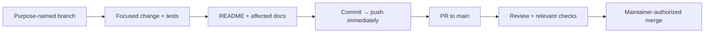
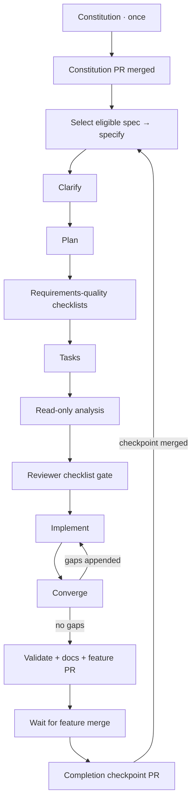

# Development workflow

## Foundation boundary

The bootstrap establishes contributor tools and an empty architecture-aligned
layout. Product code, build manifests, runtime packaging, application CI/CD,
and cloud hosting are future feature work. Azure identity provisioning is a
separate, explicitly authorized [operator action](../infra/bootstrap/README.md).

Current technical intent is defined by the [charter](PRODUCT_CHARTER.md),
[product specification](PRODUCT_SPEC.md), [architecture](ARCHITECTURE.md),
and [modular-provider ADR](adr/0001-modular-provider-architecture.md).

## Everyday change flow



Use `feature/`, `bugfix/`, `chore/`, `docs/`, `refactor/`, `hotfix/`, or `test/`.
Never commit directly to `main`. Inspect the worktree first, preserve user work,
and honor a branch explicitly designated for the task. Do not force-push shared
history. Push after **every** commit; failures are blockers, not successful
handoffs. Open/update the PR when work is ready; do not merge without permission.

Use the [PR template](../.github/pull_request_template.md). Update the README
and affected docs on the branch before merge; explicitly justify unaffected
documents. Describe actual checks and operational/manual steps. Keep credentials,
state, tfvars, plans, build output, and runtime data out of Git; retain lockfiles.

## Checkpointed Spec Kit flow

In a Copilot surface supporting repository skills, ask:

> Use the `hoard-speckit` skill to advance the next stage.

In CLI, `/skills` shows available skills. Name `hoard-speckit` explicitly; exact
slash-command spelling can vary by Copilot surface. The entry point is
[its SKILL.md](../.github/skills/hoard-speckit/SKILL.md).

The bootstrap **does not run** this flow or pre-ratify the constitution.
The first invocation runs constitution only. After that PR is merged, the next
invocation selects the first dependency-ready open specification from the
[master inventory](HOARD_SPECKIT_MASTER_BACKLOG.md) and passes its exact prompt
to the installed specify skill.



Each box representing a scheduled stage is **one invocation**, not a command
to run the entire backlog. Clarification is before planning; checklist generation
can use the plan, tasks precede analysis, and analysis precedes implementation.
Convergence is the installed post-implementation gap check.

### Checkpoint contract

- `.specify/hoard-flow.json` is **tracked shared progress**: stage, ready/running
  status, branch, active backlog ID/directory/PR, merged completions, and history.
- `.specify/feature.json` is an **ignored local pointer** used by Spec Kit.
  Restore it from the active shared checkpoint when resuming in another checkout.
- The master backlog owns prompts/dependencies; the checkpoint's `completed`
  entries own delivery status. A checked implementation task is not a merged
  feature. Eligibility uses completed dependencies, not phase labels alone.
- The first open eligible row wins. For example, F-08 is skipped until its
  dependency `18` is complete; the driver can then select original spec `01`.
  IDs stay stable and independent from Spec Kit sequential directory numbers.
- Start state is persisted **before** the skill runs; completion is persisted
  only after artifacts and quality gates pass. Commit/push the checkpoint with
  the stage's artifacts. Do not run two driver invocations concurrently.
- Constitution and completion checkpoints must be merged before a new feature
  starts from main. There is intentionally a progress-only PR after each feature
  merge: it avoids declaring a feature complete in its own still-unmerged PR.

Inspect without modifying anything:

```bash
python3 scripts/speckit_flow.py status
```

The skill normally manages these commands; they are also available for recovery:

```bash
# On a proper work branch; do not run just to inspect progress.
python3 scripts/speckit_flow.py begin
# Only the specify stage needs the pinned new directory:
# python3 scripts/speckit_flow.py begin --feature-directory specs/001-provider-contracts

# Execute the scheduled installed skill and verify the actual stage gate first.
python3 scripts/speckit_flow.py finish --evidence "Stage result and review/check references"
# At finalize only: add --pr NUMBER.
```

**Interrupted stage:** `running` means inspect and resume the same artifacts.
Never reset JSON to `ready`, rerun specify into another directory, or invent
successful evidence. A failed stage stays running. A successful stage that
failed to push must be pushed before continuing. Restore corrupted checkpoints
from reviewed Git history and reconcile artifacts; do not silently default.

**Human gates:** requirements-quality custom checklists are reviewer-owned.
Generating them does not approve them. Analysis is read-only; remediation must
be separately authorized. Block on unresolved significant findings, unanswered
scope decisions, or missing acceptance evidence. The helper validates state and
some artifacts; the agent/reviewer must assess semantic correctness.

### Installed skills and agent responsibilities

| Entry point | When to use it |
| --- | --- |
| `hoard-speckit` | Advance/resume one backlog stage and checkpoint it |
| `speckit-constitution` | Governance creation/amendment; no product implementation |
| `speckit-specify`, `speckit-clarify` | Outcome-focused spec and ambiguity resolution |
| `speckit-plan`, `speckit-checklist`, `speckit-tasks` | Design, requirements-quality reviews, executable task breakdown |
| `speckit-analyze` | Read-only cross-artifact consistency gate after tasks |
| `speckit-implement`, `speckit-converge` | Build tasks, then append genuine remaining gaps |
| `speckit-taskstoissues` | Only when explicitly asked to publish tasks as GitHub issues |
| `hoard-architecture-review` agent | Substantial project-reference/provider-contract/composition/shared-invariant changes before PR handoff |
| `hoard-release` | Explicitly requested tag-driven source release; never deploy |

The architecture agent is read-only and returns concrete `path:line` findings,
not implementation or a blanket approval. Select it in Copilot's agent selector
or delegate a narrowly bounded architecture review when supported. It is not
required for simple doc or repository-tool changes.

## Current checks and future product checks

```bash
python3 -m unittest discover -s tests/tooling -v
tofu -chdir=infra/bootstrap fmt -check
tofu -chdir=infra/bootstrap init -backend=false
tofu -chdir=infra/bootstrap validate
tofu -chdir=infra/bootstrap test
```

The OpenTofu tests mock Azure/GitHub; they do not provision anything. There is no
application build command or CI pipeline in this bootstrap. Later features
must introduce and document focused backend/UI format/type/unit checks,
architecture tests, provider contract suites, and real-client protocol tests.

## Releases and deployment

[Version tags publish GitHub source releases](RELEASING.md). They do not run
product builds, package publication, OpenTofu, OIDC login, or deployment.
The [Azure identity root](../infra/bootstrap/README.md) merely prepares one
environment for a later, independently designed deployment workflow.
