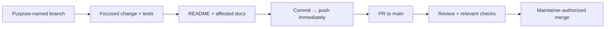
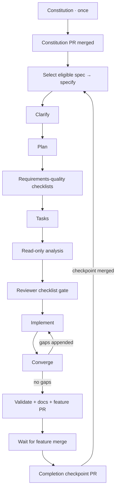

# Development workflow

## Foundation boundary

The bootstrap establishes contributor tools and an empty architecture-aligned
layout. Product code, build manifests, runtime packaging, application CI/CD,
and cloud hosting are future feature work. Azure identity provisioning is a
separate, explicitly authorized [operator action](../infra/bootstrap/README.md).

Current technical intent is defined by the [charter](PRODUCT_CHARTER.md),
[product specification](PRODUCT_SPEC.md), [architecture](ARCHITECTURE.md),
and [modular-provider ADR](adr/0001-modular-provider-architecture.md).

## Everyday change flow



Use `feature/`, `bugfix/`, `chore/`, `docs/`, `refactor/`, `hotfix/`, or `test/`.
Never commit directly to `main`. Inspect the worktree first, preserve user work,
and honor a branch explicitly designated for the task. Do not force-push shared
history. Push after **every** commit; failures are blockers, not successful
handoffs. Open/update the PR when work is ready; do not merge without permission.

Use the [PR template](../.github/pull_request_template.md). Update the README
and affected docs on the branch before merge; explicitly justify unaffected
documents. Describe actual checks and operational/manual steps. Keep credentials,
state, tfvars, plans, build output, and runtime data out of Git; retain lockfiles.

## Local MCP servers

The repository includes `.mcp.json` for Copilot CLI and `.vscode/mcp.json` for
VS Code Copilot. Both describe the same eight servers; keep their definitions
aligned when changing them. These settings apply to this checkout, not your
user-level MCP configuration or a hosted coding agent.

| Server | Connection | Purpose |
| --- | --- | --- |
| [Microsoft Learn](https://learn.microsoft.com/en-us/training/support/mcp) | Remote HTTP | Official .NET, ASP.NET Core, and Microsoft documentation and code samples |
| [Context7](https://context7.com/docs/resources/all-clients) | Remote HTTP | Library-specific documentation and examples |
| [Next.js DevTools](https://github.com/vercel/next-devtools-mcp) | Local stdio via `npx` | Connect to a future Next.js development server for runtime errors, routes, and logs |
| [shadcn](https://ui.shadcn.com/docs/mcp) | Local stdio via `npx` | Discover components, examples, and registry items for the planned console |
| [Playwright](https://github.com/microsoft/playwright-mcp) | Local stdio via `npx` | Browser interaction and accessibility snapshots with an isolated, nonpersistent profile |
| [Azure MCP](https://learn.microsoft.com/en-us/azure/developer/azure-mcp-server/) | Local stdio via `npx` | Optional Azure resource inspection, with `--read-only` enabled |
| [Docker MCP Gateway](https://docs.docker.com/ai/mcp-catalog-and-toolkit/mcp-gateway/) | Local stdio via `docker` | Connect to the MCP servers enabled in your local Docker MCP Toolkit |
| [NuGet MCP](https://learn.microsoft.com/en-us/nuget/concepts/nuget-mcp-server) | Local stdio via `dnx` | Official NuGet package discovery, upgrade planning, and dependency vulnerability guidance |

The HTTP servers need network access but no local Node installation. Context7
can be used without a key, subject to anonymous rate limits. If authentication
or a higher quota is needed, configure credentials privately in the client;
never add keys or authorization headers to these tracked files. Documentation
queries go to the respective remote service: do not send secrets or private
source code.

The full Node-based stdio setup needs Node.js 22+ (a supported LTS release)
and npm on `PATH`; Azure MCP 3.0.0 requires Node.js 22 or newer. The servers run
publisher packages through `npx -y`, which downloads and runs code in npm's cache
on first start. The `@latest` packages can pick up
updates later. Azure MCP is instead pinned to stable `3.0.0`: at setup time,
its npm `latest` tag pointed to a prerelease. Review and trust the publishers
before starting them. Next.js DevTools and Azure MCP telemetry are disabled in
both configurations. No package manifest, local `node_modules`, or application
scaffolding is required for this MCP setup.

Playwright uses `--isolated`, so cookies and login state are not persisted or
borrowed from your normal browser. It still needs an installed supported
browser; follow its browser-install guidance if a browser launch reports one
missing. Browser automation is not a substitute for committed end-to-end tests.

Azure resource operations require your own authenticated Azure identity, for
example through `az login`, and appropriate least-privilege RBAC. This setup
does not sign in, select a subscription, or provision resources. The read-only
flag prevents write operations; sensitive-data confirmation remains enabled.
Do not remove that restriction or perform an Azure write without separate
authorization. Azure remains optional for local Hoard development.

The Azure entry is named `azure-mcp` to avoid collisions with an existing
`azure` client plugin, which can take precedence over a same-named workspace
entry. Its read-only restriction does not constrain separately installed Azure
servers. If your client already provides Azure or another server listed here,
choose which connection to use in the client to avoid duplicate tools; this
repository does not disable or modify existing plugins.

Docker Gateway requires a running Docker engine and the `docker mcp` CLI
plugin, normally supplied by Docker Desktop with **MCP Toolkit** enabled.
Check availability with `docker mcp version`. Use Docker Desktop's MCP Toolkit
to select and configure the servers you actually need; no catalog servers are
enabled by this repository. The gateway uses your existing local selection,
so avoid enabling duplicate copies of servers already connected directly here.
Credentials belong in Docker's secret storage, not Git. No TCP gateway port,
all-server catalog flag, or relaxed security settings are configured. If Docker
Desktop is stopped, the gateway cannot connect; start it before starting this
MCP entry. This setup does not start Docker Desktop, change its catalog, or run
Hoard containers.

NuGet MCP requires the .NET 10 SDK or later, including `dnx` on `PATH`.
It downloads and runs the official `NuGet.Mcp.Server` package from nuget.org
using the publisher's recommended `--source` and `--yes` arguments. No
prerelease version is requested; an unversioned package name follows stable
updates. Review the publisher before starting the server. No project, package
reference, or tool manifest is created by this configuration. Project-specific
dependency analysis awaits the feature introducing the .NET projects, and any
package changes must remain within the explicitly requested task and normal
client permissions. If `dnx` cannot load the service index, check network and
trusted proxy access to `https://api.nuget.org/v3/index.json` before retrying;
do not disable TLS or certificate validation to make the server start.

For Copilot CLI, start a new session from this checkout, review any workspace
trust prompt, and use `/mcp` to inspect the servers. `copilot mcp list` also
shows the loaded configuration and its source, but does not prove a server
connection. For VS Code, open `.vscode/mcp.json` and use its **Start** actions;
review server trust prompts and use **MCP: List Servers** for status. Existing
client permission and trust controls still apply.

Hoard has no runnable UI yet. Next.js runtime tools require a running Next.js
16+ development server, and project-specific shadcn registry configuration
belongs to the feature that creates `apps/web`. Do not scaffold an app or run
component installation just to enable these servers. The default shadcn registry
does not require a `components.json` file for discovery.

To roll back, remove the server entries from both files and restart or stop
the affected client connections. This does not alter global settings or npm's
download cache. Product specifications and architecture diagrams are unaffected:
MCP is contributor tooling, not a Hoard runtime capability.

## Checkpointed Spec Kit flow

In a Copilot surface supporting repository skills, ask:

> Use the `hoard-speckit` skill to advance the next stage.

In CLI, `/skills` shows available skills. Name `hoard-speckit` explicitly; exact
slash-command spelling can vary by Copilot surface. The entry point is
[its SKILL.md](../.github/skills/hoard-speckit/SKILL.md).

The bootstrap **does not run** this flow or pre-ratify the constitution.
The first invocation runs constitution only. After that PR is merged, the next
invocation selects the first dependency-ready open specification from the
[master inventory](HOARD_SPECKIT_MASTER_BACKLOG.md) and passes its exact prompt
to the installed specify skill.



Each box representing a scheduled stage is **one invocation**, not a command
to run the entire backlog. Clarification is before planning; checklist generation
can use the plan, tasks precede analysis, and analysis precedes implementation.
Convergence is the installed post-implementation gap check.

### Checkpoint contract

- `.specify/hoard-flow.json` is **tracked shared progress**: stage, ready/running
  status, branch, active backlog ID/directory/PR, merged completions, and history.
- `.specify/feature.json` is an **ignored local pointer** used by Spec Kit.
  Restore it from the active shared checkpoint when resuming in another checkout.
- The master backlog owns prompts/dependencies; the checkpoint's `completed`
  entries own delivery status. A checked implementation task is not a merged
  feature. Eligibility uses completed dependencies, not phase labels alone.
- The first open eligible row wins. For example, F-08 is skipped until its
  dependency `18` is complete; the driver can then select original spec `01`.
  IDs stay stable and independent from Spec Kit sequential directory numbers.
- Start state is persisted **before** the skill runs; completion is persisted
  only after artifacts and quality gates pass. Commit/push the checkpoint with
  the stage's artifacts. Do not run two driver invocations concurrently.
- Constitution and completion checkpoints must be merged before a new feature
  starts from main. There is intentionally a progress-only PR after each feature
  merge: it avoids declaring a feature complete in its own still-unmerged PR.

Inspect without modifying anything:

```bash
python3 scripts/speckit_flow.py status
```

The skill normally manages these commands; they are also available for recovery:

```bash
# On a proper work branch; do not run just to inspect progress.
python3 scripts/speckit_flow.py begin
# Only the specify stage needs the pinned new directory:
# python3 scripts/speckit_flow.py begin --feature-directory specs/001-provider-contracts

# Execute the scheduled installed skill and verify the actual stage gate first.
python3 scripts/speckit_flow.py finish --evidence "Stage result and review/check references"
# At finalize only: add --pr NUMBER.
```

**Interrupted stage:** `running` means inspect and resume the same artifacts.
Never reset JSON to `ready`, rerun specify into another directory, or invent
successful evidence. A failed stage stays running. A successful stage that
failed to push must be pushed before continuing. Restore corrupted checkpoints
from reviewed Git history and reconcile artifacts; do not silently default.

**Human gates:** requirements-quality custom checklists are reviewer-owned.
Generating them does not approve them. Analysis is read-only; remediation must
be separately authorized. Block on unresolved significant findings, unanswered
scope decisions, or missing acceptance evidence. The helper validates state and
some artifacts; the agent/reviewer must assess semantic correctness.

### Installed skills and agent responsibilities

| Entry point | When to use it |
| --- | --- |
| `hoard-speckit` | Advance/resume one backlog stage and checkpoint it |
| `speckit-constitution` | Governance creation/amendment; no product implementation |
| `speckit-specify`, `speckit-clarify` | Outcome-focused spec and ambiguity resolution |
| `speckit-plan`, `speckit-checklist`, `speckit-tasks` | Design, requirements-quality reviews, executable task breakdown |
| `speckit-analyze` | Read-only cross-artifact consistency gate after tasks |
| `speckit-implement`, `speckit-converge` | Build tasks, then append genuine remaining gaps |
| `speckit-taskstoissues` | Only when explicitly asked to publish tasks as GitHub issues |
| `hoard-architecture-review` agent | Substantial project-reference/provider-contract/composition/shared-invariant changes before PR handoff |
| `hoard-release` | Explicitly requested tag-driven source release; never deploy |

The architecture agent is read-only and returns concrete `path:line` findings,
not implementation or a blanket approval. Select it in Copilot's agent selector
or delegate a narrowly bounded architecture review when supported. It is not
required for simple doc or repository-tool changes.

## Current checks and future product checks

```bash
python3 -m unittest discover -s tests/tooling -v
tofu -chdir=infra/bootstrap fmt -check
tofu -chdir=infra/bootstrap init -backend=false
tofu -chdir=infra/bootstrap validate
tofu -chdir=infra/bootstrap test
```

The OpenTofu tests mock Azure/GitHub; they do not provision anything. There is no
application build command or CI pipeline in this bootstrap. Later features
must introduce and document focused backend/UI format/type/unit checks,
architecture tests, provider contract suites, and real-client protocol tests.

## Releases and deployment

[Version tags publish GitHub source releases](RELEASING.md). They do not run
product builds, package publication, OpenTofu, OIDC login, or deployment.
The [Azure identity root](../infra/bootstrap/README.md) merely prepares one
environment for a later, independently designed deployment workflow.
