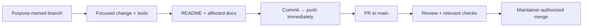
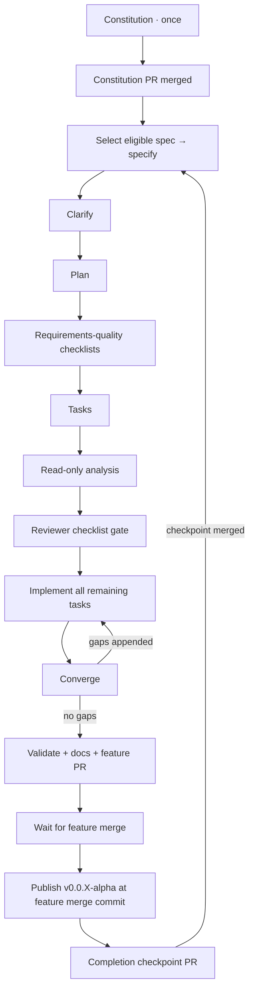

# Development workflow

## Foundation boundary

The bootstrap established contributor tools and reserved architecture boundaries.
F-01 adds four .NET library projects, immutable provider declarations, explicit
registration, and compile/package/boundary acceptance tooling. F-02 adds
opt-in fixture-tested lifecycle in Hosting. F-03 adds fixture-backed configuration,
owner-scoped local secrets and explicit synthetic conversion through that same
lifecycle. F-04 adds opt-in protected discovery slices in Application and safe
Hosting observations; F-05 adds separate BCL-only metadata operations with
independent SQLite/memory qualification fixtures. F-06 adds separate BCL-only
artifact operations with independent Local/ObjectSemantics qualification fixtures,
shared reference/read/deletion authority and bounded recovery. These remain
test-only, not production storage or F-07 certification. Core remains empty. No caching engine,
production providers, curated executable, UI, product CI/CD,
or deployment exists.
Azure identity provisioning is a
separate, explicitly authorized [operator action](../infra/bootstrap/README.md).

Current technical intent is defined by the [charter](PRODUCT_CHARTER.md),
[product specification](PRODUCT_SPEC.md), [architecture](ARCHITECTURE.md),
and [modular-provider ADR](adr/0001-modular-provider-architecture.md).

## Everyday change flow



Use `feature/`, `bugfix/`, `chore/`, `docs/`, `refactor/`, `hotfix/`, or `test/`.
Never commit directly to `main`. Inspect the worktree first, preserve user work,
and honor a branch explicitly designated for the task. Do not force-push shared
history. Push after **every** commit; failures are blockers, not successful
handoffs. Open/update the PR when work is ready; do not merge without permission.

Use the [PR template](../.github/pull_request_template.md). Update the README
and affected docs on the branch before merge; explicitly justify unaffected
documents. Describe actual checks and operational/manual steps. Keep credentials,
state, tfvars, plans, build output, and runtime data out of Git; retain lockfiles.

## Local MCP servers

The repository includes `.mcp.json` for Copilot CLI and `.vscode/mcp.json` for
VS Code Copilot. Both describe the same eight servers; keep their definitions
aligned when changing them. These settings apply to this checkout, not your
user-level MCP configuration or a hosted coding agent.

| Server | Connection | Purpose |
| --- | --- | --- |
| [Microsoft Learn](https://learn.microsoft.com/en-us/training/support/mcp) | Remote HTTP | Official .NET, ASP.NET Core, and Microsoft documentation and code samples |
| [Context7](https://context7.com/docs/resources/all-clients) | Remote HTTP | Library-specific documentation and examples |
| [Next.js DevTools](https://github.com/vercel/next-devtools-mcp) | Local stdio via `npx` | Connect to a future Next.js development server for runtime errors, routes, and logs |
| [shadcn](https://ui.shadcn.com/docs/mcp) | Local stdio via `npx` | Discover components, examples, and registry items for the planned console |
| [Playwright](https://github.com/microsoft/playwright-mcp) | Local stdio via `npx` | Browser interaction and accessibility snapshots with an isolated, nonpersistent profile |
| [Azure MCP](https://learn.microsoft.com/en-us/azure/developer/azure-mcp-server/) | Local stdio via `npx` | Optional Azure resource inspection, with `--read-only` enabled |
| [Docker MCP Gateway](https://docs.docker.com/ai/mcp-catalog-and-toolkit/mcp-gateway/) | Local stdio via `docker` | Connect to the MCP servers enabled in your local Docker MCP Toolkit |
| [NuGet MCP](https://learn.microsoft.com/en-us/nuget/concepts/nuget-mcp-server) | Local stdio via `dnx` | Official NuGet package discovery, upgrade planning, and dependency vulnerability guidance |

The HTTP servers need network access but no local Node installation. Context7
can be used without a key, subject to anonymous rate limits. If authentication
or a higher quota is needed, configure credentials privately in the client;
never add keys or authorization headers to these tracked files. Documentation
queries go to the respective remote service: do not send secrets or private
source code.

The full Node-based stdio setup needs Node.js 22+ (a supported LTS release)
and npm on `PATH`; Azure MCP 3.0.0 requires Node.js 22 or newer. The servers run
publisher packages through `npx -y`, which downloads and runs code in npm's cache
on first start. The `@latest` packages can pick up
updates later. Azure MCP is instead pinned to stable `3.0.0`: at setup time,
its npm `latest` tag pointed to a prerelease. Review and trust the publishers
before starting them. Next.js DevTools and Azure MCP telemetry are disabled in
both configurations. No package manifest, local `node_modules`, or application
scaffolding is required for this MCP setup.

Playwright uses `--isolated`, so cookies and login state are not persisted or
borrowed from your normal browser. It still needs an installed supported
browser; follow its browser-install guidance if a browser launch reports one
missing. Browser automation is not a substitute for committed end-to-end tests.

Azure resource operations require your own authenticated Azure identity, for
example through `az login`, and appropriate least-privilege RBAC. This setup
does not sign in, select a subscription, or provision resources. The read-only
flag prevents write operations; sensitive-data confirmation remains enabled.
Do not remove that restriction or perform an Azure write without separate
authorization. Azure remains optional for local Hoard development.

The Azure entry is named `azure-mcp` to avoid collisions with an existing
`azure` client plugin, which can take precedence over a same-named workspace
entry. Its read-only restriction does not constrain separately installed Azure
servers. If your client already provides Azure or another server listed here,
choose which connection to use in the client to avoid duplicate tools; this
repository does not disable or modify existing plugins.

Docker Gateway requires a running Docker engine and the `docker mcp` CLI
plugin, normally supplied by Docker Desktop with **MCP Toolkit** enabled.
Check availability with `docker mcp version`. Use Docker Desktop's MCP Toolkit
to select and configure the servers you actually need; no catalog servers are
enabled by this repository. The gateway uses your existing local selection,
so avoid enabling duplicate copies of servers already connected directly here.
Credentials belong in Docker's secret storage, not Git. No TCP gateway port,
all-server catalog flag, or relaxed security settings are configured. If Docker
Desktop is stopped, the gateway cannot connect; start it before starting this
MCP entry. This setup does not start Docker Desktop, change its catalog, or run
Hoard containers.

NuGet MCP requires the .NET 10 SDK or later, including `dnx` on `PATH`.
It downloads and runs the official `NuGet.Mcp.Server` package from nuget.org
using the publisher's recommended `--source` and `--yes` arguments. No
prerelease version is requested; an unversioned package name follows stable
updates. Review the publisher before starting the server. No project, package
reference, or tool manifest is created by this configuration. Project-specific
dependency analysis awaits the feature introducing the .NET projects, and any
package changes must remain within the explicitly requested task and normal
client permissions. If `dnx` cannot load the service index, check network and
trusted proxy access to `https://api.nuget.org/v3/index.json` before retrying;
do not disable TLS or certificate validation to make the server start.

For Copilot CLI, start a new session from this checkout, review any workspace
trust prompt, and use `/mcp` to inspect the servers. `copilot mcp list` also
shows the loaded configuration and its source, but does not prove a server
connection. For VS Code, open `.vscode/mcp.json` and use its **Start** actions;
review server trust prompts and use **MCP: List Servers** for status. Existing
client permission and trust controls still apply.

Hoard has no runnable UI yet. Next.js runtime tools require a running Next.js
16+ development server, and project-specific shadcn registry configuration
belongs to the feature that creates `apps/web`. Do not scaffold an app or run
component installation just to enable these servers. The default shadcn registry
does not require a `components.json` file for discovery.

To roll back, remove the server entries from both files and restart or stop
the affected client connections. This does not alter global settings or npm's
download cache. Product specifications and architecture diagrams are unaffected:
MCP is contributor tooling, not a Hoard runtime capability.

## Checkpointed Spec Kit flow

In a Copilot surface supporting repository skills, ask:

> Use the `hoard-speckit` skill to advance the next stage.

In CLI, `/skills` shows available skills. Name `hoard-speckit` explicitly; exact
slash-command spelling can vary by Copilot surface. The entry point is
[its SKILL.md](../.github/skills/hoard-speckit/SKILL.md).

The bootstrap did not run this flow or pre-ratify the constitution. The initial
constitution stage establishes
[version 1.0.0](../.specify/memory/constitution.md), covering product boundaries,
provider composition, shared correctness/security, evidence, accessibility,
operations, and governance. It creates no feature specification or product code.
Templates remain unchanged; the installed stage skills read the constitution
at runtime.

The constitution adoption PR must merge before a new specification begins.
After merge, the next invocation selects the first dependency-ready open
specification from the [master inventory](HOARD_SPECKIT_MASTER_BACKLOG.md)
and passes its exact prompt to the installed specify skill. The tracked
checkpoint, rather than this guide, records current stage and merge progress.

The first generated feature is
[F-01: platform package boundaries and provider contracts](../specs/001-provider-contracts/spec.md).
Its [built-in quality checklist](../specs/001-provider-contracts/checklists/requirements.md)
validates the specification, not implementation or reviewer-owned custom
checklist approval. Package contracts, custom-host compilation, and architecture
checks described there were acceptance requirements at specification time;
their current bounded implementation is described below.
Its initial [clarification review](../specs/001-provider-contracts/spec.md#clarifications)
records a no-question result with no scope changes; a later user-approved
follow-up resolves the checklist review's optional-dependency ambiguity.
Exact public signatures and
build commands were proposed in the
[implementation plan](../specs/001-provider-contracts/plan.md) and
[public contracts](../specs/001-provider-contracts/contracts/public-api.md),
then delivered by the separately authorized implementation stage. The plan
retains historical design alongside current evidence and includes research,
a declaration model,
compatibility/architecture acceptance contracts, and a
[validation quickstart](../specs/001-provider-contracts/quickstart.md).
The implementation now supplies the foundation commands in that quickstart;
they prove compilation and package boundaries, not product behavior.
Planning did not generate or approve custom reviewer-owned checklists, create
tasks, scaffold projects, or authorize implementation. The subsequent checklist
stage generated separate
[architecture](../specs/001-provider-contracts/checklists/architecture.md) and
[compatibility](../specs/001-provider-contracts/checklists/compatibility.md)
requirements-quality reviews: 20 and 18 criteria respectively.
These standard-depth checklists are for maintainers and provider-contract
reviewers before implementation authorization; they assess written requirements,
not product behavior. At the user's explicit request, a delegated review
initially found architecture 20/20 and compatibility 17/18 satisfied.
The user then approved the recommendation for
[RQ-01: incompatible present optional dependencies](../specs/001-provider-contracts/checklists/compatibility.md#rq-01-incompatible-present-optional-dependency).
The spec, declaration model, and policy now classify an enabled incompatible
optional target as an unsupported composition, without automatic disablement
or substitution; installed/registered-but-disabled optional targets are
unavailable and confer no integration/capability claim. Five new classification
examples bring the written matrix to 23 cases. The delegated re-review closes
CHK014: architecture 20/20 and compatibility 18/18, all 38 criteria satisfied
without waivers. The built-in specification checklist and driver are unchanged.
The subsequent [task-generation stage](../specs/001-provider-contracts/tasks.md)
produced 57 unchecked tasks: shared setup/declarations, four story phases, and
cross-cutting acceptance/documentation work. All 17 requirements and six
outcomes are mapped to implementation and focused proof tasks. The dependency
graph serializes the shared validation script while allowing independent
fixture/test/inspector work; architecture negatives and all 23 compatibility
classifications remain future proof obligations. No product scaffolding or
implementation occurred.

The subsequent read-only cross-artifact analysis found no actionable
duplication, ambiguity, underspecification, inconsistency, constitutional
conflict, or coverage gap. All 17 functional requirements and six buildable
outcomes have implementation/proof tasks; all 57 tasks map to requirements or
shared acceptance prerequisites. The prerequisite graph is complete and
acyclic, including serialized shared-script edits. All feature artifacts and
reviewer-owned checklist markers remained unchanged. The analysis report is
recorded in the draft feature PR, with its completion evidence in the shared
checkpoint; no remediation or implementation occurred. The next scheduled
stage was implementation through a separate `hoard-speckit` invocation, with the
existing reviewer-owned 38/38 checklist gate satisfied. Artifact analysis is
not passing product evidence or permission to skip the remaining stages.

The completed implementation stage delivers declaration-only Abstractions,
provider-free Core/Application, and metadata/type registration in Hosting.
The [provider guide](PROVIDERS.md) and
[compile-only custom-host guide](../examples/CustomHost/README.md) describe
current APIs and limits. `bash scripts/validate-foundation.sh` restores/builds
with locks, checks SDK formatting/analyzers, builds Core in isolation, packs
four local platform libraries and five independent fixtures, compiles family
consumers and both hosts, and executes architecture/compatibility/registration
acceptance. The F-01 host is never run. Current solution tests also include
in-process lifecycle regressions; the dedicated lifecycle graph/distribution/
old-binary proof still requires validate-lifecycle.sh. No listener starts.
Every subprocess has a ten-minute timeout.
A Python standard-library helper owns copying, hashes, metadata manifests, and
explicit subprocess errors; Bash owns prerequisites and private-directory cleanup.
Tests consume the prepared evidence, never recursively invoke the orchestrator,
and deliberately fail when evidence is missing.

Default runs do not rewrite lockfiles. After an intentional contract/dependency
change, `bash scripts/validate-foundation.sh --update-locks` regenerates and
replays standalone locks; review and commit them before the default locked run.
Local acceptance packages omit Git revision stamps and normalize source paths,
so fresh temporary locations and checkpoint commits do not invalidate their
content hashes. This is local proof tooling, not release/package publication.
The helper also canonicalizes unsigned local SDK archive envelopes (ZIP
metadata and OPC relationship IDs/paths) without changing nuspec/assembly/core
property bytes. Focused regressions protect reproducibility and reject signed/
external inputs; no published/external package is rewritten and locked hashes
are never bypassed. Compiler/SDK changes affecting payloads need reviewed locks.
SDK package pruning is disabled in the example so its complete explicit packed
dependency graph remains available for inspection even with ASP.NET's shared
framework. Framework ownership comes from resolved reference-pack metadata,
not trusted namespace/name prefixes.
The implemented-graph architecture review identified three proof gaps, now
corrected with focused regressions: unused framework references create real
dependency edges, prohibited BCL query/connection/transaction shapes cannot
bypass public-surface checks, and all eight named platform/provider/host scans
are mandatory. See the [review and measured evidence](../specs/001-provider-contracts/plan.md#necessary-implementation-details-and-review).
The support-claim audit is complete. The subsequent installed convergence stage
assessed all 17 functional requirements, six buildable success criteria, 15
story acceptance scenarios, nine edge cases, 12 grouped plan decisions, all 57
implementation tasks, and eight constitutional principles against current
scoped code. It found one HIGH-severity partial gap: the graph inspector rejected
the permitted `Identity -> Hosting -> Core` closure under ARCH-008, although
identity providers may use the approved Hosting API and Hosting references Core.
A temporary diagnostic invoking the current compiled graph inspector reproduced
that false rejection; the original permitted fixtures did not cover this path.
[Phase 8 / T058](../specs/001-provider-contracts/tasks.md#phase-8-convergence)
recorded the correction and regression work. That convergence invocation
appended only the new task section; its passing baseline of 81 .NET tests
and 17 tooling tests did not resolve the uncovered path.

The separately authorized T058 implementation now tracks Identity paths whose
first edge reaches Hosting separately from other paths to the same dependency.
Core is permitted through that approved Hosting composition, not directly or
through an unrelated SDK-owned helper. A package-only fixture uses the actual
Hosting registration API; isolated negatives retain both forbidden routes even
when Hosting is also referenced, with normal/reversed edge-order checks.
All four new fixture projects carry locks. No platform API, provider package,
runtime behavior, or reviewer-owned checklist changed. See the
[follow-up evidence](../specs/001-provider-contracts/plan.md#t058-implementation-follow-up-2026-10-20).
The separately authorized follow-up convergence assessment found no actionable
gaps: missing 0, partial 0, contradicts 0, unrequested 0, with zero findings at
any severity. It checked all 17 functional requirements, six buildable success
criteria, 15 story acceptance scenarios, nine edge cases, 12 grouped plan
decisions, all 58 tasks (including T058), and eight constitutional principles.
Fresh default locked acceptance passed all 86 .NET tests (42 foundation,
41 architecture, three composition), zero failed/skipped, including the
permitted Identity/Hosting path and both forbidden alternatives. All 17 Python
tooling tests passed. The assessment left the spec, plan, tasks, and all
reviewer-owned/built-in checklist bytes unchanged; no empty convergence phase
or further implementation task was added. Its report is recorded in the draft
feature PR and shared checkpoint.
The separately authorized
[finalization acceptance](../specs/001-provider-contracts/plan.md#finalization-acceptance-2026-10-20)
repeated the full locked foundation check and all 17 tooling tests, refreshed
the dependency advisory assessment with no known vulnerable packages, and
verified the acceptance traceability, documentation, and existing architecture
reviews. The reviewed implementation, locks, tasks, and checklist markers
remain unchanged. At finalization,
[PR #4](https://github.com/Stonefly-Labs/Hoard/pull/4) was ready for maintainer
review, targeting `main`; the shared checkpoint recorded `await_merge` with
that PR number and no completed feature.

PR #4 subsequently merged into `main` on 2026-10-20 at
`837fdf3edf51c3df34710184d018479683c194c2`. The separate `await_merge` stage
verified the GitHub merge state, merge ancestry in fetched `origin/main`, and
all 58 completed tasks. It created `chore/spec-progress-f-01` from that main
and records F-01 in the shared checkpoint's completed entries, retaining its
directory, PR, and merge commit. At that point the checkpoint had no active
feature and scheduled `specify`; the first dependency-ready entry was
[F-02: module registry, composition and lifecycle](HOARD_SPECKIT_MASTER_BACKLOG.md#foundation-f-02).
The progress checkpoint merged through
[PR #5](https://github.com/Stonefly-Labs/Hoard/pull/5), satisfying the gate for
the subsequent specification stage.

[F-02: module registry, composition and lifecycle](../specs/002-module-lifecycle/spec.md)
now has its own requirements at `specs/002-module-lifecycle`, on
`feature/002-module-lifecycle`. Five prioritized stories, 22 functional
requirements, and seven measurable outcomes cover explicit registered-module
selection, pre-activation dependency/compatibility checks, deterministic ordering,
disabled-route/worker/connection isolation, readiness, bounded initialization,
partial-start cleanup and shutdown, sanitized diagnostics, and restart versus
custom rebuild behavior. The existing F-01 optional-dependency policy is
preserved: absent/disabled optional targets confer no integration; enabled
incompatible targets fail composition. All explicitly enabled modules must
initialize successfully; optional dependency does not mean degraded startup.
The [built-in requirements checklist](../specs/002-module-lifecycle/checklists/requirements.md)
passes all 16 specification-quality criteria, with no unresolved clarification
markers. It is not a custom reviewer-owned approval or runtime acceptance
result. The bounded architecture review found no actionable requirement-level
findings; its operational proof obligations remain future work.

The subsequent
[clarification review](../specs/002-module-lifecycle/spec.md#clarifications)
found no critical ambiguities across all ten review categories. Zero questions
were asked or answered, and no requirements, acceptance criteria, or scope
decisions changed. The built-in specification-quality checklist was revalidated
at 16/16 to 16/16: no newly passing items, regressions, or unchecked items.
Its bytes and historical specification-stage notes remain unchanged; no custom
reviewer-owned approval is implied. Exact lifecycle APIs and state
representation, route-conflict inspection, finite budget defaults, and the stable
ordering tie-break remain planning decisions under the existing requirements.
No consequential product decision blocks planning.

The subsequent [implementation plan](../specs/002-module-lifecycle/plan.md)
defines opt-in Hosting lifecycle adapters on F-01's unchanged registration
boundary. Persistence/artifact providers retain Abstractions-only dependencies
through host-side adapters. Metadata validation precedes all construction;
enabled modules follow deterministic dependency ordering, service composition,
supervised host build, owned-route analysis, initialization and complete
readiness before traffic/worker admission. Startup/stop coordination has finite
deadlines and reports incomplete cleanup rather than pretending cancellation
forcibly stops trusted in-process code.

The [research](../specs/002-module-lifecycle/research.md),
[in-memory model](../specs/002-module-lifecycle/data-model.md),
[public API](../specs/002-module-lifecycle/contracts/public-api.md),
[lifecycle](../specs/002-module-lifecycle/contracts/lifecycle.md) and
[acceptance](../specs/002-module-lifecycle/contracts/acceptance.md) contracts
resolve planning details and map all 22 requirements, seven outcomes and
20 story scenarios to 40 fixture-only proof cases. The restricted owned-route
language rejects unsupported shapes instead of claiming to analyze arbitrary
constraints. The bounded architecture review identified a missing build
supervision boundary and two resource/worker semantics questions; the plan
corrects all three with an explicit supervised build API, retained request/
dependency resource leases and protected root disposal after drain timeout,
and whole-callback worker admission. LC-20/23/26/29 retain those proof duties.
No runtime results or repeat approval are inferred from those design corrections.

The [validation quickstart](../specs/002-module-lifecycle/quickstart.md)
distinguishes current foundation/tooling commands from a proposed lifecycle
validation script, independent packed fixtures and a separate lifecycle-only
host example. Neither that script nor new runtime APIs/projects/dependencies
are created in planning. F-01's compile-only example and all checklists remain
unchanged. The ASP.NET Core shared-framework/versioning dependency impact,
source/binary registration compatibility, deadline/admission/cleanup behavior
and actual package graph still require implementation evidence.

The subsequent checklist stage generated
[composition](../specs/002-module-lifecycle/checklists/composition.md) and
[lifecycle](../specs/002-module-lifecycle/checklists/lifecycle.md)
requirements-quality reviews: 20 criteria each, all 40 unchecked and
reviewer-owned. Standard-depth scope and audience are explicit: maintainer and
provider PR review before implementation authorization. Composition covers
registry/selection, compatibility/dependencies/capabilities, route ownership,
unchanged registration compatibility, and bundled/custom restart journeys.
Lifecycle covers disabled isolation, admission/readiness, finite coordination
budgets, partial-start and normal cleanup, pending-resource protection,
concurrency, and sanitized actionable diagnostics. The planning review's build,
resource-retention, and worker-admission corrections remain written proof
obligations; checklist generation neither evaluates them nor supplies runtime
evidence. Requirements/design artifacts and the built-in 16/16 checklist remain
unchanged; no custom criterion is approved or waived.

The subsequent [task-generation stage](../specs/002-module-lifecycle/tasks.md)
produced 72 unchecked implementation tasks across eight phases: shared setup
and safety primitives (13), US1 selection/start (14), US2 enabled/ready
functionality (18), US3 failure/stop (10), US4 safe diagnostics/state (5),
US5 distribution/restart (7), and cross-cutting acceptance (5).
All 22 functional requirements, seven outcomes and 40 LC acceptance cases
have implementation and focused proof assignments; all 20 story scenarios
retain the acceptance contract's LC mapping. Explicit acyclic prerequisites
serialize shared coordinator/lease/route/tooling edits, while 29 marked tasks
identify scoped file-disjoint parallel opportunities after their prerequisites.
The endpoint-free US1 fixture proof is the first bounded increment, not a
shippable lifecycle or complete F-02.

Tasks retain supervised synchronous build, single disposal ownership, pending
request/response/worker/build protection, finite deadlines and once-only
cleanup as implementation/regression obligations. Independent fixture packages,
package-only host variants, retained old registration binaries, explicit
framework-reference impact, initial reviewed locks and fresh default locked
replay remain required evidence. Existing F-01 fixture/example sources and
compile-only scenarios must stay intact; reviewed Hosting dependency/content
changes may require affected lock refreshes, not silent hash bypasses.
No test may skip a missing package input or accept an empty proof selection.
The task-generation stage did not perform cross-artifact analysis, implement
these obligations or evaluate the custom checklists; all 40 remained unchecked
at that stage.

The subsequent installed read-only cross-artifact analysis found no actionable
duplication, ambiguity, underspecification, inconsistency, constitutional conflict
or coverage gap. All 22 functional requirements and seven buildable outcomes
have implementation and focused proof assignments; all 72 tasks map to those
requirements or shared acceptance prerequisites. The complete prerequisite graph
is acyclic, including serialized shared-file edits; 40 LC cases, 20 story
scenarios and 12 edge cases retain their proof obligations. T002's tooling
regressions and T006's composition inputs are mapped shared prerequisites,
not orphan tasks. The analysis report is recorded in the draft feature PR,
with completion evidence in the shared checkpoint. No feature artifact or
built-in/custom checklist byte changed, and no remediation was needed.

The later explicitly requested checklist review evaluated all 40 custom
criteria at baseline `c7ccde4`: composition 19/20 and lifecycle 19/20, 38/40
satisfied without waivers. Composition CHK014 was left open for
[RQ-02: inconsistent baseline/custom artifact manifests](../specs/002-module-lifecycle/checklists/composition.md#rq-02-baseline-and-custom-artifact-package-lists-disagree).
Lifecycle CHK013 was left open for
[RQ-01: timed-out cleanup callback retention](../specs/002-module-lifecycle/checklists/lifecycle.md#rq-01-explicitly-retain-resources-for-timed-out-cleanup-callbacks).
Both were MEDIUM written-requirements/documentation findings, not demonstrated
runtime defects. The initial review changed checklist markers only, not
spec/design/tasks or the driver checkpoint.

The user subsequently approved both recommendations. The follow-up explicitly
tracks a non-completed StopAsync as pending Phase activity even after its wait
times out: owner/prerequisite/root resources remain protected, independent safe
cleanup shares the original deadline, and late completion after the bounded
result cannot rewrite outcomes, retry or trigger deferred disposal. LC-28/29
and T048/T050..T053/T055 retain the A -> B plus independent C regression duty.
The baseline manifest now consistently includes the two protocols, Metadata,
Artifact.One and optional Identity; only custom adds Artifact.Two and its host
adapter. LC-35/36, T065 and the quickstart require baseline absence and
same-binary bundled protocol switching; independent packing still covers six
fixtures. All 40 custom criteria are now satisfied without waivers after
re-evaluation; the built-in checklist remains 16/16.

Fresh installed read-only cross-artifact analysis found zero actionable
findings, with all 22 requirements/seven outcomes, 72 unchecked tasks, 40 LC
cases, 20 scenarios and 12 edge cases retaining complete proof mappings and
acyclic prerequisites. All feature bytes remained unchanged during that
analysis. The bounded follow-up architecture review also found no actionable
findings or unresolved design questions; actual runtime/package/graph proof
remains an implementation obligation. The PR records both results.
The approved follow-up is not a driver stage, independent human inspection,
runtime implementation or acceptance. The checkpoint/history is byte-for-byte
unchanged; no `begin`/`finish` or progress reset was used.

Specification, clarification, planning, checklist and task generation create no
lifecycle implementation, production executable/provider, configuration parser,
management discovery endpoint, UI, or conformance certification. F-02 can
later prove lifecycle with explicit selections and instrumented fixtures;
F-03 retains configuration sources,
option/secret handling, and operator selection UX, while F-04 retains management
discovery. Read-only analysis likewise supplies no runtime implementation or
passing product evidence. The next scheduled stage was `implement` through a
separate invocation, with the custom checklist gate now satisfied and the
approved findings resolved. This follow-up does not start implementation or
mark any of its 72 tasks complete. Do not reset the checkpoint to fabricate a
scheduled analysis rerun or infer runtime acceptance from `implement` / `ready`.
Task generation and analysis do not require custom checklist approval, but the
later implementation gate does require reviewer approval or explicit reviewer
authorization; their initial generation/analysis did not supply it. The
requested review and approved follow-up now satisfy that requirements gate,
not a feature-completion or runtime-support claim.

### Implemented F-02 lifecycle boundary

The separately authorized implementation adds metadata-only registry/selection/
version/capability validation, deterministic dependency ordering, inert opt-in
adapter association, supervised service/build/route/init phases, readiness,
worker/request admission and bounded reverse cleanup in Hosting. Abstractions,
Core and Application source stay unchanged. F-03 must feed the same validator;
F-04 still owns authorized discovery/UI, not an automatically exposed health
endpoint.

```bash
bash scripts/validate-lifecycle.sh
```

This separate ten-minute-per-subprocess orchestrator packs six independent
fixtures, verifies private-feed/hash/lock provenance, runs TestServer's seven
baseline/custom distribution journeys, retains/runs an old registration binary,
and inspects ten exact project/packed/transitive/API graphs. Source-only filters,
`--packages-only` and `--journeys-only` explicitly report partial proof.
Intentional payload changes use `--update-locks`, reviewed locks and an
independent default replay. The existing foundation command retains its eight
mandatory real scans and original compile-only fixture/example sources. It
excludes only LC-38's separate prepared lifecycle manifest test; lifecycle
acceptance supplies that mandatory proof.

Hosting now propagates the ASP.NET Core shared-framework prerequisite even to
non-web registration-only consumers. Old AddHoard/AddModule APIs remain inert
and source/binary-compatible. NuGet.Versioning is internal; TestHost is test-only
and never classified as verified shared-framework provenance. See
[measured evidence and implementation adjustments](../specs/002-module-lifecycle/plan.md#implementation-evidence).

The [provider guide](PROVIDERS.md#opt-in-lifecycle) and
[example](../examples/LifecycleHost/README.md) document actual APIs and limits.
Use normal app StartAsync, explicit StopHoardApplicationAsync(lease), and sole
external lease disposal. Module-only stop can report NotAttemptedOwnerPending;
only the final lease StopResult reports root release. Shared framework stop,
synchronous notification callbacks, cancellation/deregistration, outstanding
responses/workers and non-cooperative callbacks remain supervised. A bounded
wait is not forced termination: incomplete resources may require process exit.
Later health loss changes readiness only; stop/fault closes admission.

The subsequent installed convergence assessment checked all 22 functional
requirements, seven buildable outcomes, 20 story scenarios, 12 edge cases,
12 grouped plan decisions, all 72 implementation tasks and eight constitutional
principles against current scoped code. It found one **CRITICAL** contradiction
of bounded coordination: the worker-fault branch calls
`IHostApplicationLifetime.StopApplication()` while holding the coordinator's
state lock. Synchronous `ApplicationStopping` callbacks can therefore block
stop coordination and safe state inspection indefinitely.

An isolated public-API/TestServer diagnostic held such a callback after worker
failure: neither stop nor snapshot access completed after 1,001 ms despite a
200 ms shutdown budget. The diagnostic released and observed its pending work.
Fresh default locked lifecycle acceptance passed 126 source tests, nine boundary
proofs and seven package-only journeys; foundation passed 220 .NET tests and
tooling passed 22 tests. Those passing suites do not cover the reproduced
notification path or establish compliance for it.

[Phase 9 / T073](../specs/002-module-lifecycle/tasks.md#phase-9-convergence)
appends the required lock-free supervised notification, resource-retention and
deterministic regression/review work. The existing task prefix, spec, plan and
all built-in/custom checklist bytes remain unchanged. No application code was
modified by convergence. README and this guide record the blocker; provider/
example/quickstart contracts, product intent, diagrams, governance, IaC and
release guides are unaffected because no API, intended behavior, dependency or
operational action changed. Existing implementation evidence remains historical,
not proof of the newly uncovered path.

The separately authorized
[T073 implementation follow-up](../specs/002-module-lifecycle/plan.md#t073-implementation-follow-up)
now records the worker failure and stop latch atomically, registers global
pending Phase activity before drain scheduling, and dispatches host lifetime
resolution/notification outside the state lock. Pending notification or
cancellation protects every module and the root. The existing tracker,
cleanup planner and sole composition owner provide that retention without new
APIs, dependencies or a second shutdown path.

Barrier/virtual-time regressions prove responsive snapshots, a 200 ms original
shutdown deadline, unsafe incomplete cleanup while a notification/cancellation
is held, frozen repeated results and no deferred cleanup after release.
The cooperative counterpart proves once-only notification, module cleanup and
root disposal. The bounded implementation architecture review found no
actionable findings; its static review and runtime proof limits are recorded
in the plan. A full run exposed a test synchronization race: the independent
cleanup proof must await harmless global cancellation quiescence before
advancing its virtual drain timer. That test now does so without weakening
resource-retention assertions.

The subsequent fresh convergence assessment checked all 22 functional
requirements, seven buildable outcomes, 20 story scenarios, 12 edge cases,
12 grouped plan decisions, all 73 existing tasks and eight constitutional
principles. T073's lock-free notification, original deadline and pending-resource
protection are implemented. One **HIGH partial** diagnostics gap was found:
`StopCoreAsync` and `CancelPending` pass cancellation tasks to `Observe`
without an owner, so callback exceptions are consumed without any diagnostic.
An isolated public-API diagnostic registered a throwing worker stop-token
callback. It executed once; both module cleanups completed and final lease
release was complete, but module/final/snapshot diagnostics were all empty.
Actual resource release does not excuse omission of the cancellation failure.

[Phase 10 / T074](../specs/002-module-lifecycle/tasks.md#phase-10-convergence)
appends safe cancellation-failure reporting and focused throwing/cooperative/
late-fault regression work. Existing task bytes, spec, plan and all checklist
markers remain unchanged. Fresh `bash scripts/validate-lifecycle.sh` passed
129 source tests, nine boundary proofs and seven package-only journeys, including
retained old-binary/new-source/framework proof. Fresh
`bash scripts/validate-foundation.sh` passed 223 tests (42 foundation,
49 architecture, 132 composition), zero failed/skipped, with all original
eight scans retained. The tooling suite passed all 22 tests. Those suites
do not exercise the newly reproduced cancellation-error path.

The separately authorized
[T074 implementation follow-up](../specs/002-module-lifecycle/plan.md#t074-implementation-follow-up)
now uses one off-lock cancellation supervisor for lifetime, readiness timeout
and cleanup timeout. Callback faults generate safe additional
`CancellationFailure` diagnostics with owner, originating phase, fixed action
and lifecycle correlation before their tracked activity is released. The
primary worker/startup/timeout finding remains separate. A completed fault does
not falsely retain resources: cooperative work can still finish cleanup and
root disposal, with the cancellation error reported.

Held late-fault proof retains every module/root for lifetime cancellation under
the original shutdown deadline. After bounded stop/disposal, releasing the
callback adds one safe diagnostic to a later snapshot, not to frozen results;
no cleanup retry or deferred disposal occurs. Throwing/cooperative timeout
counterparts cover readiness and module cleanup, including known errors before
result publication and zero seeded payloads in normal results/logs. The bounded
implementation architecture review found no actionable findings; measured
red/green, packed locks and complete acceptance evidence are in the plan.

That implementation checkpoint schedules fresh `converge`. README,
provider/example guides, quickstart, lifecycle
contract/model and implementation evidence document the correction. Spec,
public API/acceptance contracts and reviewer-owned checklists are unchanged.
Product intent, baseline diagrams/ADR, governance, master backlog, F-01
sources/examples, IaC and release guidance are unaffected: existing diagnostic
and resource invariants are restored without new APIs, dependencies, provider
capabilities, permissions or operational actions.

The subsequent installed convergence assessment checked all 22 functional
requirements, seven buildable outcomes, 20 story scenarios, 12 edge cases,
12 grouped plan decisions, all 74 existing tasks and eight constitutional
principles. T074's cancellation-failure reporting is implemented. One **HIGH
partial** gap remains in eventual-fault observation:
`HoardLifecycleCoordinator.Observe` reports only when given an owner and the
shared stop task has already completed. Readiness supplies no owner; timed-out
cleanup faults before stop completes also receive no safe diagnostic.

Two isolated public-API probes reproduced those omissions without a listener
or repository source changes. A readiness callback faulted after the bounded
assessment returned not ready: later snapshots and final diagnostics retained
only Timeout/NotReady. A protocol cleanup faulted after its callback timeout
while independent metadata cleanup held the shared stop open: final diagnostics
contained only Timeout. All three cleanup callbacks ran once, the protocol's
outcome stayed TimedOut, the remaining module cleanups and root disposal
completed, and no seeded payload appeared in snapshots. The diagnostic used
real-time budgets and a 200 ms observer grace; deterministic barrier/virtual-time
regressions belong to the implementation follow-up, not this assessment.

[Phase 11 / T075](../specs/002-module-lifecycle/tasks.md#phase-11-convergence)
appends once-only owner-aware eventual-fault reporting and its focused proof.
The task also requires auditing existing supervised startup/readiness/cleanup
and framework-stop/root-disposal observers for the same timing/ownership
omission, without claiming those additional paths were dynamically reproduced.
Normal awaited failures must not become duplicate diagnostics; eventual faults
must not rewrite results, retry cleanup or trigger deferred disposal.

Fresh `bash scripts/validate-lifecycle.sh` passed 136 source tests, nine boundary
proofs and seven package-only journeys, with six independent packages and
retained old-binary/new-source/shared-framework proof. Fresh
`bash scripts/validate-foundation.sh` passed 230 tests (42 foundation,
49 architecture, 139 composition), zero failed/skipped, retaining the original
eight scans. The tooling suite passed 22 tests. Those passing baselines do not
exercise the newly reproduced omissions and do not resolve F1.

Only the new Phase 11/T075 section was appended to tasks; all previous task
bytes, spec, plan and built-in/custom checklists remain unchanged. No
implementation or checklist approval occurred. README and this guide record
the blocker; provider/example/quickstart contracts, product intent, diagrams,
governance, F-01 sources/examples, IaC and release guidance are unaffected
because no API, intended behavior, dependency or operational action changed.
The next separately authorized stage is `implement` for T075, followed by fresh
convergence. Keep PR #6 draft: finalization, merge, feature completion and
dependency availability remain separate gates.

The separately authorized
[T075 implementation follow-up](../specs/002-module-lifecycle/plan.md#t075-implementation-follow-up)
now binds fault observation to each supervised callback's owner and originating
phase. Safe normal failures or additional `LateCallbackFailure` diagnostics
are recorded inside tracked activity before release, not in a continuation
conditioned on terminal stop. Startup, readiness, cleanup, framework stop and
root disposal share the mechanism; directly awaited faults are not duplicated,
and cooperative cancellation does not become a new eventual fault. Known
errors can appear in the shared stop result; faults after bounded results
appear only in later snapshots, without outcome changes, retry or deferred
disposal. T074 cancellation supervision and the sole lease owner remain intact.

The bounded architecture review found a HIGH omitted worker-fault path during
shutdown and a MEDIUM missing deadline recheck between framework stop and root
disposal. Focused red regressions reproduced both. Workers now record safe
additional failures during drain or after bounded stop, without requesting a
second shutdown. Root disposal is explicitly NotAttemptedBudgetExhausted when
the existing deadline expires before dispatch. Review scope, the corrections'
proof, package locks and full acceptance are recorded in the plan; the review
itself ran no tests and did not re-review the corrections.

README, provider/example guides, quickstart, lifecycle contract/model and task
checkpoint document the corrected behavior. Requirements, public API/acceptance
contracts and reviewer-owned checklist bytes remain unchanged; product intent,
baseline diagrams/ADR, governance, backlog, F-01 sources/examples, IaC and release
guidance are unaffected because no public API, dependency, product capability,
permission or operational action changes. This finishes only implementation;
fresh `converge` is next, and PR #6 remains draft.

The subsequent installed convergence assessment checked all 22 functional
requirements, seven buildable outcomes, 20 story scenarios, 12 edge cases,
12 grouped plan decisions, all 75 existing tasks and eight constitutional
principles against current scoped code. T073..T075's notification, cancellation
and eventual-fault corrections are implemented. One **CRITICAL contradiction**
remains in request resource retention: the admission endpoint registers its
lease-release `OnCompleted` callback after upstream host middleware. Reverse
callback order releases that lease before the earlier middleware's response
completion work finishes.

An isolated public-API/TestServer probe held such a middleware callback.
Protocol cleanup ran once, its artifact prerequisite and independent metadata
cleanup all reported Completed, and UnsafeActivities was empty while response
completion was still pending. The root was incorrectly eligible for external
owner disposal (NotAttemptedOwnerPending); the probe did not attempt root
disposal while holding the callback. A paired callback registered inside the
handler correctly retained protocol/artifact as UnsafePendingCallback and the
root as NotAttemptedUnsafe. Both held callbacks were released and observed.
The probe used a 150 ms real-time drain budget with five-second scheduler
backstops and no listener; deterministic barrier/virtual-time regressions remain
implementation work.

[Phase 12 / T076](../specs/002-module-lifecycle/tasks.md#phase-12-convergence)
appends the completion-boundary correction, pre-/post-admission and handled-error
regressions, pending owner/prerequisite/root protection, cooperative once-only
release and no deferred cleanup requirements. Existing task bytes, spec, plan
and all built-in/custom checklists remain unchanged. The assessment produced
one contradicts/CRITICAL finding and zero missing, partial or unrequested
findings; no application code or checklist approval changed.

Fresh `bash scripts/validate-lifecycle.sh` passed 161 source tests, nine boundary
proofs and seven package-only journeys, including six independent packages and
retained old-binary/new-source/shared-framework proof. Fresh
`bash scripts/validate-foundation.sh` passed 255 tests (42 foundation,
49 architecture, 164 composition), zero failed/skipped, retaining the original
eight scans. `python3 -m unittest discover -s tests/tooling -v` passed 22 tests.
Those passing baselines do not exercise the reproduced pre-admission completion
path and do not resolve F1.

README and this guide record the blocker. Provider/example/quickstart contracts,
product intent, diagrams/ADR, governance, master backlog, F-01 sources/examples,
IaC and release guidance are unaffected: convergence changes no API, intended
behavior, dependency, permission or operational action. Implementation evidence
remains historical, not acceptance of this uncovered path. Keep PR #6 draft;
that convergence checkpoint scheduled `implement` for T076. Finalization,
merge, feature completion and dependency availability remain separate gates.

The separately authorized
[T076 implementation follow-up](../specs/002-module-lifecycle/plan.md#t076-implementation-follow-up)
installs an internal first startup filter during supervised host build. Its
middleware registers the request-completion boundary before host filters and
middleware, so reverse-order completion releases admitted leases last, not on
handler return. Admission still uses the existing coordinator/tracker and
executes through normal host middleware/access policy; there is no new public
API, dependency, admission authority or disposal owner.

Barrier/virtual-time regressions cover callbacks registered by startup filters,
host middleware and handlers, for normal and handled-error responses. Pending
completion keeps the protocol, its artifact prerequisite and root protected
after the original drain budget expires; independent metadata cleanup completes.
Releasing pending work after bounded stop/disposal neither rewrites frozen
results nor retries cleanup/disposal. Cooperative callbacks release one request
activity only after all three registration sites finish, then modules and root
clean up once. A throwing handler-completion callback still runs the earlier
host callbacks before release in TestServer; this is not transport certification.

The bounded architecture review found no confirmed violations or unresolved
design questions. Its throwing-completion proof gap is covered by the added
counterpart; full locked acceptance and reviewed payload-only lock changes are
recorded in the plan. README, provider/example guides, lifecycle contract/model,
quickstart and task evidence describe the corrected boundary. Requirements,
public API/acceptance contracts and reviewer-owned checklists remain unchanged.
Product intent, baseline diagrams/ADR, governance, backlog, F-01 sources/examples,
IaC and release guidance are unaffected: no public API, dependency, product
capability, permission or operational action changes. This completes only
implementation; fresh `converge` is next and PR #6 remains draft.

### F-02 clean convergence

The subsequent installed `speckit-converge` assessment found no actionable gaps
in the current implementation against the spec, plan and all 76 tasks,
including the resulting T073..T076 corrections. It checked 22 functional
requirements, seven buildable outcomes, all 20 story scenarios, 12 edge cases
and 40 LC cases, plus 20 buildable plan obligations and the eight constitutional
principles as applicable to this bounded feature.

The plan obligations cover additive registration compatibility, metadata-only
validation, immutable selection, deterministic dependencies, host-owned
adapters, one coordinator, supervised build, analyzable owned routes, admission,
initial/later readiness, worker supervision, absolute budgets, reverse cleanup,
pending-resource retention, sole root ownership, safe diagnostics, independent
fixtures, restart/custom journeys, source/binary/framework compatibility, and
locked acceptance with architecture review and honest documentation. Current
source and focused proof paths were inspected; checked task boxes alone were
not evidence. There were zero missing, partial, contradictory or unrequested
findings, so `tasks.md` remains byte-for-byte unchanged without an empty phase.
Spec, plan, contracts, all checklist bytes, product/test/tooling sources and
tracked locks also remain unchanged.

| Fresh command | Result |
| --- | --- |
| `bash scripts/validate-lifecycle.sh` | Passed: 169 tests, nine boundary proofs, seven package-only journeys; six independent packages, retained old binary, new-source/shared-framework proof, formatting/analyzers and unchanged locks |
| `bash scripts/validate-foundation.sh` | Passed: 263 tests (42 foundation, 49 architecture, 172 composition), zero failed/skipped; original eight graph scans, ARCH-001..008, C-01..23, isolated Core, five original fixture packages and both compile-only hosts |
| `python3 -m unittest discover -s tests/tooling -v` | Passed: 22 tests |

The earlier direct host-notification-task exception-injection limitation
remains explicitly scoped in the implementation evidence, not a newly claimed
proof. No new runtime change requires another implementation architecture
review. README and this guide record convergence; provider/example/quickstart
contracts, product intent, diagrams/ADR, governance, backlog, IaC and release
guidance are unaffected because no API, behavior, dependency, operational step
or supported capability changes. No extension hooks are registered.

At that checkpoint, `finalize` was scheduled for a separate invocation and
PR #6 remained draft. Clean convergence alone is not finalization, merge
readiness, feature completion or dependency availability.

### F-02 finalization

The separately authorized finalization verifies all 22 requirements, seven
outcomes, 20 story scenarios, 12 edge cases and 40 LC cases through the
[acceptance traceability](../specs/002-module-lifecycle/plan.md#acceptance-traceability)
and clean convergence assessment. All 76 tasks remain complete; the built-in
16/16 and reviewer-owned composition/lifecycle 20/20 each remain unchanged.
No requirement, API, implementation, test, example, lock or checklist approval
changes in finalization.

Fresh default locked lifecycle acceptance passed 169 tests, nine boundary
proofs and seven package-only journeys, with six independent fixtures and
retained-old-binary/new-source/shared-framework compatibility. Foundation
acceptance passed 263 tests (42 foundation, 49 architecture, 172 composition),
zero failed/skipped, retaining the original eight scans, ARCH-001..008,
C-01..23, isolated Core and both compile-only hosts. Both commands verify
formatting/analyzers and package provenance. Tooling passed 22 tests.
The dated dependency assessment covered seven source/test projects with no
known vulnerable direct/transitive entries or assessment errors.
Exact commands/results and documentation review are in
[finalization acceptance](../specs/002-module-lifecycle/plan.md#finalization-acceptance-2026-10-21-utc).

The implemented graph and T073..T076 ownership changes already received the
required custom architecture review. No implementation changed after reviewed
commit `1760c01`, so documentation-only finalization requires no new review.
The recorded direct host-notification-task exception-injection limitation
remains explicit; this handoff does not claim that distinct test or production
provider, native-client or transport certification.

README, specification review status, plan acceptance and this guide now
describe the handoff. Provider/example guides, quickstart/contracts/model,
research, baseline product intent/architecture/diagrams/ADR, governance,
backlog, IaC and release guidance remain accurate: finalization changes no
API, dependency, runtime behavior, support scope, permission or operational step.
No extension hooks are registered.

At finalization, [PR #6](https://github.com/Stonefly-Labs/Hoard/pull/6) targeted
`main` and was ready for maintainer review. The shared checkpoint recorded
`await_merge / ready`, with F-02 still active and no dependent feature unlocked.
Finalization itself performed no infrastructure plan/apply, deployment,
publication, tag, release, permission change or merge.

### F-02 merge completion checkpoint

PR #6 subsequently merged into `main` on 2026-10-21 (UTC) at
`b80c69fc386541be4f56f6ef2edeca40f43a0e1c`. The separate `await_merge` stage
verified GitHub's merged state, merge ancestry in fetched `origin/main`, the
shared finalization checkpoint and ratified constitution, and all 76 completed
tasks. It started `chore/spec-progress-f-02` at that merge, and the helper
independently checked merge ancestry and task completion before recording F-02
with its directory, PR and merge commit.

The completion checkpoint clears the active feature and schedules `specify`;
the next dependency-ready entry is
[F-03: provider configuration and activation validation](HOARD_SPECKIT_MASTER_BACKLOG.md#foundation-f-03).
That progress-only PR had to merge before a new specification could begin from
main. No new specification or later stage ran during that completion invocation,
and no implementation, test, lock, task or reviewer-owned checklist changed.

README, this guide and the specification's current status reflect completion;
historical finalization evidence remains unchanged. Provider/example guides,
quickstart/contracts/model/research and plan acceptance, baseline product
intent/architecture/diagrams/ADR, governance, backlog, IaC and release guidance
are unaffected because this checkpoint changes no API, package graph, command,
runtime/support behavior or operational requirement. No new architecture review,
.NET acceptance or IaC run is warranted for this progress/docs-only scope.
The stage performs no merge, publication, deployment, infrastructure action,
tag, release or permission change.

### F-03 configuration specification

The F-02 completion checkpoint merged through
[PR #7](https://github.com/Stonefly-Labs/Hoard/pull/7). The subsequent
specification stage started `feature/003-provider-configuration` from fetched
`origin/main`, verified the shared checkpoint and ratified constitution, and
pinned [F-03](../specs/003-provider-configuration/spec.md) to
`specs/003-provider-configuration` using the exact backlog prompt.

Five prioritized stories, 22 acceptance scenarios, 26 functional requirements
and eight outcomes cover command line > environment > one file > documented
defaults, canonical-key conflicts, whole-selection replacement, provider option
validation and disabled-module isolation. Configuration must consume F-02's
existing pre-construction composition gate and F-01's compatibility policy,
including incompatible enabled optional targets. Explicit validated defaults
are not fallback from an invalid override. Environment/mounted-file secret
references require no cloud service; safe diagnostics exclude values, locators
and untrusted error payloads. Configuration work has finite coordination budgets,
protects pending resources, observes late faults and cannot activate after failure.
Settings and resolved secrets remain fixed until explicit restart.

Safe configuration evolution requires a supported version, a sanitized preview,
retained original, explicit approval and a complete validated replacement.
The private replacement may preserve secret references, but reports never expose
their locators or resolved credentials. Acceptance must include a representative
and interrupted conversion; synthetic old versions cannot be advertised as
released-format support. Configuration rollback never claims to reverse
provider-owned schema/data changes.

The [built-in requirements checklist](../specs/003-provider-configuration/checklists/requirements.md)
passes all 16 specification-quality criteria, with no unresolved clarification
markers. The bounded architecture review found no actionable findings or
consequential unanswered requirement choices. Exact option-contract ownership/
compatibility, actual lifecycle integration and pending-work retention, and
migration interruption/recovery remain later proof obligations. This review
does not generate or approve custom reviewer-owned checklists.

README and this guide now link the requirements. Provider/example guides,
F-01/F-02 artifacts/checklists, product intent, baseline architecture/diagrams/
ADR, governance, master backlog, IaC and release guides are unaffected: this
stage changes no API, dependency, implemented configuration behavior, provider
support claim, permission or operational command. The specification creates no
parser, resolver, converter, executable, management endpoint, UI or new runtime
API. No extension hooks are configured. The next scheduled stage is `clarify`
through a separate invocation, not planning or implementation.

### F-03 configuration clarification

The subsequent [clarification review](../specs/003-provider-configuration/spec.md#clarifications)
found no critical ambiguities across all ten review categories. Zero questions
were asked or answered; no requirement, acceptance criterion or scope decision
changed. Source precedence and canonical conflicts, effective versus structural
validation, explicit selection through F-02's gate, disabled isolation,
secret ownership/redaction, bounded pending-work safety, fixed-state restart
and interruption-safe conversion already have observable acceptance obligations.

Exact configuration/reference syntax, canonical names, option-contract ownership
and representation, supported version mappings, safe report layout and finite
budgets remain planning decisions under the existing requirements. Management/UI,
production scale targets, real-provider data recovery and cloud integrations
remain separately scoped; synthetic conversions cannot imply released-format
compatibility. No consequential product choice blocks planning.

The built-in requirements checklist was revalidated at 16/16 before and after,
with no newly passing items, regressions or unchecked items; its bytes are
unchanged. No custom reviewer-owned approval, implementation or runtime
acceptance is implied. No extension hooks are configured.

README, this guide and the specification record the result. Provider/example
guides, F-01/F-02 artifacts/checklists, product intent, baseline architecture/
diagrams/ADR, governance, master backlog, IaC and release guides are unaffected:
no requirement, API, dependency, provider support, command, permission or
operational behavior changed. No plan, tasks, parser, resolver, converter,
executable, endpoint or UI was created. The next scheduled stage is `plan`
through a separate invocation.

### F-03 configuration planning

The subsequent installed `speckit-plan` stage pins the same feature directory
and produces the [implementation plan](../specs/003-provider-configuration/plan.md),
[research decisions](../specs/003-provider-configuration/research.md),
[data/ownership model](../specs/003-provider-configuration/data-model.md),
[operator format](../specs/003-provider-configuration/contracts/configuration-format.md),
[Hosting API contract](../specs/003-provider-configuration/contracts/hosting-api.md),
[acceptance matrix](../specs/003-provider-configuration/contracts/acceptance.md)
and [validation guide](../specs/003-provider-configuration/quickstart.md).

The design uses version 1 JSON defaults/one explicit file, `HOARD_CONFIG` JSON
environment overrides and `--hoard:<path>=<JSON>` arguments. It preserves
whole-selection replacement, keyed option merging and structural rejection of
discarded/disabled malformed inputs. Descriptive option contracts live in
Hosting, with host-owned metadata/artifact adapters and no required change to
Abstractions/provider binaries. Configuration delegates composition acceptance
to F-02 and hands only successful single-use fixed owner inputs to the existing
supervised lifecycle; it does not create another readiness or shutdown authority.

Environment/file references resolve only after public checks. Default finite
coordination is 30 seconds outer/five seconds per dispatch, with retained
in-use inputs, supervised cancellation notification and safe late observations,
not forced termination. Reports never expose values, targets or raw callback
errors. Offline preview/apply uses an explicit synthetic `fixture-v0 -> 1`
mapping, full pre-publication validation, private same-directory staging and a
fresh no-clobber destination, retaining the original. Local-platform publication
proof, truthful pending outcomes and separate provider data recovery are
mandatory; released older-format or universal power-loss support is not implied.

All 26 requirements, eight outcomes, 22 scenarios and 13 edge cases map to
36 planned proof cases. The bounded custom architecture review found no
confirmed design contradiction or consequential unresolved question. Its
material future gaps are explicitly included: unchanged option-bearing legacy
provider binary, atomic proof-consumption/disposal/input-transfer races,
safe remapping of even regex-valid unknown lifecycle identities/path elements,
and publication/cancellation/interruption evidence on each claimed platform.
The reviewer ran no tests and approved no custom checklist.

README and this guide link the design. Existing specification/built-in checklist,
F-01/F-02 artifacts and reviewer-owned markers, product/test/tooling/lock files,
provider/example guides, baseline charter/specification/architecture/diagrams/
ADR, governance, backlog, IaC and release guidance remain unchanged. They are
unaffected because planning changes no implemented API, dependency, provider
support, executable command, listener, permission or operational behavior.
Provider/example additions and actual command documentation wait for implementation.

No extension hooks are configured. No task list, custom checklist, parser,
resolver, converter, runtime change, infrastructure plan/apply, publication,
deployment or merge occurs here. The proposed `validate-configuration.sh`
does not exist yet and is not claimed as passing. The next scheduled stage
is `checklist` through a separate invocation; generation is not reviewer approval
or implementation authorization.

### F-03 configuration requirements-quality checklists

The subsequent installed `speckit-checklist` stage pins the same recorded
directory and creates separate
[configuration](../specs/003-provider-configuration/checklists/configuration.md)
and [safety](../specs/003-provider-configuration/checklists/safety.md)
requirements-quality checklists, with 20 criteria each. Both are standard-depth
PR reviews for maintainers and provider-contract reviewers before implementation
authorization. No clarification question was needed: audience, depth and scope
were explicit in the stage invocation.

Configuration criteria cover permitted sources and precedence, canonical
duplicates, whole selections versus keyed options, explicit defaults,
structural versus effective validation, disabled isolation, existing composition
ownership, descriptive option associations, compatibility and bounded inputs.
Safety criteria cover local reference grammar/ownership, safe diagnostic identity
remapping and output surfaces, finite coordination and retained pending resources,
atomic ownership handoff, fixed-state restart, bundled/custom recovery,
versioned preview/approval and original-preserving publication/interruption.
Every criterion asks about written requirement quality with traceable evidence;
none is an implementation procedure or a claim that its criterion is satisfied.

All 40 items were generated unchecked and remain reviewer-owned. Generation is
not evaluation, approval, implementation authorization, exploit review or
runtime evidence.
The specification, seven planning artifacts, built-in 16/16 checklist and all
F-01/F-02 artifacts/approvals remain byte-for-byte unchanged. No extension hooks
are configured. No task list, parser, resolver, converter, runtime API or
configuration validation command is created by this stage.

README and this guide link the new review artifacts. Provider/example guides,
baseline product charter/specification, architecture/diagrams/ADR, constitution,
backlog, test/tooling/lock files, IaC and release documentation are unaffected:
no implemented behavior, dependency, support claim, executable command,
permission or operator procedure changes. Conversion requirements are reviewed
as writing, not performed. No infrastructure plan/apply, deployment, publication
or merge occurs.

After generation, the user explicitly asked Copilot to review both checklists
and flag anything needing attention. The assisted requirements review finds
configuration 20/20 and safety 20/20 satisfied, with no unresolved writing gap,
waiver or decision requiring user attention. Both artifacts now record checked
criteria and grouped written evidence. No specification or design remediation
was needed. This is separately requested requirements evaluation, not another
scheduled driver stage, independent human inspection, implementation
authorization, exploit review or runtime acceptance.

The generation-time checkpoint evidence correctly records 40 initially
unchecked items; the subsequent assisted review is recorded in the checklists
and draft PR, without rewriting stage history. The custom requirements-review
gate is now satisfied. The next separately authorized stage is `tasks`, followed
by read-only analysis; implementation is not started by this review and still
requires the remaining scheduled gates and a separate invocation.

### F-03 configuration task generation

The subsequent installed `speckit-tasks` stage pins the recorded feature
directory and produces the
[implementation task list](../specs/003-provider-configuration/tasks.md):
69 unchecked tasks across eight phases. Setup has four tasks, shared bounded
ownership/metadata primitives have eight, the five story phases have
8/11/11/7/12 respectively, and cross-cutting acceptance has eight.

The source-resolution MVP inspects safe winners/provenance without construction
or secret reads; it cannot produce a successful activation proof. Later
increments add secret-free composition through the actual F-02 gate, local
owner-scoped secrets, restart/bundled/custom journeys and explicit synthetic
conversion. All 26 requirements, eight outcomes and 36 planned CFG proof cases
have implementation/integration and focused evidence assignments, retaining the
acceptance contract's mappings for all 22 scenarios and 13 edge cases.

Task-level prerequisites order shared parser/evaluator/proof/lifecycle and
orchestrator edits. Disjoint tests, local env/file readers and conversion
mapping/publication work have explicit parallel groups; US4/US5 can develop
after the secure secret increment, with shared runner edits serialized.
Every task names destinations and required outcomes, including finite budgets
and size limits, unknown-identity remapping, atomic proof/disposal/input-transfer
races, retained option-bearing provider/lifecycle binaries, actual package
graphs and platform-specific no-clobber/interruption proof. Test instructions
require intended red-before-green evidence and release/observation of held work.

The specification, seven design artifacts and all built-in/custom checklist
bytes remain unchanged. Task generation neither evaluates those checklists
again nor supplies runtime acceptance. The existing assisted 40/40
requirements-quality review remains satisfied. No extension hooks are configured.
No parser, resolver, converter, runtime API, package/example change, dependency,
lockfile or `validate-configuration.sh` is created by this stage.

README and this guide link the generated work and next gate. Provider/example
guides, product charter/specification, baseline architecture/diagrams/ADR,
constitution, backlog, predecessor artifacts, IaC and release documentation are
unaffected: no implemented API, graph, support claim, command, listener,
permission or operational procedure changes. Their actual configuration and
recovery additions remain implementation tasks. No infrastructure plan/apply,
deployment, publication or merge occurs.

At the task-generation checkpoint, the next separately authorized stage was
read-only `analyze`; task generation did not start implementation or authorize
remediation. Reviewed custom checklists do not bypass the analysis gate.

### F-03 configuration cross-artifact analysis

The subsequent installed `speckit-analyze` stage uses the recorded feature
directory and reviews the specification, plan, tasks and supporting contracts
without changing them. It found no actionable duplication, ambiguity,
underspecification, inconsistency, constitution conflict or coverage gap.
All 26 functional requirements and eight buildable outcomes have implementation
and focused proof assignments; all 36 planned CFG cases preserve coverage of
the 22 scenarios and 13 edge cases. All 69 tasks map to requirements or shared
acceptance prerequisites, including the shared harness/primitive proofs in
T001/T012. The complete prerequisite graph is acyclic, the 30 parallel markers
refer to independent ready groups, and shared-file edits are ordered.

The structured report is recorded in
[draft PR #8](https://github.com/Stonefly-Labs/Hoard/pull/8), with completion
evidence in the shared checkpoint. All 12 feature artifacts, the constitution
and existing 16/16 built-in plus 20/20 and 20/20 custom checklist bytes remain
unchanged. No remediation or new checklist approval occurred; no extension
hooks are configured. The existing tooling suite passes all 22 tests.

README and this guide record the analysis and next gate. Provider/example
guides, predecessor artifacts, product charter/specification, baseline
architecture/diagrams/ADR, constitution, backlog, IaC and release documentation
are unaffected: analysis changes no implemented API, graph, support claim,
command, listener, permission or operational procedure. No parser, resolver,
converter, runtime/test/tooling/dependency/lock change, infrastructure action,
deployment, publication or merge occurs.

At the analysis checkpoint, the next separately authorized invocation was
`implement`, with the existing 40/40 custom requirements-review gate satisfied.
All 69 implementation tasks were unchecked. Actual safe output, bounded ownership, retained-binary
compatibility and local-platform publication/interruption still need measured
implementation evidence and the later required architecture review; this
analysis supplies none of that runtime acceptance.

### F-03 configuration implementation

The initial T001..T020 source-resolution checkpoint is historical; subsequent
implementation adds active selection/options, local secrets, configured
lifecycle handoff, restart/distribution and explicit synthetic conversion.
The [complete evidence](../specs/003-provider-configuration/plan.md#complete-implementation)
records actual commands, review disposition and support boundaries. PR #8
remains draft; convergence/finalization/merge are separate authorizations.

The input explicitly supplies Defaults, optional file, argument enumerable and
an environment dictionary/read adapter. It does not inspect developer process
credentials, appsettings, user-secrets or UI state. Snapshotting scans at most
4,096 arguments and 4,096 environment entries, retaining only reserved Hoard
arguments and names eligible for the documented environment-reference grammar.
Defaults/overlay/reserved-argument text is bounded before copying/parsing;
secret strings are immutable references, resolved only after every active
public check passes. Hosts must supply finite in-memory inputs; trusted
enumerators/clock implementations are not a sandbox.

Each explicit document requires version 1; overlays cannot repair document
versions. Canonical keys are case-insensitive after JSON escape decoding;
module selection values are not rewritten. Every supplied occurrence is
structurally checked, including disabled/discarded options. Whole selections
replace; module option leaves and option versions merge independently; secret
reference objects replace atomically. Reports retain only safe identities and
winning source kinds, never values or private origins.

Default coordination is 30 seconds absolute and five seconds per dispatch,
capped by remaining time. Complete synchronous prefixes, async bodies and
cancellation notification are tracked; pending tasks retain inputs after
bounded disposal, with safe eventual diagnostics and frozen results. Expired
monotonic dispatch caps reject even if timeout notification arrives late.
Metric listeners run within supervised callback work, not under the state lock.

Use full fixture acceptance and retained compatibility checks:

```bash
bash scripts/validate-configuration.sh
bash scripts/validate-lifecycle.sh
bash scripts/validate-foundation.sh
python3 -m unittest discover -s tests/tooling -v
```

The configuration runner prepares real package/graph inputs for its two
`Prepared_configuration...` proof tests. Ordinary source/primitive/lifecycle
tests need no such manifest; retained foundation/lifecycle runners exclude
only those configuration-specific preparation tests, not the ordinary
regressions. No missing manifest is treated as a passing proof.

Explicit partial modes are:

```bash
bash scripts/validate-configuration.sh \
  --filter '(FullyQualifiedName~Configuration|FullyQualifiedName~ConfiguredComposition)&FullyQualifiedName!~Prepared_configuration'
bash scripts/validate-configuration.sh --baseline-only
```

An explicit `--baseline-only --update-locks` creates/replays the two new
standalone Baseline locks. `--baseline-only --retain-baseline /absolute/fresh/private/directory`
retains the verified old binaries/assets/hashes outside Git without overwriting
an existing destination. These partial switches alone do not execute configured
package journeys or establish old-binary compatibility against new configuration.
`--evidence-directory /absolute/fresh/private/directory` optionally retains
the partial runner's real TRX and status, including failed red runs. For a full
run it retains the complete owner-private workspace, actual package/graph/
binary/platform evidence, results and final status for independent review;
this can be large. Only fully verified acceptance sets `fullAcceptance: true`.
An optional full-run `--retained-baseline /absolute/private/baseline-directory`
reuses the earlier verified binaries without changing/recompiling their bytes.
The old-provider package is built reproducibly against pre-F-03 Abstractions
with normalized source paths before any optional retained-byte substitution.
Both configured hosts restore/build with the same reviewed package locks, then
receive the verified retained provider DLL in their runtime output. Each journey
records and rechecks that actual DLL hash before/after execution; original
retained bytes never determine a different package hash or bypass locked restore.
Neither option accepts an existing output directory or publishes artifacts.
Intentional dependency/payload changes use explicit `--update-locks`, reviewed
lock diffs and a separate default locked replay. Unit tooling tests use
synthetic inputs; they never recursively run these acceptance suites.

Evaluation succeeds only after the existing F-02 graph gate, enabled-only
required/type/range/allowed-value/address/version checks, every public callback,
local env/file resolution and secret-dependent callbacks. Invalid effective
input never restores a previous value. Proof consumption/disposal uses one
builder ownership gate and rejects stale/foreign/used/disposed proofs before
construction. Configured `ConfigureOptions` shares F-02's ComposingServices
phase, lease, ledger and root; it introduces no second lifecycle authority.
Inputs survive pending delivery/notification/root work, even after bounded
disposal. Legacy F-02 callers without opt-in keep their original APIs/behavior.

Conversion lives in `Hoard.Hosting.Configuration.Conversion`: preview pins
explicit original/proposal/builder/destination context without resolving
secrets; `Session.Approve()` authorizes one full-validation apply, never
activation. No environment/CLI overlays apply during conversion; an explicit
read adapter may supply local secret values during apply. Output preserves
references, not resolved credentials. Exclusive same-directory private staging,
flush/close and no-clobber publication preserve the original. Observe
`Publication.Status` after `PublicationPending`; the returned outcome/report
remain frozen. Remove only identified staging files after their originating
process/work is known to have ended. Do not promise rollback from cancellation.

Actual publication/interruption evidence covers the current macOS local
volume, not Linux, network shares, hostile same-user races or hardware power
loss. Run the same real child matrix on any newly claimed platform.
Configuration restoration never reverses provider schema/artifact changes;
coherent versions, reference targets and provider-owned backups/restore remain
separate recovery prerequisites.

See the [historical MVP evidence](../specs/003-provider-configuration/plan.md#source-resolution-mvp-implementation)
for its earlier scoped review and three corrected findings.
Source/option/diagnostic/ownership types are grouped into cohesive files rather
than one file per ancillary type; there is no new package, runtime dependency
or second lifecycle authority. README, provider guide and the active
plan/quickstart/status banners distinguish fixture support from planned product
features. F-01/F-02 artifacts and reviewer checklists, product intent,
baseline diagrams/ADR, constitution, backlog, infrastructure and release guides
are otherwise unaffected: no real provider, listener, management/API/UI,
deployment, permission or provider-data operation is introduced.

### F-03 convergence: diagnostic follow-up

The installed `speckit-converge` assessed the present scoped implementation
against all 26 FRs, eight buildable SCs, 22 story scenarios, 13 edge cases,
12 grouped plan decisions, 69 original tasks and eight constitutional principles.
Its outcome is **tasks_appended**, with two HIGH partial diagnostic-fidelity
findings and no missing, contradicting or unrequested findings:

| Finding | Current evidence | Remaining task |
| --- | --- | --- |
| F1: known secret setting lost | A public-API probe supplies a CLI reference for `modules:metadata:options:credential`; missing resolution reports `SecretUnavailable`, owner `metadata`, source `CommandLine`, but setting `unknown-setting` | T070: retain safe setting context through resolution and supervised failures |
| F2: option rule/source lost | A public validator returns the declared field/rule `label`/`paired` after a CLI override; the report has the canonical field but only `CheckFailure`, source `Defaults`, no `paired` identity and generic correction | T071: retain the validated declared rule and effective source with host-owned action text |

The probes use current compiled Hosting APIs and existing instrumented fixtures
in a session-private harness, not application changes or personal credentials.
Both failures return no activation proof. No credential disclosure, activation
bypass or new lifecycle authority was observed. These are feature diagnostic
gaps, not a claim that a passing suite proves every requirement.

Fresh exact acceptance commands passed:

| Command | Result |
| --- | --- |
| `bash scripts/validate-configuration.sh` | 168 configuration tests, six boundary proofs, nine package-only journeys, five actual Darwin child interruption barriers; CFG-01..36, formatting/analyzers and tooling passed; locks unchanged |
| `bash scripts/validate-lifecycle.sh` | 336 tests, nine boundary proofs, seven journeys, six independent packages and retained old registration binary passed |
| `bash scripts/validate-foundation.sh` | 42 unit, 54 architecture and 339 composition tests passed, zero failures/skips; retained package/Core/host/rejection proofs passed |
| `python3 -m unittest discover -s tests/tooling -v` | All 38 tests passed |

The stage appends only [Phase 9 / T070–T071](../specs/003-provider-configuration/tasks.md#phase-9-convergence).
All original task bytes/markers, spec, plan, contracts and reviewer checklists
remain unchanged; the earlier implementation-stage status in the task list
is historical, not completion of the two new tasks. No extension hooks exist.
The shared checkpoint returns to `implement / ready`, then requires a fresh
convergence assessment. PR #8 remains draft; finalization and merge are blocked
until the gaps are resolved. No feature completion or dependency unlock occurs.

README and this guide update only current foundation/stage status. Provider/
example/quickstart guidance, baseline product/architecture diagrams/ADR,
governance/backlog, predecessor artifacts, infrastructure and release guides
are otherwise unaffected: no API, dependency, grammar, command, runtime behavior,
platform support, permission or operational procedure changed. Diagnostic
guidance/evidence changes belong to the implementation follow-up. Existing
architecture-review evidence remains historical; this append-only task/docs
checkpoint changes no provider boundary or shared lifecycle invariant.

### F-03 diagnostic implementation follow-up

The separately authorized `speckit-implement` follow-up corrects T070/T071
without changing the original 69 tasks or reviewer-owned checklist approvals.
Secret env/file dispatch now captures the known canonical field alongside
owner/phase/winning source. Failure, timeout, caller cancellation, cancellation
notification failure and eventual check faults keep that context; pending
inputs remain retained and returned reports/outcomes stay frozen.

Public and secret-dependent rule rejection retains `CheckFailure` and a
separate nullable `OptionRule`, validated against the owner's finite declared
rule metadata. The effective violated field supplies its winning source.
Malformed/unknown callback results still fail InvalidCheckResult without
reflecting their identities; correction text is host-owned. Unsupported active
option versions report their canonical version setting and actual source.
No values, locators, raw exceptions or new metric dimensions are added.
F-02 remains the only activation/lifecycle owner; no dependency is added.

Executable red/green evidence and complete acceptance/review disposition are
recorded in the [follow-up plan evidence](../specs/003-provider-configuration/plan.md#diagnostic-implementation-follow-up).
The next scheduled stage is fresh `converge`, not finalize. PR #8 remains
draft; no feature completion, dependency unlock or merge occurs here.
README, provider/example diagnostic guidance, model/contracts and quickstart
are updated. Product intent, baseline architecture/diagrams/ADR, governance,
backlog, predecessor artifacts, IaC and release guides are unaffected because
no provider support, grammar, listener, API endpoint, dependency direction,
platform guarantee, deployment, permission or provider-data operation changes.
The only additive public member is the safe diagnostic `OptionRule`.

### F-03 clean convergence

The subsequent installed `speckit-converge` assesses the present scoped code
against the spec, plan and every task, not checkbox completion or a branch diff.
Its outcome is **converged**, with zero missing, partial, contradicting or
unrequested findings and zero findings at any severity. It checks all 26 FRs,
eight buildable SCs, 22 story scenarios, 13 edge cases, 12 grouped plan
decisions, all 71 tasks including T070/T071, and eight constitutional principles.
No empty convergence phase is appended. All feature artifacts, task bytes,
built-in/custom checklists and constitution remain byte-for-byte unchanged.

The assessment traces source structure/precedence/bounds, actual F-02 composition
and disabled isolation, active option contracts/checks, local owner-only secrets,
finite supervision and retained inputs, single-use proof transfer, configured
delivery, restart/distribution, synthetic conversion and private publication
to their implementation and focused proofs. The twelve plan groups cover
Hosting/dependency compatibility; strict source parsing; merge/fixed provenance;
the existing composition gate; public option checks; local secret ownership;
finite supervision; proof/transfer ownership; sole F-02 delivery/lifecycle;
restart/distribution; synthetic preview/approval; and no-clobber publication.
Documentation and support claims are checked against the actual APIs, example
journeys and measured limits, not inferred from a passing test count.

T070's env/file failures now retain the exact known field, owner and source
through timeout, caller cancellation, notification failure and late faults.
T071's public/secret-dependent rejection retains only the validated declared
OptionRule, effective field/source and host-owned action; explicit active
option-version errors retain their own setting/source. Malformed/unknown
callback identities remain sanitized InvalidCheckResult failures. No activation
bypass, new dependency/lifecycle owner or normal-output payload was observed.

| Validation entry point | Fresh result |
| --- | --- |
| `bash scripts/validate-configuration.sh` with a fresh private `--evidence-directory` | Passed full locked acceptance: 201 configuration tests, six boundary proofs, nine package-only journeys, five actual Darwin interruption barriers, CFG-01..36, formatting/analyzers and 38 tooling tests; no lock mutation |

The optional evidence-directory flag only retains the complete owner-private
workspace; it is not a partial selector. Actual TRX records show 201/201 and
6/6 passed with zero failed, skipped or unexecuted tests. The closed result is
passed/fullAcceptance; the manifest has all 36 cases, 13 actual graph scans,
nine exact journeys, six independent packages and both retained pre-F-03
binaries with verified runtime-provider provenance. Evidence paths are local
artifacts, not committed binaries or a prerequisite for another checkout:
the documented default command prepares equivalent fresh proof inputs.

Publication remains measured Darwin on local device `16777232`, not a verified
filesystem-family, Linux, network-share or power-loss guarantee. The prior
implementation's lifecycle/foundation runs and architecture review remain
historical evidence; this convergence does not claim to rerun them or constitute
an exploit-focused security review. No runtime source, test, dependency or
operational behavior changes in this stage.

Only README, this guide and the driver checkpoint change. Provider/example/
quickstart guidance, product charter/specification, baseline architecture/
diagrams/ADR, backlog/governance, predecessor artifacts, infrastructure and
release guides are unaffected: their APIs, support boundaries, procedures and
intent remain accurate. Existing architecture-review evidence is sufficient
for this documentation/progress-only handoff; finalization retains its own
acceptance/documentation/review gate.

The checkpoint schedules **`finalize / ready`**. PR #8 remains draft; no further
implementation pass is needed for the assessed scope. This invocation does not
finalize, request a merge, complete F-03, unlock dependencies, deploy, apply
infrastructure or publish packages/releases.

### F-03 finalization

The separately authorized finalization verifies the clean convergence result
against all 26 requirements, eight outcomes, 22 story scenarios, 13 edge cases,
36 CFG cases, 12 grouped plan decisions and all 71 completed tasks. The built-in
16/16 and reviewer-owned configuration/safety 20/20 each remain unchanged.
Requirements review is not independent implementation or provider certification.

Fresh full locked configuration acceptance passed 201 tests, six boundary
proofs, nine package-only journeys and five actual Darwin interruption barriers,
with all 13 graph scans, six independent packages, retained pre-F-03 binaries
and verified runtime-provider provenance. The optional private evidence-directory
flag retained the complete workspace and actual 201/201 and 6/6 TRX results,
not a partial selection. Lifecycle acceptance passed 369 tests, nine boundary
proofs and seven journeys; foundation passed 42 unit, 54 architecture and
372 composition tests, zero failed/skipped. Formatting/analyzers and all
38 tooling tests passed; no lock changed. The dated dependency advisory check
covered seven solution projects with no known vulnerable entries or errors.
Commands, acceptance traceability and limitations are recorded in the
[finalization evidence](../specs/003-provider-configuration/plan.md#finalization-acceptance-2026-10-21).

The implemented graph/ownership corrections and T070/T071 already received
the required custom architecture reviews. No implementation changed after
reviewed commit `66fef6b`; this documentation/progress-only finalization does
not require a new review or claim an independent runtime/exploit audit.
Publication remains measured Darwin/local-device behavior, not Linux,
network-filesystem or hardware power-loss certification. Bounded waiting
cannot terminate trusted code, and configuration rollback cannot reverse
provider-owned data changes.

README, specification review status, plan evidence, this guide and the provider
guide's stale future-tense gate description are updated. Provider API/operational
guidance, examples, quickstart/model/contracts/research, baseline product intent,
architecture/diagrams/ADR, governance/backlog, predecessor artifacts, IaC and
release guidance otherwise remain accurate: finalization changes no API,
dependency, runtime, grammar, support scope, permission or operational procedure.
Task bodies/markers and reviewer-owned checklist bytes are preserved.

At finalization, [PR #8](https://github.com/Stonefly-Labs/Hoard/pull/8) targeted
`main` and was ready for maintainer review. The shared checkpoint recorded
`await_merge / ready`, with F-03 still active and dependent work locked.
Finalization itself performed no merge, infrastructure plan/apply, deployment,
package/release publication, tag or permission change.

### F-03 merge completion checkpoint

PR #8 subsequently merged into `main` on 2026-10-21 (UTC) at
`7fd73267a5154583363c94e9e85b9bac7d4a16b3`. The separate `await_merge` stage
verified GitHub's merged state, merge ancestry in fetched `origin/main`, the
shared finalization checkpoint and ratified constitution, and all 71 completed
tasks. It started `chore/spec-progress-f-03` at that merge, and the helper
independently checked merge ancestry and task completion before recording F-03
with its directory, PR and merge commit.

The completion checkpoint clears the active feature and schedules `specify`;
the next dependency-ready entry is
[F-04: module capabilities and management discovery API](HOARD_SPECKIT_MASTER_BACKLOG.md#foundation-f-04).
The progress-only checkpoint subsequently merged through
[PR #9](https://github.com/Stonefly-Labs/Hoard/pull/9), satisfying the next-spec
merge gate.
No new specification or later stage ran during this completion invocation,
and no implementation, test, lock, task or reviewer-owned checklist changed.

README, this guide and the specification's current status reflect completion;
historical finalization evidence remains unchanged. Provider/example guides,
quickstart/contracts/model/research and plan acceptance, baseline product
intent/architecture/diagrams/ADR, governance, backlog, predecessor artifacts,
IaC and release guidance are unaffected because this checkpoint changes no API,
package graph, command, runtime/support behavior or operational requirement.
No new architecture review, .NET acceptance or IaC run is warranted for this
progress/docs-only scope. The stage performs no merge, publication, deployment,
infrastructure action, tag, release or permission change.

### F-04 module discovery specification

The separately authorized `specify` stage starts
`feature/004-module-discovery` from fetched `origin/main` after verifying
the merged F-03 completion checkpoint, ratified constitution and shared
predecessor work. The helper pins
[F-04](HOARD_SPECKIT_MASTER_BACKLOG.md#foundation-f-04) and
`specs/004-module-discovery`; the installed `speckit-specify` receives the exact
backlog prompt with only its command prefix removed.

The [specification](../specs/004-module-discovery/spec.md) contains five
independently testable journeys, 22 acceptance scenarios, 13 edge cases,
22 functional requirements and eight measurable outcomes. It separates known
package inclusion, registration, enablement, distribution support and observed
readiness. Unknown inclusion or support evidence cannot be promoted into an
installed/usable production feature. Capability availability is operation- and
dependency-scoped and must match actual composed fixture routes/services and
published lifecycle observations, never extra probes or a second activation
authority. Failed startup does not become a successful diagnostic service.

Management-read access protects inventory, capability/option details and API
descriptions. Explicit local loopback policy is distinct from secured network
exposure; reference identities exercise enforcement without implementing
production login or token issuance. Sanitized descriptive option metadata
contains no configured values or secret locators. Discovery is read-only and
does not confer execution permission.

The presentation contract requires distinct loading, empty, denied, failed,
unknown, stale, disabled, unsupported and temporarily not-ready states, safe
textual guidance and no unsupported/unavailable action invocation. A reference
consumer must prove these decisions; the rendered Next.js console remains
SPEC-11 and later UI work. Versioned, coherent observations identify their
distribution/lifecycle and freshness; representative local acceptance targets
95% of 100 reads within two seconds for 100 modules with 10 capabilities each
and 10 concurrent readers, without provider I/O or resource growth.
These are future proof obligations, not measurements from specification.

The [built-in quality checklist](../specs/004-module-discovery/checklists/requirements.md)
passes 16/16 specification-quality criteria with no unresolved clarification
markers. It is not reviewer-owned custom checklist approval, implementation
authorization or passing runtime evidence. Exact contracts, public signatures,
limits, route shapes and observation mechanics remain planning decisions.
The bounded `hoard-architecture-review` found no actionable requirements-level
architecture findings or unresolved design questions; route/service truth,
coherent observations, access/redaction and reference-consumer behavior still
require future implementation evidence.
This invocation generates no plan, tasks, custom checklists, endpoint, product
console, provider, package/dependency change or infrastructure. At the
specification checkpoint, the next stage was `clarify` through a separate
invocation.

README and this guide reflect the specification. Provider/example guides,
predecessor artifacts, baseline charter/product specification/architecture/
diagrams/ADR, constitution, master backlog, IaC and release guidance are
unaffected because this stage changes no current API, dependency graph,
validation command, runtime/support behavior or operational procedure. Their
planned discovery/static-console boundaries remain in force.

### F-04 module discovery clarification

The separately authorized `clarify` stage resumes the recorded
`feature/004-module-discovery` branch and `specs/004-module-discovery`, preserving
the completed specification in draft
[PR #10](https://github.com/Stonefly-Labs/Hoard/pull/10).
Before beginning, the branch incorporates merged workflow/release-policy
[PR #11](https://github.com/Stonefly-Labs/Hoard/pull/11) from fetched
`origin/main`, retaining its active feature checkpoint and pushing the merge.
The specification generator is not rerun and no second feature is created.

The installed `speckit-clarify` uses explicitly pinned feature context. The
[dated clarification review](../specs/004-module-discovery/spec.md#clarifications)
finds no critical ambiguities: zero questions, no changed requirements,
acceptance criteria or scope decisions. All ten review categories are clear:
functional scope/behavior, domain/data, interaction/UX, applicable quality
attributes, integration/dependencies, edge cases/failure handling,
constraints/tradeoffs, terminology/consistency, completion signals and
miscellaneous/placeholders.

The review preserves operation-scoped support and availability, the existing
configuration/lifecycle authorities, management-read versus execution permission,
sanitized metadata, coherent bounded observations and unknown/stale consumer
rules. Exact contract shapes, endpoints, limits, finite budgets, safe reason
vocabulary and observation mechanics remain planning decisions. Reference
consumer evidence stays in F-04; rendered screens and production identity
providers stay in their separately scoped workstreams.

Revalidation of the
[built-in specification-quality checklist](../specs/004-module-discovery/checklists/requirements.md)
remains **16/16 to 16/16**: zero newly passing items, regressions or unchecked
items, with every marker and all other checklist bytes unchanged. This is not
custom reviewer approval or runtime evidence. No extension hooks are configured.
At the clarification checkpoint, the next separately authorized stage was
`plan`; that invocation created no design artifacts, tasks, custom checklist,
endpoint, console or provider.

README, this guide and the spec's clarification section are updated with the
checkpoint. Provider/example guides, predecessor artifacts, baseline
charter/product specification/architecture/diagrams/ADR, constitution, backlog,
IaC and release guidance are unaffected: clarification changes no requirement,
public API, dependency graph, current command, runtime/support behavior or
operational procedure. The existing specification-stage architecture review
remains relevant; no new provider contract, composition or shared invariant
change warrants another architecture review. Product/.NET, frontend and IaC
acceptance are not rerun for this documentation/checkpoint-only stage.

### F-04 module discovery planning

The separately authorized `plan` stage runs the installed `speckit-plan`
with `specs/004-module-discovery` explicitly pinned on its recorded branch.
Its [implementation plan](../specs/004-module-discovery/plan.md),
[research](../specs/004-module-discovery/research.md),
[in-process model](../specs/004-module-discovery/data-model.md) and
[validation quickstart](../specs/004-module-discovery/quickstart.md) are design
artifacts, not new runtime behavior. The generated contracts define
[Hosting/Application integration](../specs/004-module-discovery/contracts/hosting-api.md),
[HTTP behavior](../specs/004-module-discovery/contracts/discovery-api.md),
[OpenAPI shapes](../specs/004-module-discovery/contracts/openapi.json),
[consumer presentation](../specs/004-module-discovery/contracts/presentation.md)
and [40 paired acceptance cases](../specs/004-module-discovery/contracts/acceptance.md).
All 22 requirements, eight outcomes, 22 scenarios and 13 edge cases are mapped.

The design keeps F-01/F-02/F-03 interfaces and the sole lifecycle authority.
An immutable host catalog separates known inclusion, tested support and
sanitized public metadata; actual route/service-owner evidence and a single
published lifecycle revision determine operation availability without request
probes, secret reads or construction. Application gains its already approved
Hosting/ASP.NET Core dependencies only during implementation. Core stays
provider-free; metadata/artifact packages remain Abstractions-only.

Two literal protected GET routes cover discovery and its fixed OpenAPI
description; neither bypasses the existing route validator. Explicit local
loopback/no-proxy and authenticated secured-network/TLS/trusted-proxy modes
share management-read enforcement. Defaults authorize no exposure until an
explicit posture/policy is supplied. Bounded private JSON encoding, cooperative
cancellation, closed safe diagnostics and no-store prevent success-shaped
fallbacks or accidental disclosure.

The bounded architecture review identified a missing failure-context schema
field set and an unspecified cross-assembly ownership check. The design now
requires safe phase/approved affected identities in Problem and a Hosting-owned
BindHoardDiscovery guard for the exact app/lease/root/source. It also requires
future private ephemeral loopback Kestrel adapter evidence rather than relying
solely on TestServer for actual binding/raw-peer capture. No external proxy,
production certificate/auth, rendered accessibility or runtime approval is
claimed. All observation/concurrency/package/binary proofs remain future gates.

The JSON-only reference consumer defines textual state distinctions, denied/
failed/stale handling and non-invocable unsupported/unknown/unavailable actions;
the rendered static Next.js console remains later work. The proposed
`bash scripts/validate-discovery.sh` does not exist yet. Existing validation
commands remain unchanged; planning never reports future cases as passed.

README and this guide are updated; spec requirements and all built-in checklist
bytes remain unchanged. Provider/example guides, predecessor artifacts, baseline
charter/product specification/architecture/diagrams/ADR, constitution, backlog,
IaC and release guidance are unaffected: no current API, package graph, command,
runtime/support claim or operational procedure changed. Their established
boundaries already permit this proposed design. No extension hooks, tasks,
custom checklists, source/project/lock changes, frontend, provider, listener,
infrastructure action or release are introduced. The next separately authorized
stage is `checklist`; generation will not approve reviewer-owned criteria.

### F-04 module discovery requirements-quality checklists

The separately authorized `checklist` stage runs the installed
`speckit-checklist` with `specs/004-module-discovery` explicitly pinned.
It creates two new reviewer-owned requirements-quality checklists:
[discovery](../specs/004-module-discovery/checklists/discovery.md) and
[management](../specs/004-module-discovery/checklists/management.md), with
20 criteria each. Both use standard depth for maintainers and PR reviewers
before implementation authorization; provider/composition reviewers own the
first domain and management-API/consumer reviewers the second.

Discovery covers explicit inclusion versus registration and selection,
distribution-qualified operation support, actual composition evidence,
inherited authorities, disabled isolation, coherent lifecycle observations,
failure/restart semantics, finite limits and measurable bounded acceptance.
Management covers equal protection of reads and API descriptions, explicit
local/network exposure assumptions, read versus execution permission,
allowlisted metadata, safe bounded diagnostics, versioned contract consistency
and consumer state/freshness/action rules. Semantic accessibility and fixture
policy/transport evidence are explicitly distinct from rendered WCAG,
production identity or external-proxy certification.

All **40 criteria are generated unchecked**. They ask whether written
requirements are complete, clear, consistent, covered and measurable; they are
not runtime test procedures or a finding that the requirements are satisfied.
Every item references the specification and supporting design sections.
No reviewer evaluation, waiver, remediation or custom checklist approval occurs.
The built-in 16/16 specification-quality checklist and all specification/design
bytes remain unchanged. No extension hooks are configured.

README and this guide link the generated reviews and preserve current versus
planned behavior. Provider/example guides, predecessor artifacts, baseline
charter/product specification/architecture/diagrams/ADR, constitution, backlog,
IaC and release guidance are unaffected: checklist generation changes no
requirement, public API, dependency, current command, runtime/support behavior
or operational procedure. No additional architecture review is needed for
this requirements-review-artifact/documentation/checkpoint-only stage.
Product/.NET, UI and IaC acceptance are not rerun; the proposed discovery
acceptance command still does not exist and is not reported as passing.

The next separately authorized stage is `tasks`, not implementation.
Task generation and subsequent read-only analysis do not approve these custom
checklists. Implementation remains gated on reviewer-owned satisfaction or
explicit reviewer authorization; the draft feature PR remains incomplete.
No task list, endpoint, console, provider, project/lock change, listener,
infrastructure action, tag, release or merge is introduced.

After generation, the user explicitly requested an assisted evaluation of both
checklists. The review assesses all 40 criteria against the unchanged
specification and nine design artifacts at `b5a1880`: **discovery 20/20 and
management 20/20 satisfied**, without unresolved requirements-quality findings,
waivers or decisions needing maintainer attention. Each checklist records
grouped criterion-level evidence and the distinction from independent human
inspection or implementation proof. Only review markers and evidence change;
no requirement or design is remediated.

This separately requested review is not a scheduled driver stage. The
checkpoint stays **`tasks / ready`**; the next invocation still performs task
generation, then separately invoked read-only analysis before implementation.
The custom requirements-quality gate is now satisfied, but actual composition,
publication/cancellation races, redaction/access integration, consumer behavior,
package/binary compatibility and bounded performance remain future proof
obligations. No runtime acceptance, rendered accessibility, production support
or permission to skip later stages follows from the checked markers.

README and this guide reflect the review; the specification, nine design
artifacts, built-in checklist and flow checkpoint are byte-for-byte unchanged.
Provider/example guides, predecessor artifacts, product/architecture/ADR/
diagrams, constitution, backlog, IaC and release guidance remain unaffected
because the assisted review changes no requirements, contract, runtime,
dependency or operational procedure. No additional architecture review or
product/.NET/UI/IaC acceptance is warranted for marker/evidence-only changes.

### F-04 module discovery task generation

The separately authorized `tasks` stage runs the installed `speckit-tasks`
with `SPECIFY_FEATURE_DIRECTORY=specs/004-module-discovery` on the recorded
feature branch. Its [implementation task list](../specs/004-module-discovery/tasks.md)
contains **78 unchecked tasks across eight phases**: four setup tasks,
eight frozen-metadata/publication prerequisites, five story phases of
8/11/16/9/10 tasks, and 12 cross-cutting tasks. Twenty-eight tasks identify
file-disjoint parallel opportunities after explicit prerequisites; the complete
task graph serializes shared coordinator/composition/source/encoding/helper
and lockfile edits.

All 22 requirements, eight outcomes and D01..D40 have implementation and focused
proof assignments. The unchanged acceptance contract supplies the complete
22-scenario/13-edge mapping. Tasks quote model invariants and preserve numeric
schema/collection/text/UTF-8 bounds. Tests precede changed behavior, with actual
negative runtime evidence required beyond initial missing-API compile failures.
The inventory MVP is in-process; it does not expose an unsecured route while
waiting for the management story. Both fixed HTTP slices are introduced together
with explicit read policy/posture, exact app/lease/source ownership, safe
bounded encoding and protected API description.

Actual route/effective owner-service evidence, sole-authority coherent
publication, disabled zero-side-effect inspection, loopback Kestrel/raw-peer/TLS
adapters, separate execution permission, safe full-surface diagnostics, JSON-only
consumer decisions, publication/cancellation races and the specified local
100-read workload remain future proof obligations. Pre-F-04 binaries must be
compiled and retained before platform changes; package-only bundled/custom
journeys, non-web framework propagation and all existing foundation/lifecycle/
configuration proofs remain mandatory. An incomplete proof inventory fails,
never skips into acceptance. Semantic consumer output is not rendered WCAG
evidence, and fixture/adapter evidence is not production qualification.

The built-in checklist and both assisted reviewer-owned 20/20 approvals remain
byte-for-byte unchanged, as do the specification and all nine design artifacts.
No extension hooks are configured. This stage creates no product/test source,
project/lock change, runner, listener, console, provider, infrastructure,
publication or merge. `bash scripts/validate-discovery.sh` is still proposed
and is not run or reported as passing.

README and this guide link the task list and next gate. Provider/example guides,
predecessor artifacts, baseline product/architecture/diagrams/ADR, constitution,
backlog, IaC and release guidance are unaffected because task generation changes
no requirement, design contract, current API, dependency graph, command,
runtime/support behavior or operational procedure. Implementation tasks require
their affected guides to be updated when new APIs actually exist. No additional
architecture review or product/.NET/UI/IaC acceptance is warranted for this
task-artifact/documentation/checkpoint-only change.

At task generation, the next separately authorized stage was read-only
`analyze`. The satisfied
custom requirements-quality gate does not bypass it or authorize implementation,
convergence, finalization or feature completion. Draft
[PR #10](https://github.com/Stonefly-Labs/Hoard/pull/10) remains incomplete.

### F-04 module discovery cross-artifact analysis

The subsequent installed `speckit-analyze` runs read-only with
`SPECIFY_FEATURE_DIRECTORY=specs/004-module-discovery` on the recorded branch.
It assesses the specification, plan, tasks and supporting model/contracts
against constitution v1.0.0. No actionable duplication, ambiguity,
underspecification, inconsistency, coverage gap or constitutional conflict is
identified; no remediation is required.

All 22 functional requirements and eight buildable outcomes have implementation
and focused proof assignments. All 78 unchecked tasks map to requirements or
shared acceptance prerequisites; the complete prerequisite graph is acyclic,
every task reaches final closure, and shared-file edit chains are ordered.
The 40 paired cases, 22 story scenarios and 13 edge cases retain their proof
obligations, including actual route/service correspondence, lifecycle publication
races, protected descriptions, real private loopback adapters, JSON-only consumer
decisions, bounded performance and package/retained-binary compatibility.
Traceability is not proof that any of those future cases pass.

The structured report and coverage table are recorded in draft
[PR #10](https://github.com/Stonefly-Labs/Hoard/pull/10), with stage evidence in
the shared checkpoint. All 14 feature files, including the specification, nine
design artifacts, task bodies/checkboxes and three checklists, remain unchanged.
The built-in 16/16 and existing assisted reviewer-owned 40/40 approvals are
preserved, not reapproved by analysis. No extension hooks are configured.
The repository tooling suite passes all 44 tests.

README and this guide record the analysis and next gate. Provider/example
guides, predecessor artifacts, baseline product/architecture/diagrams/ADR,
constitution, backlog, IaC and release guidance are unaffected: analysis changes
no requirement, design, implemented API, package graph, command, runtime/support
claim or operational procedure. No additional architecture review or product/
.NET/UI/IaC acceptance is warranted for this read-only analysis and documentation/
checkpoint-only change. The proposed discovery runner still does not exist
and is not run or reported as passing.

The checkpoint schedules **`implement / ready`** through a separate invocation,
with the existing custom requirements-quality gate satisfied. That invocation
must complete every remaining task and its checks unless genuinely blocked.
Analysis starts no implementation, listener, console, provider, infrastructure
operation, release or merge, and does not bypass convergence/finalization or
mark F-04 complete.

### F-04 implemented discovery and acceptance

The implementation invocation delivers Hosting's immutable public catalog,
safe source and sole-lifecycle publication plus Application's two protected
GET-only discovery slices. It completes the full task scope, not a single
phase. The [quickstart](../specs/004-module-discovery/quickstart.md#public-integration)
documents exact opt-in/mapping order, direct-local/no-proxy versus authenticated
TLS/trusted-proxy posture and the supported explicit Kestrel URL topology.
The [provider guide](PROVIDERS.md#safe-discovery-metadata-and-observations)
explains approved metadata, exact fixture support/actual binding evidence and
why read permission never authorizes execution.

```bash
bash scripts/validate-discovery.sh
```

The default command passed all 122 actual/declared tests, D01..D40, nine
package journeys, seven distinct wire observations, 18 real graph scans and
12 private-copy runtime mutations. It verifies all required suite classes and
fully qualified theory rows, never merely method names/counts. Missing or stale
proof, nonlocal/hash-drifted packages, skipped rows, retained binary/dependency/
assets drift and lock mutation fail closed. Default workspace cleanup is
owner-private and exact; use a fresh absolute `--evidence-directory` outside
the repository to retain local proof. `--update-locks` is intentional only;
review resulting locks, then independently replay the default.

Final default configuration, lifecycle and foundation checks also passed,
preserving all prior scan inventories, architecture/compatibility classifications
and retained binaries. Tooling passed 61 tests. Local macOS 26.5.0/.NET SDK
10.0.203 measurement recorded 100 complete reads of 100 x 10 contributions at
concurrency 10, zero extra provider activity/resources and p95 0.0354103s in the
retained run (0.066s in the subsequent exact default run).
The [implementation report](../specs/004-module-discovery/plan.md#implementation-evidence)
records exact commands/results, original hashes, earlier failed attempts,
provenance correction, both architecture reviews and red/green evidence.

The BCL-only stdin consumer proves semantic presentation/refresh behavior,
not a rendered console. Protected reads are snapshots of actual publication/
assessment times, not health refreshes or permission grants. Production auth,
external proxy isolation, request-log redaction, native providers/conformance
and rendered accessibility remain unqualified. Only dedicated adapter tests
open finite private ephemeral loopback listeners; no product/public service
or deployment exists.

README/guides/examples and active implementation artifacts are updated.
Product charter/specification/architecture/ADR/diagrams, constitution/backlog,
predecessor artifacts, IaC and release documents are unaffected because their
product scope, approved boundaries, governance and operational release/cloud
procedures did not change. No infrastructure, release, publication or merge
ran. Draft [PR #10](https://github.com/Stonefly-Labs/Hoard/pull/10) remains draft;
the next separately authorized stage is `converge`, not merge or a new feature.

### F-04 convergence: reference-consumer follow-up

The installed `speckit-converge` resumes the interrupted `converge / running`
checkpoint on the recorded branch and explicitly pinned feature directory.
It preserves the already appended
[Phase 9 / T079-T080](../specs/004-module-discovery/tasks.md#phase-9-convergence),
without rerunning `begin`, duplicating tasks or changing any existing task.
The assessment covers 22 functional requirements, eight buildable outcomes,
22 story scenarios, 13 edges, all 80 current tasks, ten grouped plan decisions
and eight constitutional principles. It identifies two **partial** consumer
gaps; there are no additional missing, contradicting or unrequested findings.

| Task | Severity | Current evidence and required correction |
| --- | --- | --- |
| T079 | HIGH | The public JSON reader understands `unknown` and terminal module phases, but action eligibility checks only understood/registered/enabled/ready owners and dependencies. With current host admission, usable capability and independent execution permission retained, all ten tested `unknown`, `stopping`, `draining`, `cleaning-up` and `stopped` owner/dependency cases remain enabled. Future phases correctly reject, and the genuine ready control correctly permits the last-entered `assessing-readiness` phase. Add paired wire regressions and fail closed at the existing interpretation/eligibility boundary. |
| T080 | MEDIUM | Fixture evidence replaces the support semantic line, giving supported, unsupported and unverified contributions identical support text. Unsupported/unverified actions correctly remain hidden and reasons remain available; preserve the explicit support state and fixture qualification separately, with focused wire/reading-order assertions. |

A private session-only reproduction uses actual authorized endpoint bytes and
the compiled JSON reader/projector, not Hosting objects as consumer input.
It confirms both findings without modifying product/test sources or introducing
a product listener. The existing two consumer classes pass all 19 tests,
demonstrating the missing regression coverage rather than disproving the gaps.
Fresh locked discovery acceptance with a private `--evidence-directory` passes
122 declared/executed tests, D01..D40, nine package journeys, 18 real graph scans,
12 runtime mutation checks, original-binary and JSON-consumer proof, with no
lock mutation. The specified 100-read local fixture workload records p95
0.031 seconds and zero additional provider activity/resource deltas.
`python3 -m unittest discover -s tests/tooling -v` passes all 61 tests.
Prior configuration/lifecycle/foundation results remain implementation evidence;
this assessment does not claim to rerun those suites or qualify production
providers, identity, proxy isolation, native clients or rendered accessibility.

Only README, this guide, the append-only task additions and the flow checkpoint
are shared by this stage. The specification, plan, contracts and reviewer-owned
checklists remain unchanged. Provider/example/quickstart guides retain the same
intended APIs and operational procedures; their known consumer proof limits are
recorded here rather than rewriting historical implementation evidence.
Product charter/specification/architecture/ADR/diagrams, governance/backlog,
predecessor artifacts, IaC and release guidance are unaffected because no
requirement, dependency boundary, API, runtime, permission, restart/rollback,
infrastructure or release behavior changes. No new architecture review is
required for this assessment-only checkpoint.

The outcome is **`tasks_appended`**, recovered from the interrupted stage:
78 original tasks remain checked and T079-T080 remain unchecked. The helper
schedules **`implement / ready`** for a separate invocation, then fresh
convergence. Draft [PR #10](https://github.com/Stonefly-Labs/Hoard/pull/10)
must remain draft; finalization and merge are blocked by these two gaps.
No implementation, merge, release, publication or infrastructure operation ran.

### F-04 convergence follow-up implementation

The next `implement` invocation completes T079-T080 without changing the
specification, contracts or reviewer-owned approvals. Reference-consumer
eligibility now requires every owner/dependency to be ready in
`assessing-readiness` or `running`, in addition to existing currentness,
support, availability, admission and independent permission checks. Unknown,
future and terminal phases cannot revive an action merely by retaining
`ready`/`usable` fields. The actual last-entered `assessing-readiness` control
remains eligible. Capability support has its own contextual semantic line,
followed by evidence scope and availability; fixture qualification no longer
replaces supported/unsupported/unverified text or safe corrective reasons.

Fifteen added wire scenarios establish the gaps before correction: 13 intended
runtime assertion failures, with future-phase rejection and genuine ready
controls already passing. All 36 focused consumer/presentation/refresh tests
then pass. Fresh `bash scripts/validate-discovery.sh --evidence-directory
<fresh-private-directory>` passes 137 declared/executed tests with no skips,
D01..D40, ten suites, nine package journeys, seven wire observations, 18 graph
scans, 12 existing runtime mutations and retained-binary/JSON-consumer checks.
No lock changed. The 100-read local fixture workload records p95 0.029193s
and zero extra provider activity/resources. Focused SDK formatting and all
61 tooling tests pass; full SDK formatting/analyzers also pass in acceptance.
Private TRX/log/manifest references and requirement mappings are in the
[follow-up evidence](../specs/004-module-discovery/plan.md#convergence-follow-up-implementation).
Prior configuration/lifecycle/foundation results remain historical; this
consumer-only change does not rerun or expand their qualification.

README, this guide, the example's semantic reading order/guide and the active
plan/tasks/quickstart are updated. Provider/custom-host guides, product
charter/specification/architecture/ADR/diagrams, governance/backlog,
predecessor artifacts, IaC and release guidance are unaffected: provider APIs,
dependencies, composition, transport, operations, restart/rollback and product
scope do not change. No new architecture review is required for this isolated
reference-consumer/evidence correction; the prior reviews remain in the plan.
All 80 tasks are checked, but draft
[PR #10](https://github.com/Stonefly-Labs/Hoard/pull/10) remains draft and F-04
remains incomplete. Next is separately invoked fresh **`converge`**. No merge,
tag, release, package publication, deployment or infrastructure operation ran.

### F-04 clean convergence

The separately invoked installed `speckit-converge` assesses the current scoped
implementation after T079-T080, not a branch diff or task completion claims.
It finds **zero actionable findings** across 22 functional requirements, eight
buildable outcomes, 22 story scenarios, 13 edge cases, all 80 tasks, ten grouped
plan decisions and eight constitutional principles. Missing, partial,
contradicting and unrequested counts are all zero; no severity has a finding.
The specification, plan, tasks, contracts and reviewer-owned checklists remain
byte-for-byte unchanged. No empty convergence phase or new task is added.

The consumer rejects unknown/future and stopping/draining/cleaning-up/stopped
owner or dependency phases despite conflicting ready/usable fields, while the
genuine last-entered `assessing-readiness` control stays eligible subject to
independent execution permission. Explicit support state precedes separate
fixture evidence scope and availability, with safe corrective reasons and
contextual reading order. These close the two prior gaps without weakening
freshness, admission, support, binding or authorization boundaries.

Fresh `bash scripts/validate-discovery.sh --evidence-directory
<fresh-private-directory>` passes **137 declared/executed tests**, zero skips,
D01..D40, ten suites, nine package journeys, seven wire observations, 18 real
graph scans, 12 private-copy runtime mutations, retained binaries, JSON-only
consumer and SDK formatting/analyzers. Default locked mode changes no lock.
The command also passes all 61 tooling tests. Its private evidence run ID is
`a15d7e55-e599-470a-a26e-ba28dc32da90`; logs, TRX, manifests and payloads stay
outside Git. On macOS 26.5.0/.NET SDK 10.0.203, all 100 complete authorized
reads of 100 modules x 10 contributions at concurrency 10 produce
615,887..615,889-byte bodies, p95 **0.0265445 seconds** and zero constructor,
probe, secret-read, service-call, connection or active-resource deltas.
This is local fixture evidence, not a production SLA.

Prior configuration/lifecycle/foundation runs and architecture reviews remain
the implementation evidence recorded in the
[plan](../specs/004-module-discovery/plan.md#implementation-evidence); they are
not new rerun or review claims. This assessment changes no application, test,
tooling, dependency or lifecycle behavior, so no new architecture review is
warranted. Production identity, external proxy isolation, framework request-log
redaction, native protocols/provider conformance and rendered accessibility
remain unqualified.

README and this guide record the clean result; the draft PR carries the full
assessment and the shared flow checkpoint records its evidence. Provider and
example guides, quickstart/contracts/research/model, charter/product
specification/architecture/ADR/diagrams, governance/backlog, predecessor
artifacts, IaC and release guidance are unaffected because APIs, support scope,
dependency boundaries, commands, transport, restart/rollback and operational
procedures are unchanged.

The checkpoint schedules **`finalize / ready`** for a separate invocation.
[PR #10](https://github.com/Stonefly-Labs/Hoard/pull/10) remains draft; clean
convergence does not finalize or complete F-04, request a merge, unlock
dependencies, publish a source release/package, deploy or apply infrastructure.

### F-04 finalization

Finalization verifies the clean convergence result, all 80 checked tasks,
the unchanged 16/16 requirements checklist and the existing reviewer-owned
20/20 discovery and 20/20 management approvals. No requirement, contract,
task body, approval, product/test/tooling source, dependency or lock changes.
The previous production/evidence architecture reviews remain applicable:
Hosting/Application composition and shared lifecycle ownership are unchanged;
the subsequent consumer correction is isolated to reference presentation
and its proof. No new architecture review is warranted for finalization docs.

Fresh locked discovery acceptance passes 137 exact declared/executed tests,
zero skips, D01..D40, ten suites, nine package journeys, seven wire observations,
18 actual graph scans, 11 local feed packages, 12 intended runtime-red mutations
with passing counterparts, JSON consumer and full SDK formatting/analyzers.
All 61 tooling tests pass within acceptance. A second fresh run uses
`--retained-baseline` to import and replay the originally frozen pre-F-04
lifecycle/configuration/options DLLs, with their original hashes, baseline
dependency/assets provenance and no consumer recompilation. This is distinct
from the first run's freshly built immutable merged-baseline consumers.
Commands, run IDs, manifest digests and original binary hashes are in the
[finalization evidence](../specs/004-module-discovery/plan.md#finalization-acceptance).

The exact-original-binary run records 100 complete authorized reads of
100 modules x 10 contributions at concurrency 10, p95 **0.034034 seconds**,
615,888..615,889-byte bodies and zero constructor, probe, secret-read,
service-call, connection or active-resource deltas on macOS 26.5.0/.NET SDK
10.0.203. This is local fixture evidence, not a production SLA.
`dotnet list Hoard.slnx package --vulnerable --include-transitive --format json`
reports no known vulnerable direct/transitive entries or assessment errors
across seven solution projects; it is not an exploit audit or future guarantee.
Previous foundation/lifecycle/configuration full-run results remain historical,
not new finalization rerun claims.

README, this guide and the active spec/plan/tasks/quickstart now record accepted
scope and the merge handoff. Provider and example guides, normative contracts,
research/model, charter/product specification/architecture/ADR/diagrams,
constitution/backlog, predecessor artifacts, IaC and release guidance are
unaffected: public APIs, support limits, commands, dependency boundaries,
transport, permissions, restart/rollback and operational procedures do not change.
Production identity, external proxies, framework request-log redaction,
native protocols/provider conformance and rendered accessibility remain unqualified.

Finalization makes [PR #10](https://github.com/Stonefly-Labs/Hoard/pull/10)
ready for maintainer review/merge and schedules **`await_merge / ready`**.
F-04 is not yet complete and dependencies remain locked. A separate invocation
after the maintainer merges verifies the exact merge commit and publishes the
authorized `v0.0.4-alpha` source prerelease before recording completion.
This invocation does not merge, tag, release, publish packages, deploy or run
OpenTofu plan/apply.

### F-04 merge completion and alpha source release

[PR #10](https://github.com/Stonefly-Labs/Hoard/pull/10) merged on 2026-10-21 at
`287c7b65a068b50e672d92f2d535ef79c910ac0b`. The separately invoked
`await_merge` stage verifies that exact commit in fetched `origin/main`, the
unchanged ratified constitution/finalization checkpoint, all 80 completed tasks
and existing 16/16 requirements, 20/20 discovery and 20/20 management approvals.
Historical product acceptance and architecture reviews remain unchanged;
this documentation/progress-only stage does not rerun product acceptance or
require a new architecture review.

Under the bounded Spec Kit standing authorization, `hoard-release` publishes
the annotated `v0.0.4-alpha` tag at that exact feature merge commit, not the
progress branch tip. `python3 -m unittest discover -s tests/tooling -v` passes
all 61 tests; `python3 scripts/release.py v0.0.4-alpha` and
`python3 scripts/release.py v0.0.4-alpha --check-main` pass. The
[Source release run](https://github.com/Stonefly-Labs/Hoard/actions/runs/39678124349)
succeeds and the [published source prerelease](https://github.com/Stonefly-Labs/Hoard/releases/tag/v0.0.4-alpha)
is non-draft and prerelease-classified, with generated notes. Both automatic
ZIP and TAR.GZ archives are downloaded and verified: identical file inventories,
selected source/checkpoint files matching the merge commit, and exact merge SHA
in the ZIP metadata. The annotated remote tag independently peels to that SHA.
Downloaded verification archives are removed; no release artifact enters Git.

Only after publication verification does the helper independently check the
remote annotated tag and GitHub prerelease and record F-04 complete with
`release_tag` and `release_url`. The running checkpoint was first pushed in
draft [PR #12](https://github.com/Stonefly-Labs/Hoard/pull/12), preserving a
clean-worktree release and durable recovery point. PR #12 merged that running
checkpoint before the completion changes were committed, so it did not record
F-04 complete on `main`. The completion changes are preserved on
`chore/spec-progress-f-04-complete` for a follow-up progress-only PR. The next
scheduled stage is `specify / ready`, but a new specification remains gated on
that follow-up completion checkpoint merging. The existing source release is
unchanged; no tag or release is recreated.

README and this guide record the verified merge/release handoff. Feature
artifacts preserve historical finalization evidence; provider/example guides,
normative contracts, research/model, charter/product specification/architecture/
ADR/diagrams, constitution/backlog, predecessor artifacts, IaC and release
procedures are unaffected: no API, support scope, dependency, command,
permission, transport or restart/rollback change occurs. No older completion
is backfilled with release metadata. This stage starts no new specification,
implements no feature, merges no PR, publishes no binary/package/image and
performs no infrastructure, deployment, governance change or OpenTofu plan/apply.

### F-05 metadata persistence specification

The F-04 completion checkpoint merged through
[PR #13](https://github.com/Stonefly-Labs/Hoard/pull/13). The separately invoked
`specify` stage fetches `origin/main`, verifies the merged checkpoint and ratified
constitution, and starts `feature/005-metadata-persistence` from current main.
The driver pins the exact master F-05 prompt and independent directory
`specs/005-metadata-persistence`; the installed `speckit-specify` uses that explicit
directory and the resolved specification template. No extension hook is
registered, and only one specification is created.

The [specification](../specs/005-metadata-persistence/spec.md) defines five
independently testable journeys: retained identity-isolated state, atomic and
concurrent changes, artifact-reference/lease ownership, controlled durable
upgrades and recovery, and alternative-provider qualification. It includes
23 acceptance scenarios, 14 edge cases, 24 functional requirements, ten logical
entity descriptions and eight measurable outcomes. Story independent tests
cover every requirement. The built-in
[requirements checklist](../specs/005-metadata-persistence/checklists/requirements.md)
passes all 16 specification-quality criteria, with no unresolved clarification
markers. This is generation-time quality review, not the scheduled clarification
stage or reviewer-owned custom checklist approval.

The specification preserves registry/request/authorization identity partitions,
all-or-nothing metadata visibility, consistent grouped reads, conditional
revisions, reconcilable uncertain commits, finite work and safe errors. Artifact
commit evidence comes from shared publication coordination; metadata cannot
establish cross-store atomicity or authorize physical deletion by itself.
Leases reject expired owners without claiming distributed coordination.
Schema compatibility, controlled upgrades, single-upgrader admission, interrupted
recovery and verified backup restoration remain explicit proof obligations.
Provider-private schemas/migrations/frameworks must not leak into consumers.

The master F-05 SQLite acceptance focus is retained as a bounded, real durable
qualification adapter during later implementation, distinct from production
SQLite delivery in original SPEC-03. An independent alternative fixture proves
logical interchangeability, not durable production support for another engine.
Generic certification remains F-07; production PostgreSQL, arbitrary NoSQL,
cross-engine transfer, HA, artifact storage and shared cache algorithms are not
implemented or promised here. Exact signatures, value limits, finite budgets,
schema paths and proof mechanics remain constrained planning decisions.

Only the specification, built-in quality checklist, README, this guide and
shared driver checkpoint change; the ignored local feature pointer is restored.
Provider/example guides, predecessor artifacts, charter/product specification,
architecture/ADR/diagrams, constitution/backlog, package/version policy, runtime
and test source, IaC and release procedures are unaffected because this stage
changes no existing API, dependency, command, operational procedure or supported
capability. No new architecture review is required for this requirements-only
change; substantial contract implementation/design still needs the normal gate.
Existing tooling checks validate the driver; product acceptance and OpenTofu
checks are not rerun for this documentation/checkpoint-only stage.

The checkpoint schedules **`clarify / ready`** for a separate invocation. The
feature PR remains draft. No plan, tasks, custom review, implementation,
qualification, schema upgrade, release, merge, infrastructure or deployment is
performed by this stage.

### F-05 metadata persistence clarification

The separately invoked `clarify` stage uses the recorded
`feature/005-metadata-persistence` branch and explicitly pinned
`specs/005-metadata-persistence`, retaining draft
[PR #14](https://github.com/Stonefly-Labs/Hoard/pull/14).
Fetched main contains no new commits requiring branch reconciliation. The
installed `speckit-clarify` resolves the existing specification without
rerunning its generator or creating another feature. No extension hooks are
configured.

The [dated review](../specs/005-metadata-persistence/spec.md#clarifications)
finds all ten ambiguity/coverage categories clear: zero questions and no
requirement, acceptance or scope changes. Identity isolation, atomic groups,
consistent reads, revision conflicts, reconcilable uncertain commits,
artifact-evidence authority, reference/lease safety and controlled schema
recovery remain explicit. SQLite durable qualification and alternative-fixture
semantics remain distinct from production support and generic certification.
Exact signatures, value/page limits, timestamp precision, finite budgets,
reconciliation lifetime, schema paths and proof mechanics are constrained
planning decisions, not unresolved product decisions.

Built-in specification-quality revalidation remains **16/16 to 16/16**:
zero newly passing items, regressions or unchecked items. All checklist bytes
remain unchanged; no reviewer-owned custom approval or runtime evidence is
claimed. Only the spec's clarification section, README, this guide and shared
checkpoint change. Provider/example guides, predecessor artifacts, baseline
charter/product specification/architecture/ADR/diagrams, constitution/backlog,
compatibility policy and release/IaC guidance are unaffected: no existing API,
dependency, supported behavior, command or operational procedure changes.
No new architecture-agent review is required for this documentation-only stage;
product/.NET and OpenTofu acceptance are not rerun.

The checkpoint schedules **`plan / ready`** through a separate invocation.
PR #14 remains draft. No design artifacts, tasks, custom review, persistence
implementation, schema upgrade, qualification, release, merge, infrastructure
or deployment are produced by this clarification stage.

### F-05 metadata persistence planning

The separately invoked installed `speckit-plan` uses the same recorded branch
and explicit `SPECIFY_FEATURE_DIRECTORY=specs/005-metadata-persistence`.
The driver begins `plan / running` before setup. No generator or prior stage
is repeated, and no extension hooks are configured. Existing specification
and built-in checklist bytes remain unchanged.

The [plan](../specs/005-metadata-persistence/plan.md),
[research](../specs/005-metadata-persistence/research.md),
[logical model](../specs/005-metadata-persistence/data-model.md),
[API contract](../specs/005-metadata-persistence/contracts/metadata-api.md),
[recovery contract](../specs/005-metadata-persistence/contracts/recovery.md),
[acceptance matrix](../specs/005-metadata-persistence/contracts/acceptance.md)
and [validation quickstart](../specs/005-metadata-persistence/quickstart.md)
resolve the constrained planning details. BCL-only operational interfaces are
opt-in additions alongside the unchanged metadata marker, not new members on
existing providers. Typed atomic groups, snapshot reads, binary canonical keys,
conditional revisions, 24-hour persisted operation tickets and atomic receipts
prevent partial state and blind replay after reconciliation expiry.

Artifact publication requires a host-injected shared authority guard retained
until transaction settlement; metadata neither verifies bytes nor authorizes
physical deletion. Reference generations and lease tombstones protect stale
decisions, while the persisted time floor and final guarded decision define
expiry. Work/result/queue/receipt bounds and finite monotonic deadlines include
explicit uncertainty and retained ownership for non-preemptible native calls.

The proposed file-backed SQLite qualification adapter uses private
`Microsoft.Data.Sqlite`, parameterized SQL and checked WAL/FULL/foreign-key
settings. The private driver version/locks will be selected and assessed during
implementation; no dependency is added now. A separately implemented immutable
memory fixture proves only logical semantics. Host-side adapters reuse F-02
admission/cleanup and F-03 owner options without provider-to-Hosting references,
new Core behavior or a second lifecycle authority.

The 48 acceptance cases trace all 24 FRs, eight SCs, 23 story scenarios and
14 edge cases. They cover unchanged package-only consumer/old-marker binaries,
real child-process termination, one explicit v1-to-v2 upgrade, read-only
incompatible-schema inspection, single-upgrader/store exclusion and verified
quiescent backup/restore. The future metadata command is clearly labelled
unimplemented; SQLite process-crash evidence cannot establish power-loss
certification, production provider support, another engine, HA or generic F-07
qualification. Existing validation commands are regression obligations at
implementation, not product evidence from planning.

The required bounded `hoard-architecture-review` found no confirmed design
violations or unresolved implementation-blocking questions. It identifies
future binary, ownership/interleaving, crash/recovery and exact environment/
dependency evidence gaps; it ran no commands. Constitution checks pass before
research and after design without exceptions.

README and this guide reflect design status. Provider/example guides, existing
feature artifacts, baseline charter/product specification/architecture/ADR/
diagrams, constitution/backlog, compatibility policy, runtime/test/tooling
source, dependency manifests/locks, IaC and release procedures are unaffected:
this stage changes no existing API, command, package graph, supported behavior
or operational procedure. Their implementation updates remain later work.
Only existing repository-tool checks and design/link/scope checks are relevant
now; .NET product acceptance and mock OpenTofu checks are not rerun.

The checkpoint schedules **`checklist / ready`**, retaining draft
[PR #14](https://github.com/Stonefly-Labs/Hoard/pull/14). No custom checklist
approval, tasks, implementation, schema operation, qualification, source release,
merge, infrastructure or deployment occurs in planning.

### F-05 metadata persistence requirements-quality checklists

The separately invoked installed `speckit-checklist` uses the recorded branch
and explicit `SPECIFY_FEATURE_DIRECTORY=specs/005-metadata-persistence`, after
the driver begins `checklist / running`. No extension hooks are configured.
It creates two standard-depth requirements-quality checklists for maintainer
and provider reviewers before implementation authorization:
[metadata contract](../specs/005-metadata-persistence/checklists/metadata.md)
and [recovery](../specs/005-metadata-persistence/checklists/recovery.md),
20 criteria each. They evaluate the written requirements, not delivered behavior.

Metadata scope covers canonical identity and authorization partitions, common
values, final-graph relationships, atomic groups/reads, concurrent revisions,
publication authority, reference generations, leases, pages, secret handling
and compatibility/qualification boundaries. Recovery scope covers operation
tickets and uncertain outcomes, finite budgets and retained work ownership,
schema admission, controlled upgrades, real crash boundaries, coherent backups,
restoration and attributable durability limits.

The user explicitly requests Copilot's assisted review and identification of
anything needing maintainer judgment. The assessment compares all 40 criteria
with the specification and seven design artifacts: each has written coverage,
with no unresolved requirements-quality finding, waiver or product decision
needing maintainer attention. Evidence is recorded in draft
[PR #14](https://github.com/Stonefly-Labs/Hoard/pull/14). This is not independent
human inspection, formal checklist approval or passing implementation evidence.
All generated custom markers remain unchecked as required by the checklist
stage; the built-in 16/16 checklist and all existing design artifacts are
unchanged. Later implementation still requires reviewer approval or explicit
reviewer authorization; tasks and analysis may proceed without that approval.

Late native-call/guard ownership, reference/lease/ticket interleavings,
unchanged-consumer/old-binary compatibility and real SQLite crash/upgrade/restore
proof remain explicit implementation obligations, not unresolved design choices
or current support claims. README and this guide link the new artifacts and
record the assisted-review result. Provider/example guides, baseline product/
architecture/ADR/diagrams, constitution/backlog, compatibility/release policy,
existing feature artifacts, runtime/test/tooling sources, dependencies/locks
and IaC are unaffected: no API, behavior, package graph, command or operational
procedure changes. No new architecture review is required for checklist and
status-documentation additions; the planning review remains historical evidence.

The checkpoint schedules **`tasks / ready`**, retaining draft PR #14.
No task generation, analysis, implementation, formal custom checklist approval,
schema operation, qualification, release, merge, infrastructure or deployment
occurs in this invocation.

### F-05 metadata persistence task generation

The separately invoked installed `speckit-tasks` uses the recorded
`feature/005-metadata-persistence` branch and explicit
`SPECIFY_FEATURE_DIRECTORY=specs/005-metadata-persistence`, after the driver
begins `tasks / running`. Its setup resolves the absolute feature directory
and canonical task template. No before/after task extension hooks are configured.

The [task list](../specs/005-metadata-persistence/tasks.md) contains 83 unchecked
tasks: six setup, 11 foundational, 11 US1 retention/isolation, 13 US2 atomicity/
reconciliation, 11 US3 publication/reference/lease, 15 US4 upgrade/recovery,
ten US5 independent qualification, and six cross-cutting acceptance tasks.
All 24 FRs, eight SCs, 23 story scenarios, 14 edge cases and 48 MP cases have
implementation/focused-proof mappings. Direct prerequisites form an explicit
acyclic graph, including serialized evidence-helper/shared-file edits and
pre-change retained-binary provenance. File-disjoint test and independent
SQLite/memory lanes are identified; story dependencies are not disguised as
parallel work.

US1 is the suggested bounded record/identity/page MVP, not full qualification
or a runnable cache. Full F-05 implementation requires every story. Tests must
record intended red before accepted behavior, then attributable green;
concurrency and late ownership use controlled barriers, while durable cases
require actual parent-terminated children, confirmed exit and reopened state.
All 39 logical cases run against each independent fixture; SQLite additionally
requires nine durable cases. Memory reports those nine as explicitly
non-durable NotApplicable, never passing or waiving a logical obligation.

The existing specification, seven planning artifacts and built-in/custom
checklist bytes are unchanged. All 40 custom review markers remain unchecked;
the earlier assisted assessment is not formal approval. Task generation does
not evaluate/approve those checklists, perform cross-artifact analysis or
execute implementation/qualification. Read-only **`analyze`** is the next
separately authorized stage; implementation additionally waits for reviewer
approval or explicit reviewer authorization.

README and this guide link the task artifact and next gate. Provider/example/
quickstart guides, product/architecture/ADR/diagrams, compatibility/release
policy, constitution/backlog, prior features, runtime/test/tooling sources,
dependencies/locks and IaC are unaffected: this stage changes only planned work,
status documentation and checkpoint, not APIs, package edges, operational
behavior or supported capabilities. Implementation tasks explicitly update
their affected surfaces and require a fresh architecture review; the historical
planning review is not implementation acceptance. Draft
[PR #14](https://github.com/Stonefly-Labs/Hoard/pull/14) remains incomplete.
No schema operation, product scaffolding, release, package publication, merge,
infrastructure plan/apply or deployment occurs in task generation.

### F-05 metadata persistence cross-artifact analysis

The separately invoked installed `speckit-analyze` uses explicit
`SPECIFY_FEATURE_DIRECTORY=specs/005-metadata-persistence` after the driver
begins `analyze / running`. Its prerequisite check resolves the recorded
directory, specification, plan, tasks and supporting design documents.
No before/after analysis extension hooks are configured.

Read-only review of the specification, plan, tasks, logical model and three
contracts against constitution v1.0.0 finds no actionable duplication,
ambiguity, underspecification, inconsistency, constitutional conflict or
coverage gap. All 24 FRs and eight buildable SCs have implementation/focused
proof tasks (32/32, 100%); all 23 story scenarios, 14 edge cases and 48 MP cases
retain mappings. Every task has a requirement/story or shared acceptance/
workflow purpose. The 83-node graph has 107 direct edges, no unknown or missing
prerequisites and no cycles; retained-binary preparation precedes platform
changes and shared orchestrator edits remain serialized.

The [structured report](https://github.com/Stonefly-Labs/Hoard/pull/14#issuecomment-6329405510)
records zero findings and no proposed remediation. All 83 tasks, existing
design/specification artifacts and checklist bytes remain unchanged. The
built-in checklist stays 16/16; the two reviewer-owned custom checklists retain
all 40 unchecked markers. Neither the earlier assisted assessment nor analysis
supplies formal approval. The checkpoint schedules **`implement / ready`**,
but that separate invocation still requires reviewer approval or explicit
reviewer authorization before execution.

All 39 logical cases for both independent fixtures, nine additional SQLite
durable cases, real crash/upgrade/restore, late-work ownership, unchanged
consumer/retained-binary and package-boundary proof remain implementation
obligations. No future metadata command runs or gains a passing claim here.
README and this guide record the analysis result and remaining gate. Provider/
example/quickstart guides, baseline charter/product specification/architecture/
ADR/diagrams, prior features, constitution/backlog, compatibility/release policy,
runtime/test/tooling sources, dependencies/locks and IaC are unaffected:
analysis changes no requirement, design, API, package edge, command, operational
procedure or supported behavior. Historical planning architecture review
remains historical; implementation requires the fresh review in its tasks.
Existing repository-tool and artifact-integrity checks apply; .NET product
acceptance and mock OpenTofu checks are not rerun for status/checkpoint-only
changes. Draft [PR #14](https://github.com/Stonefly-Labs/Hoard/pull/14) stays
incomplete; no implementation, checklist approval, schema operation,
qualification, source release, merge, infrastructure or deployment occurs.

### F-05 assisted checklist review

The user reiterates that Copilot should run the existing checklists and
highlight only decisions needing maintainer attention. This separately
requested review follows the earlier features' assisted-review pattern; it
does not regenerate checklists, self-approve them during implementation or
advance a scheduled driver stage.

Copilot evaluates all 40 criteria against the specification and seven planning
artifacts at `72f1078`. The
[metadata checklist](../specs/005-metadata-persistence/checklists/metadata.md)
and [recovery checklist](../specs/005-metadata-persistence/checklists/recovery.md)
now record **20/20 and 20/20 satisfied**, with grouped criterion-level evidence.
There is no unresolved requirements-quality finding, waiver or decision needing
maintainer attention. Markers record the requested reviewer assessment, not
independent human inspection, implementation completion or durability evidence.
The custom requirements-quality review gate is satisfied.

The checkpoint remains **`implement / ready`**, all 83 tasks remain unchecked
and the specification, seven planning artifacts and built-in checklist remain
unchanged. No driver stage is begun or finished. Actual transaction/reference/
lease interleavings, finite late-work ownership, independent package/old-binary
compatibility and SQLite crash/upgrade/backup recovery remain mandatory proof
obligations for the next separately authorized implementation invocation.

README and this guide reflect the review. Provider/example/quickstart guides,
baseline charter/product specification/architecture/ADR/diagrams, prior features,
constitution/backlog, compatibility/release policy, runtime/test/tooling sources,
dependencies/locks and IaC guidance are unaffected: review markers/evidence
change no requirement, design, API, dependency boundary, command, operation or
capability. No additional architecture review or product/.NET/IaC acceptance is
warranted for this documentation-only change. Draft
[PR #14](https://github.com/Stonefly-Labs/Hoard/pull/14) remains incomplete;
no implementation, schema operation, qualification, publication, merge,
infrastructure action or deployment occurs.

### F-05 implementation setup

The separately invoked `speckit-implement` runs on the recorded feature branch
with `SPECIFY_FEATURE_DIRECTORY=specs/005-metadata-persistence`. The existing
review gate passes: metadata 20/20, recovery 20/20, built-in requirements 16/16.
There are no pre/post implementation extension hooks.

T001..T006 establish a deterministic clock/owned barrier harness, twelve
fail-closed evidence-tool tests, isolated locked build/package preparation and
the retained marker/registration binary from merged pre-F-05 main
`10ce78851b97b02bd83a8ef7da7ffdc2381d6519`. Private evidence freezes binary,
recipe, dependency, lock, source and package hashes before public API changes.
The SQLite scaffold privately pins Microsoft.Data.Sqlite 10.0.13; exact
native/transitive packages and license/advisory review are in the
[research](../specs/005-metadata-persistence/research.md).

The [metadata quickstart](../specs/005-metadata-persistence/quickstart.md)
documents preparation-only selectors. They explicitly report
`qualification: false`; default full mode fails while runtime case evidence
is missing. Initial missing-runner red and a runtime mutation that accepts
failed cases are both observed; the unmodified verifier passes all twelve
tooling cases. No operational provider, schema, L/D qualification, cache,
release or deployment follows from compiling/packing scaffolds.

The driver remains **`implement / running`**. Continue through all remaining
tasks in this invocation unless genuinely blocked; do not call `finish` or
start convergence from setup. Requirements/checklist bytes remain unchanged.
Provider/example guides, architectural/product diagrams, release/IaC guides
and previous feature artifacts are unaffected by setup because there is no
new operational API, host behavior or supported capability.

### F-05 operational metadata implementation

The full implementation continues beyond setup through all functional and
acceptance obligations in the 83-task feature.
`Hoard.Abstractions.Metadata` now supplies opt-in store/schema/publication
contracts without changing `IMetadataProvider`. Independently packed SQLite and
copy-on-write memory fixtures preserve exact caller identities, atomic groups/
receipts, bounded snapshot reads/keyset pages, references, fenced leases and
explicit admission. HostAdapters uses existing configured F-02/F-03 composition:
one selected authority, inert registration, no routes or disabled I/O, failure
blocks readiness, no fallback or second lifecycle.

```bash
# Full fixture qualification, immutable locks, retained owner-private evidence.
bash scripts/validate-metadata.sh
# Focused proof; rebuild/verify prerequisites, explicitly not full qualification.
bash scripts/validate-metadata.sh --phase logical
bash scripts/validate-metadata.sh --phase recovery
bash scripts/validate-metadata.sh --phase packages
```

Use `--update-locks` only for intentional source/package/dependency changes, then
review locks and replay the default command independently. `--evidence` accepts
a fresh destination outside Git with an existing parent; the runner prints the
retained location. Proofs and synthetic databases/captures/binaries stay private.
Each subprocess is bounded to ten minutes, with stricter operation/admin
budgets. Only the exact owned temporary workspace and known children are cleaned
up. Never remove a live database/WAL/owner file as recovery.

The full manifest accounts for all 96 provider/case entries: 39 logical cases
per implementation, nine additional SQLite durable cases and explicit
`NotApplicable: non-durable fixture` for memory. It records actual local OS/
runtime/filesystem/driver/native versions, effective WAL/FULL/foreign-key/busy
settings, proof hashes/durations, all eight real signal-terminated crash
boundaries, isolated verified-v1 restore, unchanged consumer/common binaries,
frozen marker binary compatibility and permitted/forbidden actual package scans.
Runtime mutations must cause the intended assertion failure, not compilation
failure, before the same repaired test passes.

The [quickstart](../specs/005-metadata-persistence/quickstart.md),
[provider guide](PROVIDERS.md#opt-in-metadata-operations-and-fixture-qualification)
and [recovery guide](../specs/005-metadata-persistence/contracts/recovery.md)
document exact interfaces, ticket reconciliation/expiry, explicit upgrades,
compatible backup readers, artifact reconciliation and cleanup ownership.
File permissions and OS ownership apply only to private local fixture data.
Native timeout cannot preempt I/O: late work retains its connection/lock/guards;
30-second incomplete cleanup remains explicit and may require process termination.
No physical-deletion permission or distributed safety follows from metadata.

The product charter/specification, baseline architecture/ADR and product
diagrams remain unchanged: their production topology and centralized cache
responsibilities are not delivered by test fixtures. Release/IaC/cloud/UI guides,
prior feature artifacts and the compile-only host source remain unaffected:
no deployment, secret permissions, protocol/UI operation, new listener,
production provider or published package is added.

Complete update-lock and independent default locked qualification pass:
59 common tests per provider, 87 applicable case passes and nine explicit
memory durability exclusions. All eight M/U crash boundaries, R0/R1 restore
installation interruptions, native cleanup ownership, unchanged consumer/common
binaries, frozen marker compatibility and seven real package graphs pass.
The final locked foundation/lifecycle/configuration/discovery commands and
76 repository tooling tests pass; every tracked lock hash is unchanged.

The [plan](../specs/005-metadata-persistence/plan.md#implementation-evidence)
records exact commands/results, the measured macOS/APFS configuration, all three
architecture findings and their verified corrections, and the final requirement
audit. No implementation extension hooks are configured. The durable driver
handoff schedules the separately invoked `converge` stage. Draft
[PR #14](https://github.com/Stonefly-Labs/Hoard/pull/14) remains incomplete until
convergence and finalization; feature merge, source release and dependency
completion remain later gates. This invocation runs none of them.

### F-05 convergence

The installed convergence stage assessed all 24 functional requirements, eight
outcomes, 23 story acceptance scenarios, 14 edge cases, 83 existing tasks, eight
numbered integration decisions and eight constitution principles against the
current implementation. It found one HIGH partial gap, F1, under FR-010/FR-015
and T026/T036 (MP-08): a query/epoch-matching continuation with null SQLite
`LastKey` or memory `After` reaches a null dereference, producing
`InternalFailure/OperatorRecovery` instead of `InvalidInput/CorrectInput`.

An SDK-interactive probe against the freshly packaged, unchanged providers
reproduces that outcome in both implementations; an ordinary valid query
continues to succeed afterward. No application or test source was edited.
The stage appended only
[Phase 9 / T084](../specs/005-metadata-persistence/tasks.md#phase-9-convergence),
requiring bounded decoded-field validation and paired malformed/valid cursor
regressions. The original task bytes and all 83 completions remain intact;
specification, plan, constitution and reviewer-owned checklists are unchanged.
There are no convergence extension hooks.

| Convergence check | Result |
| --- | --- |
| `python3 -m unittest discover -s tests/tooling -v` | Passed 76 tests |
| `bash scripts/validate-metadata.sh` | Passed existing full locked qualification and formatting/analyzers: 59 common tests per provider, 87 applicable entries and nine explicit memory durability exclusions; locks unchanged |
| `dotnet fsi --quiet --readline-` with the fresh fixture assemblies and query/epoch-matching null-key continuations | Reproduced F1 in both providers; subsequent valid queries passed |
| SHA-256 append-only artifact checks | Specification/plan unchanged; original tasks byte-identical, exactly one new unchecked T084 |

Fresh qualification retains source commit
`7dcf5090f426ed8088e1b6ba5ec15d11c6e963d8` and source/lock fingerprint
`2594b90d9871c0a0555e2e5c590ea77dab461c543dbe50ededa5dda552922f5a`.
It verifies the existing eight M/U crash boundaries, R0/R1 restore interruptions,
native cleanup ownership, seven package graphs, unchanged consumers/marker
binary and both runtime mutation pairs. This passing existing suite does not
waive F1 or establish clean convergence.

The outcome is `tasks_appended`; the next separately invoked stage is
**`implement`**, not `finalize`. Draft
[PR #14](https://github.com/Stonefly-Labs/Hoard/pull/14) remains incomplete until
T084, fresh convergence and finalization pass. The driver updates only this
handoff documentation and its checkpoint outside the append-only assessment.
Provider/example/API/recovery guides and product/architecture diagrams remain
unaffected: no API, supported behavior, operational procedure, dependency or
production capability changed. No merge, tag, release, infrastructure operation
or deployment ran.

### F-05 T084 implementation correction

The returned implementation stage completes T084 only. SQLite `LastKey` and
memory `After` now use null-safe bounded checks before hex decoding, preserving
the existing complete-query/schema/epoch/size binding and finite decode limits.
Six common theory variants mutate every decoded field (null, omitted,
wrong-type, empty, odd-length and invalid hex); each rejection must return
`InvalidInput/CorrectInput/Page`, allow the original cursor to resume, and
preserve remaining/full dataset traversal.

Both independently packaged providers reproduce the null/omitted
`InternalFailure` assertion before repair. The corrected focused logical gate
passes 65 tests per provider. The full independent locked metadata gate passes
formatting/analyzers, 65 common tests per provider, all 87 applicable entries,
nine explicit memory D exclusions, and existing crash/restore/native-ownership,
package/old-binary/unchanged-consumer/runtime-mutation proofs. Repository tooling
passes 76 tests. Four downstream locks change only local fixture package
content hashes; no dependency identity/version or platform/third-party hash
changes, and default replay preserves the reviewed locks.

[Exact commands and attribution](../specs/005-metadata-persistence/plan.md#t084-malformed-continuation-correction)
include both red runs and the tested working-source fingerprint. README,
plan/tasks, quickstart and acceptance evidence are updated. Provider/API/model/
recovery/example guidance and product/architecture diagrams are unaffected:
they already require malformed-cursor refusal, and no public API, operational
procedure, dependency or shared boundary changes. The earlier architecture
review remains applicable; no new substantial provider-boundary change occurs.
The specification, constitution and reviewer-owned checklists are unchanged;
no implementation hooks exist.

All 84 tasks are complete. The next separately authorized stage is fresh
**`converge`**, not finalize or merge; draft
[PR #14](https://github.com/Stonefly-Labs/Hoard/pull/14) remains incomplete until
convergence and finalization. No merge, tag, release, package publication,
infrastructure operation or deployment ran.

### F-05 fresh convergence: stored-page corruption classification

The separately invoked installed `speckit-converge` assesses the current
implementation after T084 against all 24 functional requirements, eight
outcomes, 23 story acceptance scenarios, 14 edge cases, 84 existing tasks,
eight numbered integration decisions and eight constitution principles.
The malformed-continuation correction passes its common regressions in both
independently packaged providers. One HIGH partial gap remains under
FR-010/FR-013, SC-007 and T024/T026/T036 (MP-21/22).

SQLite page reads deserialize and validate persisted payloads directly.
A syntactically valid registry payload with `Label: null` reaches the generic
caller-input exception mapping and returns `InvalidInput/CorrectInput/Page`.
The identical stored record in a grouped read correctly returns
`CorruptState/OperatorRecovery/Read`. Consumers therefore receive incorrect
caller-correction guidance for damaged stored data. The existing
corruption-aware decoder is the appropriate shared mechanism; globally
reclassifying input failures would break valid malformed-query rejection.

An SDK-interactive probe against the freshly packed, unchanged SQLite fixture
reproduces both results. Malformed JSON is a positive classification control:
both read paths report `CorruptState/OperatorRecovery`. Restoring the original
synthetic payload after each probe makes the same valid grouped read and page
succeed; fixture cleanup also completes. No application or test source is
edited. Private synthetic data, captured output and binaries stay outside Git.

The assessment appends only
[Phase 10 / T085](../specs/005-metadata-persistence/tasks.md#phase-10-convergence),
requiring corruption-aware page decoding and paired structural/value/JSON
corruption, valid-page and caller-input regressions. A SHA-256 prefix comparison
confirms every original task byte and all 84 completions are unchanged.
Specification, plan, constitution and reviewer-owned checklists also remain
unchanged. No pre/post convergence hooks exist.

`$PRIVATE_EVIDENCE` below represents this invocation's owner-private parent
outside Git; personal paths and raw evidence are not committed.

| Convergence check | Result |
| --- | --- |
| `bash scripts/validate-metadata.sh --evidence "$PRIVATE_EVIDENCE/metadata-convergence"` | Passed full locked qualification and formatting/analyzers: 65 common tests per provider, 87 applicable entries and nine explicit memory durability exclusions; locks unchanged |
| `python3 -m unittest discover -s tests/tooling -v` | Passed 76 tests |
| `DYLD_LIBRARY_PATH="$PWD/runtimes/osx-arm64/native" dotnet fsi --quiet --readline-` from the fresh package consumer output, with the bounded synthetic corruption probe on standard input | Reproduced F1; malformed-JSON classification, restored valid reads/pages and cleanup controls passed |
| SHA-256 artifact and source/lock comparison | Original tasks prefix, specification, plan and checklists unchanged; exactly one new unchecked T085; tested source/lock fingerprint unchanged |
| `git diff --check` | Passed |

The full manifest attributes execution to source commit
`50a16a3f54b7a1a75d82ca8905f36742e27c0165` and source/lock fingerprint
`41ef899b40bd4017c3be0973de1bb66e93a81ca7dae3b9ed2cf064f1072b6c1a`.
Its measured configuration remains macOS 26.5.0/APFS, .NET 10.0.7,
Microsoft.Data.Sqlite assembly 10.0.13.0 and native SQLite 3.53.3, with checked
WAL/FULL/foreign-key/busy-timeout-zero settings. Existing eight M/U crash
boundaries, R0/R1 restore interruptions, native cleanup ownership, seven actual
package graphs, unchanged consumer/common binaries, frozen marker compatibility
and both runtime mutation pairs pass. Existing-case success does not resolve
F1 or establish clean convergence. Earlier platform-wide regression results
remain historical; they are not claimed to have been repeated in this stage.

The outcome is **`tasks_appended`** and the next separately invoked stage is
**`implement`** for T085, not finalize or merge. Draft
[PR #14](https://github.com/Stonefly-Labs/Hoard/pull/14) remains incomplete until
the correction, fresh convergence and finalization pass. The driver updates
only README, this guide and its checkpoint outside the append-only assessment.
Provider/API/model/recovery/acceptance/quickstart/example guides and product/
architecture diagrams are unaffected: convergence changes no intended API,
operational procedure, dependency or supported production capability. No new
substantial boundary change requires another architecture review in this stage.
No merge, tag, release, package publication, infrastructure operation or
deployment ran.

### F-05 T085 stored-page corruption correction

The returned implementation stage completes T085. SQLite pages now reuse the
existing bounded corruption-aware record decoder used by exact/grouped reads.
The decoder checks canonical stored-key equality in both paths. Only persisted
JSON/record validation becomes `CorruptState/OperatorRecovery`; caller query/
continuation validation and final result-size failures retain
`InvalidInput/CorrectInput`. No global exception translation changes.

The new packaged MP-21 regression reproduces the null-label failure before
repair: expected `CorruptState`, actual `InvalidInput` (65 pass, one fails).
Five SQLite-specific shapes cover null label/revision, oversized label,
malformed JSON and mismatched identity after a valid first row. Both page and
group reads fail completely with safe phase/retry results, preserve the damaged
payload and recover the exact original encoded page after synthetic restoration.
Both fixture selections also pass the common page-corruption assertion.
The existing malformed-cursor theory and tightened oversized-result controls
preserve caller-correction guidance and valid traversal.

Focused locked replay and full locked qualification pass 66 tests per provider;
the full run passes formatting/analyzers, 87 applicable entries and nine explicit
memory D exclusions, actual crash/restore/native ownership, seven package graphs,
unchanged consumers/common binary, frozen marker and runtime mutation pairs.
Repository tooling passes 76 tests; `git diff --check` passes. Four downstream
locks change only local SQLite/HostAdapters content hashes, without identity,
version, memory/Abstractions or third-party changes. Default replay preserves all
88 reviewed locks. [Exact commands and attribution](../specs/005-metadata-persistence/plan.md#t085-stored-page-corruption-correction)
also record the intermediate lock-refresh/test-comparison correction.

README, plan/tasks, quickstart and acceptance evidence are updated. Provider/API/
model/recovery/example guides and product/architecture/ADR diagrams are
unaffected: existing corruption requirements, public APIs, operational procedures,
package boundaries and production support claims are unchanged. Earlier platform
regression results remain historical, not rerun for this fixture-private change.
The previous architecture review remains applicable without a new substantial
boundary change. Constitution, specification and reviewer-owned checklists are
unchanged; no pre/post implementation hooks exist. Backlog/governance, prior
features, release/cloud/UI/IaC guidance are unaffected; no new permissions,
schema-repair procedure or deployment behavior is introduced.

All 85 tasks are complete. The next separately authorized stage is fresh
**`converge`**, not finalize or merge. Draft
[PR #14](https://github.com/Stonefly-Labs/Hoard/pull/14) remains incomplete until
convergence and finalization. No merge, tag/release, package publication,
infrastructure operation or deployment ran.

### F-05 fresh convergence after T085

The installed append-only assessment checks all 24 functional requirements,
eight buildable outcomes, 23 story scenarios, 14 edge cases, 12 grouped plan
decisions, all 85 existing tasks and eight constitutional principles against
current scoped code. T084/T085's malformed-continuation and returned-page record
decoding corrections are implemented. Two **HIGH partial** gaps remain:

| Finding | Current evidence | Required follow-up |
| --- | --- | --- |
| F1: filtered pages hide corrupt query dimensions | `SqlitePages.cs` filters authorization partitions using `json_extract` before decoding candidate records. A stored entry with null `Identity.AuthorizationPartition` produces `CorruptState/OperatorRecovery/Read` on exact read, but a successful empty page for its original partition. | T086: corruption-aware bounded page selection, with regression coverage and an audit of the analogous aggregate/lease predicates; preserve legitimate foreign-scope absence and query isolation. |
| F2: committed receipt retrieval lacks validation | `SqliteOperations.cs` deserializes stored receipts without the full receipt validation used during schema integrity checks. A persisted receipt with null `Revisions[0].Target` returns successful `MetadataResolution.Committed`. | T087: bounded persisted receipt/state validation and ticket binding before replay/reconciliation, with safe corruption outcomes and focused regressions. |

One bounded diagnostic executes against the fresh package consumer's binaries,
using only a private synthetic database seeded by the existing crash runner.
Both findings are runtime observations, not deductions from checked tasks.
The diagnostic verifies the damaged entry remains unchanged, restores both
synthetic payloads, recovers the original valid page and commit receipt, and
passes final schema integrity. No listener or repository application-code
change is involved. F1's aggregate/lease audit and F2's other malformed/oversized/
ticket-binding cases are implementation obligations, not additional reproduced
paths. There are zero missing, contradicts or unrequested findings and no
requirement waiver.

`$PRIVATE_EVIDENCE` represents the owner-private session evidence parent outside
Git. The F# diagnostic is retained there, not added to the repository.

| Exact command / check | Result |
| --- | --- |
| `bash scripts/validate-metadata.sh --evidence "$PRIVATE_EVIDENCE/metadata-convergence"` | Passed full locked qualification and formatting/analyzers: 66 common tests per provider, 87 applicable passes and nine explicit memory D exclusions |
| `python3 -m unittest discover -s tests/tooling -v` | Passed 76 tests |
| `DYLD_LIBRARY_PATH="$PWD/runtimes/osx-arm64/native" dotnet fsi --quiet --exec "$PRIVATE_EVIDENCE/metadata-corruption-probe.fsx"` from the fresh package consumer output | Reproduced F1/F2; valid-page/original-receipt restoration and final integrity controls passed |
| Artifact/source/lock integrity comparison | Original task prefix, specification, plan and all checklist bytes unchanged; exactly two new unchecked tasks, T086/T087; qualified source fingerprint and all 88 locks unchanged |
| `git diff --check` | Passed |

The full manifest identifies source commit
`bbdf328ca14d8971e123c5da704a1b3fd3c90d69` and source/lock fingerprint
`68215c83a4b41ed5b8f3c10976aa7519e71fc8d82cbd1e657a30cec30e3a513d`.
Configuration remains macOS 26.5.0/APFS, .NET 10.0.7, driver 10.0.13.0 and
native SQLite 3.53.3, with checked WAL/FULL/foreign-keys/busy-timeout-zero.
All existing eight M/U process-stop boundaries, R0/R1 restore interruptions,
native cleanup ownership, seven package graphs, unchanged consumer/common
binaries, frozen marker and both assertion-level runtime mutation pairs pass.
Passing existing cases does not resolve F1/F2. Earlier platform-wide regression
results remain historical and were not repeated for this append-only assessment.

The outcome is **`tasks_appended`** under
[Phase 11](../specs/005-metadata-persistence/tasks.md#phase-11-convergence).
The next separately invoked stage is **`implement`** for both T086 and T087,
then fresh convergence; keep
[PR #14](https://github.com/Stonefly-Labs/Hoard/pull/14) draft.
No pre/post convergence hooks exist. Outside the assessment, the driver updates
only README, this guide and its checkpoint. Provider/API/model/recovery/
acceptance/quickstart/example guides and product/architecture/ADR diagrams are
unaffected: no intended API, operational procedure, dependency boundary or
production capability changes. Their contracts still apply; the new tasks
record implementation gaps, not weaker guarantees. The existing architecture
review remains historical and no new substantial boundary change occurs here.
Governance/backlog, prior features, release/cloud/UI/IaC guidance and permissions
are unaffected. No implementation, merge, tag/release, package publication,
infrastructure operation or deployment ran.

### F-05 T086/T087 filtered-page and receipt corrections

The separately invoked implementation completes both Phase 11 tasks and all
87 feature tasks. SQLite now decodes bounded ordered candidates before applying
payload-based authorization/aggregate/lease filters. Every scanned candidate
consumes the original deadline; only page-sized results and matching lookahead
are retained. Five package-only theory variants prove complete corruption
failure, unchanged damaged payloads, exact restored pages and one-row traversal
that excludes interleaved foreign scopes while preserving healthy empty scopes.

Persisted operation decoding is shared by runtime replay/reconciliation and
schema integrity: native types, ticket bounds, closed state, fingerprint shape,
bounded receipt bytes, public receipt validation and ticket equality are checked
before returning success. Fourteen malformed, oversized, wrong-ticket or
invalid-state/fingerprint forms return sanitized operator-recovery failures with
the original ticket and originating phase. Damaged state and committed aggregate
contributions remain unchanged; synthetic restoration returns the original
receipt without duplicate effects. The memory implementation is unchanged.

`$PRIVATE_EVIDENCE` represents this invocation's owner-private evidence parent
outside Git; raw synthetic databases, binaries and canary captures are not tracked.

| Exact command / check | Result |
| --- | --- |
| `bash scripts/validate-metadata.sh --phase logical --evidence "$PRIVATE_EVIDENCE/red"` | Intended runtime red: six new SQLite failures and 66 passes against unchanged packages |
| `bash scripts/validate-metadata.sh --phase logical --update-locks --evidence "$PRIVATE_EVIDENCE/logical"` | Passed 72 tests per provider and unchanged consumers; not full qualification |
| `bash scripts/validate-metadata.sh --evidence "$PRIVATE_EVIDENCE/qualified"` | Passed complete locked qualification and formatting/analyzers: 72 tests per provider, 87 applicable entries and nine memory D exclusions |
| `python3 -m unittest discover -s tests/tooling -v` | Passed 76 tests |
| Source/lock/proof comparison | Current source and retained proof hashes verified; four locks change only local SQLite/HostAdapters hashes; all 88 locks preserved by locked replay |
| `git diff --check` | Passed |

The [plan](../specs/005-metadata-persistence/plan.md#t086t087-filtered-page-and-receipt-corruption-corrections)
records exact source/environment attribution, the six passing pre-repair memory
controls and the unchanged architectural/regression scope. Existing actual
crash/restore/native ownership, seven package graphs, unchanged consumer/common
binaries, frozen marker and runtime mutation proof pass again. Earlier separate
platform regression commands remain historical, not newly claimed execution.

README, tasks, plan, quickstart and acceptance evidence are current.
Provider/API/model/recovery/example guides and baseline product/architecture/ADR
diagrams are unaffected because the existing contracts, operations, package
boundaries and production support scope do not change. The prior architecture
review remains applicable; no new substantial dependency, lifecycle, authority,
reference or lease boundary is introduced. Governance/backlog, earlier features,
release/cloud/UI/IaC guidance and permissions are unaffected. Specification,
constitution and reviewer-owned checklists remain unchanged; no implementation
hooks exist. Fresh **`converge`** is the next separate stage, then finalization.
[PR #14](https://github.com/Stonefly-Labs/Hoard/pull/14) remains draft. No merge,
tag/release, package publication, infrastructure plan/apply or deployment ran.

### F-05 clean convergence

The subsequent installed `speckit-converge` assessment finds no actionable
missing, partial, contradictory or unrequested work. It checks all 24 functional
requirements, eight buildable success criteria, 23 story acceptance scenarios,
14 edge cases and all 87 existing tasks, including the resulting T084..T087
behavior. Twelve grouped plan decisions and all eight constitution principles
are assessed against the current implementation and fresh attributable proof.
No new task or empty convergence phase is appended; `tasks.md` is byte-for-byte
unchanged. No implementation, requirement, design or checklist approval changes.

The assessment covers additive BCL-only contracts and canonical encoding;
independent SQL/native and immutable-root state machines; atomic
revision/ticket/receipt, snapshot/page, authority/reference/lease behavior;
bounded admission and late ownership; configured F-02/F-03 adapters; schema,
crash and backup/restore recovery; package/binary boundaries; and fail-closed
qualification/documentation. Existing out-of-scope production, F-07,
multi-node, power/device-loss and other-engine/filesystem claims remain excluded.

`$PRIVATE_EVIDENCE` denotes the existing owner-private evidence parent outside
Git. The full run independently verifies all 96 provider/case entries:
87 applicable passes and nine explicit memory durability exclusions, with no
applicable failure or skip. Source/lock fingerprint
`29971e15fbeebde654bad140c1801f840c50018f4b507deaf50243fd5818cb24`
matches the current source; every proof/package hash and all 88 locks are
independently checked. Measured scope remains macOS 26.5.0/APFS, .NET 10.0.7,
driver 10.0.13.0 and native SQLite 3.53.3 with checked WAL/FULL/foreign keys/
busy-timeout-zero.

| Exact command / check | Result |
| --- | --- |
| `bash scripts/validate-metadata.sh --evidence "$PRIVATE_EVIDENCE/metadata-converge"` | Passed complete locked qualification and formatting/analyzers; 72 common tests per provider, all 87 applicable entries and nine memory D exclusions |
| `python3 -m unittest discover -s tests/tooling -v` | Passed 76 tests |
| Independent manifest/source/lock verification | Passed current fingerprint, all proof/package hashes and unchanged 88-lock inventory |
| Additional freshly packaged SQLite corruption probe | Six wrong-type/unknown option discriminators correctly return `CorruptState/OperatorRecovery` for grouped reads, pages, replay and reconciliation; damaged rows stay unchanged and restored original records/receipts and final integrity pass |
| `git diff --check` | Passed |

Full qualification repeats all eight M/U process stops, R0/R1 interrupted
restore installations, native-stall ownership, backup/compatible restore,
seven actual package graphs, unchanged consumer/common binaries, frozen
pre-F-05 marker compatibility and both runtime assertion-failure/green pairs.
Earlier separate foundation/lifecycle/configuration/discovery commands remain
historical, not newly claimed executions. The installed stage has no pre/post
extension hooks.

README and this guide record the clean result and next gate. Spec, plan,
contracts, tasks, constitution, all checklist bytes, product/test/tooling sources
and locks remain unchanged. Provider/example/compatibility/recovery guides and
baseline product/architecture/ADR diagrams are unaffected: this assessment
changes no API, behavior, dependency, operational procedure or support scope.
The existing architecture review remains applicable; no new substantial
boundary change requires another review. Earlier feature artifacts, governance/
backlog and release/cloud/UI/IaC guidance and permissions are unaffected.

The next separately invoked stage is **`finalize`**.
[PR #14](https://github.com/Stonefly-Labs/Hoard/pull/14) stays draft; clean
convergence is not finalization, feature completion or a merge request.
No merge, tag/release, package publication, infrastructure plan/apply, cloud
mutation or deployment ran.

### F-05 finalization

The separately invoked finalization stage uses the recorded
`feature/005-metadata-persistence` branch and explicit
`SPECIFY_FEATURE_DIRECTORY=specs/005-metadata-persistence`, after the driver
records `finalize / running`. All 87 implementation tasks are complete, fresh
convergence is clean, and the built-in 16/16 and reviewer-owned 40/40 checklist
assessments remain unchanged. All 24 requirements, eight outcomes, 23 story
scenarios and 14 edge cases retain their implementation/proof mappings.

The [implementation architecture reviews](../specs/005-metadata-persistence/plan.md#implementation-evidence)
remain applicable. Their restore-installation, lifecycle-stop and original-ticket
reconciliation findings were corrected and re-reviewed, with runtime proof.
T084..T087 subsequently change fixture-private validation, not public signatures,
dependency direction, lifecycle, publication authority or reference/lease
algorithms. Finalization changes no implementation boundary, so it does not
require another architecture review.

`$PRIVATE_EVIDENCE` below represents this invocation's existing owner-private
evidence parent outside Git; raw databases, binaries and synthetic captures are
not committed.

| Exact command / check | Result |
| --- | --- |
| `bash scripts/validate-metadata.sh --evidence "$PRIVATE_EVIDENCE/f05-finalize-evidence"` | Passed complete locked qualification and formatting/analyzers: 72 common tests per provider, 87 applicable entries and nine explicit memory durability exclusions |
| `python3 -m unittest discover -s tests/tooling -v` | Passed 76 tests |
| Independent manifest/source/lock verification | Passed every proof/package hash, current source fingerprint, eight confirmed crash exits, seven package graphs and all 88 unchanged locks |
| `git diff --check` | Passed |

The final manifest attributes source commit
`9bb288b2234341695599a1c2536d8e88209486de` and fingerprint
`29971e15fbeebde654bad140c1801f840c50018f4b507deaf50243fd5818cb24`.
Measured scope remains macOS 26.5.0/APFS, .NET 10.0.7,
Microsoft.Data.Sqlite assembly 10.0.13.0 and native SQLite 3.53.3, with checked
WAL/FULL/foreign-keys/busy-timeout-zero settings. Full acceptance repeats M0..M2,
U0..U4, R0/R1 restore interruptions, native ownership, compatible backup/restore,
unchanged consumer/common binaries, the frozen marker binary and both runtime
red/green pairs. Separate foundation/lifecycle/configuration/discovery results
remain historical; finalization does not claim new executions of those commands.

README, this guide and feature plan/task/quickstart status now record the merge
handoff. Provider, API/model/recovery/acceptance and CustomHost guidance already
describe the implemented fixture interfaces, commands, reconciliation, recovery
and limits; no additional change is needed because finalization changes none of
those behaviors. Baseline charter/product specification/architecture/ADR diagrams,
earlier features, governance/backlog, release/cloud/UI/IaC guides and permissions
are unaffected: no production provider, endpoint, runtime, deployment or new
operational procedure is delivered. Specification, constitution, checklists,
product/test/tooling sources and locks remain unchanged.

[PR #14](https://github.com/Stonefly-Labs/Hoard/pull/14) is ready for maintainer
review and merge using the repository template. `finish --pr 14` records
**`await_merge / ready`**, not feature completion or dependency eligibility.
After the maintainer merges, a separate invocation must verify that merge and
publish `v0.0.5-alpha` at its exact merge commit before recording completion.
No merge, tag/release, package publication, infrastructure plan/apply, cloud
mutation or deployment runs in finalization.

### F-05 merge completion and alpha source release

[PR #14](https://github.com/Stonefly-Labs/Hoard/pull/14) merged into `main` at
`81e2e8d41e08aafc9e89f388dab78e7509227dd5`. The separately invoked
`await_merge` stage verifies that exact commit in fetched `origin/main`, all
87 completed tasks, and the merged finalization, checklist and architecture
evidence above. This progress/docs-only stage changes no product code or
dependency; full metadata and earlier platform acceptance remain historical
evidence, not new executions.

The stage starts `chore/spec-progress-f-05` from fetched main before `begin`.
Its running checkpoint is committed/pushed as `eefbd1d` in draft
[PR #15](https://github.com/Stonefly-Labs/Hoard/pull/15), preserving a clean
worktree and durable recovery point before tagging. Under the bounded standing
authorization, the installed `hoard-release` skill publishes
[`v0.0.5-alpha`](https://github.com/Stonefly-Labs/Hoard/releases/tag/v0.0.5-alpha)
at the exact feature merge, not the progress branch tip.

| Exact command / check | Result |
| --- | --- |
| `python3 scripts/release.py v0.0.5-alpha` | Passed; valid prerelease |
| `python3 -m unittest discover -s tests/tooling -v` | Passed all 76 tests |
| `git merge-base --is-ancestor 81e2e8d41e08aafc9e89f388dab78e7509227dd5 origin/main` | Passed |
| `python3 scripts/release.py v0.0.5-alpha --check-main` | Passed; exact merge commit |
| `gh run watch 39730092661 --exit-status --interval 3` | Passed; [Source release run](https://github.com/Stonefly-Labs/Hoard/actions/runs/39730092661) succeeded at the exact merge |
| Release/tag/archive verification | Passed non-draft prerelease, generated PR-linked notes and changelog, annotated remote tag, ZIP commit comment and four exact-merge file comparisons in each automatic archive |
| `git diff --check` | Passed |

The annotated tag object is `f890f2d1f6938751a6e6f64b9815235829cd399c`;
its remote peeled commit is the feature merge above. Both GitHub archive roots
identify that tag object; the ZIP comment identifies the full merge commit.
README, checkpoint, task list and public metadata values match the exact
merge's bytes in both archives. Verification holds downloaded archives only
in memory; no archives, databases, build outputs or credentials enter Git.

Only after publication verification does `finish` independently verify the
remote annotated tag and GitHub prerelease and record F-05 complete with its
`release_tag` and `release_url`. The completion checkpoint and documentation
are shared through PR #15, which must merge before a later invocation can
start the next **`specify`** stage. This invocation starts no new specification
and does not merge that PR.

README and feature plan/task/quickstart status now record the verified handoff.
Provider/API/model/recovery/acceptance and CustomHost guides, baseline product
intent/architecture/ADR diagrams, constitution/backlog, predecessor artifacts,
release/cloud/UI/IaC guidance and permissions are unaffected: no implementation,
signature, package edge, operational procedure or support scope changes.
No new architecture review is needed for this progress/docs-only scope.
Specification and reviewer-owned checklists remain unchanged. This source
release publishes no runtime binaries, packages or containers and performs no
deployment, infrastructure plan/apply, cloud mutation or governance change.

### F-06 artifact storage specification

The F-05 completion checkpoint merged through
[PR #15](https://github.com/Stonefly-Labs/Hoard/pull/15). The separately invoked
`specify` stage fetches `origin/main`, verifies the shared checkpoint and ratified
constitution already merged, and starts `feature/006-artifact-storage` from that
main. The driver pins the exact master F-06 prompt and independent directory
`specs/006-artifact-storage`. The installed `speckit-specify` uses the explicitly
pinned directory and core specification template resolved through the preset
stack. No pre/post extension hooks are configured; only one spec is created.

The [specification](../specs/006-artifact-storage/spec.md) defines five
independently testable journeys: verified publication, bounded large transfers,
interrupted-work recovery, safe deletion, and alternative-store qualification.
It includes 23 acceptance scenarios, 15 edge cases, 25 functional requirements,
nine logical entities and eight measurable outcomes. Story independent tests
map all requirements to observable proof obligations. Its built-in
[requirements checklist](../specs/006-artifact-storage/checklists/requirements.md)
passes all 16 quality criteria with no unresolved clarification markers. This
generation-time review is not the scheduled clarification stage, custom
reviewer-owned checklist approval or product acceptance.

The agreement requires private staging, complete-content verification,
immutable digest identity, conditional publication, reconcilable uncertain
mutations and direct committed-read visibility. Bounded non-seekable streaming,
explicit resource ownership and classified safe failures remain mandatory.
The future qualification must write and read 256 MiB and 4 GiB artifacts within
64 MiB incremental transfer memory per single-transfer run; this is not a
production size default or total host memory ceiling.

Shared coordination owns integrity/publication policy, metadata sequencing
and reader/reference/deletion authority; no provider establishes cross-store
atomicity or independently treats an unreferenced observation as deletion
permission. Recovery must fence expired owners, preserve acknowledged content
and distinguish incomplete staging from committed-but-unreferenced artifacts.
Filesystem and object-store capabilities must preserve the same safety
outcomes without requiring atomic rename or trusting incomplete listings.

The master F-06 filesystem focus remains real durable qualification during
later implementation, distinct from production filesystem delivery in original
SPEC-04. An independent no-rename object-store-semantics fixture proves logical
portability, not qualification of a real remote service or delivery of SPEC-27.
Generic certification remains F-07. Exact signatures, finite operational
budgets, reconciliation lifetimes and stored-content verification schedules
remain planning decisions under these requirements.

Only the spec, built-in checklist, README, this guide and shared flow checkpoint
change; the ignored local feature pointer is restored. Existing provider/example
guides, predecessor artifacts, product charter/specification, architecture/ADR
and diagrams, constitution/backlog, compatibility policy, product/tooling source,
IaC and release guidance are unaffected: this stage changes no existing API,
package edge, operational procedure or supported capability. No new architecture
review is required for this requirements-only change; substantial later contract
design/implementation retains its normal review gate. Repository tooling checks
cover the checkpoint, not artifact-store behavior; product and OpenTofu checks
are not rerun for this documentation/checkpoint-only stage.

| Exact command / check | Result |
| --- | --- |
| `python3 -m unittest discover -s tests/tooling -v` | Passed all 76 tests |
| `SPECIFY_FEATURE_DIRECTORY=specs/006-artifact-storage .specify/scripts/bash/check-prerequisites.sh --json --paths-only` | Passed; resolves the pinned feature/spec |
| Direct artifact assertions | Passed exact master prompt, feature pointers, completed template and counts above; no pre/post hooks configured |
| `git diff --check` | Passed |

The checkpoint schedules **`clarify / ready`** for a separate invocation; the
feature PR remains draft. No plan, tasks, custom review approval, implementation,
qualification execution, merge, tag/release, infrastructure or deployment occurs.

### F-06 artifact storage clarification

The separately invoked `clarify` stage uses the installed `speckit-clarify`
with `SPECIFY_FEATURE_DIRECTORY=specs/006-artifact-storage`, retaining the
recorded feature branch and directory. The preceding specification checkpoint
is already pushed; [PR #16](https://github.com/Stonefly-Labs/Hoard/pull/16)
remains draft. No pre/post extension hooks are configured.

The [dated clarification review](../specs/006-artifact-storage/spec.md#clarifications)
finds no critical ambiguities worth formal clarification. Zero questions were
asked or answered, and no functional requirements, acceptance scenarios,
outcomes, entities or scope decisions change.

| Ambiguity category | Status |
| --- | --- |
| Functional scope and behavior | Clear |
| Domain and data model | Clear |
| Interaction and UX flow | Clear |
| Non-functional quality attributes | Clear |
| Integration and external dependencies | Clear |
| Edge cases and failure handling | Clear |
| Constraints and tradeoffs | Clear |
| Terminology and consistency | Clear |
| Completion signals | Clear |
| Miscellaneous / placeholders | Clear |

Publication verification and direct-read visibility, uncertain acknowledgment
and recovery, ownership fencing, reader/reference-safe deletion and truthful
provider capabilities already have observable outcomes. Exact signatures,
finite budgets, reconciliation lifetimes, stored-content verification schedules,
capability representation and proof mechanics remain planning decisions, not
unanswered product questions. The 4 GiB/64 MiB target remains a future
qualification obligation, not measured evidence or a production default.

The built-in [quality checklist](../specs/006-artifact-storage/checklists/requirements.md)
is revalidated at **16/16 -> 16/16**, with no newly passing items, regressions
or unchecked items; the entire checklist remains unchanged. No reviewer-owned
custom checklist is generated or approved. Only the specification's
Clarifications section, README, this guide and shared checkpoint change.
Provider/example guides, predecessor artifacts, charter/product specification,
architecture/ADR/diagrams, constitution/backlog, compatibility policy and
release/IaC guidance are unaffected because requirements, public APIs,
dependency edges, operational procedures and supported capabilities do not
change. No new architecture review or product/OpenTofu run is warranted for
this documentation/checkpoint-only stage.

| Exact command / check | Result |
| --- | --- |
| `python3 -m unittest discover -s tests/tooling -v` | Passed all 76 tests |
| `SPECIFY_FEATURE_DIRECTORY=specs/006-artifact-storage .specify/scripts/bash/check-prerequisites.sh --json --paths-only` | Passed; resolves the pinned feature/spec |
| Direct clarification assertions | Passed dated no-question review, unchanged requirements/checklist, ten clear categories, new local links and absence of hooks/later-stage artifacts |
| `git diff --check` | Passed |

The checkpoint schedules **`plan / ready`** for a separate invocation, with no
clarification blocker. Planning, custom checklist review, task generation,
implementation, qualification execution, merge, publication, infrastructure
and deployment are not performed by this stage.

### F-06 artifact storage planning

The separately invoked `plan` stage retains `feature/006-artifact-storage` and
explicitly pins `SPECIFY_FEATURE_DIRECTORY=specs/006-artifact-storage`.
The installed `speckit-plan` initializes its resolved template once; no
pre/post extension hooks are configured. It creates the
[plan](../specs/006-artifact-storage/plan.md),
[research decisions](../specs/006-artifact-storage/research.md),
[operation model](../specs/006-artifact-storage/data-model.md),
[API contract](../specs/006-artifact-storage/contracts/artifact-api.md),
[recovery protocol](../specs/006-artifact-storage/contracts/recovery.md),
[acceptance matrix](../specs/006-artifact-storage/contracts/acceptance.md)
and [future validation quickstart](../specs/006-artifact-storage/quickstart.md).
These artifacts are design obligations, not implemented public APIs or
executed artifact-store acceptance.

The additive BCL contract preserves `IArtifactProvider`, the existing
`Metadata.ArtifactDigest` and all lifecycle/configuration/metadata APIs.
Stores expose private verified staging, conditional immutable publication,
protected full-copy reads, ticket reconciliation and bounded maintenance.
Full read completion verifies digest/length; an open is not a media scrub,
and a failed copy cannot authorize reuse of partial destination output.
Complete verification is mandatory even for newly submitted duplicate content.

One host-injected shared authority coordinates store publication, readers,
F-05 metadata admission and exclusive deletion. Its metadata bridge validates
exact current commit evidence and holds protection through actual transaction
settlement. A zero-reference observation is not deletion permission.
Store/digest/incarnation and operation receipts fence stale deletion/recreation,
while late uncertain I/O retains exclusion rather than pretending rollback.
The guard-recognition API is provider-neutral; no concrete authority or
provider-private metadata schema leaks into consumers.

All 25 FRs, eight outcomes, 23 scenarios and 15 edge cases are traced to
48 planned cases: 40 common logical cases, four local durability cases and
four package/report cases. Full qualification requires exactly 96 provider/case
entries, 92 applicable passes and four explicit simulated-provider durability
exclusions. Each implementation must actually write/read 256 MiB and 4 GiB
with paced non-seekable streams and at most 64 MiB incremental peak process RSS.
Data generation and OS measurements cannot be replaced by sparse file size,
managed allocation counts, a smaller payload or a skipped test.

The local qualification adapter owns a private same-filesystem root, immutable
payloads and checked decision/receipt records. Actual child-process kills at
B0..B3/D0..D1 prove only the reported process-crash configuration; no portable
BCL flush is advertised as power-loss or directory durability certification.
The independently implemented disk-backed object-semantics fixture uses
multipart/conditional pointers and delayed direct visibility/listing without
rename; it supplies no durable remote-service claim.

Finite budgets now include transfer/control/cleanup/maintenance deadlines,
inactivity, byte/buffer/concurrency/staging limits, owner renewal and 24-hour
receipt retention. Cooperative streams have finite resource-release proof;
non-cooperative negative cases must retain bounded ownership, report incomplete
cleanup and block readiness. Closing a borrowed stream or disposing a live guard
is not an acceptable timeout shortcut.

The required bounded `hoard-architecture-review` identified one P2 omission:
the store lacked a public way to recognize protection acquired by the metadata
bridge. The design correction adds authority-owned `RetainAsync`, atomically
recognizing opaque live identity and pinning the same-operation protection
without another admission acquisition. AS-35 includes foreign/copied/disposed
guard negatives and held-after-expiry settlement. The reviewer otherwise found
no confirmed dependency/API compatibility violation or additional product-policy
question. The correction is recorded in the plan; no second agent review or
runtime proof is claimed. Both pre-research and post-design constitutional
assessments pass without an exception or ADR change.

README and this guide link the new artifacts and accurately schedule
`checklist / ready`. Existing specification and built-in checklist remain
byte-for-byte unchanged, with no custom approval or tasks generated. Provider/
example/compatibility guides, predecessor artifacts, charter/product spec,
baseline architecture/ADR/diagrams, constitution/backlog, product/tooling source,
locks, release and IaC guides remain unaffected: this stage adds proposed
contracts/fixture proof, not existing APIs, dependencies, runnable commands,
supported capabilities or operational procedures. The planned
`bash scripts/validate-artifacts.sh` must not be presented as runnable until
implementation. Existing .NET/OpenTofu acceptance is not rerun for design-only
changes; the tooling checks below do not establish storage behavior.

| Exact command / check | Result |
| --- | --- |
| `python3 -m unittest discover -s tests/tooling -v` | Passed all 76 tests |
| `SPECIFY_FEATURE_DIRECTORY=specs/006-artifact-storage .specify/scripts/bash/setup-plan.sh --json` | Passed once; copied resolved plan template into the pinned directory |
| `SPECIFY_FEATURE_DIRECTORY=specs/006-artifact-storage .specify/scripts/bash/check-prerequisites.sh --json --paths-only` | Passed; resolves the pinned feature/spec/plan |
| Direct planning assertions | Passed seven artifacts, 48 cases/25 FRs/eight SCs, six crash barriers, 31 local links/anchors, unchanged spec/16-item checklist and planning-only scope |
| `git diff --check` | Passed |

The feature PR remains draft and the next separate invocation runs `checklist`.
Reviewer approval, tasks/analysis, implementation, qualification, convergence
and finalization remain outstanding. No source release, package publication,
infrastructure plan/apply, settings/permissions change, deployment or merge occurs.

### F-06 artifact storage checklists and assisted review

This subsection records the original checklist checkpoint. The
[approved RQ-01 follow-up](#f-06-approved-rq-01-clarification-and-re-review)
below records the current 40/40 review status.

The separately invoked `checklist` stage retains the recorded branch and pins
`SPECIFY_FEATURE_DIRECTORY=specs/006-artifact-storage`. After the driver begins
`checklist / running`, the installed `speckit-checklist` resolves its template
and produces two new standard-depth requirements-quality checklists for
maintainer/provider-contract PR review:
[storage](../specs/006-artifact-storage/checklists/storage.md) and
[recovery](../specs/006-artifact-storage/checklists/recovery.md), 20 criteria each.
Generation leaves all 40 markers unchecked; no extension hooks are configured.

Storage covers content identity, complete verification, immutable publication,
read completion, borrowed streams, finite resource limits, private namespaces,
safe diagnostics and honest provider-neutral qualification. Recovery covers
ticket reconciliation, expiry/fencing, bounded maintenance, metadata authority,
protected readers, deletion/recreation, process-crash evidence and incomplete
cleanup. Every question evaluates written requirements and carries specification
traceability; none is an implementation procedure or passing runtime claim.

The maintainer explicitly reiterates: "you review the checklists, then highlight
what needs my attention". After generation completes, the separately authorized
assisted review evaluates all 40 items against the existing specification and
seven planning artifacts. Per-item evidence records **storage 20/20** and
**recovery 19/20**, with recovery CHK012 left unchecked. This is requirements
review, not self-approval during implementation or an unqualified approval of
the entire feature.

**Initial finding: high-priority
[RQ-01](../specs/006-artifact-storage/checklists/recovery.md#rq-01-finite-release-versus-non-cooperative-work).**
FR-009, SC-006 and US2 scenario 3 initially required finite owned-resource
release without an explicit cooperation condition. The API/plan/research and
required AS-39
negative instead permit non-cooperative stream/native work to retain ownership,
stop admission and block readiness until settlement. Bounded retained counts
are not finite release time. The recommendation is to explicitly distinguish
finite caller-return/cleanup-attempt budgets from resource release, guarantee
finite release for cooperative I/O, and require fenced late work, bounded
retained ownership and truthful incomplete cleanup/not-ready otherwise.
No disposal under live work, forced closure of borrowed streams or fabricated
rollback is acceptable. A different safely preemptible execution model would
require reconsidering the design.

At this checklist checkpoint, the maintainer had not approved that clarification
or a waiver. Requirements,
plan, research, model, API/recovery/acceptance contracts, quickstart and historical
built-in 16/16 checklist remain byte-for-byte unchanged. The custom review
did not silently edit them to satisfy its own criterion. RQ-01 needed resolution
and CHK012 re-review before implementation approval. The subsequent
[approved follow-up](#f-06-approved-rq-01-clarification-and-re-review)
records that resolution separately. Checklist generation was
complete, so the driver may schedule `tasks / ready`; neither task generation
nor later analysis bypasses this outstanding requirements gate.

README and this guide link the generated reviews, counts and exact decision
needed. Provider/example/compatibility guides, predecessor artifacts, charter/
product specification, baseline architecture/ADR/diagrams, constitution/backlog,
source/tests/tooling, locks, release and IaC guidance remain unaffected: the
change adds reviewer questions/evidence and checkpoint status, not APIs,
dependency edges, supported capabilities, operational procedures or architecture.
No additional architecture-agent review is needed for this checklist/docs-only
change. Product/.NET/OpenTofu checks are not rerun; the proposed artifact command
remains unimplemented and no storage qualification result is claimed.

| Exact command / check | Result |
| --- | --- |
| `SPECIFY_FEATURE_DIRECTORY=specs/006-artifact-storage .specify/scripts/bash/check-prerequisites.sh --json --template checklist-template` | Passed; resolves recorded directory, planning documents and canonical checklist template |
| `python3 -m unittest discover -s tests/tooling -v` | Passed all 76 tests |
| Direct generation/review assertions | Passed 40 initially unchecked sequential questions, 100% specification traceability, 40 evidence rows, final 39 satisfied/one unresolved marker, unchanged nine original artifacts and no later-stage scaffolding |
| Local Markdown link/anchor checks | Passed for both new checklists and added README/development links |
| `git diff --check` | Passed |

The feature stays draft in [PR #16](https://github.com/Stonefly-Labs/Hoard/pull/16).
Only the checklist stage and the expressly requested assisted review run here;
no tasks, cross-artifact analysis, requirements remediation, implementation,
qualification, convergence, finalization, release, infrastructure plan/apply,
settings/permissions change, deployment or merge occurs.

### F-06 artifact storage task generation

This subsection records task generation before the separately approved
[RQ-01 correction](#f-06-approved-rq-01-clarification-and-re-review).

The separately invoked `tasks` stage retains `feature/006-artifact-storage`
and explicitly pins `SPECIFY_FEATURE_DIRECTORY=specs/006-artifact-storage`.
After the driver begins `tasks / running`, the installed `speckit-tasks`
resolves its canonical template and all eight specification/design inputs.
No pre/post extension hooks are configured. The generated
[tasks](../specs/006-artifact-storage/tasks.md) contain **86 unchecked tasks**:
six setup, 13 foundational, 11 US1, 11 US2, 15 US3, 12 US4, 12 US5 and six
cross-cutting tasks. All task lines have sequential IDs, exact destination
paths and story labels only in their respective story phases.

The plan's five journeys become independently testable increments in actual
dependency order: verified publication/read, bounded real large transfers,
exact receipt/recovery/ownership, shared-authority deletion, then unchanged
consumer/package/qualification proof. US1 is the smallest useful MVP, not
complete qualification or a runnable cache. The task prerequisite table is
complete and acyclic, with separate provider lanes and file-disjoint test work.
Shared orchestrator edits are serialized, and the old binary is frozen before
public API changes. Parallel markers describe scheduling opportunities, not
permission to launch a workflow engine.

Traceability assigns all 25 FRs, eight SCs, 23 story scenarios, 15 edge cases
and AS-01..48 to implementation and focused proof. Tests require intended
runtime red-before-green evidence rather than treating a missing type as proof
of failure safety. Each independent store must actually write/read both 256 MiB
and 4 GiB through paced non-seekable streams, with <=64 MiB incremental OS
peak RSS. Local B0..B3/D0..D1 require actual parent-signaled exit, fresh reopen,
exact receipt and full acknowledged control/new-content readback. Complete
qualification needs exactly 96 provider/case entries, 92 applicable passes and
four explicit simulated-provider durability exclusions, including every
required subproof on the current source/locks. Focused modes cannot qualify.

The tasks preserve the additive BCL-only boundary, historical digest and marker,
private independent local/object mechanisms, existing lifecycle/configuration
authority and unchanged metadata fixtures/APIs. One controlled host authority
coordinates publication, readers, metadata settlement and exclusive deletion;
zero-reference observation is never deletion permission. No cache engine,
production provider, endpoint, UI, cloud account, vendor SDK or generalized
F-07 certification is introduced by task generation.

**At task generation, RQ-01 remained unresolved and high priority.** The tasks
explicitly retained the conflict between FR-009/SC-006/US2.3 finite release and
design/AS-39 retained non-cooperative ownership. They did not choose the recommended clarification,
amend requirements, mark recovery CHK012 satisfied or grant a waiver.
Implementation had to wait for an approved resolution, aligned artifacts and
re-review (or explicit reviewer authorization), without silently interpreting
contradictory acceptance as satisfied. Read-only analysis may assess the
conflict; critical/high findings require separately authorized remediation and
fresh analysis before progress. Successful task generation itself is not blocked
by unchecked custom review markers and does not bypass their implementation gate.
The [later approved follow-up](#f-06-approved-rq-01-clarification-and-re-review)
updates the current task/review status without changing task markers or the
scheduled stage.

README and this guide link the task list and distinguish planned proof from
current behavior. Specification, seven planning artifacts and all three
checklists remain byte-for-byte unchanged, including built-in 16/16, storage
20/20 and recovery 19/20. Provider/example guides, existing compatibility
policy, predecessor artifacts, charter/product specification, architecture/ADR/diagrams,
constitution/backlog, source/tests/tooling, locks, release and IaC guides are
unaffected: only task/documentation/checkpoint artifacts change, not an API,
dependency edge, supported capability, architecture or operational procedure.
No additional architecture-agent review is needed for this task/docs-only
stage; implementation tasks retain that required pre-handoff review.

| Exact command / check | Result |
| --- | --- |
| `SPECIFY_FEATURE_DIRECTORY=specs/006-artifact-storage .specify/scripts/bash/setup-tasks.sh --json` | Passed once; resolved the pinned directory, canonical task template and four available design-document entries |
| `SPECIFY_FEATURE_DIRECTORY=specs/006-artifact-storage .specify/scripts/bash/check-prerequisites.sh --json --require-tasks --include-tasks` | Passed; resolved the same feature with tasks included |
| `python3 -m unittest discover -s tests/tooling -v` | Passed all 76 tests |
| Direct task-structure/traceability/integrity assertions | Passed 86 unchecked sequential tasks, 36 parallel markers, all 86 prerequisite rows acyclic, 25 FR/eight SC/48 case/23 scenario/15 edge mappings, 11 unchanged original artifacts and intact review gate |
| Local Markdown link/anchor assertions | Passed all 14 links/anchors in the new task list and added README/development text |
| `git diff --check` | Passed |

The next separately authorized stage is read-only **`analyze`**. The feature
stays draft in [PR #16](https://github.com/Stonefly-Labs/Hoard/pull/16).
No cross-artifact analysis stage, requirements remediation, implementation,
qualification, convergence, finalization, source release, infrastructure
plan/apply, settings/permissions change, deployment or merge occurs here.
Existing product/.NET/OpenTofu checks and the still-unimplemented
`validate-artifacts.sh` are not run for documentation-only task generation;
artifact-structure/link/integrity checks are not runtime storage evidence.

### F-06 approved RQ-01 clarification and re-review

The maintainer explicitly approves the recommended RQ-01 clarification:
"yeah, let's do what you're suggesting". This is a separately authorized
requirements correction and assisted re-review, not another `hoard-speckit`
invocation or implicit implementation approval.

The [specification follow-up](../specs/006-artifact-storage/spec.md#approved-follow-up-2026-10-22-rq-01-resource-ownership)
aligns exactly US2 scenario 3, FR-009 and SC-006 with the existing
[finite-work/ownership design](../specs/006-artifact-storage/contracts/artifact-api.md#finite-work-and-ownership):
caller return and cleanup attempts obey finite budgets; the qualified
cooperative I/O profile also guarantees actual owned-resource release within
the cleanup bound. Non-cooperative stream/native work retains only bounded
owned resources, fences late mutation, reports incomplete cleanup and blocks
admission/readiness until settlement or owner-controlled process termination.
Live handles/buffers/slots/guards cannot be released to fake cleanup, borrowed
streams cannot be forcibly disposed, and uncertainty cannot become false
rollback or successful cleanup.

The separate [recovery CHK012 re-review](../specs/006-artifact-storage/checklists/recovery.md#approved-resolution-and-re-review-2026-10-22)
compares these three updated specification passages with the unchanged API,
research D6, protected-reader/settlement ownership and required AS-39.
They now specify the same safe cooperative-release/non-cooperative-retention
outcomes. CHK012 is satisfied without a waiver: recovery becomes 20/20 and the
combined custom review **40/40**. All other custom markers and the built-in
16/16 requirements checklist remain unchanged. Storage's evidence notes
reference the resolution; none of its markers is re-generated or toggled.
No further maintainer decision remains from this review; actual release,
memory, crash and coordination proof are still future implementation obligations.

The [task list](../specs/006-artifact-storage/tasks.md) updates its current
status, RQ-01 references and focused ownership test instructions to the approved
requirements. Its 86 task IDs/markers, five-story counts, 36 parallel markers
and complete dependency graph are unchanged. No generator, `begin` or `finish`
is rerun. The tracked flow checkpoint stays byte-for-byte unchanged at
**`analyze / ready`**; read-only analysis must run through its installed skill
on a separate invocation before implementation.

README, this guide and draft [PR #16](https://github.com/Stonefly-Labs/Hoard/pull/16)
record approval, the resolved finding and current review status while retaining
the original finding/history. The seven planning artifacts, required AS-39 and
all 48 acceptance cases remain unchanged because they already describe this
cooperation distinction. Provider/example/compatibility policy, predecessor
artifacts, charter/product specification, baseline architecture/ADR/diagrams,
constitution/backlog, source/tests/tooling, locks, release and IaC guidance are
unaffected: the correction aligns written promises with existing design, not
public signatures, dependencies, resource limits, architecture or runtime
behavior. No architecture-agent review is needed for this requirements/docs-only
correction; implementation still requires its planned architecture review.

| Exact command / check | Result |
| --- | --- |
| `SPECIFY_FEATURE_DIRECTORY=specs/006-artifact-storage .specify/scripts/bash/check-prerequisites.sh --json --require-tasks --include-tasks` | Passed; resolves the recorded feature and unchanged task inventory |
| `python3 -m unittest discover -s tests/tooling -v` | Passed all 76 tests |
| Focused clarification/re-review assertions | Passed only US2.3/FR-009/SC-006 plus the approval log changed in the spec, only recovery CHK012 toggled, 40/40 custom criteria satisfied and all 86 unchecked tasks/36 parallel markers/dependencies preserved |
| Artifact/checkpoint integrity assertions | Passed nine unchanged planning/built-in/checkpoint artifacts, required AS-39 unchanged, no source/test/tooling/lock changes and driver still `analyze / ready` |
| Local Markdown link/anchor assertions | Passed all 17 added local links/anchors |
| `git diff --check` | Passed |

No analysis stage, implementation, qualification, convergence/finalization,
release/tag/package publication, infrastructure plan/apply, settings/permissions
change, deployment or merge occurs. Product/.NET/OpenTofu acceptance and the
unimplemented artifact runner are not run for this documentation-only change.

### F-06 artifact storage read-only analysis

The separately invoked `analyze` stage retains the recorded
`feature/006-artifact-storage` branch and explicitly pins
`SPECIFY_FEATURE_DIRECTORY=specs/006-artifact-storage`. The driver begins
`analyze / running` before the installed `speckit-analyze` initializes the
existing specification, plan and tasks. No generator or earlier stage is
repeated, and no before/after analysis hooks are configured.

The read-only assessment finds no actionable duplication, ambiguity,
underspecification, constitutional conflict, coverage gap or inconsistency.
All **25 functional requirements and eight buildable outcomes** have
implementation/proof tasks: **100% coverage**, with zero actionable findings
and no remediation required. All **86 tasks** map to requirements, stories or
shared acceptance prerequisites; no task is unmapped. The 23 scenarios,
15 edge cases and all 48 acceptance cases retain focused proof assignments.
The 86-row prerequisite graph is complete and acyclic. Shared runner edits
are serialized, provider lanes remain independent and baseline capture
precedes public contract changes. The 36 parallel markers are scheduling
metadata, not authorization for agents or a workflow engine.

The approved RQ-01 clarification agrees across US2.3, FR-009, SC-006,
the API ownership contract, recovery design and T032/T037/T040/AS-39:
finite caller return and cleanup attempts, finite cooperative resource release,
bounded retained non-cooperative ownership, fenced late mutation and blocked
admission/readiness. No live-resource release or fabricated cleanup/rollback
is permitted. The additive BCL boundary, unchanged marker/digest/metadata APIs,
one shared authority and exact local-versus-simulated qualification limits
remain consistent with the constitution. UI, native protocol clients and
production-provider acceptance remain outside this bounded feature.

All **12 feature artifacts remain byte-for-byte unchanged**, including the
86 unchecked implementation tasks, built-in 16/16 checklist and existing
40/40 custom-review markers. Analysis does not re-approve checklists, implement
contracts, qualify storage or establish runtime proof. Actual four size/provider
measurements, six process-crash barriers, authority races, independent packages
and the 96-entry qualification inventory remain future obligations.

The full structured analysis report and per-requirement coverage table are
recorded in draft [PR #16](https://github.com/Stonefly-Labs/Hoard/pull/16).
Only after the read-only skill completes does the driver finish analysis and
update README, this guide and the shared checkpoint. Provider/example guides,
compatibility policy, predecessor artifacts, charter/product specification,
architecture/ADR/diagrams, constitution/backlog, product/test/tooling sources,
locks, release and IaC guidance are unaffected: no requirement, public API,
dependency, support claim, command, permission or operational procedure changes.
No new architecture review is warranted for this report/docs/checkpoint-only
stage; the implementation's planned review remains mandatory.

| Exact command / check | Result |
| --- | --- |
| `SPECIFY_FEATURE_DIRECTORY=specs/006-artifact-storage .specify/scripts/bash/check-prerequisites.sh --json --require-spec --require-tasks --include-tasks` | Passed once; resolves the recorded feature and all required analysis artifacts |
| `python3 -m unittest discover -s tests/tooling -v` | Passed all 76 tests |
| Direct inventory, traceability, prerequisite and integrity assertions | Passed 33 requirement/outcome mappings, 86 unique sequential unchecked tasks, complete acyclic prerequisites, serialized runner edits, pre-API baseline ordering, 48 case IDs, 36 parallel markers and byte-identical feature artifacts |
| `git diff --check` | Passed |

The checkpoint schedules **`implement / ready`** for a separate invocation,
with the existing reviewer-owned 40/40 custom gate satisfied and no analysis
blocker. PR #16 remains draft. Product/.NET/OpenTofu acceptance and the
unimplemented artifact command are not run for this analysis/docs-only stage.
No implementation, qualification, convergence/finalization, feature completion,
merge, release/tag/package publication, infrastructure plan/apply, governance
change or deployment occurs.



Each box representing a scheduled stage is **one invocation**, not a command
to run the entire backlog. Clarification is before planning; checklist generation
can use the plan, tasks precede analysis, and analysis precedes implementation.
Convergence is the installed post-implementation gap check. The implementation
invocation covers every remaining task, including tests and documentation:
successful tasks, batches, stories, phases, validation checkpoints, and
commit/push boundaries do not require another approval or invocation. Continue
until all tasks and checks pass, including when resuming or implementing
convergence-added tasks. Genuine blockers, unresolved questions, required
approvals, or user interruption can stop it with the stage still running.
Reviewer-owned checklist approval is not implicit. Completion still stops before
the separately invoked `converge` stage.

`await_merge` includes the post-merge source release, not a second scheduled
stage. The maintainer's standing authorization allows `hoard-speckit` to invoke
`hoard-release` and push the exact `v0.0.X-alpha` tag without another prompt.
X is the pinned feature directory's positive decimal prefix, not its backlog
ID: `specs/001-...` maps to `v0.0.1-alpha`, `002` to `v0.0.2-alpha`, and `010`
to `v0.0.10-alpha`. The tag must be annotated and target the recorded feature
PR's exact merge commit in `origin/main`, even if main has advanced.
Publication must be verified before recording completion or selecting the next
spec. Merges still require explicit authorization; this does not authorize
other release versions, package publication, infrastructure, or deployment.

### Checkpoint contract

- `.specify/hoard-flow.json` is **tracked shared progress**: stage, ready/running
  status, branch, active backlog ID/directory/PR, merged completions, and history.
  `status` also derives `release_tag` for the active directory without network
  calls or checkpoint writes. New completions include the verified
  `release_tag` and `release_url`.
- `.specify/feature.json` is an **ignored local pointer** used by Spec Kit.
  Restore it from the active shared checkpoint when resuming in another checkout.
- The master backlog owns prompts/dependencies; the checkpoint's `completed`
  entries own delivery status. A checked implementation task is not a merged
  feature. Eligibility uses completed dependencies, not phase labels alone.
- The first open eligible row wins. For example, F-08 is skipped until its
  dependency `18` is complete; the driver can then select original spec `01`.
  IDs stay stable and independent from Spec Kit sequential directory numbers.
- Start state is persisted **before** the skill runs; completion is persisted
  only after artifacts and quality gates pass. Commit/push the checkpoint with
  the stage's artifacts. Do not run two driver invocations concurrently.
- Constitution and completion checkpoints must be merged before a new feature
  starts from main. There is intentionally a progress-only PR after each feature
  merge and verified alpha release: it avoids declaring a feature complete in
  its own still-unmerged PR. Previously recorded completions without releases
  remain valid historical records; this policy does not backfill releases.

Inspect without modifying anything:

```bash
python3 scripts/speckit_flow.py status
```

The skill normally manages these commands; they are also available for recovery:

```bash
# On a proper work branch; do not run just to inspect progress.
python3 scripts/speckit_flow.py begin
# Only the specify stage needs the pinned new directory:
# python3 scripts/speckit_flow.py begin --feature-directory specs/001-provider-contracts

# Execute the scheduled installed skill and verify the actual stage gate first.
python3 scripts/speckit_flow.py finish --evidence "Stage result and review/check references"
# At finalize only: add --pr NUMBER.
# At await_merge: first verify the derived source prerelease was published.
```

**Interrupted stage:** `running` means inspect and resume the same artifacts.
Never reset JSON to `ready`, rerun specify into another directory, or invent
successful evidence. A failed stage stays running. A successful stage that
failed to push must be pushed before continuing. Restore corrupted checkpoints
from reviewed Git history and reconcile artifacts; do not silently default.
Already-open feature branches must incorporate merged workflow/tooling updates
from main to use the new release gate; preserve their feature checkpoints and
shared history when reconciling, rather than resetting them to main's state.

**Post-merge release recovery:** start `chore/spec-progress-<id>` from fetched
main before `begin`; commit/push that running checkpoint and open/update its
draft PR before invoking the release skill, so tagging uses a clean worktree.
Verify the `Source release` run, generated notes, source archives, exact tag
commit, and published prerelease. A successful tag push alone is not completion.
The helper's `finish` independently requires an annotated remote tag at the
feature merge commit and a non-draft GitHub prerelease with the expected tag and
URL. Missing publication, collisions, wrong commits, drafts, non-prereleases,
or failed checks leave `await_merge` running.
On retry, reuse only the correct existing tag/release after verification; watch
or rerun the specific failed workflow run when appropriate, never retag,
overwrite, or silently edit a release. Once verified, finish and commit/push
the release-bearing completion checkpoint, then make its PR ready. The next
spec still waits for that checkpoint PR to merge. See [release governance](RELEASING.md).

**Human gates:** requirements-quality custom checklists are reviewer-owned.
Generating them does not approve them. Analysis is read-only; remediation must
be separately authorized. Block on unresolved significant findings, unanswered
scope decisions, or missing acceptance evidence. The helper validates state and
some artifacts; the agent/reviewer must assess semantic correctness.

### Installed skills and agent responsibilities

| Entry point | When to use it |
| --- | --- |
| `hoard-speckit` | Advance/resume one backlog stage and checkpoint it |
| `speckit-constitution` | Governance creation/amendment; no product implementation |
| `speckit-specify`, `speckit-clarify` | Outcome-focused spec and ambiguity resolution |
| `speckit-plan`, `speckit-checklist`, `speckit-tasks` | Design, requirements-quality reviews, executable task breakdown |
| `speckit-analyze` | Read-only cross-artifact consistency gate after tasks |
| `speckit-implement`, `speckit-converge` | Build tasks, then append genuine remaining gaps |
| `speckit-taskstoissues` | Only when explicitly asked to publish tasks as GitHub issues |
| `hoard-architecture-review` agent | Substantial project-reference/provider-contract/composition/shared-invariant changes before PR handoff |
| `hoard-release` | Explicit release request or authorized Spec Kit post-merge alpha release; never deploy |

The architecture agent is read-only and returns concrete `path:line` findings,
not implementation or a blanket approval. Select it in Copilot's agent selector
or delegate a narrowly bounded architecture review when supported. It is not
required for simple doc or repository-tool changes.

## Current checks and future product checks

F-06 implementation passes full **test-fixture** qualification. Its entry point,
`bash scripts/validate-artifacts.sh --evidence <fresh-private-destination>`,
requires an existing owner-private parent outside Git. It prepares the retained
pre-F06 baseline and independent packages with tracked locks, then executes
the complete 96-entry matrix (92 passes/four Object durability exclusions). Set
`HOARD_ARTIFACT_RETAINED_BASELINE` to the original private baseline capture;
the marker binary is hash-verified and reused without rebuilding. The BCL
contracts and independent storage mechanisms also have focused package checks;
use `--phase logical` for nonqualifying common checks,
including real metadata transactions and non-cooperative containment children.
Both fixtures declare the baseline and become ready after successful explicit
admission; missing guarantees/version/authority reject before root I/O.
Failure captures are retained with
`qualification: false`; neither compilation nor the verifier's synthetic tests
qualifies storage. See the [final implementation evidence](../specs/006-artifact-storage/plan.md#final-fixture-qualification-and-handoff-2026-10-22).
The initial `NU1403` failure came from rebuilt Abstractions bytes under local
acceptance version `0.1.0` meeting the old package-content hash. The maintainer
approved reviewed local-package hash refreshes on 2026-10-22. Only 142
`Hoard.*` hashes in 38 of 97 tracked lockfiles change; package versions,
dependency graphs, external-package hashes and frozen baseline locks/binaries
remain unchanged. All five existing regression commands pass separate default
locked replays at that earlier checkpoint. Focused artifact runs still report
`qualification: false`; only complete locked full mode qualifies. The artifact runner permits that local hash-only
metadata lock delta while still rejecting source, dependency/version, external
hash and malformed-hash changes. This does not disable package integrity checks
or authorize rewriting published packages. See
[exact results and audit](../specs/006-artifact-storage/plan.md#approved-lock-refresh-and-locked-replay-2026-10-22).
Provider authoring guidance identifies the additive, fixture-qualified contracts. Custom-host
examples, architecture diagrams, compatibility policy, IaC and release guides
are otherwise unaffected: old APIs/markers and production behavior are unchanged,
and no production storage, deployment or release is delivered.

The resumed mechanisms are recorded in the
[implementation evidence](../specs/006-artifact-storage/plan.md#resumed-storage-mechanisms-and-recovery-2026-10-22).
`--phase logical` runs common package checks and the unchanged round-trip
consumer without durable-crash or external-measurement proof tests.
`--phase recovery` runs ticket/owner checks
and six directly owned SIGKILL/fresh-process reopen journeys. `--phase transfers`
performs real 256 MiB/4 GiB write/read and OS peak-RSS measurements on both
fixtures and four actual-input runtime proof tests. Each rebuilds/hash-verifies prerequisites in a fresh private
workspace; none qualifies storage. `--phase packages` now checks actual resolved
graphs/public signatures, provider/Hosting leak negatives, baseline public member
accessibility and the unchanged old marker binary with current assemblies, plus
both consumer selections. Full mode requires every obligation, input binding
and exact per-AS runtime witness; missing evidence still fails closed.
The unchanged consumer now executes 16 store/evidence/maintenance/read/authority
operations on both choices, rather than only a round trip. It verifies exact
pending/committed/removed receipts, renewal, abandonment, bounded observation,
safe stale cleanup/recreation, unsupported ranges, borrowed stream survival and
independent retained protection. Report validation rejects roundtrip-only or
incomplete/duplicate/foreign operation inventories. Actual compiled consumer
bodies are checked separately from the host composition entry point; a hidden
provider-constructor control rejects. The same resolved negative graph also
rejects an impermissible Core/provider edge, and compiled object code has no
rename calls with the Local mechanism as its positive rename control.
Foundation and lifecycle selectors exclude only artifact graph tests that need
artifact-specific preparation, as they already do for other feature-owned graph
tests. Artifact package mode executes those tests with its real graphs; generic
architecture rejection/permitted and in-memory compatibility checks still run
in the existing foundation/lifecycle suites.
In-process metadata fixtures, not fabricated reference counts,
now test committed orphans, failed publication, live-reference exclusion and
guard retention through lost metadata acknowledgments on SQLite and memory.
Configured artifact fixture selection now uses the existing F-02/F-03 lifecycle:
registration/composition and disabled options perform no storage I/O, while
startup refuses incomplete capabilities. Successful controls prove exactly one
selected ready instance, stop and explicit restart: Local reopens its exact
known identity; Object uses a fresh root/epoch and rejects old tickets.
Lost deletion acknowledgments retain pending
physical status until exact-incarnation cleanup actually finishes; reconciliation
then advances only reclamation status, preserving the logical receipt.
Pre-decision commit cancellation fences the exact settled owner/generation,
including cancellation before the worker starts. Fencing happens after worker
unwind; live I/O is never cleaned underneath it. Independent-thread follow-up
reads guard against rejection paths stranding a provider state lock.
Cancellation settlement recognizes the complete current staged handle, not
just copied owner IDs; stale/forged handles and a newer external renewal cannot
destructively fence valid staging. Progress renewal owned by the cancelled
invocation still receives terminal fencing.
Equivalent-writer proof now holds both admitted publications before releasing
the decision; cleanup proof holds an old generation while replacement staging
is created. Additional checks cover conflicting staged lengths, producer/sink
inactivity and stale versus fresh recovery-page traversal. Package controls
compile actual third-party SDK, raw filesystem and service-locator leaks beside
permitted operation/stream/stamp counterparts.
Ordinary artifact commands own a fresh process session. Timeout or interruption
settles only its observed exact PIDs before returning; process observations share
the original cleanup deadline. A real descendant-timeout test confirms the owned
descendant stops while an unrelated child remains alive. Incomplete settlement
is an explicit failure, not permission to delete the retained evidence.
Architecture review corrected close admission/release ownership, terminal
noncommit cleanup, deadline bookkeeping behind blocked state I/O and ticket
validation/expiry classification. Final architecture review additionally found
successful-result handoff and unclaimed-reclamation defects; exact regression
reds and the corrections are recorded in the final evidence below.
Ticket-expiry admission now has separate finite retained-index budgets and
bounded compaction of expired fully reclaimed history. Physically active or
unresolved ticket work keeps its dependent records. Paired regressions cover
capacity restoration, blocked native/delete/reconciliation ownership and
finalized receipts across delete/recreate; a 105-cycle small-budget Local
journey reopens successfully after UTC rollback. Separate locked logical,
all-six-crash-barrier and package replays bind the current correction; see
[exact evidence and bounded reviews](../specs/006-artifact-storage/plan.md#bounded-ticket-and-reclaimed-history-2026-10-22).
Those earlier partial checks did not enable readiness or complete the stage.
The qualification value record now enforces the exact failure-model exclusions:
none for Local process-crash durability, exactly AS-41..44 for simulation.
Owned-child negatives additionally exercise non-cooperative source, destination
and synchronous native work on both fixtures. The parent validates two
PID/run/provider/scenario-bound observations around an explicit inspection
handshake, then terminates only that child and observes its exit before root
cleanup. Each observation checks retained physical work, borrowed streams,
exclusive root ownership, applicable read/delete protection and incomplete
shutdown with blocked admission. These six cases are containment negatives,
not cooperative release, durable crash recovery or qualification.
Retained-history admission now bounds candidates examined, not just records
removed: at most 100 tickets and 100 candidates per retained-history index,
with at most 100 history retirements per call. Rotating candidate cursors
resume across calls, including after a candidate fault. Incremental
exact-incarnation dependency memberships avoid rebuilding a protected-ticket
set from every ticket; Local rebuilds these indexes from validated bounded
records on reopen. Unexpired, unresolved and physically active dependencies
remain protected. The partial gate still does not establish full qualification.
Public qualification records now require a bounded explicit environment,
baseline capabilities and all 48 immutable per-case statuses, durations and
proof hashes. The old flat constructor explicitly rejects unattached case names
and aggregate hashes. The verifier reads each hashed case payload, checks its
provider/run/source/lock/configuration/capability/environment/package context,
and resolves both runtime subproofs to actual passed TRX tests and measured
durations. Case JSON is limited to 1 MiB and each TRX witness to 16 MiB.
The exact per-AS registry now requires all provider/parameter variants, not
generic passing method names. Full mode binds every case to actual input files,
materializes both public qualification records, and executes runtime/verifier
mutations plus altered-full-manifest rejection checks.

### F-06 final fixture qualification and handoff

The final locked full run and all four separate focused modes bind source
`aa5afb01c594acb418f48db975c408ea3c0350e6ef33cef93ba27fd322739e24`.
The full run ID is `f57fd648-f0fe-4eef-b72d-554b4e691a44`, retained privately at
`../hoard-artifact-evidence/final-qualified-handoff-locked-20261022`.
It contains 92 applicable passes/four explicit Object AS-41..44 exclusions,
229 logical/crash checks, four actual-transfer proof tests, three architecture
checks/eight graph scans, both unchanged consumer selections and the original
marker binary (`5b745ae0860722852921cab4e6b210fa20facb59e53aa6f1f8a157060aba939d`).
All six Python-owned SIGKILL/fresh-process barriers, three executed mutation
pairs and 29 altered-full-manifest rejection checks passed.

Qualification is limited to macOS 26.5 arm64, .NET 10.0.7 and APFS. Local uses
payload/decision `Flush(true)` without directory fsync; Object is process-local
simulation. Incremental OS peak RSS for Local 256 MiB/4 GiB was
2,129,920/17,793,024 bytes and Object 1,916,928/18,595,840 bytes, each below
67,108,864. Transfers run individually with one slot, 256 KiB copy buffers and
a 2 MiB provider buffer limit. No production cache/provider, remote service,
power-loss/network-filesystem/HA support or F-07 certification is inferred.

The final `hoard-architecture-review` found a P1 successful-result handoff race.
Four controlled runtime reds reproduced lost tickets/read sessions. Success
delivery is now serialized against cancellation; abandoned results stay owned
until their provider-private reclamation finishes. A bounded follow-up found
two P2 issues: expired staging reclamation and forgotten cleanup failures.
Six additional actual assertion reds preceded exact-generation cleanup without
new-work expiry requirements, retained failed-cleanup bookkeeping, blocked
admission/readiness/root release and bounded shutdown retries without duplicate
live cleanup. All corrected logical regressions and the final full run passed.

Exact final commands/results are in the
[plan evidence table](../specs/006-artifact-storage/plan.md#final-fixture-qualification-and-handoff-2026-10-22).
All five predecessor scripts passed separate default locked runs; tooling
passed 105 tests and `git diff --check` passed. The final delta is 15 local
`Hoard.*` content hashes in six locks only; dependency graphs/versions, external
hashes and frozen baseline locks/binaries are unchanged.
Full mode refuses `--update-locks`; refresh intentionally, review the delta,
then replay locked acceptance separately. The original pre-F06 capture remains
mandatory. The four focused modes always report `qualification: false`.
README, provider/test guides and the quickstart describe the delivered fixture
scope. Existing examples, product diagrams, compatibility/release policy and
IaC are unaffected: no prior API is removed, no product host/provider is added,
and no infrastructure, merge or release is performed.
The implementation checkpoint does not start convergence or finalize the PR;
the next separately authorized stage is **`converge`**.

### F-06 convergence findings

The separately invoked installed `speckit-converge` assessed the current
implementation in pinned `specs/006-artifact-storage`: 25 FRs, eight buildable
SCs, 23 story scenarios, 15 edge cases, eight Phase 1 design decisions with
their technical constraints, all 86 original tasks and eight constitutional
principles. The 48-case matrix, actual provider/authority paths, compiled
consumer, transfer/crash children and evidence verifier support the assessment;
checked task markers and a passing suite are not proof of uncovered behavior.

**Outcome: `tasks_appended`.** Two HIGH partial gaps remain; zero missing,
contradictory or unrequested findings and zero other severity findings.
The installed skill appended only
[Phase 9 / T087-T088](../specs/006-artifact-storage/tasks.md#phase-9-convergence).
Every preceding byte of tasks.md is preserved. Specification, plan, all other
feature artifacts and every built-in/custom checklist marker are unchanged.
No application, test, tooling or lockfile was modified. No extension hooks exist.

| Finding | Source | Current-code evidence and reproduced result |
| --- | --- | --- |
| F1 / T087: failed staging cleanup ownership | FR-009/012/015, US2/AC3-4, US3/AC4, SC-006; T032/037/043/048/049 | Local's staging failure path marks `notcommitted` before unlink; Object fences the upload before removing multipart files. If unlink fails, each supervisor returns `AccessDenied` with cleanup `Released` and readiness true. Restore access and expire ownership: observation exposes one abandoned stage, but cleanup returns zero completed/one conflict because it rejects Local `notcommitted` or Object `Fenced` state. One payload and its reservation remain; a new full-cap reservation returns `Capacity`. |
| F2 / T088: recovery cursor exhaustion | FR-015, US3/AC4, SC-008; bounded resumable recovery and T043/048/049/055 | Both maintenance implementations retain each consumed continuation and allocate another, with a 32-handle quota. A stable 35-identity inventory, page size one and one sequential caller returns only 32 observations before `Capacity`, without inventory mutation or concurrent scans. |

F1 requires bounded retained/retryable exact-generation reclamation and truthful
cleanup/readiness until settlement, including repeated failure, safe stop/local
reopen and capacity restoration. F2 requires a bounded cursor lifecycle that
permits complete sequential scans beyond 32 pages while retaining expiry,
query/store binding, changed-inventory rejection and listing-safety semantics.
Neither correction is implemented in this convergence stage.

Fresh evidence uses the same source fingerprint
`aa5afb01c594acb418f48db975c408ea3c0350e6ef33cef93ba27fd322739e24`.
Run `d74a80fa-1aa2-42a8-8217-2cf9370c661e` is retained privately at
`../hoard-artifact-evidence/converge-f06-locked-20261022`.
It passes the existing full 96-entry inventory: 92 applicable passes/four Object
durability exclusions, all four actual transfers, six actual crash barriers,
package/architecture/compatibility and fail-closed evidence checks. These
existing cases omit the two newly reproduced paths; their passing status does
not close T087/T088 or establish clean convergence.

| Command / check | Result |
| --- | --- |
| `HOARD_ARTIFACT_RETAINED_BASELINE=../hoard-artifact-evidence/pre-f06-20261022 bash scripts/validate-artifacts.sh --evidence /Users/christopherhouse/projects/hoard-artifact-evidence/converge-f06-locked-20261022` | Passed existing locked full qualification, 92 passes/four exclusions; not a clean-convergence result |
| Owner-private .NET probe referencing this fresh run's compiled Abstractions/Local/Object/HostAdapters assemblies, not rewritten provider code | Reproduced both findings on both providers: stable paging 32/35 then `Capacity`; restored staging access still yields 0 completed/1 conflict, 1 residual file, `Released`, ready true and blocked reservation |
| `python3 -m unittest discover -s tests/tooling -v` | All 105 passed |
| Append-only, feature/checklist integrity, current-source manifest verification, README/development link and `git diff --check` checks | Passed |

The probes and detailed raw proof remain outside Git. README and this guide
now distinguish existing passing qualification from known convergence gaps.
Provider/test guides, examples, quickstart, contracts/model/research, compatibility
policy, charter/product spec, architecture/ADR/diagrams, governance/backlog,
IaC and release guides are unaffected: this stage changes no API, mechanism,
dependency, command, operational configuration or supported environment; the
normative requirements already require both corrections. Those documents may
need implementation evidence updates when the fixes actually exist.
The driver schedules **`implement / ready`**, followed by fresh convergence.
[PR #16](https://github.com/Stonefly-Labs/Hoard/pull/16) remains draft. No feature
completion, dependency unlock, finalization, merge, tag, publication, infrastructure
action or deployment occurred.

### F-06 convergence follow-up implementation

The separately invoked installed `speckit-implement` completes both
[Phase 9 tasks](../specs/006-artifact-storage/tasks.md#phase-9-convergence).
All 88 tasks are checked; existing reviewer-owned checklist markers are
unchanged. This invocation does not run convergence or finalization.

Failed prefix reclamation now retains exact staging ownership/reservations,
reports retained cleanup and blocks readiness/new admission. Bounded maintenance
can retry after access returns without ticket expiry or reopening a finalized
noncommit. Repeated shutdown failure keeps root ownership; one owned retry task
prevents duplicate live cleanup, and Local stop/reopen restores safe capacity.
Borrowed streams remain intact. Stale owners cannot reclaim new staging.

Recovery continuation successors retire their consumed handles; terminal pages
release them. All 32 independent single-row scans traverse 35 stable identities,
then free quota for another set of scans. Query/page-size/store/revision/expiry,
explicit consistency and no-deletion-authority protections remain intact.

Required architecture review `f06-recovery-followup-review` found one MEDIUM
introduced receipt-recovery issue. Two additional runtime reds preceded its
correction: exact settled receipts remain reconcilable during pending staging
cleanup, and bounded maintenance reclaims only residual staging without touching
committed bytes or reopening tickets. The reviewer ran no tests or post-fix
re-review; paired regressions/full acceptance provide correction evidence.

Six original and two review-correction runtime reds are retained privately.
Fresh source
`42cb2a4eaa77daf772b4197c1b6b189155516a9029aa08f00fdecfa995f1a90c`
qualifies in locked full run `a3c382f7-31a8-45a8-bda1-3037d44f9119`.
It passes 237 common/crash tests, four actual-transfer proof tests, three
architecture checks/eight graphs, six actual SIGKILL/fresh-reopen journeys,
the original frozen binary and both unchanged consumers. The 96-entry matrix
contains 92 passes/four Object durability exclusions; three mutation pairs and
29 altered manifests pass their rejection controls. Exact commands, red paths,
environment/limits and review details are in the
[follow-up evidence](../specs/006-artifact-storage/plan.md#convergence-follow-up-implementation-2026-10-22).
The logical update run passed 231 tests; its qualification remains false.
`python3 -m unittest discover -s tests/tooling -v` passed all 105 tests.
Build analyzers/format verification, hash-only lock audit and
`git diff --check` passed. Only 15 local package hashes in six locks change;
graphs/versions, external hashes and historical baselines remain unchanged.

README, provider/test guides, quickstart and recovery contract are updated.
Other contracts/model/research, examples, baseline product/architecture/diagrams/
ADR/governance/backlog, compatibility, IaC and release guides are unaffected:
no API, dependency boundary, production support, configuration or deployment/
release behavior changes. Predecessor full checks remain historical, not freshly
rerun; the complete affected artifact gate and tooling suite run here.
[PR #16](https://github.com/Stonefly-Labs/Hoard/pull/16) stays draft. Next:
**`converge / ready`**, separately invoked; no clean-convergence, merge,
feature completion, release, infrastructure or dependency-unlock claim.

### F-06 fresh convergence: unpublished object cleanup

The separately invoked installed `speckit-converge` assesses present scoped
code against all 25 FRs, eight buildable SCs, 23 story acceptance scenarios,
15 edge cases, eight grouped Phase 1 plan decisions, all 88 existing tasks and
eight constitutional principles. T087's failed-staging ownership/receipt
correction and T088's consumed-continuation lifecycle remain covered.
Outcome: **`tasks_appended`**, one **HIGH partial** finding; zero missing,
contradicting or unrequested findings. No critical, medium or low finding.

| ID | Source | Current evidence | Required correction |
| --- | --- | --- | --- |
| F1 | FR-008/009/012/015, US2.2..4, SC-006; bounded private payload/recovery plan; T024/T032/T036/T037/T049/T050/T065 | `ObjectPublication.cs` creates a new assembled object per commit attempt, but failed deletion in its unselected-object `finally` has no retained cleanup index. Three 1 KiB retries leave three untracked payloads while returning `AccessDenied`, cleanup `Released` and readiness true. Abandonment frees the multipart reservation; recovery lists nothing and stop reports release with all three payloads remaining. | Track exact unpublished assembly ownership/capacity before fallible work, fence admission/readiness/retries on incomplete cleanup and provide finite repeatable recovery/shutdown without deleting selected or newer objects. |

The isolated package-only probe uses unchanged assemblies from the fresh
qualification workspace. It injects an actual exception at `pointer.compare`
after assembly and removes write permission from the owned `objects` directory.
Access is restored after each attempt. The otherwise identical writable
control leaves zero objects across all three retries; the failure variant
retains 1,024, 2,048 and 3,072 bytes. After `AbandonAsync`, both variants report
zero `ObserveAsync(All)` rows and admit another full-cap reservation; only the
failure variant still has payloads after successful `StopAsync`. No root or
artifact implementation is edited by the probe, and no external store is used.

The append-only stage adds just
[Phase 10 / T089](../specs/006-artifact-storage/tasks.md#phase-10-convergence).
All previous task text/markers, spec, plan, contracts and reviewer-owned
checklists remain unchanged. The existing task-status header is historical
implementation evidence, not a claim that newly appended T089 is complete.
Implementation must retain focused runtime red/green proof, cover partial and
complete assembly/cancellation/unlink retry/selected-object protection, wire
required runtime witnesses and rerun affected default locked acceptance.
Convergence does not implement the correction.

| Exact command / check | Result |
| --- | --- |
| `HOARD_ARTIFACT_RETAINED_BASELINE=../hoard-artifact-evidence/pre-f06-20261022 bash scripts/validate-artifacts.sh --evidence ../hoard-artifact-evidence/converge-followup-20261023` | Passed existing full locked qualification: 237 common/crash tests, four measured-transfer proof tests, package/architecture/retained-binary/consumer checks, four actual 256 MiB/4 GiB measurements and six actual SIGKILL/reopen barriers; 96 entries, 92 passes/four explicit Object durability exclusions |
| `python3 -m unittest discover -s tests/tooling -v` | All 105 passed |
| `dotnet run --project "$SESSION_FILES/convergence-probe/Probe.csproj" -c Release` | Reproduced F1 using current package assemblies: writable control zero residuals; denied-unlink variant three residual 1 KiB objects, false released cleanup/readiness and successful released shutdown; diagnostic probe, not a passing regression or qualification |
| `artifact_evidence.verify_manifest(manifest, work, artifact_evidence.source_hash(root))` | Passed independent retained full-manifest revalidation against unchanged current source |

`SESSION_FILES` denotes this invocation's private session `files/` directory;
the probe source, exact command output and owned roots are outside Git.
Retained `convergence-probe/result.log` SHA-256:
`99f3aec66a8691d239d8d6ab915e9ff2900c724ba2497eecccb6ba7b86b49ab3`.
Fresh full run `faea99c3-fc0b-44bb-a402-24e223a0158f` binds source
`42cb2a4eaa77daf772b4197c1b6b189155516a9029aa08f00fdecfa995f1a90c`.
These passing existing checks do not cover or waive F1 and do not establish
clean convergence. Full acceptance independently verifies formatting/analyzers.
No dependencies, lockfiles, application/test/tooling sources, historical
baseline inputs or capability claims change.

README and this workflow guide record the current gap and next stage.
Provider/test guides, quickstart, existing examples, product charter/spec/
architecture/diagrams/ADR, governance/backlog, compatibility, IaC and release
guides are unaffected: no API, runtime mechanism, intended contract, supported
environment or operational command is changed by this append-only assessment;
implementation must update affected evidence when T089 is actually fixed.
There are no pre/post convergence hooks. The driver schedules
**`implement / ready`** for T089, followed by a separate fresh convergence.
[PR #16](https://github.com/Stonefly-Labs/Hoard/pull/16) remains draft.
Finalization is blocked; no merge, feature completion, dependency unlock,
release, package publication, infrastructure action or deployment is authorized
or performed.

### F-06 unpublished-object cleanup implementation

The separately invoked installed `speckit-implement` completes T089 and all
89 tasks. Before any fallible file creation, ObjectSemantics registers each
assembly to its exact upload and reserves its verified length. Its independent
scratch pool is bounded by the staging byte limit and transfer slots, alongside
the existing multipart reservation; the two private pools total at most twice
the staging byte limit, excluding selected/retired content. Selection atomically
transfers the exact object out of scratch accounting. No rename or shared
Local algorithm, public API, dependency or capability change is introduced.

Failed unlink retains partial/complete assemblies and original reservations,
blocks readiness/new admission and prevents commit retries from allocating
more payloads. Exact abandoned-generation maintenance reclaims only that
operation's unselected assembly and multipart pieces, reports actual bytes and
restores capacity only after settlement. Bounded nonduplicating shutdown retry
retains ownership on repeated failure. Selected/current/new content and exact
settled reuse receipts survive cleanup; borrowed sources stay open.

Five actual runtime reds precede the fix. Required bounded architecture review
`f06-t089-architecture` finds no confirmed defect, but identifies a missing
direct equivalent-reuse/unselected-unlink witness. The sixth regression closes
that evidence gap in the final full run; the reviewer ran no commands/tests.
See the [exact commands, audit and limits](../specs/006-artifact-storage/plan.md#unpublished-object-cleanup-implementation-2026-10-22).

| Exact command / check | Result |
| --- | --- |
| `HOARD_ARTIFACT_RETAINED_BASELINE=../hoard-artifact-evidence/pre-f06-20261022 bash scripts/validate-artifacts.sh --filter 'FullyQualifiedName~Unselected_object_cleanup\|FullyQualifiedName~Stop_retains_unselected_object\|FullyQualifiedName~Committed_receipts_remain_reconcilable' --update-locks --evidence ../hoard-artifact-evidence/t089-focused-green-update-20261023` | Seven checks and both unchanged consumers passed; intentional local-payload hash refresh, nonqualifying |
| `HOARD_ARTIFACT_RETAINED_BASELINE=../hoard-artifact-evidence/pre-f06-20261022 bash scripts/validate-artifacts.sh --evidence ../hoard-artifact-evidence/t089-full-locked-20261023` | Separate default locked full qualification passed: 243 common/crash tests, four actual-transfer proof tests, three architecture checks/eight graphs, both unchanged consumers/original marker and six SIGKILL/reopen barriers; 96 entries, 92 passes/four Object durability exclusions |
| `python3 -m unittest discover -s tests/tooling -v` | All 105 passed |
| `artifact_evidence.verify_manifest(manifest, work, artifact_evidence.source_hash(root))` | Independent final-source/lock manifest revalidation passed |
| Hash-only lock audit against `5134e09` | Nine local package content hashes in five locks; dependency graphs/versions, external hashes and frozen baseline unchanged |
| `git diff --check` | Passed |

Full run `a5c38d76-6d43-4cc9-94a6-0ec01f220cfb` binds source
`b4a89fcc5fdf5334a4ab03c493ba62704580643ca486e970ced3e65f9d1da1db`.
The exact catalog requires the new Object AS-15/17/21/27/40 witnesses. Actual
256 MiB/4 GiB write/read measurements meet the 64 MiB incremental RSS limit;
materialized qualification records, three mutation pairs and all 29 altered
manifest controls pass. Full acceptance includes whitespace/build analyzers.
No simulation or stale capture is substituted for durable proof.

README, provider/test guides, quickstart, recovery contract, plan and task status
are synchronized. Spec/API/model/research, existing examples, baseline charter/
product architecture/diagrams/ADR/governance/backlog, compatibility, IaC and
release guides are unaffected: no public signature, dependency boundary,
supported environment or operational command changes. Original task bodies
and reviewer-owned checklist markers stay unchanged. No extension hooks exist.
The five predecessor full gates remain historical; fixture/catalog-only changes
receive complete affected artifact qualification and tooling regressions.

The checkpoint schedules **`converge / ready`** for a separate invocation.
[PR #16](https://github.com/Stonefly-Labs/Hoard/pull/16) remains draft.
No clean-convergence, finalization, feature completion, dependency unlock,
merge, release, package publication, infrastructure action or deployment.

```bash
python3 -m unittest discover -s tests/tooling -v
bash scripts/validate-foundation.sh
bash scripts/validate-lifecycle.sh
bash scripts/validate-configuration.sh
bash scripts/validate-discovery.sh
dotnet restore Hoard.slnx --locked-mode
dotnet build Hoard.slnx --configuration Release --no-restore
dotnet format Hoard.slnx --verify-no-changes --no-restore
tofu -chdir=infra/bootstrap fmt -check
tofu -chdir=infra/bootstrap init -backend=false
tofu -chdir=infra/bootstrap validate
tofu -chdir=infra/bootstrap test
```

The OpenTofu tests mock Azure/GitHub; they do not provision anything. The .NET
commands build libraries only; no runnable application or product CI exists.
`dotnet test` requires the temporary `HOARD_FOUNDATION_EVIDENCE` manifest prepared
by the full script; a solution build/test alone is not package independence proof.
Partial script selectors `--phase declarations`, `--phase packages`,
`--phase architecture`, and `--phase hosts` cover their named bounded checkpoints,
never full acceptance. Later features
must introduce and document focused backend/UI format/type/unit checks,
architecture tests, provider contract suites, and real-client protocol tests.

### F-06 fresh convergence: corruption quarantine

The installed `speckit-converge` assessed the present scoped implementation
against 25 functional requirements, eight buildable success criteria, 23 story
acceptance scenarios, 15 edge cases, eight grouped plan decisions, all 89
existing tasks and eight constitutional principles. T087/T088/T089's resulting
cleanup/cursor behavior is present, but the outcome is **`tasks_appended`**:
one HIGH partial finding, no missing/contradicting/unrequested findings.

| ID | Source | Current evidence | Remaining work |
| --- | --- | --- | --- |
| F1 | FR-005/010/012, US1/AC5, SC-001/003; T021/T022/T025..T028 | `LocalEvidence.cs:35..36` and `ObjectReadSession.cs:213..215` detect a direct-length mismatch but never mark the selected incarnation corrupt | Quarantine each exact detected-corrupt incarnation across validation/open/publication/reconciliation detection paths, with paired regressions and Local reopen proof |

A private console probe references the actual independently prepared current
assemblies and calls only public artifact/authority contracts. For **each**
provider, an intact published receipt first validates successfully; truncating
its payload makes `ValidateAsync` return `CorruptContent`. Without performing a
full copy (whose existing path does record corruption), `OpenReadAsync` still
returns a successful session. Externally restoring the original bytes then
makes that same evidence validate and a new duplicate commit return
`AlreadyPresentVerified`. No explicit recovery or new incarnation intervenes.
The normative verification policy requires detected corruption to mark that
incarnation unusable; external byte restoration is not authorized automatic
repair. This is missing quarantine, not a demand for continuous media scrubbing.

The skill appends only [Phase 11 / T090](../specs/006-artifact-storage/tasks.md#phase-11-convergence).
All previous task bytes/checkboxes, spec, plan and reviewer-owned checklists
remain unchanged. Application/test/tooling sources and lockfiles are untouched;
the probe and raw qualification captures remain outside Git. No pre/post
convergence hooks are configured. No implementation or checklist self-approval
occurs in this stage.

| Exact command / check | Result |
| --- | --- |
| `SPECIFY_FEATURE_DIRECTORY=specs/006-artifact-storage .specify/scripts/bash/check-prerequisites.sh --json --require-spec --require-tasks --include-tasks` | Passed; exact pinned directory and required artifacts |
| `HOARD_ARTIFACT_RETAINED_BASELINE=../hoard-artifact-evidence/pre-f06-20261022 bash scripts/validate-artifacts.sh --evidence ../hoard-artifact-evidence/converge-f06-20261023-2021` | Fresh default locked qualification passed: 243 common/crash tests, four actual-transfer proof tests, three architecture checks/eight graphs, original binary and both unchanged consumers; exact 96 entries, 92 passes/four Object AS-41..44 exclusions |
| `dotnet run --project "$SESSION_FILES/corruption-probe/Probe.csproj" -c Release -v quiet` | Reproduced F1 on both providers: initial `Success`, truncation `CorruptContent`, subsequent open `Success`, restored-byte validation `Success`, duplicate reuse `Success (AlreadyPresentVerified)` |
| `python3 -m unittest discover -s tests/tooling -q` | All 105 passed |
| `artifact_evidence.verify_manifest(manifest, work, artifact_evidence.source_hash(root))` | Independent fresh current-source/lock manifest revalidation passed |

`SESSION_FILES` denotes this invocation's private session `files/` directory.
Fresh full run `d43680be-3121-4fbe-a18c-6cea1c01f081` binds source
`b4a89fcc5fdf5334a4ab03c493ba62704580643ca486e970ced3e65f9d1da1db`.
Existing full qualification includes all four real 256 MiB/4 GiB write/read
measurements and six owned SIGKILL/fresh-reopen barriers, with zero failed or
skipped tests. It omits the demonstrated validation-first quarantine sequence
and therefore cannot establish clean convergence. The five predecessor gates
remain historical, not freshly rerun for this append-only assessment.

The driver records this result separately from the skill's append-only write.
README and this guide describe the blocker; provider/test guides, quickstart,
recovery/API/model/research, examples, baseline charter/product architecture/
diagrams/ADR/governance/backlog, compatibility policy, IaC and release guides
are unaffected because no API, intended behavior, dependency, runtime mechanism,
supported environment or operational command is changed. The original evidence
and task-status passages remain chronological implementation history.

Next stage: **`implement`** T090, then separately invoked fresh convergence.
[PR #16](https://github.com/Stonefly-Labs/Hoard/pull/16) stays draft.
Finalization, feature completion and dependency unlock remain blocked; no
merge, tag, release, package publication, infrastructure action or deployment.

### F-06 corruption quarantine implementation

The separately invoked installed `speckit-implement` completes T090; all 90
tasks are checked and reviewer-owned checklist bytes remain unchanged.
Each independent provider quarantines the exact committed incarnation whenever
validation, open, reuse, full-copy, publication or unresolved reconciliation
detects corruption. External byte restoration does not revive evidence/opens/
reuse. Local quarantine survives compatible reopen; Object retention remains
process-local. Permission and unavailable-directory failures stay distinct.
Finalized receipts remain historical decisions; authorized delete/recreate
produces a new incarnation without poisoning it.

Delayed opens recheck quarantine before handing off a session. Required review
`f06-t090-architecture` found two P2 defects, both reproduced and corrected:
Local unresolved reconciliation now rechecks quarantine after verification,
and failed quarantine persistence retains its in-memory fence, not-ready/
admission block and root ownership. Restore access and retry bounded `StopAsync`
until pending quarantine is durable; failure/timeout never reports root release.
One owned recovery task retries at most 100 pending decisions per call.

| Exact command / check | Result |
| --- | --- |
| `HOARD_ARTIFACT_RETAINED_BASELINE=../hoard-artifact-evidence/pre-f06-20261022 bash scripts/validate-artifacts.sh --update-locks --filter 'FullyQualifiedName~ArtifactEvidenceTests\|FullyQualifiedName~ArtifactReadVerificationTests\|FullyQualifiedName~ArtifactPublicationRaceTests' --evidence ../hoard-artifact-evidence/t090-final-update-20261023` | All 32 focused checks and both consumers passed; final-source local hash refresh, nonqualifying |
| `HOARD_ARTIFACT_RETAINED_BASELINE=../hoard-artifact-evidence/pre-f06-20261022 bash scripts/validate-artifacts.sh --evidence ../hoard-artifact-evidence/t090-full-locked-20261023` | Separate default locked full qualification passed: 261 common/crash tests, four actual-transfer proof tests, three architecture checks/eight graphs, both unchanged consumers/original marker, four actual size/provider measurements and six owned SIGKILL/reopen barriers; exact 96 entries, 92 passes/four Object durability exclusions |
| `python3 -m unittest discover -s tests/tooling -v` | All 105 passed |
| `artifact_evidence.verify_manifest(manifest, work, artifact_evidence.source_hash(root))` | Independent final-source/lock full-manifest revalidation passed |
| Hash-only lock audit against `73a1fc4` | Only 15 local package hashes in six locks; versions/graphs, external hashes and frozen historical inputs unchanged |
| Task/checklist integrity, local documentation links and `git diff --check` | Passed |

Run `555737ba-995c-4501-b205-b2352da0da9a` binds source
`27fada08e37c9fe21949ce5579151e01a1cdafd676b18ae3415fa3950bfd37a4`.
Fourteen intended runtime reds precede their corresponding corrections, with
intact/access/outage/full-copy controls retained. Exact commands, reviewer
findings/corrections, bounded recovery and environment limits are in the
[T090 evidence](../specs/006-artifact-storage/plan.md#corruption-quarantine-implementation-2026-10-22).
The full verifier requires new per-AS witnesses and passes its three executed
mutation pairs/29 altered-manifest controls, formatting and build analyzers.
Actual generated 256 MiB/4 GiB write/read transfers on each fixture meet the
64 MiB incremental OS peak-RSS ceiling; no stale or simulated durability proof
is substituted.

README, provider/test guides, quickstart, recovery contract, plan and task status
are synchronized. Spec/API/model/research, examples, charter/product architecture/
diagrams/ADR/governance/backlog, compatibility, IaC and release guides are
unaffected because no public signature, dependency boundary, supported environment
or operational command changes. No hooks exist. Predecessor full gates remain
historical, not rerun for fixture/catalog-only changes. Qualification remains
test-only macOS/.NET/APFS Local process-crash evidence plus process-local Object
simulation, not production/F-07 or power-loss/remote-service/HA certification.

That implementation checkpoint scheduled separately invoked **`converge / ready`**.
[PR #16](https://github.com/Stonefly-Labs/Hoard/pull/16) remains draft.
No clean-convergence, finalization, feature completion, merge, release, package
publication, infrastructure action, deployment or dependency unlock is claimed.

### F-06 clean convergence

The subsequent installed `speckit-converge` assesses the present implementation
in the pinned `specs/006-artifact-storage` directory, not a branch diff.
Outcome: **converged**, with zero missing, partial, contradicting or unrequested
findings and zero findings at any severity. The assessment covers all 25 FRs,
eight buildable SCs, 23 story acceptance scenarios, 15 edge cases, eight Phase 1
plan decisions, all 90 existing tasks and eight constitutional principles.
Corrective chains are assessed by their resulting behavior, including
T087/T088 failed-prefix ownership and cursor retirement, T089 bounded
unselected-object cleanup and T090 exact-incarnation corruption quarantine.

No convergence phase or task is appended. Spec, plan, tasks, contracts,
checklists, product/test/tooling sources and lockfiles remain byte-for-byte
unchanged. No custom checklist approval or implementation occurs, and no
extension hooks exist.

| Exact command / check | Result |
| --- | --- |
| `SPECIFY_FEATURE_DIRECTORY=specs/006-artifact-storage .specify/scripts/bash/check-prerequisites.sh --json --require-spec --require-tasks --include-tasks` | Passed; exact pinned feature and all required artifacts |
| `HOARD_ARTIFACT_RETAINED_BASELINE=../hoard-artifact-evidence/pre-f06-20261022 bash scripts/validate-artifacts.sh --evidence ../hoard-artifact-evidence/converge-t090-20261022` | Fresh default locked full qualification passed: 261 logical/crash checks, four measured-transfer proof checks, three architecture checks/eight actual graphs, original frozen marker, both unchanged 16-operation consumers, four actual size/provider measurements and all six owned SIGKILL/fresh-process barriers; exact 96 entries, 92 passes/four Object AS-41..44 exclusions |
| `python3 -m unittest discover -s tests/tooling -v` | All 105 passed |
| `artifact_evidence.verify_manifest(manifest, work, artifact_evidence.source_hash(root))` | Independent current-source full-manifest revalidation passed |
| Artifact/task/checklist integrity and `git diff --check` | Passed; all 90 tasks remain checked, no feature artifact or source/lock change |

Run `83c78659-2dc0-4564-93da-f74bdd2fc263` binds unchanged source
`27fada08e37c9fe21949ce5579151e01a1cdafd676b18ae3415fa3950bfd37a4`.
Each measured child writes and reads actual paced non-seekable 256 MiB/4 GiB
payloads. Incremental OS peak RSS is Local 2,244,608/17,924,096 bytes and Object
2,129,920/18,661,376 bytes, all below 67,108,864 bytes.
The exact B0/B1/B2/B3/D0/D1 kill/reopen proofs, three executed mutation pairs,
29 altered-manifest rejections, formatting and build analyzers pass.
Qualification remains limited to macOS 26.5 arm64, .NET 10.0.7/APFS,
Local `Flush(true)` without directory fsync and process-local Object simulation.
It is not production/F-07, remote-service, power-loss, Windows or HA certification.

README and this guide record the assessment and next stage. Provider/test
guides, examples, quickstart, feature design/evidence artifacts, baseline
charter/product specification/architecture/diagrams/ADR, governance/backlog,
compatibility, IaC and release guides are unaffected because no requirement,
API, mechanism, dependency, command, supported environment or recovery/rollback
procedure changes. Predecessor acceptance remains historical rather than
newly rerun; only the full affected artifact suite and tooling regressions run
for this assessment.

Next separately invoked stage: **`finalize`**. Draft
[PR #16](https://github.com/Stonefly-Labs/Hoard/pull/16) carries this assessment.
Clean convergence alone does not finalize the feature, authorize merge,
unlock dependencies, publish a tag/release/package or deploy infrastructure.

### F-06 finalization

The separately invoked finalization stage resumes the recorded
`feature/006-artifact-storage` branch and explicitly pinned
`specs/006-artifact-storage` directory. All 90 tasks are complete and convergence
is clean. The built-in 16/16 and reviewer-owned storage/recovery 40/40 approvals
remain unchanged, without waivers. All 25 requirements, eight outcomes, 23 story
scenarios, 15 edge cases and the exact 48-case matrix retain their proof mappings.

The [implementation architecture reviews](../specs/006-artifact-storage/plan.md#final-fixture-qualification-and-handoff-2026-10-22)
and [T087/T088](../specs/006-artifact-storage/plan.md#convergence-follow-up-implementation-2026-10-22),
[T089](../specs/006-artifact-storage/plan.md#unpublished-object-cleanup-implementation-2026-10-22)
and [T090 corrections](../specs/006-artifact-storage/plan.md#corruption-quarantine-implementation-2026-10-22)
remain applicable. Reported findings were reproduced as runtime assertion reds
and corrected; focused regressions and fresh full acceptance verify the fixes.
The T090 reviewer was not rerun after correction. Finalization changes no
implementation, contract or dependency boundary and does not add another review
or imply blanket independent approval.

| Exact command / check | Result |
| --- | --- |
| `SPECIFY_FEATURE_DIRECTORY=specs/006-artifact-storage .specify/scripts/bash/check-prerequisites.sh --json --require-spec --require-tasks --include-tasks` | Passed; exact pinned feature and required artifacts |
| `HOARD_ARTIFACT_RETAINED_BASELINE=../hoard-artifact-evidence/pre-f06-20261022 bash scripts/validate-artifacts.sh --evidence ../hoard-artifact-evidence/finalize-f06-20261022` | Fresh default locked full qualification passed: 261 logical/crash checks, four measured-transfer proof checks, three architecture checks/eight actual graphs, original frozen marker, both unchanged 16-operation consumers, four actual transfers and six owned SIGKILL/fresh-reopen barriers; exact 96 entries, 92 passes/four Object AS-41..44 exclusions |
| `python3 -m unittest discover -s tests/tooling -v` | All 105 passed |
| `artifact_evidence.verify_manifest(manifest, work, artifact_evidence.source_hash(root))` | Independent current-source full-manifest revalidation passed |
| Task/checklist/source/lock integrity, affected local documentation links and `git diff --check` | Passed; all task bodies/markers, reviewer approvals, normative contracts, product/test/tooling sources and locks preserved |

Run `49189bab-9010-4ec6-a825-2b4d2f2de31b` binds source
`27fada08e37c9fe21949ce5579151e01a1cdafd676b18ae3415fa3950bfd37a4`.
The actual paced non-seekable 256 MiB/4 GiB write/read incremental OS peak RSS
is Local 9,863,168/17,842,176 bytes and Object 2,195,456/18,366,464 bytes,
all below 67,108,864 bytes. B0/B1/B2/B3/D0/D1 owned-child crash/reopen proof,
three executed mutation pairs, 29 altered-manifest negatives, formatting and
build analyzers pass. The environment remains macOS 26.5 arm64, .NET 10.0.7/APFS,
Local `Flush(true)` without directory fsync and process-local Object simulation.
No production/F-07, remote-service, power-loss/OS/device-failure, Windows/
network-filesystem or HA qualification follows. Raw evidence remains outside Git.
The five predecessor full gates remain historical, not newly rerun here.

README, this guide and feature plan/task/quickstart status record the merge
handoff. Provider/test guides, API/model/recovery/acceptance contracts, research
and examples already describe the implemented interfaces, commands, limits and
recovery procedures; no behavior changes require further edits. The normative
specification, constitution and reviewer checklists remain unchanged. Baseline
charter/product specification/architecture/diagrams/ADR, earlier features,
governance/backlog, compatibility, release/cloud/UI/IaC guidance and permissions
are unaffected: no new runtime, capability, dependency or operational procedure
is introduced.

[PR #16](https://github.com/Stonefly-Labs/Hoard/pull/16) is ready for maintainer
review and merge using the repository template. `finish --pr 16` records
**`await_merge / ready`**, not completion or dependency eligibility. After the
maintainer merges, a separate invocation must verify the merge and publish
`v0.0.6-alpha` at its exact merge commit before recording completion. No merge,
tag/release, package publication, infrastructure plan/apply, repository-setting
change, cloud mutation or deployment runs in finalization.

### F-06 merge completion and alpha source release

[PR #16](https://github.com/Stonefly-Labs/Hoard/pull/16) merged into `main` at
`9389016c0285c79f6f515f59805a5a41c69b0767`. The separately invoked
`await_merge` stage verifies that exact commit in fetched `origin/main`, all
90 completed tasks, unchanged 16/16 built-in and 40/40 reviewer-owned checklist
approvals, and the finalization/convergence/architecture evidence above.
The retained full manifest independently revalidates against unchanged source
`27fada08e37c9fe21949ce5579151e01a1cdafd676b18ae3415fa3950bfd37a4`,
run `49189bab-9010-4ec6-a825-2b4d2f2de31b`, with all 96 attributed entries.
This is verification of retained acceptance, not a new full product execution
or architecture review; the qualification limits above still apply.

The stage starts `chore/spec-progress-f-06` from fetched main before `begin`.
Its running checkpoint is committed/pushed as `f46b561` in draft
[PR #17](https://github.com/Stonefly-Labs/Hoard/pull/17), preserving a clean
worktree and durable recovery point before tagging. Under the bounded standing
authorization, the installed `hoard-release` skill publishes
[`v0.0.6-alpha`](https://github.com/Stonefly-Labs/Hoard/releases/tag/v0.0.6-alpha)
at the exact feature merge, not the progress branch tip.

| Exact command / check | Result |
| --- | --- |
| `python3 scripts/release.py v0.0.6-alpha` | Passed; valid prerelease |
| `python3 -m unittest discover -s tests/tooling -v` | Passed all 105 tests |
| `git merge-base --is-ancestor 9389016c0285c79f6f515f59805a5a41c69b0767 origin/main` | Passed |
| `artifact_evidence.verify_manifest(manifest, work, artifact_evidence.source_hash(root))` | Passed independent retained full-manifest revalidation against unchanged source |
| `python3 scripts/release.py v0.0.6-alpha --check-main` | Passed; exact merge commit |
| `gh run watch 39887599522 --exit-status --interval 3` | Passed; [Source release run](https://github.com/Stonefly-Labs/Hoard/actions/runs/39887599522) succeeded at the exact merge |
| Release/tag/archive verification | Passed non-draft prerelease, generated PR-linked notes/changelog, annotated remote tag, ZIP full-commit comment and four exact-merge file comparisons in each automatic archive |
| `git diff --check` | Passed |

The annotated tag object is `a2b7124ab826c04b43f3dcfc809e1d891f2271bd`;
its remote peeled commit is the feature merge above. README, checkpoint, task
list and `src/Hoard.Abstractions/Storage/IArtifactStore.cs` match the exact
merge's bytes in both source archives. Verification holds downloaded archives
only in memory; no archives, raw qualification evidence, runtime data, build
output or credentials enter Git.

Only after publication verification does `finish` independently verify the
annotated remote tag and published GitHub prerelease and record F-06 complete
with `release_tag` and `release_url`. PR #17 shares the completion checkpoint
and documentation and must merge before a later invocation starts F-07
**`specify`**. This invocation starts no new specification and merges no PR.

README and feature plan/task/quickstart status now record the verified handoff.
Provider/API/model/recovery/acceptance and CustomHost guides, examples, baseline
product intent/architecture/ADR diagrams, constitution/backlog, predecessor
artifacts, release/cloud/UI/IaC guidance and permissions are unaffected: no
implementation, signature, package edge, operational procedure or support scope
changes. No new architecture review is needed for this progress/docs-only scope.
The normative specification and reviewer-owned checklists remain unchanged.
The source release publishes no runtime binaries, packages or containers and
performs no deployment, infrastructure plan/apply, cloud mutation or governance
change.

### F-07 provider conformance specification

The F-06 completion checkpoint merged through
[PR #17](https://github.com/Stonefly-Labs/Hoard/pull/17) at
`e75415fee07a5003c4cb40d869826c19fe0a2f36`. The next invocation fetched
`origin/main`, verified the merged checkpoint and ratified constitution,
and began F-07 on `feature/007-provider-conformance` from that main commit.
The driver pinned the exact dependency-ready master prompt and
`specs/007-provider-conformance` before invoking installed `speckit-specify`.
The resolved core specification template was used; no extension hooks exist.

The [specification](../specs/007-provider-conformance/spec.md) defines five
prioritized journeys, 23 acceptance scenarios, 14 edge cases, 24 functional
requirements and eight measurable outcomes. Scope includes shared category
checks, startup/readiness/disabled-module failures, declared and actual
source/binary compatibility, forbidden/permitted dependency proof, contributor
templates, bounded isolated resources, and attributable fail-closed local/CI
reporting. The [built-in checklist](../specs/007-provider-conformance/checklists/requirements.md)
satisfies 16/16 specification-quality criteria, not custom reviewer approval.

The future baseline must exercise both independent F-05 metadata options and
both independent F-06 artifact options with unchanged common assertions and
consumers. Required logical guarantees cannot become optional exclusions.
Actual local database/filesystem crash evidence, process-local simulations
and future remote-service qualification remain distinct. Marker-only protocol
and identity checks cannot certify operational behavior; F-08 retains identity
contracts, production providers retain their backlog scopes, and native-client
acceptance remains SPEC-09. Existing contracts and finite retained-ownership
semantics are not redefined. CI checks are a future bounded F-07 deliverable,
not a workflow added or executed by specification generation.

Only README, this guide, the checkpoint and the new specification/checklist
change. Provider/API/compatibility/recovery and example guides, existing feature
artifacts, product charter/specification, architecture/ADR/diagrams, governance/
backlog, release/cloud/UI/IaC guidance and runtime/test/tooling sources are
unaffected: this stage changes no API, dependency edge, executable behavior,
support status or operational procedure. No new architecture review or product
acceptance execution is warranted for this requirements-only change.

That specification checkpoint scheduled **`clarify`** in a separate invocation. The feature remains
incomplete and its PR remains draft; no implementation, qualification,
production support, merge, release, package publication, infrastructure action
or deployment is claimed.

### F-07 provider conformance clarification

The installed `speckit-clarify` reviewed the pinned
[specification](../specs/007-provider-conformance/spec.md#clarifications) against
all ten ambiguity categories and the constitution. No critical ambiguity
required a question: zero asked or answered, with no requirement, acceptance
criterion or scope change. Functional scope, domain/data, interaction flow,
applicable quality attributes, integrations, failure handling, constraints,
terminology, completion signals and placeholders are clear for this feature.

Mandatory logical checks, actual durable-local evidence, simulated behavior and
future service qualification remain distinct. Composition, disabled optional
targets, retained binary consumers and permitted dependency counterparts retain
their existing policies. Observation deadlines do not authorize unsafe resource
release; reports must preserve input attribution and reject incomplete evidence.
Exact interfaces, report formats, finite budgets, job structure and the bounded
composition/version matrix remain constrained planning decisions, not unresolved
product choices.

The built-in specification checklist was revalidated unchanged at **16/16 ->
16/16**, with no newly passing items, regressions or unchecked items. No custom
reviewer checklist is approved. No extension hooks are configured; no plan,
tasks, implementation, CI workflow or qualification run is produced here.
The next stage is **`plan / ready`** through a separate invocation; draft
[PR #18](https://github.com/Stonefly-Labs/Hoard/pull/18) remains incomplete.

Only the clarification record, README, this guide and shared checkpoint change.
Provider/API/compatibility/recovery and example guides, predecessor artifacts,
product charter/specification, architecture/ADR/diagrams, governance/backlog,
release/cloud/UI/IaC guidance and runtime/test/tooling sources are unaffected:
no requirement, API, dependency edge, executable behavior, support scope or
operational procedure changes. No architecture-agent review, product acceptance,
infrastructure action, publication or merge is warranted or performed.

### F-07 provider conformance planning

The installed `speckit-plan` used pinned `specs/007-provider-conformance` and
generated the [plan](../specs/007-provider-conformance/plan.md),
[research](../specs/007-provider-conformance/research.md),
[data model](../specs/007-provider-conformance/data-model.md),
[validation quickstart](../specs/007-provider-conformance/quickstart.md) and
four contracts: [shared harness](../specs/007-provider-conformance/contracts/harness.md),
[evidence/CI](../specs/007-provider-conformance/contracts/evidence.md),
[finite matrix](../specs/007-provider-conformance/contracts/matrix.md) and
[acceptance](../specs/007-provider-conformance/contracts/acceptance.md).
No extension hooks are configured.

The design extracts common assertions into a separately packable test-only
SDK, with explicit provider-specific setup/fault bindings outside it. The SDK
does not reference concrete providers or enter production package graphs.
Existing independent mechanisms and platform contracts remain unchanged.
Both metadata and both artifact bindings retain their 192 inherited case
entries (179 applicable passes/13 exclusions required in a successful future
run), including actual SQLite/Local process-crash and 4 GiB/RSS obligations.
The plan adds 20 composition rows with explicit subvariants, existing policy
plus three-axis version boundary expansion, unchanged-source/retained-binary
consumption, isolated architecture negatives and permitted counterparts,
contributor good/faulty examples and 48 F-07 acceptance obligations.

Five mandatory local/CI profiles share one frozen inventory/evaluator.
Every case is bound to actual parameterized runtime witnesses and exact source,
locks, package bytes, configuration, capabilities and environment. Missing,
stale, duplicate, altered, skipped-mandatory, interrupted or retried-away
failures cannot qualify. Finite watchdogs preserve live ownership rather than
claiming settlement. All retained diagnostics, including private evidence,
are sanitized before persistence; raw output is transient and byte-bounded,
never spooled as logs/TRX. Synthetic stores are separate owned resources, not
report artifacts.
The workflow is planned only, with read-only permissions, no credentials,
verified action SHA pins and explicit runner-capacity admission at implementation.

All 24 FRs, eight SCs, 23 scenarios and 14 edge cases have design/proof mappings.
Constitution gates pass before and after design without exceptions. The bounded
architecture review identified retained-diagnostics sanitation and output-capture
bounds that are now corrected in the contracts and QC-34/QC-48 proof obligations.
Planned commands remain clearly marked unavailable. No product code,
new package manifest, workflow, custom checklist, tasks or runtime qualification
is created by this stage. Next is separately invoked **`checklist`**; custom
requirements reviews remain reviewer-owned and draft PR #18 remains incomplete.

README and this guide are updated. Provider/API/compatibility/recovery and
example guides, predecessor artifacts, baseline charter/product specification,
architecture/ADR/diagrams, constitution/backlog and release/cloud/UI/IaC guides
are unaffected: planning changes no implemented contract, dependency edge,
activation behavior, supported provider or operational procedure. The new
future contributor guide is specified, not presented as an existing example.
No merge, release/tag, publishing, infrastructure plan/apply, repository-setting
change, cloud action or deployment is authorized or performed.

### F-07 provider conformance checklists and assisted assessment

The installed `speckit-checklist` used pinned `specs/007-provider-conformance`
after `begin` recorded `checklist / running`. No before/after extension hooks
are configured. Standard-depth scope is requirements quality for maintainers
and provider-contract/evidence reviewers at draft PR review, before
implementation authorization. The two new reviewer-owned files are
[conformance](../specs/007-provider-conformance/checklists/conformance.md) and
[evidence](../specs/007-provider-conformance/checklists/evidence.md), with
20 criteria each. Every criterion cites written requirements; the checklists
assess completeness, clarity, consistency, measurable acceptance, scenarios,
edge cases, bounds, dependencies and scope, not delivered runtime behavior.

At the maintainer's request, an assisted assessment maps all 40 criteria to
written evidence and finds no unresolved requirements-quality blocker or
product decision needing maintainer resolution. All 40 markers remain
unchecked: generation and advisory assessment do not constitute reviewer
approval or authorization to implement. The built-in 16/16 checklist, spec,
plan, contracts and other design artifacts remain unchanged.

The important implementation risks are already explicit requirements:
preserve all 192 inherited category entries and parameterized subproofs during
extraction; freeze old binaries before candidate execution; perform actual
256 MiB/4 GiB and SQLite/Local crash proofs; measure at least 24 GiB private
scratch and sufficient runner capacity without reducing mandatory coverage;
sanitize private diagnostics before persistence as well as public output, and
bound transient capture without raw spooling or truncation into a pass.
Finite observation still preserves live ownership until actual settlement.
These require future evidence, not new product decisions at this checkpoint.

Next is separately invoked **`tasks`**. Task generation and later read-only
analysis do not require custom approval, but implementation remains gated on
reviewer approval or explicit reviewer authorization. Draft PR #18 stays draft.
No task list, implementation, workflow, runtime qualification, merge, release,
publishing, infrastructure plan/apply or deployment is performed here.

README and this guide link the new artifacts and distinguish assessment from
approval. Provider/API/compatibility/recovery and example guides, predecessor
artifacts, charter/product specification, architecture/ADR/diagrams,
constitution/backlog and release/cloud/UI/IaC guides are unaffected: this stage
changes no contract, product dependency, supported behavior or operational
procedure. No architecture change requires a new architecture-agent review.

### F-07 provider conformance task generation

The installed `speckit-tasks` uses the pinned
`SPECIFY_FEATURE_DIRECTORY=specs/007-provider-conformance` and canonical task
template to generate [86 unchecked tasks](../specs/007-provider-conformance/tasks.md).
Setup has six tasks and shared foundations twelve; the five story phases contain
20, 11, 12, six and 13 tasks, followed by six cross-cutting completion tasks.
There are 18 explicitly marked different-file parallel opportunities, subject
to the exact prerequisite graph and immutable-input acceptance isolation.

Every functional requirement, all eight outcomes and QC-01..48 have focused
implementation/proof assignments. The task list preserves all 192 inherited
category entries, every CP/version/architecture subvariant, real durable-local
recovery and actual 256 MiB/4 GiB/RSS proof. It requires safe owned execution,
sanitation before private/public diagnostic persistence, sealed old binaries
before candidate builds, a package-only contributor red/green journey and
all five actual CI profiles. Insufficient runner capacity, incomplete ownership
or missing CI evidence blocks acceptance; no reduced-coverage fallback is allowed.

US1 is the suggested MVP: unchanged common category consumers on all four
independent implementations, exact applicability and deliberate faulty-adapter
proof. It is category-scoped evidence, not complete F-07 qualification.
Each later story has its own independent diagnosis criteria; cross-story
prerequisites honestly identify shared packaged consumer, host and evaluator
integration. Shared-file edits are explicitly serialized and acceptance cannot
overlap edits to fingerprinted inputs.

Existing specification, plan, research, model, contracts, quickstart and all
checklists remain unchanged. All 40 reviewer-owned custom markers remain
unchecked; advisory assessment and task generation do not approve them.
No extension hooks are configured. Next is separately invoked read-only
**`analyze`**; implementation still requires reviewer approval or explicit
authorization and cannot bypass analysis.

README and this guide link the tasks and record the next gate. Provider,
compatibility, custom-host and other example guides, predecessor artifacts,
charter/product specification/architecture/ADR/diagrams, constitution/backlog,
IaC/release/UI guidance are unaffected: task generation changes no requirement,
design, implemented API, package graph, runtime/support claim or operational
procedure. The task list assigns their actual implementation-time updates.
No product project, harness, workflow, listener, qualification, package
publication, release, infrastructure operation or merge occurs in this stage.
Draft [PR #18](https://github.com/Stonefly-Labs/Hoard/pull/18) remains incomplete.

### F-07 provider conformance analysis

The installed `speckit-analyze` runs read-only with explicitly pinned
`SPECIFY_FEATURE_DIRECTORY=specs/007-provider-conformance`, after the driver
records `analyze / running`. Its prerequisite check resolves the recorded
directory and complete design/task inventory; no extension hooks are configured.

The review finds no actionable duplication, ambiguity, underspecification,
inconsistency, coverage gap or constitutional conflict across the specification,
plan, tasks and supporting contracts/model. All 24 functional requirements and
eight buildable outcomes have implementation and focused proof assignments:
32/32 covered, with zero unmapped tasks. Supporting mappings retain QC-01..48,
23 acceptance scenarios, 14 edge cases, all 192 inherited category entries and
every finite composition/version/architecture subvariant. This is an assessment
of planned coverage, not proof that any runtime obligation has passed.

All 86 tasks remain unchecked, with 18 marked parallel opportunities and story
counts 20/11/12/6/13. All 86 exact prerequisite rows are complete, execution-ordered
and acyclic; every task reaches T086 closure. Shared-file edits are serialized.
Old baselines are sealed before candidate builds. Immutable-input acceptance,
real transfer/recovery proof, sanitation before private diagnostic persistence,
bounded live ownership and actual five-profile CI remain future obligations.
Insufficient runner capacity or missing evidence remains a blocker.

All 13 feature artifacts, including task bodies and built-in/custom checklist
markers, remain byte-for-byte unchanged. The structured analysis report is
published in draft [PR #18](https://github.com/Stonefly-Labs/Hoard/pull/18).
No remediation is needed. The next separately authorized stage is **`implement`**,
but execution remains blocked on reviewer approval or explicit reviewer
authorization for all 40 unchecked custom checklist items. Existing advisory
assessment is not approval, and this analysis does not change that gate.

README and this guide record the analysis and next gate. Provider/compatibility,
custom-host and other example guides, predecessor artifacts, charter/product
specification, baseline architecture/ADR/diagrams, constitution/backlog and
IaC/release/UI guidance are unaffected: analysis changes no requirement, design,
API, dependency graph, runtime/support claim or operational procedure.
No product, .NET/native-client or IaC acceptance is implied by this documentation
checkpoint; no implementation, workflow, qualification, release/tag, publishing,
infrastructure operation, repository-setting change, deployment or merge occurs.

### F-07 partial implementation checkpoint

Explicit maintainer authorization cleared the implementation entry gate without
self-approving the 40 reviewer-owned checklist markers. The driver remains
`implement / running`; do not rerun `begin`, call `finish`, start convergence,
or treat the partial SDK/catalog/manifests as qualification.

The checked-in foundations include strict evidence admission, a frozen
source-level inventory, typed SDK seams, focused unit tests and historical
baseline preparation. Source-derived test identities are not observed runtime
witnesses. A local historical preparation completed before candidate package
builds, but its retained outputs are private, non-qualifying and not committed.
Baseline reuse now verifies all six source/recipe/lock/binary/package inventories
and the original seal. Package-only SDK/Memory checks passed a fresh-cache
locked replay; full profile replay remains unfinished.

The bounded `hoard-architecture-review` of these foundations identified a real
scope decision: Memory's current public controls cannot inject and observe
targeted record/receipt corruption while preserving unrelated state. T003
requires unchanged providers; T021/T023 require unchanged shared assertions and
all mandatory logical controls. A separate binding cannot bridge that gap
without prohibited private access or simulated outcomes. The recommended
resolution was a narrow test-only seam inside the Memory fixture assembly.
The maintainer subsequently directed autonomous resolution and continued
implementation. The fixture now uses bounded private stored encodings and
targeted capture/replacement controls, with real public-path validation;
private state types stay private and no provider depends on the SDK.
Nine package-only checks cover SDK admission and actual corruption/restoration.
No mandatory assertion or applicability rule was weakened.

The same early review found incomplete descendant containment, an unprotected
post-spawn registration window, cleanup/termination budget and state-ordering
defects, and missing binding/matrix checks during witness ingestion. Initial
repairs and targeted regressions are implemented. Native child execution now
requires inherited Linux kernel process-group confinement and stable
PID-handle group signalling (probed Linux 6.9+ support). A two-way startup
handshake prevents target execution before handle, identity and ledger admission.
Group signals use the kernel handle; Linux process fingerprints use actual
kernel start ticks, not second-resolution `ps` dates. Unsupported hosts return
`PrerequisiteMissing` rather than claiming safe generic containment. The Ubuntu
foundation workflow runs sanitized native regressions without skips and does
not claim qualification. Local skipped native checks are incomplete evidence.
Run [39901637391](https://github.com/Stonefly-Labs/Hoard/actions/runs/39901637391)
passed 23 tests without skips and measured 92,112,142,336 free scratch bytes.
Run [39904414231](https://github.com/Stonefly-Labs/Hoard/actions/runs/39904414231)
then observed exactly two intended failures for missing process/group handles.
The repaired handshake and stable-handle implementation passed all 26 native
checks without skips in
[39906330789](https://github.com/Stonefly-Labs/Hoard/actions/runs/39906330789).
A new challenge in
[39906992231](https://github.com/Stonefly-Labs/Hoard/actions/runs/39906992231)
then failed only the diagnostic-parent directory replacement check. The
correction uses original directory device/inode identities and descriptor-relative
ledger writes, diagnostic retention and cleanup; a same-name replacement cannot
recreate ownership. Cleanup traversal also has finite depth/entry bounds.
The correction passed 28 native checks without skips in
[39908082714](https://github.com/Stonefly-Labs/Hoard/actions/runs/39908082714).
Its private ledger format now
requires directory identities: do not resume earlier retained roots as though
they carried the new ownership proof.
Separately, all 72 unchanged inherited metadata tests passed against
candidate Memory packages without skips. Neither focused result is complete
F-07 acceptance. Full challenge coverage remains required before acceptance.
This is not the final architecture review or T081 completion.

The next foundation checkpoint adds a real bounded VSTest logger, private
input/owner manifests, safe per-execution proofs and completion records, and
an SDK resource allocator with native directory identity pins. Settlement
timeouts/faults retain ownership; the SDK never deletes stores or reports
`Released` in-process. Actual controller cleanup remains authoritative.
The executor now accepts only finite VSTest scaffolding plus closed safe events,
not console summaries or arbitrary test output. Python evidence admission binds
packages, bindings, baselines, runtime assets, execution UUIDs, every retry's
proofs, dimensions and monotonic attempt intervals. The logger is not yet wired
to complete controller ingestion or actual loaded-provider proofs.

Portable tooling discovered 141 tests: 132 passed and nine Linux-native checks
were skipped on macOS. The current SDK source tests passed 39 cases; independently
prepared/fresh-cache locked current SDK/logger packages passed 41 cases.
Package-only smoke locks were independently replayed and the project built.
The focused composition/version suite passed 142 cases. A broad direct
composition invocation passed 646 cases and failed five preparation-dependent
checks because foundation/configuration/discovery evidence was not supplied;
this is not a full predecessor acceptance result.
A bounded SDK/logger architecture review found no confirmed architectural
violations, but identified Linux allocator execution and loaded-provider proof
integration as material gaps. This is not final T081 review.

**Resolved timing clarification:** the earlier CP-11/FR-007 wording required
route conflicts to fail before provider construction. Existing Hosting
receives real routes from constructed modules' `MapEndpoints` callbacks and
rejects ambiguity before route publication/readiness, not before construction.
Responsibility IDs are owner-scoped identifiers, not route templates; malformed
or duplicate IDs cannot honestly stand in for CP-11. Those declaration tests
are therefore labelled `endpoint-declaration`, not CP-11.
The maintainer subsequently directed autonomous continuation and resolution.
The implementation preserves public APIs and clarifies actual route-conflict
rejection at mapping, before publication, initialization, readiness or admission;
declaration errors still reject before construction. The actual ambiguity/repair
test observes construction and mapping, zero published routes and zero
initialization/connections/workers/requests for rejection. No product contract
redesign, duplicate-ID substitute or self-approval of CHK014 is used.
The spec/matrix/QC-14/task wording records this explicit timing correction.
Continue the same running implementation stage through all remaining tasks.

The next foundation increment completes T001/T006: the frozen source inventory
now includes the original registration/lifecycle baseline as well as the other
recorded historical revisions, and every evidence entity has required-field and
unknown-extension checks. These are pre-extraction expectations, not copied
runtime passes. The controller now ingests actual logger JSONL/proof/completion
bytes, preserving failed/incomplete attempts while checking exact manifest,
package, assembly, parameter, dimension and monotonic relationships. Proof trees
are descriptor-walked with byte/file/depth/time bounds and reject symlinked roots
and special files rather than following them.

`python3 scripts/conformance_sdk_checks.py --evidence <fresh-private-absolute-path>`
is a **non-qualifying Linux diagnostic**, not the planned conformance CLI.
It seals/verifies all six historical baselines before candidate compilation,
then exercises the SDK allocator and safe logger with fixed source-owned test
identities. Runtime command inputs containing private paths stay in synthetic
stores, not diagnostic/proof directories. Current local archive hashes may be
prepared in the isolated smoke lock with an explicit preparation record;
fresh locked replay preserves its dependency graph and leaves tracked locks
unchanged. Historical platform-built archives now have the separate explicit
preparation described below. Native SDK diagnostics now pass, not qualification. Actual loaded-provider evidence,
all category assertions, full profile evaluation and final review remain required.

The first combined Linux attempt correctly rejected mocked fixture progress
as unknown output and the workflow's lexical `repository/../evidence` path
as repository-relative ownership. Fixture-local capture and an absolute sibling
path repair those integration issues; neither diagnostic nor ownership
admission is weakened.

The source SDK now has a concrete `ConformanceEvidenceBuffer`: it retains at
most 10,000 typed fault observations in order, copies immutable snapshots, and
rejects cancellation/overflow without discarding prior evidence. All 42 source
SDK tests pass locally. Native SDK execution is still incomplete: historical
locked restoration reported compiler/NuGet code 1403 before any candidate
compilation. The locks remain unchanged; bounded archive/assembly fingerprints
are being used to diagnose the platform difference.

Those fingerprints show different Linux assembly bytes, not just ZIP envelopes.
Build commands now disable .NET runtime roll-forward so the pinned SDK/compiler
uses its requested runtime rather than a newer runner patch. This is scoped to
restore/build/pack, not test-runtime selection; missing requested runtime fails
explicitly. Historical locks are not rebound. Native confirmation is pending.

The next native run produced the same differing assembly hashes, so runtime
roll-forward alone does not explain the cross-platform baseline mismatch.
Historical source and locks remain unmodified; the SDK/logger cases have not
executed on Linux yet.

T007 is complete after typed corruption requests were shown to accept missing
subjects/unknown enum values, then repaired at admission. The full source SDK
now passes 42 tests. These contracts and strict evidence entities are not the
remaining category adapters, runtime-provider attribution or final evaluator.

Historical cross-platform preparation is now explicit:
`conformance_baselines.py --prepare-local-archives` creates alternate private
locks, without editing pinned source locks or changing package versions,
dependencies or third-party hashes. The SDK diagnostic opts into this
non-qualifying preparation before candidate compilation. A fresh locked restore
consumes each alternate lock. The private preparation seal uses schema `2`
for this mode; existing strict schema-`1` seals still verify unchanged. Public
F-07 evidence remains schema `1` / catalog `f07-v1`.

Each alternate lock has a recipe-owned record linking its original lock,
prepared bytes, actual local archives and graph-preserving derivation. Seal
verification recomputes that derivation and rejects detached/rehashed graph
changes, absent archives or a downgrade to the old preparation format. Native
confirmation of this increment is pending; it is not provider qualification.

Native confirmation is now available at
[run 39913608773](https://github.com/Stonefly-Labs/Hoard/actions/runs/39913608773),
head checkpoint `53c3857`: all six baselines were prepared/sealed before
candidate compilation and reverified after all SDK/logger cases. The baseline
seal is `41b210b8650f0c6070215818fd1699beffe28cb047b68ae37a45d4a997fa9081`;
admitted input digest is
`a982fc72e53d6a62df4aba671761cf4d2b061ccc9d1f65da60f1a5d6711e750d`.
Six allocator facts and the two parameter cases passed; actual assertion,
unknown exception/output, skip and passing-with-stdout cases retained their
expected distinct safe outcomes. The separate Python job passed all 61 checks
with zero failures/errors/skips and 92,111,626,240 free scratch bytes.
Neither the current workflow head nor all 42 source SDK tests are inferred
to have run from this older native checkpoint. Full provider/profile
qualification, actual loaded-provider proof and final resource projection remain
unfinished.

The catalog now maps composition, version and inherited classification rows to
actual methods and exact parameters. Default composition discovery omits seven
mandatory package-only cases; they are not exclusions. The conditional project
now has its own tracked `PackageAcceptance/packages.lock.json`. Deliberate
preparation used the already sealed F-06 artifact feed, followed by a second
empty-cache locked restore and package-mode Release build. No predecessor lock
was changed. Actual bounded discovery matched all 144 distinct expected runtime
identities, including those seven cases, with none missing:

```bash
dotnet test tests/integration/Hoard.Composition.Tests/Hoard.Composition.Tests.csproj \
  -p:ConformancePackageAcceptance=true -c Release --no-build --no-restore \
  --list-tests --verbosity quiet
python3 scripts/conformance_case_catalog.py --check-sdk
```

Both commands passed. Discovery is not execution/qualification, and one physical
test appearing in multiple matrix dimensions cannot supply borrowed witnesses.
Three intended source logger failures and three Python admission failures
identified the missing finite version-range punctuation. Both layers now preserve
bounded bracket/parenthesis/comma parameters and continue rejecting paths,
free text, embedded quotes and control characters. All 45 current source SDK
tests pass; earlier package-acceptance results remain historical. The Linux
diagnostic now selects these three exact range cases as an additional scenario.
Run [39916071298](https://github.com/Stonefly-Labs/Hoard/actions/runs/39916071298)
at `4678eb8` passed all seven scenarios/15 observations, including those three
range cases; it reproduced the six-baseline seal above and input digest
`a807dba086c63476d9b440a0621f0cf7cded31b194a0dae1b7312a8422127a10`.
This does not imply all 45 source tests ran natively. At that checkpoint T008
remained incomplete until the remaining control mappings were wired; actual loaded-provider attribution and complete
profile evaluation are also unfinished.

A new native concurrency regression holds two independently owned runs at
explicit file barriers, writes the same cache key with distinct values, lets
one watchdog contain its child, and verifies the other remains alive until its
own release. [Run 39914002055](https://github.com/Stonefly-Labs/Hoard/actions/runs/39914002055)
at `6f9e0b7` passed all 62 Python checks with zero failures/errors/skips,
including this native challenge; T009 is complete. The SDK/logger job also
passed again and independently reproduced the same six-baseline seal
`41b210b8650f0c6070215818fd1699beffe28cb047b68ae37a45d4a997fa9081`.
It measured 92,111,634,432 free scratch bytes. These observations do not complete
the remaining foundation tasks or qualify a profile.

Cleanup now preserves the evidence root, `proofs`, safe `diagnostics`, runtime
records and ownership ledger; only settled `stores`, `feed` and `cache` are
removed. Retained input archives/binaries needed for verification must therefore
be stored outside those synthetic directories before full cleanup. The current
SDK diagnostic still deliberately retains its baseline/input bytes and remains
`Settling`, not authoritatively `Released`.

The private ownership ledger is now schema `2`, separate from public schema `1`
and baseline seal schema `2`. Old ownership ledgers are not silently adopted.
It retains up to 128 explicit cleanup observations, rejects overflow rather
than truncating history, and publishes state only after atomic ledger
replacement. Live children or failed cleanup/publication remain retained.
Explicit retry after observed exit preserves the previous failure and safe
evidence. Immutable path-free resource projections include actual live PID/start
identities; PID zero/all-zero digest explicitly mean no live child. A preserved
evidence directory is not an active synthetic store. Four focused regressions
cover evidence preservation, live-work retry and failed release publication;
portable conformance checks pass 70 tests with ten native skips. A reproduced
atomic-rename failure also required removing only the writer's identity-checked
partial marker; pre-existing foreign markers remain untouched. All 175 tooling
tests pass with ten native skips. Native foundation job `120293251935` in
[run 39917215214](https://github.com/Stonefly-Labs/Hoard/actions/runs/39917215214)
at `bc27614` passed all 70 checks with zero failures/errors/skips and
92,111,507,456 free scratch bytes; its SDK/logger job also passed. T010 is now
complete, not the full profile/controller lifecycle.

The next diagnostic increment rejects events above 1 KiB before JSON expansion,
keeps raw line buffering within a two-read window (64 KiB/read), and reserves
safe retention space for explicit failure records. Unknown text, output floods,
watchdog expiry and failed containment keep safe prefixes plus closed codes;
raw output is never saved. A closed-output-but-live child remains subject to
the watchdog. The catalog also copies witness/control collections and matches
SDK admission bounds without changing generated bytes. Intended regressions
demonstrated both defects before repair; all 177 tooling checks pass with ten
native skips. Native foundation job `120296941427` in
[run 39918257385](https://github.com/Stonefly-Labs/Hoard/actions/runs/39918257385)
at `ac9be42` then passed all 72 checks with zero failures/errors/skips and
92,111,450,112 free scratch bytes. Its SDK/logger diagnostic also succeeded.
T011 is complete; no provider/profile qualification follows from that result.

The next supervisor increment includes admission/state-publication work in
absolute command deadlines, reserves 40 seconds for termination and cleanup at
profile end, and supplies bounded five-second control/15-second barrier scopes.
An intended regression observed 10.2 seconds of renewed admission controls
against a 0.3-second budget; deadline propagation repairs it. Caller deadlines
cannot widen a scope/profile ceiling. SDK host probes now use at most five
seconds per control. Cleanup leaves time for containment within its outer limit.

Native artifact/baseline admission observes >=24 GiB free space and rejects
remote/unknown filesystems before creating the root. The current conservative
allowlist is GNU `stat` types `ext2/ext3`, `xfs`, `btrfs`, `zfs`, `f2fs` and
`bcachefs`; unsupported mounts are prerequisite failures, not smaller transfer
runs. `proofs/preflight.json` retains path-free capacity/filesystem/duration
facts with `qualification: false`; portable macOS ownership checks explicitly
leave filesystem identity unobserved and cannot start providers. Execution
currently serializes owned commands, stricter than the four-child/one-transfer
upper bounds. Cleanup-budget expiry records retained ownership and leaves
synthetic resources intact; an explicit later retry preserves that failed
observation. All 184 tooling checks pass with ten native skips on macOS.
Native foundation job `120303380550` in
[run 39920220726](https://github.com/Stonefly-Labs/Hoard/actions/runs/39920220726)
at `1675f93` passed all 79 checks with zero failures/errors/skips and
92,111,450,112 free scratch bytes. Its SDK/logger diagnostic passed all seven
scenarios/15 observations, reproduced the same six-baseline seal and bound
input digest `46a16ed43d07b26d2c11cbf5beb19eb0fd157d47c4e01ed9548bd4ad0f198c4d`.

A held-admission regression then demonstrated that another caller could enter
the same run's ownership work. A nonblocking per-run writer gate now rejects
overlapping commands, cleanup and transitions before ledger access, while
allowing cleanup to invoke its own controlled child. Different runs remain
independent. An actual insufficient-capacity admission now produces safe
`Incomplete`/`InsufficientCapacity` and exit `2` without creating a workspace or
altering an outside sentinel. Evidence violations remain `Failed`/exit `1`,
not prerequisite errors. All 187 tooling checks pass with ten native skips.
Native foundation job `120307028359` in
[run 39921337767](https://github.com/Stonefly-Labs/Hoard/actions/runs/39921337767)
at `b9d335a` passed all 82 checks with zero failures/errors/skips and
92,111,400,960 free scratch bytes. Its SDK/logger job passed seven scenarios/15
observations, reverified all six baselines and bound input digest
`ec4c80a84b38a0815d337cac5b121b6e530ff7d34fff718e9a888f69410a8d60`.

The catalog now also maps 41 actual architecture/inspection identities and ten
SDK catalog admission identities. All match real discovery; the combined
non-category mapping contains 195 distinct runtime identities. This is not
architecture/profile qualification. The 192 inherited keys and 13 exclusions
are unchanged. Every QC-01..48 now names individual required subproofs rather
than a single aggregate label: 299 assignments across profile expansions, not
observed passes. Unknown/missing QC maps and overflowing expansions reject.
The regenerated SDK catalog agrees with the independent Python expansion.

Strict SDK catalog tests first reproduced malformed/unknown profile/field,
duplicate-field, invalid-string and incomplete-profile defects. Admission now
rejects those and oversized input/collections/results with closed diagnostics,
never a shortened catalog. All 55 source SDK tests pass; the ten new catalog
identities are selected as an eighth native diagnostic scenario, not full
SDK/package acceptance.

A subsequent allocation challenge reproduced a parent replaced by a symlink
during preflight redirecting workspace creation into an outside sentinel.
Parent/root descriptors now pin capacity/filesystem probes and creation of the
workspace and its synthetic child directories; no resolved replacement path
can redefine ownership. Lexical traversal and substitution during preflight or
immediately after root creation reject, preserving the outside directory and
pre-existing outside root unchanged. All 190 tooling checks pass with ten native
skips. Native foundation job `120317044366` in
[run 39924374116](https://github.com/Stonefly-Labs/Hoard/actions/runs/39924374116)
at `79663dd` passed all 85 checks with zero failures/errors/skips and
92,111,257,600 free scratch bytes. Its SDK/logger job `120317044724` passed
eight scenarios/25 observations, including all ten catalog cases, and
independently reverified all six baselines with the unchanged native seal.
Input digest:
`5d7fb9b9ed2288da5c10c4773da834140172c323822ba31b79e13c6b71c803ff`.
T008/T012 are complete within their catalog/supervisor foundation scope.
This does not imply all 55 source SDK tests ran natively or that the named QC
controls executed. Complete immutable input snapshots, actual loaded-provider
attribution and full profile orchestration remain separate T013/T014 and later
obligations.

T013 now has descriptor-relative source hashing and copying with bounded reads,
aggregate bytes, file count, depth and monotonic time. Root/ancestor aliases,
replacement during creation and unlisted special files reject; post-copy
verification checks exact source equality while excluding generated
`bin`/`obj`/`__pycache__` outputs. Timeout/overflow keep their incomplete codes,
not an invented input-mutation diagnosis. Snapshots include example projects
and build/ignore policy alongside runtime sources, tests, scripts and workflows.
Copied source files are read-only before candidate compilation.

Real Git observations produce immutable `sourceRevision`/`sourceState`.
Ambient Git-directory/index/worktree overrides and global configuration cannot
redirect these observations. Assumed-unchanged/skip-worktree index entries
cannot certify clean CI input. CI requires a clean checkout at exactly
`GITHUB_SHA`, including the actual PR merge-ref checkout rather than silently
substituting its branch-head label; local dirty bytes are explicitly labelled.
The SDK diagnostic now uses this shared snapshot/identity path and verifies it
again after execution, including added files and source-revision changes.

Smoke archive preparation reuses the sealed graph-preserving alternate-lock
helper; the original copied source lock remains read-only and unchanged.
Independent restore/build receives the explicit alternate
`NuGetLockFilePath`, and its derivation/bytes are verified again afterwards.
Immutable source copies are retained input material, not sanitized diagnostic
uploads. A focused actual-checkout probe copied and verified all 703 scoped
files with read-only modes and settled its synthetic resources in 395 ms;
this is diagnostic evidence only. Native run
[39927534630](https://github.com/Stonefly-Labs/Hoard/actions/runs/39927534630)
at `4e17986` then passed all 91 foundation checks without skips and eight SDK
scenarios/25 observations, preserving all six verified historical baselines.

The following input-sealing increment reads package metadata, SHA-256/SHA-512 and
runtime assembly bytes from one bounded archive capture, not separate path
reads. It checks the actual generated source mapping before admitting its
path-free synthetic policy. Bounded lock/runtime inventories and the complete
SDK diagnostic input manifest are recomputed after execution, including fresh
safe environment observations. Free-space variation does not masquerade as
mutable machine identity: the input manifest retains its admission measurement.
Native run
[39929542533](https://github.com/Stonefly-Labs/Hoard/actions/runs/39929542533)
at `44881ff` verified 99 foundation checks without skips, eight SDK scenarios/
25 observations and all six historical seals.

The next increment centralizes capture in `capture_profile_inputs` for all five
admitted profile IDs; the SDK diagnostic now delegates to that shared path.
Selected package, lock, runtime and typed binding-declaration files are read
through pinned roots. Binding snapshots are immutable, bounded and admitted
against actual selected package bytes; capability changes alter their hashes.
The safe configuration policy comes from verified synthetic source mapping,
not arbitrary configuration dictionaries. Environment values must already be
typed observations from the relevant producer; this API is not runtime attestation.
All 207 tooling checks pass with ten native skips, and all 57 source SDK tests
pass. Native confirmation of this shared capture/ninth declaration scenario
is recorded below. Loaded-provider attribution continues to belong to T014; no
qualification or new CLI is claimed. Production reference edges and architecture
diagrams are unaffected by this test-only input capture.
An additional intended regression changed generated `runtimeconfig.json` while
the DLL stayed unchanged; the old inventory missed it. The SDK now inventories
dependency/runtime configuration files alongside assemblies, so these mutations
also reject. Their file hashes are runtime-artifact identity, not configuration
policy values or proof of which runtime loaded.
Native run
[39932469750](https://github.com/Stonefly-Labs/Hoard/actions/runs/39932469750)
at `525bdf0` verified the shared capture and runtime-configuration repair:
102 foundation checks without failures/errors/skips and nine SDK scenarios/
27 observations, with all six historical baselines independently reverified.
T013 is complete as a shared foundation API; actual loaded-provider/session/
runtime provenance remains T014 work. These 27 observations do not constitute
a full 57-test source SDK or package-only run.

T014's enum-parameter regression first failed in both the C# logger and Python
ingestion. Both now accept bounded bare ASCII identifiers (including existing
boolean/null tokens), without accepting spaces, paths, overlong tokens or an
unselected runtime identity. The three token alternatives have distinct initial
characters; boolean/null alternatives are not duplicated inside the identifier
alternative. All 62 source SDK tests and 103 conformance tooling checks pass
(ten native skips locally). Native diagnostics now select ten scenarios/
29 observations, including both actual enum theory rows; verification of this
increment passed in run
[39933805476](https://github.com/Stonefly-Labs/Hoard/actions/runs/39933805476)
at `a1fe180`: 103 native checks without failures/errors/skips, 92,111,106,048
free scratch bytes, ten scenarios/29 observations and all six baselines.
Input digest `8b291f375d50901e255a9d95dbb44e37ed117ab520c04c19e208ebc270388992`.
This repair does not complete loaded-provider provenance or T014.

`ConformanceLoadedAssembly.Capture` now inspects an actual typed instance,
never its rendering or declared package label. Within a five-second scope it
captures at most 64 MiB in reads of at most 64 KiB, hashes those bytes, and checks
their PE assembly name/version and MVID against the loaded module. Its closed
projection contains only name/version, MVID, assembly hash and hashed actual
type name, not paths or object values. No directory discovery or assembly
loading is performed. Python `ingest_loaded_assembly` checks the independently
selected runtime artifact and, when selected, actual embedded package bytes;
an unpackaged test artifact cannot borrow a provider package label. An explicit
`package_id=None` makes only an unpackaged runtime correspondence claim.
The two source facts first failed to compile without the capture API; two Python
regressions also failed before ingestion existed. All 64 source SDK tests and
105 conformance tooling checks now pass (ten native skips locally); the new
eleventh native scenario/31 total observations passed run
[39934964377](https://github.com/Stonefly-Labs/Hoard/actions/runs/39934964377)
at `0a0b1d1`: 105 native foundation checks without failures/errors/skips,
92,111,003,648 free scratch bytes, eleven scenarios/31 observations and all six
baselines. Input digest
`6d21a3127a27650ac8c73e37eb6aaa0552d4c55496581a73cb2d0f600229866b`. These are
component-capture APIs, not session/factory invocation linkage, an actual .NET/
SQLite environment producer, or completed T014/provider qualification.

The next T014 increment adds actual VSTest discovery-event capture, separate
from execution witnesses. Each private attempt manifest/completion has required
`purpose` (`discovery`/`execution`); a discovery UUID cannot be reused as an
execution attempt. Discovery selects exact requested fully qualified methods,
then requires every parameterized identity, actual source assembly and input/
owner/attempt link. Other methods in the same assembly are outside that filter;
an extra parameter row of a selected method fails. Duplicate/foreign results,
unknown messages and incomplete inventory retain only their safe prefix.
Discovery never emits execution UUIDs, witness statuses or assertion passes.
Completion now binds the complete JSONL bytes with an incremental SHA-256;
an intended in-bounds timestamp mutation exposed the missing correspondence
before repair. The executor admits only exact frozen discovery display names
and finite scaffolding, never substring matches or raw diagnostic persistence.
All 213 tooling checks (including 108 conformance checks; ten native skips)
and 70 source SDK tests pass locally. A portable
actual VSTest probe discovered both exact enum rows with no unknown diagnostics;
its temporary private fixtures were removed and it makes no native/qualification
claim. Linux diagnostics now discover each selected scope before executing it,
including four discovery transport regressions: twelve scenarios, 35 selected
discovery records and 35 execution observations. Run
[39936903326](https://github.com/Stonefly-Labs/Hoard/actions/runs/39936903326)
at `6a04293` verified all twelve scopes, 108 native foundation checks without
failures/errors/skips, 92,110,938,112 free scratch bytes and all six baselines.
Input digest `5d058da1593a05b0dad1a11b061bf35161bee428da73a243295bdbca5116fe41`.
T014 remains unchecked for its remaining execution-state and loaded-session/
factory/invocation integration.

`RuntimeCaseHistory` now supplies a single-controller, catalog-owned runtime
case-state API. It freezes admitted inputs and exact expected witnesses,
rejects unknown keys/overlapping or replayed attempts, defaults to one attempt
and permits at most three explicitly selected attempts. Actual transport
admission precedes append-only terminal observations; interruption fabricates no
execution, and rejected provenance closes a safely classified attempt before
surfacing the error. Earlier failures, witnesses and proof references remain
immutable after a passing retry. A latest `Passed` state is not qualification:
report admission still rejects any unsuccessful historical attempt.
`NotApplicable` is selected only from catalog exclusions and carries no runtime
proof. Runtime observations alone remain `Incomplete` when separate catalog
controls are outstanding; control-only cases and full controller/profile wiring
are not implemented by this API. Run
[39938028171](https://github.com/Stonefly-Labs/Hoard/actions/runs/39938028171)
at `a9039fa` verified 111 native checks without failures/errors/skips,
92,110,921,728 free scratch bytes, all twelve diagnostic scopes/35 observations
and all six baselines. Input digest
`dba8a0ef424aa28b2053e7cc0e87a12c66b1b8f9f66227d46071bf218420f6b9`.

Typed observed metadata/artifact session wrappers now actually invoke the supplied
factory and pin each interface reference used by consumers and component capture.
Provider getters are lazy: the caller first owns the returned session for cleanup,
including if a getter, fault-hook admission or origin capture subsequently fails.
Reopen delegates to the actual session and records parent/new session identities;
reference-equality instance IDs remain stable across observations without calling
provider equality, hashing or rendering methods. Real cleanup is delegated, never
inferred from origin capture. The closed observation includes the actual initial
declaration digest and executing .NET runtime/architecture; component-byte capture
shares five seconds and a 256 MiB aggregate bound, with 64 MiB per assembly.
Factory/provider operations still require the owning controller's finite scopes.
Parent ingestion independently selects each role's runtime/package bytes, checks
the immutable declaration, environment and parent identity, and rejects missing or
inconsistent role/instance projections. An unpackaged factory cannot borrow a
provider package label. Three C# missing-API regressions and two Python missing-API
regressions preceded the implementation. All 73 source SDK checks and 218 tooling
checks pass locally (ten native tooling skips); focused format checks pass.
The bounded architecture review found no actionable ownership/dependency defects.
Native run
[39940194762](https://github.com/Stonefly-Labs/Hoard/actions/runs/39940194762)
at `457c4e5` verified 114 checks without failures/errors/skips,
92,110,696,448 free scratch bytes, thirteen scopes/38 discoveries/38 executions
and all six baselines. Input digest
`8ffbb9fc9ca1d634e0030b796ae3454f20577185226bb643f370983787781782`.
At that checkpoint these leaf observations were not yet linked to exact
platform execution/attempt/group/input evidence. SQLite/PRAGMA production and full
controller/evaluator integration remain unfinished, and T014 stays unchecked.
An added source-routing regression caught the session diagnostic mistakenly
selecting the smoke assembly. The explicit source scope list is repaired; all
thirteen scenario launches now have focused assembly/package checks before
discovery, and all sixteen SDK orchestration unit tests pass. Native observation
in run `39940194762` established execution. Its predecessor run `39939945388`
had passed 113 native checks and twelve diagnostic scopes before the source-routing
error safely failed the thirteenth scope with `Incomplete`/`EvidenceIncomplete`.

The current origin channel emits only hashes, canonical UUIDs and closed runtime/
case data through bounded `ITestOutputHelper` packets. It does not export provider
names, paths or tokens. Actual VSTest results carry the packets; the safe logger
requires exact run/case and admitted assembly correspondence, complete packet
inventory/digest and nonreplayed sessions before embedding origins in that result's
execution/attempt/group/input/owner-bound proof. Proofs remain bounded to 64 KiB.
Parent ingestion independently selects role/runtime/package assignments, checks
actual initial declaration/runtime/architecture and reopen lineage, and requires
an attributable origin for a passing provider-bound qualification witness.
This requirement does not invent origins for failed/skipped observations.
Case history freezes role assignments, retains immutable admitted origins and
rejects origin replay under fresh attempt/execution IDs.

The bounded architecture review found an instance-coherence map resetting per
origin. Intended rehashed regressions reproduced contradictory component identities
across origins, separate results and fresh attempts; shared instance-identity maps
now reject all three without deleting prior observations. Packet/missing/digest/
foreign-case/replay/raw-field regressions also preceded repairs. The native selection
now includes a real package-mode output probe over an explicitly synthetic metadata
factory, not a provider qualification, plus its source-owned negative controls:
fifteen scopes/46 expected discovery and execution observations. That full channel
is native-pending. Local tooling passes 221 checks (ten native skips); the complete
80-test source SDK suite and focused formatting verification pass. No CLI/full profiles
or SQLite producer are claimed, and T014 remains unchecked pending its remaining
foundation verification.

Native run
[39943968117](https://github.com/Stonefly-Labs/Hoard/actions/runs/39943968117)
at `068788807481b41eed82c8800f94cd5c2173cafa` closes that pending channel check:
116 foundation checks, zero failures/errors/skips, 92,110,667,776 free scratch
bytes, fifteen scopes/46 exact discoveries/46 execution observations and all six
baselines. Input digest
`9b39c7bffc01e32c147d925b741308417eb2e2cc45e796f5af35b72faee18934`;
baseline seal
`41b210b8650f0c6070215818fd1699beffe28cb047b68ae37a45d4a997fa9081`.
The real package-mode probe passed without relaxing unknown-output sanitation.
T014 is complete as the generic discovery/origin/proof/state foundation, not full
profile/provider qualification. T015's existing owned preparation has now been
audited against its exact six revisions and recipe/lock/dependency/binary checks;
the same native run seals/verifies all six before candidate compilation and
reverifies after execution. Its source/recipe/lock/binary/package substitution
and alternate-lock derivation regressions pass. T015 is complete; no historical
SDK release was invented. The next foundation task is the explicit lock-preparation
entry point and all new project locks (T016). Concrete SQLite observations,
shared category assertions/adapters and full CLI/evaluator work remain later tasks.

T016 now introduces the explicit non-qualifying preparation command:

```sh
bash scripts/validate-conformance.sh --update-locks --evidence <fresh-private-path>
```

It requires the existing supported Linux ownership/containment/filesystem and
24 GiB scratch preflight. Six historical baselines seal/verify before current
packages build. Existing predecessor locks are never published or graph-resolved;
bounded, recorded local-archive derivations preserve their versions, graph and
third-party hashes. The thirteen explicitly selected conformance locks may be
resolved during preparation only. A second owned run gets a fresh source snapshot,
feed and cache, with no first-run bin/obj or package-cache reuse, and must build
the unchanged locks using `--locked-mode` without resolution fallback. Package
bytes and lock bytes must match. Only then may the command publish the selected
locks, after rechecking the original repository inputs. Source races/foreign paths
reject instead of overwriting unrelated work. This is build/preparation evidence,
not passing tests or provider qualification; complete profile CLI remains T017.

Three missing-API regressions preceded this increment; a fourth focused case
checks successful publication without unrelated changes. All 225 local tooling checks
pass (ten native skips), including invalid-argument sanitation, no force-resolution
fallback after a locked failure, concurrent-source/foreign-path rejection and
publication preserving unrelated bytes. A local pinned SDK Docker experiment
failed the existing native preflight checks (120 tests, 26 prerequisite errors);
no locks published and no checks were weakened. That task-owned container exited
and was removed. Supported Ubuntu CI now performs the actual preparation/fresh
replay and retains only reviewable source lockfiles via a pinned artifact action;
native verification and lock review are pending. No raw diagnostics/store data is
uploaded, and this preparation job is not a mandatory qualifying F-07 profile.

Initial preparation run
[39946559245](https://github.com/Stonefly-Labs/Hoard/actions/runs/39946559245)
at `082d064` passed all 120 native foundation checks without failures/errors/skips
and repeated the fifteen-scope/46-observation SDK diagnostics with all six
baselines. The new preparation job safely failed at command 124 with compiler
`CS1566`: Application's embedded
`specs/004-module-discovery/contracts/openapi.json` was outside the source snapshot
inventory. A focused snapshot regression reproduced the omission before repair.
That exact compiled resource now participates in source fingerprinting/copying;
unrelated specification prose does not. No predecessor artifacts or assertions
were changed, no locks published on the failed path, and repaired native
preparation is recorded below.

Repair run
[39947737831](https://github.com/Stonefly-Labs/Hoard/actions/runs/39947737831)
at `585970d7e4ba3085724b563b026cb9711e41055d` passed all three native jobs:
120 foundation checks without failures/errors/skips, fifteen SDK scopes/
46 discoveries/46 executions with all six baselines, and both independent
preparation/locked-build graphs. Actual free scratch: 92,112,183,296 bytes.
SDK input digest
`3c77e2758f16fbc38ee08652d9cd01685d9ac99c6288d3801f8a4b7fbc2353bb`;
preparation proof
`8a8f66c6cc4d8cc51845ac5091a62caf9456d1cd7fb5a5fe9ee73600c37f9638`.
Both builds reproduced all 18 current packages and 13 selected lock byte sequences.
The downloaded source-only artifact had exactly that inventory; strict review
confirmed seven new binding/consumer/host/contributor locks, local archive hash
updates only in the three existing smoke/package-acceptance variants, no existing
dependency-graph changes and 20 unchanged third-party identity/version/hash triples.
The command's guarded atomic publication imported those generated bytes. No
predecessor source lock changed. T016 is complete as non-qualifying preparation;
T017 normal-profile/verify/aggregate admission and dispatch is next.

The T017 foundation front end now freezes harness-owned exact catalog keys before
dispatch, rejects unsupported/service profiles without fallback, accepts an
explicit `.csproj` only for metadata/artifact category selection, and rejects
duplicate/abbreviated options, mixed modes, nonexistent case IDs and unsafe
evidence paths before allocation. Filtered selection is diagnostic, never
qualification. The shell wrapper needs Python for admission/help/offline modes;
actual execution remains responsible for its native/.NET/Git prerequisites.
A separate Python entry module preserves the evidence library's exception/type
identity instead of executing it twice under different module names.

Preparation still invokes the real T016 driver. Runtime, verify and aggregate
execution is not delivered: admitted requests explicitly return
`Incomplete`/`EvidenceIncomplete`, exit `2`, without creating evidence, executing
providers, borrowing another profile or accepting a cached success summary.
The four new CLI regressions first failed on the missing API/module, then passed.
The actual shell entry also rejects an unsupported profile safely from another
working directory. All 231 tooling checks pass (ten native skips on macOS), including an additional
explicit contributor-project/unchanged-common-selection/private-parent check.
These checks establish admission and failure routing, not runtime profiles,
independent verification or qualification.

Native run
[39949986671](https://github.com/Stonefly-Labs/Hoard/actions/runs/39949986671)
at `83ddd428dbf0070b23c45f8d4fbf9843255bd087` passed 125 foundation checks without
failures/errors/skips and the real shell-to-preparation route with identical bytes
for all 18 packages/13 locks across independent fresh builds. It also repeated
the fifteen SDK scopes/46 discoveries/46 executions and all six baselines.
Free scratch: 92,110,598,144 bytes; input digest
`e6eb8293e95bd22208dba1df7bc71d1c9cf97f3d002c467ba62bd8d3ded39369`;
preparation proof
`f58635d15061fa1eb4377e4187a26fe35d96809e970eca20e6f3a325c3bee666`.

The foundation gate distinguishes dispatch/admission from the real backends
explicitly scheduled in T035/T046/T057/T064/T071..T074. Requiring those complete
backends at T017 would contradict their dependency on T018. Missing backends
must therefore reject, never fall back or qualify; their guards are not completed
profile implementations. T017 is complete only within this foundation scope.
T018's direct typed `BindingContractTests` run passed 19 tests without skips.
Its missing-hook/backup negatives reject with `BindingInvalid`, corrected hooks
admit, mutable caller collections cannot change captured declarations, provider
capabilities cannot select exclusions, and retained cleanup cannot become a
released observation. Native ownership tests preserve live resources and failed
cleanup history; earlier intended missing-handle, parent-replacement, immutable
input and result-origin red/green repairs remain recorded in the plan.
T018 is complete; story work follows, with all backend/qualification tasks open.

The first T019/T020 tests embed the source-owned frozen inventory into the test
assembly and compare the complete compiled SDK category maps against it. Every
case, parameterized witness, independent control and exclusion must match; this
preserves all inherited convergence obligations without treating their labels as
observed provider behavior. New metadata discovery controls exercise complete,
missing and changed corruption parameters for both bindings; altered owned
manifests reject with `InputChanged`. Artifact controls require both handoff
parameters and reject a row borrowed from the other provider. Missing logical,
streaming or authority hooks reject without reducing the agreement, and object
simulation retains its frozen restart exclusions.

All 103 source SDK tests pass without skips, including these 23 new guards;
focused formatting passes. The new native diagnostic selection contains seventeen
scopes/69 expected observations. Native run
[39953736120](https://github.com/Stonefly-Labs/Hoard/actions/runs/39953736120)
at `fa334245ddac4d6e380faf541aeeeb71dc9f5eaa` verified all seventeen scopes/
69 discoveries/69 executions, 127 foundation checks without failures/errors/
skips and six historical baselines. Independent preparation/replay reproduced
all eighteen package/thirteen lock byte sequences. SDK input digest:
`4732cfb3a9872d8361a56da48dbd0ab5d5a4b1e6607be6931eab02401843f6fd`;
preparation proof:
`40632d60679a7d6311d245af98967ab611638673fcec7564ea185c5e2b728a56`.
An intended routing
regression exposed two new scopes going to the smoke assembly and unknown/mixed
names falling through. The controller now admits only homogeneous SDK-test or
smoke namespaces and rejects unknown/mixed/empty selections before launch. It no
longer needs a second hand-maintained list of scenario names to choose the
assembly. All 232 tooling checks pass (ten native skips). This is partial test
preparation: actual compiled common-consumer parity, four adapters, unchanged
behavioral assertions and real-provider category proof remain unbuilt;
T019/T020 stay unchecked.

The next partial extraction introduces six actual SDK consumers under
`Hoard.Testing.Conformance/Metadata/`: aggregate overflow/bounds, registry scope/
interval isolation, bounded-page traversal, competing creates, revision races/
delete-recreate fencing and lease owner/generation/revision fencing. Assertion
bodies and synthetic data follow the inherited tests; public operations receive
the caller's cancellation token. Consumers take the public store only, not a
provider name, private representation or expected result. They do not own or
dispose the caller's store. A focused portable source probe runs all six against
unchanged Memory source; this is not a package-only or native qualification run.
Two source SDK tests reject a structurally valid contradictory-success store at
the common competing-create assertion and propagate cancellation before commit.
The missing namespace was observed before implementation; that compiler red is
not the behavioral faulty-binding proof required by T034. An initial malformed
synthetic ticket was corrected to the public 24-hour ticket contract so rejection
now reaches the intended assertion rather than failing setup.

The next native SDK diagnostic increment also builds the actual Memory archive,
rebinds only the four local archives in the existing package-acceptance lock and
builds that consumer in an independent fresh cache with locked restore. Its
output is separate from source SDK tests; mixed source/package diagnostic
identities reject before launch. Source locks and third-party graphs are
unchanged and all derivations/archives reverify before completion. The six
real-Memory witnesses enter exact safe discovery and execution ingestion, but
this increment's native result is still pending. Two missing-helper reds and
one mixed-assembly routing failure preceded implementation. Existing witnesses/wrappers and all
remaining common assertions are preserved pending full extraction/adapter
rewiring. T019..T024 remain unchecked; no complete parity or category outcome is
claimed.

The executable slice now also includes nine publication-backed consumers:
entity round trips, registry and authorization-partition isolation, atomic
final-graph deletion/disabled retention, competing reference replacement/
removal, zero-reference ABA fencing, telemetry rollback, all seven page query
kinds and oversized request/result rejection. All fifteen common methods run
against unchanged Memory source. A separate test-only registration authority
supplies typed evidence; it is not an artifact provider or proof of live reader/
publication-guard lifetime. Private provider state and algorithms stay outside
the SDK.

An actual Memory-backed partition-aliasing wrapper was observed failing
`MetadataIdentityAssertions.AuthorizationPartitionIsolationAsync` at its digest
equality assertion. The paired control now requires that exact assertion failure
and runs the same compiled delegate against a fresh correct Memory store. No
common assertion changes between the two executions. This is an observed
behavioral negative, not the initial API compiler red; it does not complete
T034's separately required stale-operation/artifact mutation bindings or their
full runtime evidence. The native selection includes these nine consumers,
the paired negative/control and both existing private record/receipt mechanism
regressions: twenty-one scopes/89 expected observations, not yet observed.
The two new paging APIs were also absent in the initial source-probe compile
before their inherited assertions were introduced.

Review of the native package extension found that the shared build helper used
the project filename as archive identity. That holds for the SDK/logger, but
`Memory.csproj` packs `Hoard.Fixtures.Metadata.Memory`. A focused failing
regression preceded an explicit package-identity parameter at that call site.
The source lock/graph and qualification boundary are unchanged.

Run [40053085598](https://github.com/Stonefly-Labs/Hoard/actions/runs/40053085598)
at `69e5e7e0357e559d0ca077ab71ddaafd62dbdc50` verified the earlier six-consumer
slice's unit diagnostics: 127 foundation checks without failures/errors/skips,
eighteen scopes/71 discoveries/71 executions, all six baselines and identical
eighteen-package/thirteen-lock replay. SDK input digest:
`3396b23f888f1a498cfe7415a7ddf598a7deffa2bc1f4ccdfdecddbd7fd2e60b`;
preparation proof:
`641ff322e4c09f5ba56ae3ed2ab8e8adb99af6228ec38e1376ee2722ce1bae2d`.
It did not yet contain the actual Memory-package consumer execution extension.

Four more inherited consumers now preserve exact ticket expiry/rollback, lease
rollback/next-generation fencing, opaque cursor scope/size/foreign-epoch rejection
with live resume, and exact canonical text/forbidden-value handling. The typed
`MetadataConformanceClock` controls only metadata UTC time; timestamps, timers
and outer deadlines remain real. Cursor checks use two independent prepared
stores without interpreting token encoding. Forbidden URI inputs are constructed
from explicitly synthetic user-info, not credentials. Each missing API was
observed before implementation; these compiler failures are not behavioral
mutation proof. The temporary source probe now passes 22 tests without skips:
nineteen actual common consumers, both private corruption mechanisms and the
paired aliasing/control. Focused formatting and all 236 tooling checks pass
(ten native skips on macOS).

Native run `40053284658` at `3714a91` safely failed its SDK diagnostic during
candidate construction with `Incomplete`/`PrerequisiteMissing`, before any
provider-consumer observations. That is consistent with the archive-name
assumption corrected in `5bdfc98`; the corrected native result is recorded below.
That checkpoint selected twenty-four scopes/93 discovery/execution
observations. No failed native checkpoint or portable source probe is promoted
to package/category qualification, and T019..T024 remain open.

The next common consumer adds fourteen typed receipt-corruption shapes. Common
code owns failure classification, exact original tickets, unchanged damaged
state, independent effects and restored replay/reconciliation; private encodings
stay in the Memory probe. The source-only probe passes 23 tests without skips,
including twenty actual consumers, and ordinary SDK tests pass 105. Source
controls are not complete admitted bindings; full session diagnostic integration
and parity remain open. Current native selection: 24 scopes/94 observations,
pending.

The repaired native run
[40053903410](https://github.com/Stonefly-Labs/Hoard/actions/runs/40053903410)
at `5bdfc98ca5c8586416c4cfa096c243c44dc1f298` succeeded in all three jobs:
131 foundation checks without failures/errors/skips, 21 scopes/89 discoveries/
89 executions and six baselines. This verifies the first fifteen actual
Memory-package consumers, the paired aliasing/control and identical replay of
eighteen packages/thirteen locks. Input digest:
`3d8f73bbf2b089f602a3654a45194c4f50b338981e4ba25b31ca30a994d43aec`;
preparation proof:
`7fd01849664c83ca59b1617edbd2eec0a3937b320bca2e2b0797fa452a5c09f6`.
This is package diagnostic execution, not category qualification.

Three additional common record consumers bring the executable slice to 23
methods. They preserve five page-damage shapes plus permanent corruption,
missing-versus-corrupt grouped reads and all five query-dimension cases,
including unchanged damaged state, complete failures, exact restoration,
single-row traversal and empty foreign scopes. Memory now exercises those
actual corruption paths rather than inheriting the old SQLite-only no-op.
A paired unchanged-scope negative fails the exact common receipt assertion;
the same compiled delegate passes with real Memory mutation/restoration.
The source-only probe passes 31 tests without skips; SDK source tests pass 105,
tooling 236 with ten native skips, and focused formatting/catalog/inventory
checks pass. The native vector is 26 scopes/102 observations, pending.
Native run [40054314377](https://github.com/Stonefly-Labs/Hoard/actions/runs/40054314377)
at `52043f4108949db8f07b4ed0ff677e4481600b65` subsequently verified the first
nineteen consumers against actual Memory packages: all three jobs succeeded,
131 foundation checks without failures/errors/skips, 24 scopes/93 discoveries/
93 executions, six baselines and identical eighteen-package/thirteen-lock
replay. Input digest:
`e52695f91f85dd6661bdf7c3e2593a736106c4a1013a0f5dd62a7bb97c1f150d`;
preparation proof:
`8005f7bedeaab8720c7db522a33f1e125f759d727cb9f848db290ebdfbac7689`.
The new corruption consumers remain pending native package execution.
Bounded architecture review found no actionable defects in this extraction/
mechanism bridge; complete bindings, parity, diagnostic integration and final
provider/package graph review remain outstanding.

Six typed observation consumers bring the slice to 29 methods: independent
candidate reads, each partial-candidate rollback, grouped root snapshots,
reconciliation I/O uncertainty, lost acknowledgment/abandonment and distinct
contributions without duplicate replay. The metadata fault driver now requires
`ObserveBoundaryAsync` over five closed logical points; private Memory strings
remain in its test bridge. SDK-owned counters prove intended callbacks occurred.
Registration disposal does not claim store settlement. Bounded real-time
barriers retain independent cleanup and no raw diagnostics are retained.
Architecture review identified a skipped writer join when a grouped read
faulted/canceled; both regressions failed before repair and pass after joining
both public tasks. Underlying store ownership remains separate.

The source-only probe passes 39 tests without skips and ordinary SDK tests pass
105; tooling 236 with ten native skips and changed format/catalog/inventory
checks pass. Current native vector: 27 scopes/110 observations, pending.
Run [40054937445](https://github.com/Stonefly-Labs/Hoard/actions/runs/40054937445)
at `cf5afb3946871676296322808d5a51f113cd3da8` verified all twenty earlier consumers
including receipt damage through actual Memory packages: all three jobs
succeeded, 131 foundation tests without failures/errors/skips, 24 scopes/
94 observations, six baselines and identical eighteen-package/thirteen-lock
replay. Input digest:
`bafcb0ad8ade5f137ab53c76ccd418c2a4d129a95362fe9c645d62b7642c1f1a`;
preparation proof:
`b673a1828e80f56052739a36fcb7fb3dab3866677bc201e928733c5d2e14a864`.
This remains partial extraction/package diagnostics, not category qualification.

Five further consumers bring the slice to 34 methods: writer-contention
uncertainty and four publication-authority checks for matching evidence,
orphan-versus-rollback, protection across timeout/settlement and replay without
reacquisition. Authority observations count actual acquisition/disposal calls;
revocation changes logical evidence availability. This test probe is not an
artifact store or cross-store integration proof.
Architecture review found skipped/cancelable settlement on writer-contention
failure; both regressions failed first and now pass after unconditional
non-cancelable settlement following exclusion release. Public task completion
does not imply session/resource release.

The source-only probe passes 44 tests without skips, ordinary SDK tests 107,
tooling 236 with ten native skips, and focused format/catalog/inventory checks
pass. Current native selection: 28 scopes/117 observations, pending.
Run [40055429472](https://github.com/Stonefly-Labs/Hoard/actions/runs/40055429472)
at `2c70dc692c5be088db3dea6f27e56bff8396e9d2` verified all 23 earlier consumers,
including actual page/query-dimension corruption and no-op negative/control:
all three jobs succeeded, 131 foundation checks without failures/errors/skips,
26 scopes/102 observations, six baselines and identical eighteen-package/
thirteen-lock replay. Input digest:
`0e87cd4b3fa1076ab99c1d99db9474d6e500b305e4bbe6e80dc3b030d42c8544`;
preparation proof:
`c0e9d29c9f47d67976adc306aff8859c978d38fd970dae558465f8ff9d6db2e0`.
Run [40056205385](https://github.com/Stonefly-Labs/Hoard/actions/runs/40056205385)
at `a1c4a1fd58f9c872e97160397b9d4015ddfb55a2` subsequently verified all 29 earlier
consumers, including atomicity/uncertainty and both failed/canceled-read joins:
all three jobs succeeded, 131 foundation checks without failures/errors/skips,
27 scopes/110 observations, six baselines and identical eighteen-package/
thirteen-lock replay. Input digest:
`ad3ea626a69e4bea331f987c9b716b00cc2aa10f1c5394db4cf8852589fbc525`;
preparation proof:
`18f093bf8be4763ea434961a9a785dcbeaa053dd51530e182b80b31a94c21d00`.
The five newer writer/authority consumers remain pending native execution; all
remaining full task obligations are unchanged.

Seven new lease/deadline consumers bring the slice to 41 methods. They cover
generation overflow, expiry at the final renew/release/guard decision, writer
budget, cancellation decisions, bounded pending readers, disposal ownership and
known exception classification. A full-slice failure exposed a definite canceled
reservation returning while work was still owned; the next reservation correctly
reported Unavailable. The common consumer now joins actual settlement first,
with a focused ordering regression and non-cancelable cleanup. The shared join
helper preserves publication cleanup. Bounded architecture review found no
actionable defects. Source-only Memory: 53 passed; ordinary SDK: 108 passed,
all without skips. Tooling: 236 checks/ten native skips; focused format/catalog/
inventory checks pass. Current native selection: 30 scopes/127 observations,
pending; the inherited incomplete-cleanup case and full extraction remain open.

Run [40057148652](https://github.com/Stonefly-Labs/Hoard/actions/runs/40057148652)
at `bb7478ca56634f085cc0b7f05f0926823ad7639c` verified all 34 earlier consumers
including publication authority and both writer-settlement regressions: all
three jobs succeeded, 131 foundation checks without failures/errors/skips,
28 scopes/117 observations, six historical baselines and identical
eighteen-package/thirteen-lock replay. Input digest:
`de9197030e3a8b8675334191edc4bae59dbb874850a72c52a06fc72c918e0e37`;
preparation proof:
`dfb1356f57a03483dff44f9b8b092c7e58bb26bf33ea21add85344cad184a9e6`.
No current source result substitutes for native package evidence.

Six capacity/admission/diagnostic consumers bring the executable slice to 47.
They preserve storage rollback/same-ticket retry, live-ledger receipt retention,
explicit admission, invalid budgets/closed stores, actual incomplete cleanup and
safe public/debugger diagnostics. Required typed counters record only boundary
and closed diagnostic counts; unknown diagnostic text rejects without retention.
The incomplete-cleanup check holds actual work for up to 60 seconds, outlasting
the real 30-second cleanup limit, while ordinary barriers remain unchanged.
It verifies failed cleanup with settlement still pending, then joins every
started task and genuine settlement before retrying disposal. No early resource
release is inferred. A dropped-diagnostic negative fails the identical common
consumer that passes with actual observation.

Source-only Memory: 60 passed without skips in 33 seconds, including real ledger
filling and cleanup timeout; ordinary SDK: 108 passed. Tooling: 236 checks/ten
native skips; focused formatting/catalog/inventory checks pass. Bounded
architecture review found no actionable defects. Current native selection:
31 scopes/134 observations, pending. Full schema extraction, actual adapters,
wrapper parity and qualification remain unfinished.

Five schema consumers bring the slice to 52 methods: unrecognized/partial
layouts, authorized legacy upgrade with entity/epoch/receipt checks, invalid
authorization, concurrent exclusion and future/corrupt reopen. Common code uses
the inspected target version, never provider names or version suffixes. Required
typed state fingerprints preserve actual raw state without decoding or repair;
the Memory helper frames all logical state sections and raw records. A focused
mutation regression verifies distinct hashes. The schema session probe remains
explicitly non-admitted, not a complete binding. Concurrent upgrades always
release and join both started tasks plus actual settlement.

Source-only Memory: 67 passed; ordinary SDK: 108 passed, without skips.
Tooling: 236 checks/ten native skips; focused SDK/Memory formatting and catalog/
inventory checks pass. Architecture review found no actionable defects.
Current native selection: 32 scopes/141 observations, pending.
Run [40057842920](https://github.com/Stonefly-Labs/Hoard/actions/runs/40057842920)
at `8df0cc67c183bf3d9f7ef016f716a9bae9039aa4` verified all 41 earlier consumers
including lease/deadline rows and pre-canceled reservation ordering: all three
jobs succeeded, 131 foundation checks without failures/errors/skips, 30 scopes/
127 observations, six baselines and identical eighteen-package/thirteen-lock
replay. Input digest:
`66c0778b4286c575a33d24e289da68758199371bb9f043ecf00669c285dc5762`;
preparation proof:
`17711c00cfeee7698e747b0f98de5d6ace3a00ecee3a667ca7c34fd35ee30a20`.
No complete adapter/parity or category qualification is implied.

The 53rd consumer preserves malformed continuation fields through closed typed
controls: six shapes across contract/epoch/schema/query/size/position, with
classification and exact valid resume/traversal checked in common code.
Private JSON/field names stay in the fixture; Memory schema identity uses its
epoch. A no-op mutation fails the named common assertion and real damage passes
the unchanged delegate. Source-only Memory: 74 passed; SDK108 passed, without
skips. Tooling236/ten native skips and focused format/catalog/inventory checks
pass. Current native selection: 33 scopes/148 observations, pending.

Run [40058311447](https://github.com/Stonefly-Labs/Hoard/actions/runs/40058311447)
at `449636a677ea6ee8f7a3c6380e8773ddbf4f3eb4` verified all 47 earlier consumers
including actual ledger fill, real 30-second cleanup failure with retained work
and dropped-diagnostic negative/control: all three jobs succeeded, 131 foundation
checks without failures/errors/skips, 31 scopes/134 observations, six baselines
and identical eighteen-package/thirteen-lock replay. Input digest:
`e3206dfcb1ab2685463eb3647cb91c07c9e4a946343cbf4bc0d500b7a6499aff`;
preparation proof:
`e88a943cd304ee70607ccc074f35af2a49be5bcc5db45cdbcec666d071e1b705`.
Full binding admission/parity and category qualification remain unfinished.

Observed metadata creation now has an explicit legacy factory entry using the
same declaration/lazy-getter/ownership gate as current creation; arbitrary case
IDs do not select setup. Memory exposes the genuine stable pending-work task
separately from its existing bounded settlement observer. Missing APIs failed
first; the new regressions verify actual factory selection and retained work
after a public deadline. SDK109 and source-only Memory75 pass without skips;
tooling236/ten native skips and focused checks pass. Current native selection:
34 scopes/150 observations, pending. Concrete adapters remain unfinished.

Run [40058954688](https://github.com/Stonefly-Labs/Hoard/actions/runs/40058954688)
at `cf9c20f2d9bdbc797ce5c4cacddd13966b02fa3d` verified all 52 earlier consumers
including schema upgrade/reopen/exclusion and raw fingerprint mutation: all
three jobs passed, 131 foundation checks without failures/errors/skips,
32 scopes/141 observations, six baselines and identical eighteen-package/
thirteen-lock replay. Input digest:
`f3f0c286237ef7f0708ffd9a14d0434ca6070b2b08128470fc2dd6c319d629b9`;
preparation proof:
`035624cf6eebad450d3f1e50b919466ef363cd6227180639b0d0a2472a04c5ab`.
Newer source results do not substitute for native execution or qualification.

The first concrete Memory binding now implements explicit current/legacy
factories, typed controls, atomic close/capture/reopen and genuine settlement
ledger integration. Independent committed reads remain tracked actual work;
public operations and SDK/provider dependency boundaries are unchanged.
Reusable provider-private payload damage replaces duplicate JSON mutation in
the existing probes. Disposal pins the actual task after admission closes,
preserves identity on retries, surfaces observation failures and never claims
physical release.

Its 19 allocator-double rows plus one real SDK-allocator integration pass
alongside the earlier 75 Memory probes against actual packed SDK/provider/
binding packages: 95 tests, no skips, ~34s, including real 30-second incomplete
cleanup. Ordinary source SDK109, tooling236/ten native skips and focused checks
pass. The package-mode consumer deliberately adds the existing Memory binding
reference and generated lock; native preparation captures/derives/reverifies
five actual package identities. A bounded custom architecture review found no
actionable defects. Current native vector: 37 scopes/170 observations, verified below;
T023 and complete qualification remain unchecked.

Native continuation run
[40059263911](https://github.com/Stonefly-Labs/Hoard/actions/runs/40059263911)
verified all 53 earlier consumers, 33 scopes/148 observations. Latest verified
factory/settlement run
[40059814134](https://github.com/Stonefly-Labs/Hoard/actions/runs/40059814134)
at `46be806d30be26f47fafaa9b064241c48759d75c` passed all three jobs,
131 foundation checks without failures/errors/skips, 34 scopes/150 observations,
six baselines and eighteen-package/thirteen-lock replay. Input digest:
`be49fdd9b29de2382622b3dc2d77166d5b680fd6b8c76511433725626998becd`;
preparation proof:
`bd7ecd7d3a3e27b88232c8625ca037fd45d7b2a7df2cb445fc1dfcb6603d6c3d`.
Those runs predate the new concrete adapter; do not relabel their scope.

Run [40061416909](https://github.com/Stonefly-Labs/Hoard/actions/runs/40061416909)
at `9be7ad73b34e17b59a5c982b59d9645532f70f72` subsequently passed all three
jobs: 131 foundation checks without failures/errors/skips, 37 scopes/170 exact
discoveries/executions including the concrete Memory binding, six baselines
and identical eighteen-package/thirteen-lock replay. Input digest:
`e8a0ea337babef2f29d884e12be691c654b127c7a657e526ee30181108c10b00`;
preparation proof:
`f7bae966d851b9b034d9d6c620122dc89ad1fe73de922db625e2c5567647bf5f`.
Free scratch: 91,724,914,688 bytes. This remains non-qualifying.

SQLite's prerequisite controls now track independent read work and async writer
leases through the actual worker lifetime, distinct from bounded idle
observation. Held writer leases do not block ordinary idle; shutdown releases
them and waits for their actual cleanup before closing primary native handles.
Caller cancellation retains late work/acquisition; escaped diagnostic/cleanup
failures fault genuine lifetime instead of reporting successful settlement.
Six source-probe checks pass without skips. The canceled-acquisition test first
failed because no actual acquisition boundary was observable; a tracked async
acquisition seam now exposes it. Focused formatting passes, and bounded custom
architecture review found no actionable defects in the lifetime increment.
These are source-only fixture prerequisites, not a completed SQLite binding,
package/native SQLite evidence, durable reopen or category qualification.
Legacy synchronous fixture helpers remain caller-owned. No product contract,
project reference, schema, public API or architecture diagram changed.

The initial SQLite binding now implements current/legacy factories, actual
same-database directory handoff, verified backup authorization and typed
record/operation/continuation controls. Old workers close before ownership
transfers; only final-head disposal binds the directory's actual lifetime.
Canceled reopen preserves the original owner and pending work. Raw state
observation requires no schema admission or repair and preserves native storage
classes. The logical publication authority is compiled from shared fixture
source into both binding assemblies without cross-provider delegation.

Bounded architecture review found full-payload native sorting before size
limits. An intended oversized-unindexed-row failure drove native value/progress
guards, bounded size/count preflight and managed sorting of bounded row digests.
Native limits alone did not reject the existing aggregate row; the test stayed
red until preflight was added. The repair passes in actual package mode.
The reviewed seven-archive graph adds only SQLite binding/provider and six
pinned dependencies, preserving existing third-party hashes/graphs. A separate
empty-cache default locked restore/build passed. Selected package tests pass
135/no skips (~33s): 95 Memory and 40 SQLite, including real 30-second cleanup.
The UTF-8 fingerprint bound rejects multi-byte text before mutation; its intended
failure now passes. Fresh package caches and build output directories prevent
same-version, canonical-timestamp archives from leaving stale copied assemblies.
Memory source94, tooling236/ten native skips and focused checks also pass.
These do not establish Linux-supervisor or complete category qualification.
Native selection remains 37 Memory/SDK/logger scopes. A package-only owned
environment entry point now observes actual configured SQLite state/version
and the loaded native module, compares the library with the exact SHA-512-pinned
NuGet archive, and includes native runtime assets in pre/post input hashing.
The package tests still pass 135/no skips after adding this entry point.
Missing environment admission and omitted native-asset hashing first failed
focused regressions; both repairs pass. Linux producer execution remains pending,
not a verified SQLite scope or category pass.

The remaining current logical consumers now run through the SQLite binding,
including independent candidate reads, exact time/expiry decisions, native writer
contention, query corruption, publication and actual disposal ownership.
All 44 added rows pass; the full selected package suite passes 179/no skips:
95 Memory and 84 SQLite. Every one of the current 53 SDK assertion methods
executes through SQLite. No provider-specific expected results or altered SDK
assertions were added. This local count is not the catalog's 179 applicable
category keys, complete frozen-wrapper parity or Linux SQLite case execution.

Published seven-archive checkpoint
[40064540294](https://github.com/Stonefly-Labs/Hoard/actions/runs/40064540294)
at `721231acffcc801d8b60467391f0c4ac7cdb43ed` passed all three jobs:
131 foundation checks without failures/errors/skips, 37 scopes/170 exact
observations, six historical baselines and identical eighteen-package/
thirteen-lock replay. Input:
`b3cfcb3f9e0bf3dd02784ca2699eb1392f89d2963425b9beb537ed222a80b6f3`;
preparation proof:
`738dbcf048cb1b58193f954caf0130b706e49f2f3d329448cb765016db2e9e90`.
Free scratch: 92,109,443,072 bytes. It verifies package preparation, not the
subsequently added SQLite environment producer or SQLite test execution.

The initial environment checkpoint
[40065028512](https://github.com/Stonefly-Labs/Hoard/actions/runs/40065028512)
passed 132 native foundation checks, then failed safely: SDK diagnostics rejected
`InputChanged`, and lock replay reported compiler `CS8892` at command 169.
Real restored signed SQLite package bytes reproduced the distinction between
NuGet's normalized pinned content hash and raw archive SHA-512. Both identities
are now checked through the fresh locked-restore receipts, with exact member
comparison and unchanged pre/post provenance; no package pin changed.
The probe entry point is excluded from the general consumer, whose actual
fresh-cache eleven-archive locked build now passes without warnings/errors.
Missing owned temporary routing also failed first; child temporary files now
stay beneath private owned caches, with a Linux-only actual-child regression.

Native run
[40066075996](https://github.com/Stonefly-Labs/Hoard/actions/runs/40066075996)
at `e6c4256bcb71fb7726344d714cdba2b83b72b547` passed all three jobs:
134 foundation checks without failures/errors/skips and 50 scopes/254 exact
discoveries/executions with expected diagnostics, including all 84 SQLite
identities. Actual SQLite 3.53.3, WAL/FULL/foreign-keys/busy-timeout-zero and
native archive/member provenance were observed; native temporary placement and
identical eighteen-package/thirteen-lock replay also passed. Full receipt hashes
are in the F-07 plan. This remains a non-qualifying diagnostic run.

The isolated diagnostic runs real SQLite native non-cooperation only in a dedicated
controller-owned child. The typed fault stops at the actual post-commit native
boundary, retaining the publication guard through a one-second caller deadline
and genuine 30-second incomplete cleanup. The producer records actual guard
counts, uncertain outcome and ticket hashes, disposed admission, pending worker
settlement and retained allocator history. A separate parent-written recovery
receipt records the exact PID/start, monotonic duration, SIGKILL and confirmed
group exit after the 45-second watchdog; no ordinary timeout is passing evidence.
The five-minute stall is never selected inside an ordinary test process.
Missing admission first failed a regression. Tooling241 passes locally
(230 passed, eleven native macOS skips); current seven-archive empty-cache
package tests pass 179/no skips, with output DLL bytes matching all seven
archives. Package-mode probe compilation and general-consumer entry-point
isolation build without warnings/errors. Bounded architecture review found no
actionable issues, while explicitly excluding unobserved native behavior.
Native run
[40067365972](https://github.com/Stonefly-Labs/Hoard/actions/runs/40067365972)
at `7530cad06a9010b69b570d48610e3a7479a4f852` passed all three jobs:
136 foundation checks without failures/errors/skips, the same 50 scopes/254
exact observations, and matching actual native producer/controller containment
proofs. SQLite 3.53.3/native provenance, six sealed baselines and identical
eighteen-package/thirteen-lock replay also passed. T026 stays unchecked until
every inherited recovery barrier and full provenance gate passes.

The first seven original metadata wrappers (MP-01..06/13) now delegate to the
existing packaged SDK entity/identity/bounds assertions. Their frozen names,
fixture factory, schema preparation, clock and disposal remain unchanged; a
private authority adapter forwards to the original fixture authority. Metadata
preparation copies/packs the SDK before the package-only suite and includes it
in the eight-archive inventory. Its unchanged-consumer proof now hashes the SDK
DLL as well and rejects changes after either composition. The missing SDK build
and previously undetected SDK mutation both failed focused regressions first.
All 72 actual package-backed predecessor tests passed against Memory and all 72
against SQLite, with no skips. Fresh default locked replay reproduced all eight
archives from an empty cache; seven wrapper dependency DLLs and the separately
built Application DLL matched their archives byte-for-byte. Only the SDK entry
is added to the tracked predecessor test lock; prior entries and third-party
pins are preserved. Private preparation rebounded local payload hashes without
altering historical source locks. Full extraction, typed-control forwarding,
frozen-parameter parity and safe exact witness imports remain unfinished.

A further ten wrappers now delegate shared paging/query/bounds, continuation
scope/epoch, competing-create/revision races and publication/reference/telemetry
assertions, bringing adoption to 17 original methods. The six malformed-cursor
theory rows and control-dependent cases remain unchanged. An actual locked
restore of the repository's package-mode test project used the verified private
eight-archive graph without editing source locks. The same freshly built suite
passed all 21 affected class tests against Memory and all 21 against SQLite,
without failures/skips; focused whitespace and frozen inventory checks pass.
The SDK and provider packages themselves are unchanged by these ten delegates.

Five additional original MP-09/10/26/27 wrappers now delegate to unchanged SDK
atomicity/publication consumers, bringing adoption to 22 methods. A typed
test-side observation bridge uses new scoped registration in the original
HostAdapters fixture. Duplicate registration rejects without replacing the
owner; idempotent scope disposal cannot remove a newer legacy observer and
does not settle an active callback. Existing fixture methods remain available;
an additive independent-snapshot overload honors cancellation and the fixture
keeps concrete schema-hook mapping private.

Three new ownership tests first failed the missing-registration assertion.
After repair, the complete 76-test suite passed on each actual provider.
A fifth observer test subsequently exercised the real schema-upgrade hook and
the atomicity wrapper now checks the SDK's injected canary as well as its
original canary; all 16 affected tests pass on both providers. Fresh default
locked replay reproduced eight archives and their actual DLLs; only the
additive HostAdapters archive differs from the prior preparation. Repository/
historical locks, SDK, provider and platform archives remain unchanged.
Tooling243 (232 passed, eleven macOS-native skips), frozen catalogs and focused
wrapper/fixture whitespace checks pass. Full schema/corruption/control parity
and safe origin imports remain open; SQLite's original U1 exclusion witness is
not replaced by the new SDK U0 mapping.

The next focused repair preserves both boundaries explicitly:
`BeforeSchemaUpgrade` remains SQLite U0 before the transaction;
`SchemaCandidatePrepared` observes U1 after candidate creation with the native
writer held. Memory maps both to its real decision boundary. The shared
exclusion consumer and original MP-35 now select the candidate hook. A real
second connection initially acquired `BEGIN IMMEDIATE` at U0, failing the
expected SQLite BUSY (5) assertion; the U1 repair passes.
Final formatted packages pass 180 selected SDK/binding tests and 11 original
schema/observer tests per provider without skips. An independent empty-cache
locked replay reproduces all eight archives and actual dependency DLLs; its
SDK archive is identical to the seven-archive binding feed. Only the SDK hash
changes in the tracked predecessor test lock, not its graph or other pins.
The expanded native request is 50 scopes/255 observations, including 85 SQLite
identities. Native run `40070802352` at `3bca09c` subsequently verified it.

Native run
[40068886475](https://github.com/Stonefly-Labs/Hoard/actions/runs/40068886475)
at `5528ecd` independently passed all three jobs: 136 foundation checks without
failures/errors/skips, the earlier 50/254 vector, native containment and identical
eighteen-package/thirteen-lock replay. It does not run the original predecessor
wrapper suite or the new candidate-boundary regression.

The next original MP-08 extraction preserves all six frozen malformed-cursor
rows and delegates their assertions to the existing shared SDK consumer
(23 original delegated methods). The original fixture maps semantic components
to its actual provider encoding and reuses the independent provider payload
damage helpers. A new parity guard decodes an actual continuation and proves
typed omission covers every original field, removes only that field and leaves
other values unchanged. Memory's combined epoch/schema mapping remains real,
not an extra synthetic field. Cancelled/unknown typed requests reject and the
valid continuation stays unchanged.
The new guard first failed the missing original-fixture corruption-method
assertion in a successfully compiled package-mode assembly. After repair,
all 79 current predecessor tests pass against each provider without skips.
Fresh default locked replay reproduces eight archives and exact DLLs, using
the same SDK/suite bytes for both compositions. Only the additive HostAdapters
archive changes; SDK/provider/platform archives and source locks are unchanged.
This is not complete metadata extraction or safe exact runtime-origin import.

Six original MP-19/20/28/32 wrappers now additionally share admission,
storage/ledger capacity and lease overflow/owner-generation-revision fencing
consumers, bringing adoption to 29 methods. Fresh admission fixtures remain
unprepared; invalid-budget disposal is still guaranteed by the shared
consumer's `finally`, and capacity/generation callbacks forward the original
controls after cancellation checks. The counter bridge reads actual boundary
activity and diagnostic occurrences, not provider-returned success flags.
An actual locked restore of the repository test project used the already
verified eight-archive graph without source-lock changes. The identical
freshly compiled suite passed all 16 affected class tests against each provider,
without skips. Its seven dependency DLLs match the archives. Focused whitespace
and frozen inventory checks pass; ordinary source-mode assets are restored.
SDK/provider/fixture archives are unchanged by these six delegates.

Three MP-17/29/30 clock-dependent methods now additionally delegate to shared
consumers (32 original methods total). Additive SDK callback overloads target
the original `MetadataTestClock`; existing clock-object signatures remain and
forward to the same assertion bodies. The store's actual `TimeProvider` is
never replaced. MP-29 still runs renew/release/guard with separate fresh
fixtures, including observation at the final decision and the rollback fence.
The new bridge regression first failed the missing callback-overload assertion.
Its repaired actual-store proof observes the original clock rolled back while
new ticket issuance retains the monotonic expiry floor.
All 80 predecessor tests pass on each provider without skips, and all 180
selected SDK/binding tests pass against final formatted packages. Independent
fresh locked replay reproduces eight archives and exact DLLs; both feed
families have the identical SDK archive. Only the SDK hash changes in the
tracked predecessor lock, preserving its graph and other entries. Tooling243,
frozen catalogs and focused formatting pass.

Native [40070802352](https://github.com/Stonefly-Labs/Hoard/actions/runs/40070802352)
at `3bca09c` passed all three jobs: 136 foundation checks without failures/
errors/skips, 50 scopes/255 observations including 85 SQLite identities,
actual native containment and identical eighteen-package/thirteen-lock replay.
This verifies the U1 regression, not the later clock-callback or original-wrapper
suites; those were validated locally. Full category/recovery/origin gates remain.

Eleven original deadline/reconciliation/replay wrappers now additionally share
consumers (43 delegated methods). Scoped observation and actual idle settlement
forward through the original fixture, retaining its original writer mechanism.
The additive cancellation-aware writer overload preserves the old signature,
propagates Memory acquisition cancellation and checks native pre-admission.
The test-side async lease disposes only the holder it acquired; cancellation
after acquisition disposes that holder before reporting cancellation.
A new ownership regression first failed the missing-overload assertion.
After repair, it proves a cancelled acquisition does not release the original
writer: the held commit expires without effects, then the same ticket succeeds
after release. All 81 predecessor tests pass on each provider without skips,
including actual 30-second cleanup failure/retention, both cancellation
decision boundaries, full queue ownership and original-ticket reconciliation.
Fresh default locked replay reproduces eight archives and exact DLLs; only the
additive HostAdapters archive changes. SDK/provider/platform archives and source
locks remain unchanged. Focused compiled whitespace and frozen inventory pass.
Complete corruption/schema extraction and safe exact origin ingestion remain.

Four further original corruption methods now delegate (47 total), preserving
all five stored-query rows and fourteen receipt-corruption shapes. Scoped
fixture controls retain original target ownership, exact restoration, failed
cleanup recovery and close/reopen protection. Native raw reads now use actual
independent bounded connections instead of queueing behind a held primary
candidate. A deliberate queued-reader substitution failed its named fact.
Bounded architecture review found two races: close/reopen could admit an owner
after its empty-owner check, and independent capture could become stale before
replacement. A lifecycle gate makes closure/registration atomic; provider-private
compare/exchange rejects changed images under the actual writer. A real
intervening-commit regression first failed its payload equality assertion before
that repair. Failed or timed-out application settles actual worker activity
before deciding whether restoration is required; failed settlement retains the
owner rather than treating a caller result as release.

All 87 current predecessor tests pass on each provider without skips, and 181
selected SDK/binding tests pass locally. Independent fresh locked replay
reproduces eight archives, seven wrapper DLLs and the separate Application DLL.
Seven actual binding output DLLs match their archives; both feed families keep
the unchanged SDK. Source/historical locks remain unchanged. The expanded Linux
request is 50 scopes/256 observations, including 86 SQLite identities; native
run `40097647586` at `84e8a4b` subsequently verified it, with 136 foundation
checks without failures/errors/skips, genuine native containment and identical
eighteen-package/thirteen-lock replay. Product architecture, ADRs, diagrams and deployment
examples are unaffected: these are test-only controls with no production API,
dependency-edge, composition or infrastructure changes.

The original MP-22 diagnostics method now also delegates (48 methods total).
Its connection-shaped failure injection and initial outcome assertions remain
untouched. The additive SDK overload then shares counters, rollback, every
failure code and all four diagnostic/debug-display checks with the original
canary and sanitizer. It consumes the caller's existing hook without claiming
its registration; the old scoped-hook API forwards to this same core.
The ownership regression first failed the missing-overload assertion, then
proved on actual stores that the original callback remains registered after
the consumer returns. All 88 current predecessor tests pass without skips on
each provider and 181 selected SDK/binding tests pass locally. Fresh locked
replay reproduces eight archives and exact DLLs; SDK bytes agree across feeds.
The predecessor source lock changes only its SDK hash; all other entries and
historical pins remain unchanged. Native run `40097647586` predates this change
and does not execute original wrappers. Schema/session extraction and exact
origin ingestion remain unfinished.

The five original schema wrappers now also delegate (53 methods total) through
an explicitly narrow schema assertion session, without fabricated mandatory
category fault hooks. Existing full-session APIs still forward to the same
assertions. The original factories, real backup authorization, U1 exclusion and
same-database reopen remain in use. Cancellation before transfer leaves the
original directory owner responsible for cleanup. Actual SQLite database/WAL
hashing runs inside owned independent work with bounded streamed buffers;
Memory uses its actual logical image. Initially observed WALs remain mandatory;
only newly empty WAL creation on read-only reopen is ignored.

Bounded architecture review found a real in-flight cancellation diagnostic bug.
Its deterministic actual-file regression first observed
`metadata.internal_failure`; translating the stream's cancellation into the
worker budget failure fixes it without changing generic failure handling.
The regression awaits genuine settlement and checks no diagnostic was emitted.
All 89 current original tests pass per provider; 183 selected SDK/binding tests
pass locally, without skips. Independent fresh locked replay reproduces eight
archives and all wrapper/Application DLLs; seven actual binding DLLs also match
archive members and both feeds use identical SDK bytes. Only the SDK hash
changes in the tracked predecessor lock, preserving other/historical entries.
Native run `40098981184` at `11875e5` passed all three jobs, 136 foundation
checks, 50 scopes/256 exact discoveries/executions, native containment and
eighteen-package/thirteen-lock replay. It predates this schema increment and
does not execute original wrappers. The new request is 50 scopes/258
observations (88 SQLite identities); schema run `40100325269` at `82a9b09`
subsequently verified it, all 136 foundation checks, genuine native containment
and identical eighteen-package/thirteen-lock replay. Exact frozen
parity/controller-origin imports and complete feature gates remain open.
Product architecture, ADRs, diagrams and deployment examples are unaffected:
this changes test-only assertion/session controls, not production contracts,
provider composition, infrastructure or deployment.

The native SDK diagnostic now builds and selects the actual original metadata
test assembly as well: all 63 frozen runtime identities run independently for
Memory and SQLite, after exact safe discovery. It privately rebinds the original
seven-package graph without adding logger dependencies or changing tracked
locks. The logger is installed as a byte-verified adapter; all seven actual
wrapper dependency images must match their archives. Original runtime,
dependency and native files join pre/post immutable input capture. The diagnostic
feed now has ten archives; the separate lock-preparation job's eighteen-package/
thirteen-lock graph is unchanged.

Two named missing-dispatch assertions failed before implementation. Five new
focused regressions cover frozen parameters/assembly selection, refusal of
shortened or renamed scopes, replaced SDK/logger images, actual closed provider
settings and graph-preserving original lock preparation. Runtime-input
recomputation also rejects changes to the added wrapper SDK image. All 248
tooling tests pass locally (237 passes, eleven native macOS skips), with frozen
inventory/catalog and patch-integrity checks passing. Native run
[40101331484](https://github.com/Stonefly-Labs/Hoard/actions/runs/40101331484)
at `8065dfc` verified all three jobs: 141 foundation checks without failures,
errors or skips, all 52 scopes/384 exact discoveries and executions (including
63 frozen original identities per provider), actual native containment and
identical eighteen-package/thirteen-lock replay. These remain harness
diagnostics, not complete binding/session origins, safe legacy metadata imports,
inherited recovery or category/profile qualification. Production architecture,
ADRs, diagrams and deployment examples remain unaffected.

### Partial artifact publication extraction

Five original two-provider publication wrappers now delegate to
`ArtifactPublicationAssertions`, which depends only on `IArtifactStore` and
preserves their existing assertion bodies. The actual staging-boundary wrapper
remains original-owned. Shared publish/read helpers and `ShortSource` keep their
existing wrapper signatures; the latter derives from the same SDK short-read
implementation used by common consumers, rather than maintaining a second copy.
SDK dependencies and production reference edges are unchanged.

Two named missing-consumer assertions failed before extraction. The repaired
paired regression decorates each actual Local/ObjectSemantics store, consuming
the first source but substituting its bytes for the next caller's source.
Two real stages/commits succeed; the unchanged shared consumer rejects the
unread duplicate at its EOF assertion. The undecorated store passes the same
consumer. No unsupported full-session hook or fabricated category binding is
introduced.

Fourteen publication/mutation tests pass. An initial unrestricted run observed
250 passes and seventeen setup failures because actual transfer proofs,
crash/noncooperative runners and cross-process admission prerequisites were not
prepared. The explicit non-external-proof selection then passes all 250 tests
without skips. Those seventeen obligations remain required, not waived.
Private non-qualifying preparation and independent empty-cache default locked
replay reproduce eleven archives and byte-verify ten actual wrapper dependency
DLLs plus the separate Application DLL. This is package/extraction evidence,
not a replacement for category acceptance or the unfinished legacy artifact
preparation/import upgrade. The latter still compares current metadata against
unchanged F-06 inputs and calls today's SDK-dependent recipe on an old SDK-free
tree; it must be split deliberately before full artifact acceptance.

The artifact package-only manifest/lock add only the SDK dependency; all old
entries and vendor pins are preserved. The metadata predecessor lock refreshes
only its SDK hash. Historical recipes, locks and retained binaries are unchanged.
README, provider guide and feature artifacts distinguish this bounded increment
from full qualification. Architecture/ADRs/diagrams/deployment examples remain
unaffected: only test consumers and package-only wrappers change.

The owned Linux diagnostic now builds that actual original artifact assembly
against its ten-package graph. Its exact scope contains all twelve frozen
publication parameters, including the original staging-boundary pair, plus
both actual-store duplicate-source mutation pairs. Both providers' parameters
share one exact scope so method-based selection cannot accidentally omit the
other parameter. Incomplete/renamed/foreign scopes reject before launch.
The safe logger is installed without a predecessor NuGet dependency; every
wrapper SDK/provider/Hosting/logger DLL must match its actual archive.
Original artifact runtime/dependency/native bytes enter pre/post immutable
inputs. The diagnostic feed grows from ten to thirteen archives; the separate
eighteen-package/thirteen-lock preparation graph is unchanged.

Two named missing-dispatch assertions first failed before wiring. All 250
tooling tests now pass locally (239 passes, eleven native macOS skips).
Existing image-replacement tests cover every dependency of both original
assemblies; lock tests preserve both original graphs, and recapture rejects a
changed artifact-wrapper SDK. Frozen inventory/catalog and patch checks pass.
The expanded native request is 53 scopes/398 observations, pending execution.
No recovery/transfer proof, full session origin, safe legacy import or category
qualification is inferred.

Three more original two-provider wrappers now forward to shared
`ArtifactReadAssertions`/`ArtifactDeletionAssertions`. These retain destination
failure/second-copy and borrowed-stream checks, exact delete receipts,
AlreadyAbsent behavior, recreation/ABA fencing, stale cleanup safety and
held-reader exclusion. The fixture still installs the actual reference
authority. The consumer's scoped reader releases exactly once before awaiting
deletion and on failed assertions; it neither leaks the guard nor double-disposes
it. No concrete provider or fixture-private fault type enters the SDK.

All 37 affected class tests pass, followed by all 250 non-external-proof
artifact tests and 89 original metadata tests per provider, without skips.
Fresh empty-cache default locked replay reproduces eleven archives and actual
dependency images; both predecessor locks refresh only their common SDK hash.
The new native scope independently selects all six frozen read/deletion
parameters and rejects shortened/renamed expectations. Its missing-dispatch
assertion first failed by name; all 251 tooling tests now pass locally
(240 passes, eleven native macOS skips), with formatting/catalog checks passing.
The expanded native request is 54 scopes/404 observations, pending Linux
execution. The seventeen external proof prerequisites, full bindings/origins,
safe legacy imports and category/profile gates remain unfinished.

Publication transport subsequently passed on Linux:
[40103524667](https://github.com/Stonefly-Labs/Hoard/actions/runs/40103524667)
at `dcb777e5a24665e569f029c1d359060319bfefcf` passed all three jobs,
143 foundation checks without failures/errors/skips, 53 scopes/398 exact
discoveries/executions (including original artifact publication/mutation),
native containment and identical eighteen-package/thirteen-lock replay.

`ArtifactEvidenceAssertions` now also shares exact receipt/protection validation
and permanent quarantine checks. Both inherited bodies mechanically match after
only dependency/helper/cancellation substitutions. Local durable reopen stays
fixture-owned and is not borrowed by ObjectSemantics. A real validator decorator
accepting the second, wrong-receipt request fails the common `Assert.IsType`
assertion on both providers after a genuine successful validation; the unchanged
validators pass the same consumer. The missing shared consumer and missing
native dispatch were observed failing first, not mistaken for behavioral proof.
Fresh eleven-archive locked replay passes 28 affected class tests, then all
252 non-external-proof artifact tests and 89 metadata tests per provider,
without skips. Both predecessor locks change only the SDK pin. All 252 tooling
tests pass locally (241 passes, eleven native macOS skips), along with format
and frozen catalog checks. The 23-identity native scope retains all original
evidence parameters, the relevant quarantine read parameters and the mutation
pair: 55 scopes/427 observations are requested, pending. Full category bindings,
origins, safe imports and seventeen external-proof obligations remain open.

Protected-read/deletion transport is now independently verified by native
[40104718986](https://github.com/Stonefly-Labs/Hoard/actions/runs/40104718986)
at `c979b6d0be855b9da9addc3513009edd704d6e73`: all three jobs passed,
144 foundation checks without failures/errors/skips, 54 scopes/404 exact
discoveries/executions, actual native containment and eighteen-package/
thirteen-lock replay. This verifies the six original read/deletion parameters,
not later evidence/controller changes or category completion.

The owning controller's opt-in `stop_at_barrier` path admits only a bounded
numeric target in recovery/event scope, with a fifteen-second ceiling. It
observes the safe event before verifying the actual child identity and issuing
owned pidfd group termination. A successful receipt requires that signal to
have been accepted, actual SIGKILL exit and complete group settlement; ordinary
exit, timeout, wrong/repeated barriers or any failure event cannot become a
barrier proof. The parent receipt adds the requested value and monotonic
observation/signal-request times, not child-declared pass booleans. Normal
command/recovery behavior and old receipt shapes are unchanged.
The missing API first failed its admission regression. All 256 tooling tests
pass locally (242 passes, fourteen native macOS skips); the three new Linux
process regressions remain pending native execution. This controller primitive
alone neither drives nor completes the inherited SQLite/Local crash matrices.
Native run `40105833001` at `0af7c98` exposed two assertions failing in the
wrong/repeated-barrier test: its child fixture emitted literal backslash-n bytes
instead of line-delimited events, so the controller correctly reached the
watchdog rather than the intended barrier rejection. The fixture now serializes
canonical events with actual newline framing. The native positive tree-exit and
normal-exit rejection cases did not fail; the corrected full gate remains
pending, not claimed green.

Exact evidence/quarantine transport also passed at native
[40105402168](https://github.com/Stonefly-Labs/Hoard/actions/runs/40105402168)
at `d7ef7cc3cdc20822c79b340a42e12eef0cbbe383`: all three jobs, 145 foundation
checks without failures/errors/skips, 55 scopes/427 exact observations including
the 23 original evidence/quarantine/mutation parameters, actual native
containment and eighteen-package/thirteen-lock replay. It does not verify the
subsequent owning-controller or recovery integration changes.

SQLite's actual CrashRunner now accepts `HOARD_CONFORMANCE_SAFE_EVENTS=1`.
It emits a closed completion event only after existing assertions, and a
closed numeric barrier event after the actual hold boundary/control write,
flushed before awaiting parent termination. Unset preserves exact legacy
output; unknown values reject before opening a store. No raw runtime/OS text
or provider-declared pass fields enter this mode.

The SDK diagnostic now builds that actual runner in locked mode, verifies its
six local dependency images and captures its complete runtime/native tree in
immutable pre/post inputs. It drives M0..M2, U0..U4 and R0/R1 with separate
seed/barrier/readback scopes plus the actual backup/restore walkthrough.
Normal exit, missing completion, missing/wrong/failed barrier or bad parent
receipt prevents the final diagnostic projection. The parent independently
checks exact receipt shape, target, sequence, PID/start hash, SIGKILL/group exit
and bounded monotonic observation/signal ordering. The record contains only
closed IDs and input/controller/readback hashes, not imported raw legacy logs.

Fresh independent locked preparation reproduces eleven archives; a separate
fresh-cache runner build verifies all six actual local DLLs. Actual
backup/restore walkthroughs pass with unchanged legacy output and the new safe
event; invalid mode rejects before store creation. All 258 tooling tests pass
locally (244 passes, fourteen native macOS skips), alongside format/catalog
checks. Controller unit doubles verify all 31 requested scopes and rejection
paths; these are not crash evidence. Subsequent Linux verification is below.
Live-held independent schema/
owner probes, safe legacy witness imports and full T026/category completion
remain open; no memory durability or Local crash proof is inferred.

The corrected native process gate passed at
[40107305423](https://github.com/Stonefly-Labs/Hoard/actions/runs/40107305423),
head `62c149c51b039724938e6547806626bdee8630f4`: 151 foundation tests, no
failures/errors/skips, including observed-barrier/tree-exit, rejected signal,
ordinary-exit and all correctly framed rejection cases. Its complete SQLite
recovery diagnostic subsequently passed: all ten actual seed/barrier/kill/
readback rows and the real backup/restore walkthrough, with 55 scopes/427 exact
observations, genuine native containment and identical eighteen-package/
thirteen-lock replay. All three jobs passed. The superseded failed `0af7c98` run was
canceled after recording its closed failure projection, never accepted.

Local's actual CrashRunner now supports the same explicit safe-event mode.
Unset preserves legacy output; unsupported values reject before store creation.
The controller builds it against its unchanged nine-package local graph,
verifies actual DLLs and captures the complete runtime tree before/after.
It drives B0..B3/D0..D1 crash/readback pairs with fresh run IDs, using the same
owned command, exact event and parent receipt admission as SQLite. Logical
receipt stability, staging-generation fencing, committed/control readback,
pending/reclaimed deletion, ABA safety and no duplicate effect remain asserted
by the original runner. ObjectSemantics borrows no durable rows.

Two fresh-cache locked builds reproduce identical runner DLLs and verify all
nine dependency images. A bounded macOS transport exercise observes the actual
barriers, kills only its own child and passes all six safe-mode readbacks, plus
an unchanged legacy B0 pair and invalid-mode rejection. This is functional
runner validation, explicitly not the Linux pidfd/group ownership proof.
All 259 tooling tests pass locally (245 passes, fourteen native macOS skips),
with formatting and frozen catalogs passing. The new Local controller test first
failed for missing dispatch; its unit double verifies all twelve requested
scopes and rejects changed runner bytes. Subsequent Linux verification is below;
safe legacy witness/session imports and full T032/category completion remain pending.
The real paced 256 MiB/4 GiB/RSS obligations are not replaced by these small
recovery payloads.

### Owned large-transfer measurement

The actual TransferRunner now has explicit safe-event mode. Unset preserves
legacy output; invalid values reject before store creation. Safe mode emits
one closed idle event after the original warmup/GC and waits for the parent's
literal transfer handshake. Actual generated non-seekable source and paced sink
still perform the original full stage/commit/read operation, checking all byte
counts, independent hashes, pacing and exact lengths. The bounded closed
producer proof is written only after those assertions. A second closed event
then holds the child for the parent's final observation and settlement handshake.

The owning command's opt-in mode admits only 256 MiB/4 GiB event transfers.
It validates the live PID/start identity for each bounded `/proc/PID/status`
read, observes kernel `VmRSS` after warmup and monotonic kernel `VmHWM`
throughout/before settlement, and enforces an inclusive 64 MiB incremental peak
ceiling. It does not substitute sampled RSS, GC counters or child-declared
memory for the OS high-water mark. Missing/repeated/reordered events, wrong
sizes, failure events, excessive memory, ordinary exit and missing settlement
cannot produce success. Warmup is bounded to fifteen seconds, settlement to
thirty and the complete transfer to forty minutes, under the existing profile
deadline. Existing commands/receipts are unchanged without this opt-in mode.

Parent receipts contain only bounded numeric measurements, monotonic times,
closed states and child identity hashes. Producer PID, current run, actual CLR,
all expected hashes, exact bytes, pacing and original buffer/slot limits must
match before a proof is admitted. Only the parent may supply RSS fields. The
existing transfer predicate is reused with an explicit `proc-status` method;
legacy validation retains its original default methods and capture rules.
The controller builds/byte-verifies the actual nine-package runner graph,
captures all runtime bytes before/after, runs four real rows serially and
emits only closed row IDs and controller/producer/proof hashes.

Missing admission/controller tests failed by name first. Focused mutations
reject changed PID/hash/runtime/pacing, unknown fields, missing completion and
unbounded memory. Native primitive tests are controller doubles, not transfer
proof. Two fresh-cache locked actual builds reproduce identical runner bytes
and nine dependency images; actual macOS execution passes all four safe
256 MiB/4 GiB read/write rows, an unchanged legacy 256 MiB row and invalid-mode
rejection. Every real row verifies actual hashes/pacing and independent
`getrusage` peak within 64 MiB of the observed idle RSS. This does not claim
Linux pidfd/group/kernel-status evidence; that execution remains pending.
Full original wrapper/session imports and T032/category completion remain open.
Production architecture, ADRs, diagrams and deployment examples are unaffected:
only test-runner transport and parent execution evidence change.
Final checks pass: `python3 -m unittest discover -s tests/tooling -q`
(266 discovered, 250 passes, sixteen native macOS skips),
`python3 scripts/conformance_case_catalog.py --check-sdk`, unchanged frozen
inventory, `dotnet format whitespace` for the runner and `git diff --check`.
The actual runner also acknowledges the literal settlement handshake before
normal exit; missing acknowledgement is not a completed parent measurement.

### Actual Local recovery and retained artifact work

Native
[40107826472](https://github.com/Stonefly-Labs/Hoard/actions/runs/40107826472)
at `e6d79f4ad5da3496f4c29038e55e16f64b8e7688` passed all three jobs,
152 foundation checks without failures/errors/skips, 55 scopes/427 exact
observations, all ten SQLite and all six actual Local observed-barrier kill/
readback rows plus the real backup/restore walkthrough, native containment
and unchanged eighteen-package/thirteen-lock replay. ObjectSemantics borrows
no durable recovery row. Native transfer-process regressions also passed 159
tests without failures/errors/skips at `d429dd2`; actual Linux large-transfer
execution remains running, not inferred from these controller tests.

The actual artifact noncooperative runner now supports explicit safe mode.
Default output is preserved; invalid mode rejects before store creation.
Original code still blocks actual source/destination/native workers, checks
borrowed streams, retained work/root ownership, blocked readiness/admission/
shutdown and appropriate read/delete protection. It repeats every inspection
after the parent's literal request while the same worker remains pending.
Bounded closed observation files precede numeric contained/inspected barriers.

The owning controller's opt-in inspection handshake requires distinct numeric
targets and the existing fifteen-second recovery stop limit. It checks the
live PID/start before sending the bounded literal request; the final observed
barrier then requires accepted owned SIGKILL and confirmed group exit.
Parent receipt admission checks the entire ordered observation/request/
observation/signal/exit chain. Missing, duplicate, reversed, foreign or failed
observations cannot qualify. This option leaves old barrier receipts unchanged.
Producer phase/run/PID/provider/scenario, all original retention flags and
allowed original failure codes must match both records before emitting hashes.
All six source/destination/native rows use actual Local/ObjectSemantics code;
the result explicitly says `durableCrashProof: false`.

Named missing admission/dispatch/handshake assertions failed first. Focused
mutations reject foreign children, mismatched second observations, changed
retention, missing parent request and wrong event chains. Shared receipt
admission now checks numeric bounds before float finiteness, so huge integers
produce `ProofMismatch`, not an escaping overflow; the regression failed first.
Two fresh-cache locked builds reproduce actual runner bytes and verify all nine
dependency images. Actual macOS execution passes both inspections and owned
termination for all six safe rows, an unchanged legacy source row and invalid
mode rejection. These are not Linux pidfd/group receipts.
All 272 tooling tests pass locally (255 passes, seventeen native macOS skips),
with compiled catalog, runner whitespace and patch integrity passing.
Subsequently, complete Linux run
[40109299238](https://github.com/Stonefly-Labs/Hoard/actions/runs/40109299238)
at `d429dd2` passed all four actual paced 256 MiB/4 GiB write/read rows with
parent kernel RSS/high-water and acknowledged settlement, not just controller
regressions. Run
[40110165383](https://github.com/Stonefly-Labs/Hoard/actions/runs/40110165383)
at `c7eb90c` then passed all six retained-worker inspection/termination rows,
165 foundation checks, 55 scopes/427 observations, all recovery/transfer
diagnostics and eighteen-package/thirteen-lock replay. All three jobs passed
in both runs.

The diagnostic now requests all seventeen original external-proof artifact
wrappers after their real prerequisites: sixteen frozen identities plus the
existing cross-process root-owner fact. Four new bounded child-output cases
bring this scope to 21. Actual captured runner bytes, current run ID,
parent-admitted transfer proofs and private per-attempt crash storage reach the
actual test host through closed settings; the legacy child protocol is preserved.
Child output and crash-state reads are bounded before return/copy; raw failure
stderr is never written as a recovery-error proof. Healthy empty legacy captures
remain. The original transfer predicate now also accepts actual kernel
`getrusage`/`proc-status` methods, retaining every byte/hash/pacing/RSS/buffer check
and rejecting an unmeasured `declared` method.
Two fresh-cache locked builds pass all 21 actual cases without skips and verify
ten dependency images. The first byte replay exposed an unmapped generated
test-SDK source path in portable debug metadata; normalizing both source and
cache debug paths in the private recipe reproduces identical test assembly bytes.
`python3 -m unittest discover -s tests/tooling -q` passes 274 tests
(257 passes, seventeen native macOS skips); compiled/frozen catalog, accepted
package-mode whitespace and patch integrity checks pass.
Current artifact package preparation now builds current metadata plus the SDK,
not pre-F-06 source through today's SDK-dependent recipe. Historical source/
binary seals and strict legacy comparison helpers remain unchanged and are not
replaced by current preparation. A real initial default build exposed NU1403
from stale local fixture package hashes. Both current preparers now reuse
explicit non-qualifying local archive derivation: default execution stays locked,
only private alternate local hashes change, original/tracked locks and external
dependency versions/hashes/edges remain unchanged. Package-acceptance locks have
a distinct alternate path; relabeling them as ordinary locks or vice versa is
rejected. Records verify original/prepared locks and actual feed bytes.
Two independent fresh-cache locked preparations reproduce all eleven artifact
archives and ten loaded dependency images. Both pass all 273 artifact cases and
89 metadata cases on each provider without skips. Actual previously measured
transfer packets are consumed unchanged; this is not fresh transfer/session
attribution. Metadata/artifact preparation retains four/five verified lock
derivations, including one package-acceptance lock each. All 276 tooling tests
pass (259 passes/seventeen native macOS skips), with compiled/frozen catalogs
and patch integrity passing.
The expanded Linux request subsequently passed at
[40111391053](https://github.com/Stonefly-Labs/Hoard/actions/runs/40111391053),
head `4e3ef47`: all three jobs, 167 foundation checks without failures/errors/
skips, 56 scopes/448 exact observations and all 21 external/capture identities,
plus actual recovery/transfer/retention prerequisites and identical eighteen-
package/thirteen-lock replay. Full original wrapper/session imports, all
authority combinations and complete category/profile acceptance
remain pending. Product architecture/ADRs/diagrams and deployment examples
remain unaffected by this test-only transport and parent evidence work.

The next extraction moves all three original publication race bodies behind
provider-free common consumers and leaves actual observers/payload mutation
fixture-side. All six frozen parameters, EOF/receipt/stamp/outcome assertions,
concurrent admission ordering, invalid-length rejection and permanent quarantine
remain intact. Mechanical body comparison passes after explicit seam/helper/
token forwarding. Actual missing consumers first failed compilation with CS0117.
A real-store forged-length adapter fails the named unchanged consumer on both
providers; commit/repaired-claim counters prove the intended mutation. Fresh
genuine stores pass unchanged. A missing exact owned scope failed first; its
six frozen identities plus two mutation rows now expand the pending Linux
request to 57 scopes/456 observations. This is still partial extraction/
diagnostic work, not complete category or profile evidence.
Two actual independent fresh-cache locked builds reproduce eleven archives
and ten loaded dependency images, each passing all 275 artifact cases plus
89 metadata cases per provider without skips. Accepted SDK/package-mode
whitespace, compiled/frozen catalogs, all 277 tooling tests (260 passes/seventeen
native macOS skips) and patch integrity pass. Source/tracked locks remain
unchanged; the newly built SDK is admitted through exact private derivation.
The preceding preparation checkpoint also passed native
[40112542005](https://github.com/Stonefly-Labs/Hoard/actions/runs/40112542005)
at `6de5933`: all three jobs, 168 foundation checks without failures/errors/
skips and the unchanged 56 scopes/448 observations, including all recovery/
transfer/retention/external-wrapper rows and eighteen-package/thirteen-lock
replay. Those Linux diagnostics do not substitute for full current-only recipe
or category/session acceptance.

The next artifact increment extracts private staging and all four original
reconciliation bodies. All ten frozen parameters and original assertion tokens/
ordering are preserved by mechanical comparison after explicit setup/seam/
helper/cancellation forwarding. Real prefix barriers, clock and authority setup,
and lost-acknowledgment observer registration remain fixture-side. A genuine
foreign-publication receipt fails the unchanged shared receipt-equality check
on both providers; counters prove one actual reconciliation and one foreign
publication, while fresh genuine providers pass. Missing shared methods first
failed actual compilation; a missing exact reconciliation scope failed its named
tooling regression. The requested native vector adds eight original rows and
two mutation parameters: 58 scopes/466 observations, pending. No complete
category/session/profile claim or task/checklist/stage advance follows.
Two fresh-cache locked builds reproduce eleven archives and verify ten loaded
dependency images; each passes 277 artifact cases and 89 metadata cases per
provider without skips. SDK/accepted-source formatting, compiled/frozen catalogs,
mechanical five-body comparison and all 278 tooling tests pass (261 passes/
seventeen native macOS skips). Earlier actual transfer packets remain unchanged,
not fresh session/category origins. Production APIs/edges/ADRs/diagrams and
deployment examples remain unaffected.

All three original direct/listing visibility bodies now execute shared
provider-free checks with actual fixture hold/release controls. Mechanical
comparison preserves their original checks and ordering. The premature-
acknowledgment negative starts an actual held Local commit, returns a genuine
earlier receipt immediately and fails the unchanged pending-task assertion.
It releases the real hold, awaits actual commit settlement and verifies the
distinct published stamp; the fresh genuine provider passes unchanged.
Missing shared consumers first failed actual compilation with CS0103, and a
missing exact visibility scope failed its named tooling regression. The next
native vector is 59 scopes/470 observations (three frozen visibility facts plus
the mutation added), pending. Complete category/session/profile work remains.

The preceding race request passed at
[40113497329](https://github.com/Stonefly-Labs/Hoard/actions/runs/40113497329),
head `91da8f4`: all three jobs, 169 foundation checks without failures/errors/
skips and 57 scopes/456 exact discoveries/executions. The eight new race rows,
all actual recovery/transfer/retention/external prerequisites, native containment
and eighteen-package/thirteen-lock replay passed strict closed admission.
Two fresh-cache locked visibility builds independently reproduce eleven
archives and verify ten loaded dependency images. Each passes 278 artifact cases
and 89 metadata cases per provider without skips. SDK/accepted-source formatting,
compiled/frozen catalogs, mechanical comparison and all 279 tooling tests pass
(262 passes/seventeen native macOS skips). Earlier actual transfer packets and
tracked locks remain unchanged; these are not fresh category/session origins.
Input: `d76fa0b400774c50f771b733de73a71bc9b0c4c6622097c896b06fff5fc7f664`;
preparation: `ab5517a180e177c516a886857cd9a79809af8c1757bd5b61d64dfe9e1555396b`.

Five original history/budget bodies now use shared consumers while actual clock,
limit/authority setup and candidate observer registration remain fixture-side.
Mechanical comparison preserves all original assertion tokens/order after
explicit seams/helpers/cancellation forwarding. Eight identities are frozen
category witnesses and eight are additional existing fixture cases, not newly
frozen entries. An initial scope-count regression caught that distinction;
the corrected eighteen-row scope preserves all sixteen original cases plus
two real-store hidden-candidate-failure mutations. The negative hides an actual
injected failure behind one genuine retry and fails the unchanged failure-type
assertion; actual candidate/reservation/failure/retry counters corroborate it.
Fresh genuine providers pass unchanged. The next requested native vector is
60 scopes/488 observations, pending; remaining budget/ownership and full
category/session/profile work is not claimed complete.

The preceding reconciliation request passed
[40114439905](https://github.com/Stonefly-Labs/Hoard/actions/runs/40114439905)
at `517b911`: all three jobs, 170 foundations without failures/errors/skips,
58 scopes/466 exact discoveries/executions, all ten new reconciliation rows,
and all actual recovery/transfer/retention/external/native prerequisites plus
eighteen-package/thirteen-lock replay. Input:
`d77ea438c9de9e604ce3432ad462e97943ba04598560e6fcbb37a382e4d8d4b8`;
preparation:
`9821ed48736ad565791cfeca5a571f0d93a77221616548dcc830af1d504f43a1`.
Two fresh-cache locked history builds independently reproduce eleven archives
and verify ten loaded dependency images. Each passes 280 artifact cases and
89 metadata cases per provider without skips. SDK/accepted-source formatting,
compiled/frozen catalogs, mechanical five-body comparison and all 280 tooling
tests pass (263 passes/seventeen native macOS skips). Earlier measured transfer
packets and tracked locks are unchanged, not fresh session/category origins.
Production contracts/edges/ADRs/diagrams and deployment examples are unaffected.

Four cooperative/noncooperative stream-ownership bodies now delegate to shared
consumers, preserving all eight frozen parameters and all three stream-helper
bodies by mechanical token/order comparison. Actual clock/settlement controls
remain fixture-side, and the legacy pending-source name forwards to the shared
implementation. A real-store mutation requires actual cancelled source work
with retained ownership before falsely reporting released cleanup; the unchanged
shared equality assertion fails on both providers. The actual release and
settlement complete, and fresh genuine providers pass unchanged. Missing
consumers first failed actual compilation with CS0103; the missing exact scope
failed its named regression. The next ten-row native scope requests
61 scopes/498 observations, pending, not category or full binding/session proof.

The visibility request passed
[40115175363](https://github.com/Stonefly-Labs/Hoard/actions/runs/40115175363)
at `793ad65`: all three jobs, 171 foundations without failures/errors/skips,
59 scopes/470 exact discoveries/executions, all four new visibility rows and
all actual recovery/transfer/retention/external/native prerequisites plus
eighteen-package/thirteen-lock replay. Input:
`d4db9e7fe5f3788b99f5a2a8fd5f6c1e708f18639894afd71c3c8edf5dc949fd`;
preparation:
`ea2609497216261e1c752d4376603f80f60c64f267ffdbdb711309c42ca8688a`.

Three original cancellation/current-owner bodies now use shared checks with
all ten existing parameters intact: two frozen category witnesses and eight
additional fixture identities. Mechanical comparison preserves exact original
assertion tokens/order after explicit clock/observer/boundary/settlement seams.
A real-store mutation waits for actual rejected-work settlement, then abandons
the current verified owner; the unchanged pending-state assertion fails on
both providers, while genuine stores pass unchanged. The first mutation tried
abandonment after logical return but before physical settlement, so its setup
guard failed under whole-suite concurrency despite focused success. Waiting on
the actual fixture settlement fixed that race without sleeps, weakened guards
or relaxed expected exceptions. The next twelve-row scope requests
62 scopes/510 observations, pending. Remaining budget/ownership and complete
binding/session/category/profile work stays unfinished.

The history request passed
[40116055015](https://github.com/Stonefly-Labs/Hoard/actions/runs/40116055015)
at `37ec19a`: all three jobs, 172 foundations without failures/errors/skips,
60 scopes/488 exact discoveries/executions, all eighteen history rows and every
actual recovery/transfer/retention/external/native prerequisite plus eighteen-
package/thirteen-lock replay. Input:
`4e103311ace86f8845a03cd53ac86133ccd912051d6b794b9c7caea7ecdd985b`;
preparation:
`d5169e04bb38147d9de543490952e264146aa6f6955c5798b85180766b199f8f`.

Four original result-handoff/expiry bodies now execute shared consumers with
twelve frozen parameters and exact assertion tokens/order preserved. Actual
completion/release observers, holds, entry, removal/release, clocks and worker
settlement remain fixture-side. A real-store negative hides a genuine reserved
ticket after cancellation; the unchanged success assertion fails on both
providers. Publishing that same actual ticket corroborates retained ownership;
fresh genuine stores pass unchanged. The next fourteen-row native scope requests
63 scopes/524 observations, pending, not complete category/session/profile proof.

The stream-ownership request passed
[40116943400](https://github.com/Stonefly-Labs/Hoard/actions/runs/40116943400)
at `5974f38`: all three jobs, 173 foundations without failures/errors/skips,
61 scopes/498 exact discoveries/executions, all ten ownership rows and every
actual recovery/transfer/retention/external/native prerequisite plus eighteen-
package/thirteen-lock replay. Input:
`6fad4115ca745592821a96dae8607e8171065480706f50f5f68ef777f78ef61f`;
preparation:
`405328324fd3fbb4f5c6d06017f0475b31387e56edc18c015abdf0bcf989cc90`.

The six remaining original budget bodies now run shared consumers with sixteen
frozen parameters and unchanged assertion tokens/order. They cover failed
unclaimed-result cleanup/retry, terminal cancelled publication, full transfer
queue, cap crossing, authority contention and cooperative cancellation.
Actual completion/reclaim/queue observers, boundaries, real settlement/stop,
limits and authority creation remain fixture-side. Shared authority checks take
only the Abstractions interface and actual identity. A genuine input-limit
failure deliberately mislabeled as capacity fails the unchanged expected-code
assertion on both providers; genuine stores pass unchanged. The next eighteen-
row native request is 64 scopes/542 observations, pending, not complete
category/session/profile proof.
Six original authority bodies now execute shared interface-only consumers,
preserving three frozen category witnesses plus three additional existing facts
and the exact copied-guard helper. Actual construction, clock, waiting/retained
counters, reference completion and drain stay fixture-side. A real authority
first rejects a copied handle, then a faulty adapter repairs it using the
original recognized handle. The unchanged failure-type assertion fails; actual
repaired retention is explicitly disposed and genuine authority passes unchanged.
The next seven-row native scope is 65 scopes/549 observations, pending.

Cancellation run `40118166329` at `631f9c4` passed all three jobs,
174 foundations without failures/errors/skips and 62 scopes/510 exact
discoveries/executions, all twelve cancellation rows and all actual prerequisite
chains/native containment plus eighteen-package/thirteen-lock replay. Input:
`3db30cc16c206a72a14d64b3d9f1bfecb3b9f9c772adec7959cb1947b99585c2`;
preparation:
`8a3b47f7297e523d12ae142b6da3d7ade1c43bd37552696087d4e1a076cbd420`.
Handoff-only run `40118782562` was canceled while pending, not accepted.
Later expanded requests include its full scope.

Both original capability bodies now run shared interface-only consumers,
preserving sixteen frozen missing-guarantee/version/authority parameters plus
two additional existing complete-profile cases. Actual capability injection,
provider construction, filesystem and readiness observation stay fixture-side.
Common checks preserve exact assertions/order for rejection before I/O,
readiness, configured limits, optional ranges, SHA-512 and stop/release.
The next eighteen-row native scope requests 66 scopes/567 observations, pending,
not complete category/session/profile proof.

Four original metadata/artifact integration bodies now execute shared checks
across every SQLite/Memory and Local/ObjectSemantics combination, preserving
sixteen frozen parameters, exact original assertions/order and helpers/data.
Actual composition, proof encoding, waiting counters, M1 hold/entry/release and
both stores' physical settlement remain fixture-side. Common checks retain
reference-versus-deletion ordering, failed transaction orphan visibility, actual
reference removal and stale-proof rejection, and lost-acknowledgment protection.
An actual reference denial deliberately mislabeled as conflict fails the
unchanged expected-code assertion in all four combinations, with exactly one
actual deletion and denial observed; genuine stores pass unchanged.
The twenty-row native request passed at `4c87667`, run `40121897879`,
all three jobs, 179 foundations and 67 scopes/587 observations, not complete
typed bindings, category/session imports or T033 acceptance.

Authority run `40120167356` at exact head
`7ee1c61a26fc9fb55473dcbc1c7890d2675ba579` passed all three jobs,
177 foundations without failures/errors/skips, 65 scopes/549 exact discoveries/
executions, all seven authority rows and every actual recovery/transfer/
retention/external/native prerequisite plus eighteen-package/thirteen-lock replay.
Input: `8bb1f75b731599fe38faefa2ef2ca84be4debc749f4b3a4cac566a7ae8fff303`;
preparation:
`126ca87d840a7576d8ac58b045ba3b14a1627d9ba7fb4542e76e2bca39724cf2`.

Three original metadata-bridge bodies now execute interface-only shared
consumers, preserving the frozen mismatched-authority witness plus two
additional existing facts. Actual host bridge/controlled-validator construction,
encoding, expiry injection and waiting/retained/call counters stay fixture-side.
The validator's exact recognized-reference operation/stamp assertions now call
the shared helper; its remaining real retention/decision logic is unchanged.
Original exact-evidence protection, invalid evidence and authority mismatch
checks preserve all assertion tokens/order. The bridge-only native request was
canceled while pending; its three rows are included in the expanded lifecycle
request, not separately accepted. These are host-bridge unit checks, not
complete four-provider binding/category/session proof.

Capability run `40120937967` at exact head
`2a7be14b5a32b2a11e28f582448977d89c346778` passed all three jobs,
178 foundations without failures/errors/skips, 66 scopes/567 exact discoveries/
executions, all eighteen capability rows and every actual recovery/transfer/
retention/external/native prerequisite plus eighteen-package/thirteen-lock replay.
Input: `fca6f8887233d4f1d32430c41520fdbf276c763dbd2f3b6b685f796e0950c649`;
preparation:
`9966fd10a5f0c49b1d2b026339153ec7a350030aa07972e2a91ae39762be4297`.

The three remaining original noncooperation/lifecycle bodies now use shared
interface-only consumers: composed shutdown with a retained reference query,
concurrent close with actual slow guard release, and deadline/stop with held
native I/O. Four parameters are frozen; two composed-shutdown cases are
additional existing facts. Actual composition, query completion/drain, slow
guard implementation, held native boundaries, physical release/removal and
settlement stay fixture-side. Shared checks retain original ownership, fencing,
deadline, retry and shutdown assertions, including the generic bounded-failure
helper. The next six-row request is 69 scopes/596 observations, pending, not
complete binding/session/category or full profile acceptance.

That lifecycle request passed `40123477371` at exact head
`f2cc84decfbd1b099f57e82b40d9636b65b8695e`: all three jobs,
181 foundations without failures/errors/skips and 69 scopes/596 exact
discoveries/executions, including all three bridge and six lifecycle rows.
Every actual prerequisite chain/native containment/eighteen-package/thirteen-
lock replay passed strict admission. Input:
`bf6e1a22dac1c6c3a58b55f70430e981eeffb67d443dc64dbba19cab031e1643`;
preparation:
`01f0cb2c3088be6ea79682ab8bb10d5359e703d40f31907f9ab1f43c50800bf9`.
This does not accept the canceled bridge-only run.

Two original storage-failure/reconciliation bodies now use shared consumers,
preserving four frozen parameters, fixed error classifications, exact failure
actions, borrowed-source handling, fixed sanitizer checks and committed-byte/
receipt retry checks. Actual post-visibility fault registration stays
fixture-side. A real access-denied staging failure relabeled as unavailable
fails the unchanged code assertion on each provider; actual stage/observed
denial counts each equal one and genuine stores pass unchanged. The next
six-row request is 70 scopes/602 observations, pending, not complete bindings/
category/session or full profiles. The original foundation harness remains
SDK-independent; its fixed sanitizer is preserved rather than introducing a
reverse dependency.

Four-way integration run `40121897879` at exact head
`4c876675728a7fa21b47942c816e065cafdeb140` passed all three jobs,
179 foundations without failures/errors/skips and 67 scopes/587 exact
discoveries/executions, including all twenty integration rows and every actual
prerequisite chain/native containment/eighteen-package/thirteen-lock replay.
Input: `a5869dfd419f2fcc869633479bc99c4524ad1affa9fec306c8496079583047ea`;
preparation:
`f15f9d1ec24f010e0e96d50e15ab3a1aa16c94a46e9bca929e5fca0596fb9c24`.

Three original prefix-cleanup bodies now use interface-only common checks with
all six frozen parameters, including the original post-stop Local reopen
assertions. Actual permission changes, observer registration/removal, readiness
and directory snapshots, stop implementation and Local-only durable reopen
remain fixture-side. Common checks preserve exact receipt/owner/cleanup/fencing
assertions and do not pretend ObjectSemantics has durable restart. The next
six-row native request is 71 scopes/608 observations, pending, not complete
bindings/category/session or full profile acceptance.

Both remaining original object-cleanup bodies now execute common checks with
five frozen parameters: reused selected-object receipt/cleanup and unselected
assembly ownership/retry/reclamation. Actual Unix permission changes, observers,
filesystem snapshots/lengths and physical worker settlement stay fixture-side.
The fixture translates its private progress/compare hook into the existing
logical during/after-assembly input; common checks own every fixed code, size,
owner and receipt expectation. Guarded physical restoration remains fixture-side,
without analyzer suppressions. The next five-row request is 72 scopes/613
observations, pending. Original failure-body extraction is complete, not full
T027/T030, binding/session/category or profile acceptance.

Storage-failure run `40124374635` at exact head
`ff50acda07e9bc8eb00277de2eb20140d2f39e5f` passed all three jobs,
182 foundations without failures/errors/skips and 70 scopes/602 exact
discoveries/executions, including all six failure/mutation rows and every
actual prerequisite chain/native containment/eighteen-package/thirteen-lock
replay. Input:
`af73ffddfa86f65c5855735147a1d7ad4da4bdb06e123601cd023587d26a7a7a`;
preparation:
`9a90d9553f8c410ccf50b6222ad4f5bb156cc1645412ac138d307449f27f8355`.

Configured publication, compatible reopen and fresh-epoch artifact operations
now execute interface-only shared consumers with fixed original content,
identity/epoch, exact receipt/ticket and protected-read expectations. Actual
host construction, DI selection, configuration evaluation, mapping, module
cardinality/identity/readiness, disabled-root observations, restart selection,
stop and missing-guarantee inert-start rejection remain in the hosting fixture.
No Hosting/Core dependency enters the SDK. All four frozen host cases remain
unchanged. Run `40127065375` at `9ce6b25` passed all three jobs,
185 foundations and 73 scopes/617 observations, not complete binding/session/
category or composition-profile acceptance.

The owned artifact adapter prerequisite now has an opt-in authority closing
fence. It synchronously rejects new acquisitions, preserves same-operation
retention, drains already queued admissions, and completes one stable task only
after all guards, waiters and real retained reference queries settle. Reopen is
rejected while live work remains and creates a fresh settlement generation.
Default authority behavior is unchanged until the fence is explicitly requested.

Architecture review rejected adding HostAdapters merely to reuse the authority:
Local/Object bindings instead source-link the existing authority with a binding-
only symbol making both authority/reference-decision types internal. Existing
HostAdapters public types remain public; there are no new package dependencies,
provider algorithm copies or SDK Core/Hosting references. This does not implement
complete category sessions or mandatory fault controls.

The missing lifecycle hooks first failed actual compilation with CS1061, and
missing exact transport failed its named tooling regression. Two independent
preparations each passed 298 artifacts and 89 metadata cases per provider with
no skips, reproducing eleven archives/ten loaded dependency images. Two separate
binding-package builds also reproduced both archives; runtime probes exercised
both actual private authority copies and rejected public type/dependency leakage.
Tooling passed 294 discovered / 277 passed / seventeen native macOS skips;
SDK, accepted-wrapper and authority whitespace plus frozen/compiled catalogs
passed. The three-row native request was 74 scopes/620 observations.
Run `40128473761` failed before authority discovery because its scope lacked the
original-artifact routing prefix; the repaired scope now reaches the correct
original artifact assembly. The failed run is never admitted.

Object-cleanup run `40126135553` at exact head
`3de87aadf19bc83da2a8dc229335a19630d77ae5` passed all three jobs,
184 foundations without failures/errors/skips and 72 scopes/613 exact
discoveries/executions, including all five new object-cleanup rows and every
actual prerequisite chain/native containment plus eighteen-package/thirteen-lock
replay. Input:
`b7b093f225913a2cf45192913ed1deafc54bd0d1e205fb008743a0e37f919bd0`;
preparation:
`a9a2e018a0f4f2f2b6cafcc64a998704fc65e03197d1df57fc09575e6c6aac18`.

The partial `LocalArtifactAssertionSessions` adapter now creates the actual
Local provider under an allocator-owned `store` child with typed scoped
observers and compatible identity/authority-preserving reopen. It joins real
provider stop, callback workers and fenced authority on one stable final task;
stale disposal cannot release a replacement. Disposal retries reuse pending
allocator observation, and observer failure remains faulted even if it occurred
before cleanup or while stop was waiting. No full binding/fault-driver support,
physical root deletion or `Released` observation is claimed.

Architecture review found that removing provider activities before the release
callback made idle/stop optimistic. Simply delaying that removal passed twelve
new Local cases but failed eight inherited handoff/cancellation cases. Separate
final-settlement tracking on Local/Object fixes both: original admission,
ticket-use, mutation and cancellation seams remain, while stop/idle join real
callbacks and final cleanup. All 300 artifact cases pass twice, and both
89-case metadata runs pass on each preparation. Fourteen final Local package-only
cases also pass, including real native allocator overlap rejection and failure
while stop awaits a callback. Fifteen independently built archives match exactly
with ten Consumer dependency image checks; tracked locks remain unchanged.
The recorded observation double is not native/category-origin proof.

Repository tooling passed 298 discovered / 281 passed / seventeen native macOS
skips. A first run honestly rejected insufficient real scratch capacity;
only inspected, completed private package caches were removed before rerunning,
without changing the 24 GiB gate or deleting evidence/images/source. Formatting,
frozen inventory, compiled catalogs and patch checks pass. Replacement native
execution requests 75 scopes/636 observations, pending. T027–T030 and full
category/profile gates remain open; the stage remains `implement / running`.

The next owned-Object design review identified missing genuine transition hooks
and an observer-capacity contradiction: seventeen typed Local points could not
all register under a sixteen-callback ceiling. Closed supported-name sets
already bound both fixture dictionaries, so every supported observer can now
coexist without admitting unknown names. A new Local case first failed with
fourteen existing cases passing; all fifteen now pass.

Object receipt/read/reconciliation callbacks now occur at distinct actual
transitions, not aliases of the earlier `object.direct` boundary. Receipt
notification follows actual recording, opened-read notification is inside
stream/guard/transfer reclamation, and reconciliation notification follows
actual content verification. Three provider-free consumers execute six actual
Local/Object rows. The single-slot callback-failure fixture supplies an explicit
successful zero-reference decision: its first deletion attempt correctly failed
under the default fail-closed authority, not because resources leaked.
All 306 artifact cases and both 89-case metadata choices pass without skips.
This prepared real controls without claiming a complete category fault driver.

Native run `40131392286` at exact head
`88c5d0182ad68dd65006e2ae3c86f3dce90a4525` passed 190 foundations without
failures/errors/skips and eighteen-package/thirteen-lock replay, but SDK
diagnostics failed pre-runtime with `ProofMismatch` after locked build replay.
No authority/Local discovery or passing receipt is admitted for that run.

Diagnostic inventory now hashes consumed managed/runtime formats, admitted-
architecture native assets and every lock, rather than all copied build assets.
The full-tree walk still rejects symlinks/special entries and identity races,
including excluded-architecture symlinks; source/lock/package seals and input
recomputation remain. Default full manifests and the existing 256 MiB/file/time
limits are unchanged. A sparse unconsumed build archive over the existing limit
reproduces the old rejection and now leaves selected inputs unchanged; an
oversized selected DLL still rejects. New phase markers separate actual SQLite
environment admission from runtime inventory capture so replacement failures
remain diagnosable. Native diagnosis is not claimed closed before replacement
execution. Tooling passes 299 discovered / 282 passed / seventeen macOS-native
skips. Replacement run `40133457888` at exact
`c58978ef016f53ab3fc8898b62b61b7bdd7d2631` passed all three jobs, 191 native
foundations without failures/errors/skips, independent eighteen-package/
thirteen-lock replay and strict 76-scope/643-observation admission, including
all fifteen Local and six observation rows plus actual prerequisite chains.
Input: `0e910492b63112b05c09277e70402c5c81fc6f1541a7cf938d8e3d3ee690b0e9`;
preparation:
`feef714d4c3428eda397c0440a8c7a63284ef8b1d4e285f1b33bdeb2e9b23439`.
This verifies the replacement, not the earlier failed run or full category/
profile acceptance.

The partial Object projection and shared internal artifact lifecycle coordinator
are now implemented. Local/Object packages source-link the same provider-free
owner/session code and existing internal authority algorithm, while keeping
actual construction and private controls independent. Compatible Local reopen
is unchanged. Object logical restart joins the old store/authority before
creating an empty private child with a fresh epoch/authority; it cannot recover
old content or borrow Local's durable behavior. Each session retains its original
identity/authority, and failed/unpublished generations remain tracked until
cleanup through the original handle.

The first fresh package preparation passed 306 artifact cases and both 89-case
metadata choices; its final package-only Consumer passed fifteen Local and
sixteen Object rows. Bounded architecture review found no confirmed defect and
identified two coverage gaps, now covered: actual direct-stop/disposal allocator
overlap and cancellation after replacement admission has begun. The latter
cancels through the actual admission clock after a new child exists, not a
timing delay. Provider/authority joins, failed observer tasks and pending
allocator observations retain their original ownership semantics. Formatting
passes for SDK, both bindings and Consumer; tooling passes 300 discovered /
283 passed / seventeen macOS-native skips. Independent fresh replay passes all
306 artifact, 31 Local/Object and 89+89 metadata cases without skips. Fifteen
archives reproduce exactly, canonical archive-map SHA-256
`727d42f8e1fdb9829e83e10f6a2d615a220f9fab425489b9892205c8cac51f99`;
ten Consumer runtime images match their archives. Previously measured transfer
packets remain reused unchanged, not fresh category/session origins.
Run `40133457888` verifies the preceding 76-scope vector. Owned-Object run
`40134767571` at exact `36481c058514a9d5dd22f13e51c5b629c1d8d656` passed all
three jobs, 192 foundations without failures/errors/skips, independent
eighteen-package/thirteen-lock replay and strict 77-scope/659-observation
admission, including all sixteen Object rows and every actual prerequisite.
Input: `f54fde15ced6fd40571bb85d43385c3a584bb4fe0dd9423539b8c41abd145526`;
preparation:
`9d7247e9ebc725519057d265ea8ac2c51bd3528558dc18b2c2c99981ab2b5ce1`.
These are diagnostic projections, not complete bindings, a 192/179/13 category
result or profile acceptance. T027–T030 and subsequent gates remain open.
Product architecture/ADR diagrams and custom-host examples are unaffected:
only test-private source composition and diagnostic consumers change.

Explicit typed artifact assertion setup now forwards actual limits and live
reference queries through both independent factories and all reopen generations.
The default overload remains fail-closed. SDK observations carry bounded typed
reference facts, not provider-selected expected results. Neither the existing
private authority algorithm nor any production API/package edge changes.
Seven initial configured cases passed; review identified missing post-reopen
limit enforcement and non-cooperative callback ownership coverage. The limit
is now actually rejected after reopen, and four further Local/Object cases
hold real reference queries after caller timeout through reopen/final cleanup.
The final package-only Consumer passes all 42 cases, with 306 artifact and
89+89 metadata cases passing in the first fresh preparation. Independent fresh
replay passes all 306 artifact, 42 Consumer and 89+89 metadata cases without
skips; fifteen archives match exactly, canonical map SHA-256
`2da3a01d231df7002b306c6208fb31f063fb963a86c7e97c7355592367314075`.
Ten Consumer dependency images match package bytes. The missing typed API first
produced the intended CS0246
compiler negative; missing exact transport failed its named regression with
two related lookup errors. Tooling passes 301 discovered / 284 passed /
seventeen macOS-native skips; SDK/binding/Consumer formatting, frozen inventory
and compiled catalogs pass.

Real local free capacity fell below the unchanged 24 GiB full-artifact gate.
Only 76 explicitly inspected completed-mode dependency caches were removed,
preserving sources, feeds, manifests, historical seals and actual runtime
images; measured free scratch then exceeded 28 GiB. No capacity guard, transfer
size or proof was relaxed. Run `40136186008` at exact
`853c669abb6554efaddc95a49d9fdf9a61f250ad` passed all three jobs,
193 foundations without failures/errors/skips and strict
78-scope/670-observation admission, including eleven configured rows and all
actual prerequisites/eighteen-package/thirteen-lock replay.
Input: `c4104825bfe5fc601fb7a053e04002be75dbbfcea90d8da81799a99b5eee2f9b`;
preparation:
`60b8884d1bb7f40c3689ee07d8a2dea553fc7b31f8cd759745a1e39c13dec77f`.

The next partial artifact control performs exact-stamp payload damage through
each independent provider's real worker supervisor. Native open/observer/
mutation/flush/disposal remain inside actual settlement; bindings only forward
typed requests. The new boundary holds a real read-write file handle and caller
cancellation cannot let reopen/final cleanup finish early. Physical changes do
not alter receipt or quarantine bookkeeping; public read/copy discovers damage.
The intended missing API first produced CS1061/CS0117. Exact transport first
failed its single named missing-factory assertion. Ten initial payload rows pass
with all 52 Consumer, 306 artifact and 89+89 metadata cases. Bounded architecture
review found no confirmed defect; the final 23 payload rows also cover failed
observers, real same-digest replacement, stale sessions/Object epochs, empty
content and incompatible open readers. Independent fresh locked replay passes
all 65 Consumer, 306 artifact and 89+89 metadata cases without skips; fifteen
archives reproduce exactly, canonical archive-map SHA-256
`a19809e0bcb89f0cb1269443063ad2681048b4015ad0dff6e8e800ea68268e4d`.
Ten dependency images match archive bytes. Full tooling passes 302 discovered /
285 passed / seventeen macOS-native skips; 76 SDK tooling checks, prepared
SDK/providers/bindings/Consumer whitespace, frozen inventory and catalogs pass.
Existing measured transfer packets are reused unchanged, not fresh origins.
The next request is 194 native foundations and 79 scopes/693 observations,
pending, not full category/profile acceptance. Production contracts,
architecture/ADR diagrams, custom-host examples, historical seals, tracked locks,
tasks and reviewer-owned checklists are unaffected by this test-private control.

The original damaged-read body now executes `ArtifactReadAssertions.DamagedReadAsync`.
All four frozen provider/truncation parameters, exact assertions and operation
order are mechanically identical after explicit interface/callback/helper/token
forwarding. Physical capture/damage/restoration stay at their original legacy
fixture boundaries, not inside the SDK and not falsely advertised as complete
owned fault-driver admission. Two real-validator mutations require one actual
corrupt-evidence denial before deliberately returning success; each fails the
unchanged common type assertion and a fresh genuine validator passes.

The missing shared method first produced the intended CS0117, independently
confirmed in the isolated compiler output. Exact transport first failed its
single named missing-factory assertion. Both fresh preparations pass all
308 artifact, 65 Consumer and 89+89 metadata cases without skips; fifteen
archives reproduce exactly, canonical archive-map SHA-256
`85e853c19f63153a3abb5a454bf24369b85a9f7678fed3b49a5ece6c141a398f`;
ten Consumer dependency images match package bytes. Initial full tooling
correctly rejected real scratch below 24 GiB (five failures/nineteen errors).
Only 55 explicitly inspected inactive dependency caches were removed across
completed preparations/wrappers; sources, feeds, manifests, historical seals,
intermediates and runtime images remain. After observing 25.188 GiB free, all
303 tooling checks pass (286 passed/seventeen macOS-native skips). SDK/wrapper
whitespace, all 77 SDK tooling checks, frozen inventory and catalogs pass.
Payload run `40137341231` at exact `1367a51` passed all three jobs,
194 foundations without failures/errors/skips and strict 79-scope/693-observation
admission, including all 23 payload rows, every actual prerequisite and
eighteen-package/thirteen-lock replay.
Input: `ad1b244e0b8c7715661fa905ac001b3c74307c910e5252820319dd7161af2a92`;
preparation:
`cfd9c8c52dee1e50978d3ed7660f077b40c0599259c6a49baee971d1a3a5d56a`.
Damaged-read run `40138438076` at exact
`4a907c5ec8b854198019b467c1069a2cdd33c00b` passed all three jobs,
195 foundations without failures/errors/skips and strict
80-scope/699-observation admission, including independent eighteen-package/
thirteen-lock replay and every actual prerequisite chain.
Input: `517a48389245ba621b1b0f5833d20c5b32cc4e041ccfba43ea2e9b1a5f4ccadf`;
preparation:
`beef2e645dafcc90515bbfa292afb3425cec4c95096e7eba63ca91237dd8c335`.
No full
category/profile result, new transfer origin or additional completed task is
claimed. Architecture/ADR diagrams and deployment/custom-host examples remain
unaffected by this assertion-only extraction.

Two more original bodies now execute provider-free read consumers: Local's
overlapping read/reconciliation quarantine race and both admitted-open
revalidation parameters. Mechanical body comparison preserves exact assertions
and public-operation order after explicit fixture/barrier/interface/token
forwarding. Named barriers are constructed/disposed in wrapper scope; their
actual observer installation, hold, restoration, release and every public
operation remain at the original logical transition. Actual observer mapping,
publication fault, physical payload changes and native settlement stay
fixture-side. No simulated durable recovery or provider-selected expectation
enters the SDK.

Both missing methods first produced CS0117, with each exact symbol confirmed
in isolated compiler output. Exact three-row transport first failed its named
missing-factory assertion. Two independent fresh preparations each pass
308 artifact, 65 Consumer and 89+89 metadata cases without skips; fifteen
archives reproduce exactly, canonical archive-map SHA-256
`40c0bb713c9d1499f8143d67da6812a1e3d1939593b634a9aa71fc76a2a339ae`.
Ten dependency images match archive bytes. All 304 tooling checks pass
(287 passed/seventeen macOS-native skips), including 78 SDK transport checks;
prepared SDK/wrapper whitespace, frozen inventory, catalogs and patch checks
pass. Previously measured transfer packets remain reused unchanged.
Read-race run `40139402208` at exact
`f05851abac1421518824782860e6db0ba24ab984` passed all three jobs,
196 foundations without failures/errors/skips and strict
81-scope/702-observation diagnostic admission, including independent
eighteen-package/thirteen-lock replay and all actual prerequisite chains.
Input: `303eeb1b8c696bc06d5e523e08b39947583e57237f420ba4d12b489e5b4b95fa`;
preparation:
`7ddb771f7d4e378bb8567796a12eb31f68b9f1008cd2aca463dfd85362a4bc29`.
Complete fault drivers, origins and category/integration/profile gates
remain unfinished. Tasks, reviewer markers, tracked locks, historical seals and
product/architecture/deployment examples remain unchanged.

All six original committed-detection parameters now execute
`ArtifactReadAssertions.CommittedDetectionQuarantineAsync`. Mechanical
whole-body comparison preserves exact assertions/public-operation order after
explicit fixture/interface/helper/token forwarding and the fixed inherited
durability variant. That expectation comes from the independent frozen test
parameter, never provider capabilities, a binding callback or a pass flag.
Physical removal/restoration and publication fault mapping stay fixture-side.
The old SDK first produced the intended missing-method `CS0117`; exact
six-row transport first failed its named missing-factory assertion.
Two independent fresh preparations each pass 308 artifact, 65 Consumer and
89+89 metadata cases without skips. Fifteen archives reproduce exactly,
canonical archive-map SHA-256
`2ae90bb74588acae39078dfb97f206b5f640d254d91179c4fa29caa786b2a591`;
ten Consumer dependency images match package bytes.
Full tooling initially failed because available scratch fell below the
unchanged 24 GiB admission gate. Removing only ten identity-verified inactive
dependency caches restored 24.140 GiB; sources, feeds, manifests, intermediates,
runtime images and historical seals were preserved. The rerun passes all
305 checks (288 passed/seventeen macOS-native skips), including 79 SDK checks.
Prepared SDK/wrapper whitespace, frozen inventory, catalogs and patch checks
pass. Committed-detection run `40140436330` at exact
`e08904228390c68f468739148ca05e39eac3542b` passed all three jobs,
197 foundations without failures/errors/skips and strict 82-scope/708-observation
diagnostic admission, including independent eighteen-package/thirteen-lock
replay and every actual prerequisite chain.
Input: `1a3c4f2f2d11f54ad715dd4ae58dfcb3ea92282b03ca017a473804377c398d0e`;
preparation:
`7bfbecaf99c2da8314713f14117b2cc9d340d0af417bb59d54c9fe29a6d823e7`.
This does not establish omitted durable checks or full qualification.
Tasks, reviewer markers, tracked locks and production/deployment documents
remain unchanged; measured transfer packets remain reused, not fresh origins.

Transitive-helper review found that the corrupt-existing, damaged-read and
committed-detection extractions had replaced the full original quarantine
helper with only its immediate common checks, omitting Local's durable
stop/reopen check. Earlier normalized-helper parity claims did not establish
that check; historical diagnostic receipts remain evidence only of the
assertions actually executed, not the omitted checks or full qualification.
The complete original helper now executes in common code, including every
stop/factory/initialize/corrupt-read/finally-stop/original-reinitialize operation.
`ArtifactQuarantineReopen` carries only public interfaces/identity/authority
and a fixture-only fresh-store factory; the fixed Local variant supplies it
and Object supplies none. Enclosing source, duplicate and guard lifetimes
remain intact; no callback supplies assertions or expected results.
Whole-helper comparison against `d7ef7cc^` is exactly equal after explicit
interface/factory/token forwarding. A frozen whitespace-normalized body and
per-wrapper owner guard now protect that transitive obligation.
Three actual reopened-store mutation pairs require real `CorruptContent`
denial before changing it to `NotFound`; all fail the unchanged common equality
assertion and pass with genuine stores. Their initial compilation produced
the intended missing-context `CS0246`; exact nine-row transport first failed
its named missing-factory assertion.
Fresh preparation/replay pass 311 artifact, 65 Consumer and 89+89 metadata cases
without skips; fifteen archives reproduce exactly, canonical archive-map
SHA-256 `9f08a15f5fd77ecffa4aaad4e5c05d6e333ba282e3ce1b23d5e606a67d593fb3`;
ten Consumer dependency images match package bytes.
All 307 tooling checks pass (290 passed/seventeen macOS-native skips), including
81 SDK checks; prepared formatting, frozen inventory, catalogs and patch checks
pass. Run `40141545447` at exact
`be3b3f2d5ed49f7a0d7a742f9b9b105ec6f7e2df` passed the ownership and fresh-lock
jobs but failed the SDK diagnostic with `UnknownDiagnostic` in the new
quarantine scope. It is not admitted. Actual `dotnet vstest --ListTests`
reproduced fifteen selected rows against its nine-row Local-only declaration:
method-level filters also discover all six Object parameters. Corrected
transport declares all twelve frozen provider parameters plus three mutation
rows. Prelaunch admission now rejects incomplete original-method expansion,
including a regressed canonical factory; the safe logger is unchanged.
Object's logical rows gain no durable-restart claim; fresh native confirmation
remains pending.
Tasks, reviewer markers, tracked locks, historical seals and production/
architecture/deployment examples remain unchanged; transfer origins are reused.

The remaining nine original evidence-validation parameters now execute
`FailedQuarantinePersistenceAsync`, `ValidationFirstCorruptionAsync` and
`ValidationAccessFailureAsync`. Entire-body comparison preserves exact
assertions, public-operation order and source/guard lifetimes after explicit
fixture/interface/helper/token forwarding. The complete transitive quarantine
helper remains protected, now including both newly extracted caller owners.
Physical path capture, permission changes, payload removal/restoration and
actual native readiness observation stay fixture-side; these legacy controls
do not establish full owned fault-driver admission. The original pre-try Unix
rejection remains at its transition; the permission setter repeats its local
platform guard so the analyzer's platform guarantee does not depend on another
callback.
All three missing methods first produced their exact intended `CS0117`;
nine-row transport first failed its named missing-factory assertion.
Fresh preparation/replay pass 311 artifact, 65 Consumer and 89+89 metadata cases
without skips. Fifteen archives reproduce exactly, canonical map SHA-256
`89efb47ca07de4de7e3d6e7d0b72f2dbd00efe580428865729ca24dc66d158c8`;
ten Consumer dependency images match package bytes.
All 308 tooling checks pass (291 passed/seventeen macOS-native skips), including
82 SDK checks; prepared formatting, frozen inventory, catalogs and patch checks
pass. Reopen parameters are no longer defaulted: every caller must explicitly
supply its real durable context or select logical-only scope. Final tooling
initially failed with five failures/nineteen errors below the unchanged
24 GiB gate. Cleanup removed only 69 exact identity-verified inactive
dependency caches, preserving every source, feed, manifest, intermediate,
runtime image and historical seal. Available scratch reached 24.248 GiB and
full tooling passed; after two additional completed caches were removed,
29.663 GiB was observed. Shared-host capacity changes are not attributed solely
to that cleanup. The newest request is 200 foundations and 84 scopes/732
observations, pending. Tasks, reviewer markers, tracked locks, historical seals and product/
architecture/deployment examples remain unchanged; full bindings, origins and
category/integration/profile acceptance remain unfinished.

Six original recovery methods now execute provider-free `ArtifactRecoveryAssertions`
for all twelve Local/Object parameters (eight frozen category witnesses and
four additional existing cases). Complete-body comparison retains
32 independent scans over 35 identities, consumed/query-bound/expired cursor
rejection, changed inventory, ownerless expiry, finalized noncommit, staging
generation fencing and recovery observation without deletion authority.
Fixed original variants retain Snapshot versus Incomplete consistency without
trusting advertised capabilities. Driver/clock/disposal stay fixture-side;
transitive publication/read helpers and source implementation are unchanged.
All six forwards first fail with intended missing-class `CS0103`; the exact
twelve-row scope first fails its missing-factory assertion. Omitted/foreign
parameters and renamed scopes reject before launch. Actual prepared-assembly
method-level discovery matches all twelve declared identities. All 309 tooling
checks pass (292 passed/seventeen macOS-native skips), including 83 SDK checks;
prepared SDK/wrapper formatting, frozen inventory, catalogs and patch checks
pass. Fresh preparation/replay passes 311 artifact, 65 Consumer and 89+89
metadata cases without skips; all fifteen archive digests reproduce exactly,
canonical full-filename map SHA-256
`1a547dfbe4ecb1e2bf1f1a10b3c60b5517b7b41a62e5cc40dcc91199eb8ad243`.
Ten actual Consumer dependency images match package bytes in each preparation;
transfer packets remain reused unchanged, not new origins. The expanded request is
201 foundations and 85 scopes/744 observations, pending, not qualification.
Remaining recovery faults/reopen controls, full bindings, origins and complete
category/profile acceptance are unfinished. Product/architecture/deployment
examples, tasks, reviewer markers, tracked locks and historical seals are
unaffected.

Run `40143552793` at exact head
`c1d2a6b4f40d5f2d5110bfe433619948292c90d1` passed all three jobs, 200 foundations
without failures/errors/skips and 84 scopes/732 exact discoveries/executions,
including the corrected fifteen-row quarantine-reopen scope and all nine
validation rows. The strict observer admitted actual prerequisite recovery,
transfers, ownership/native containment and eighteen-package/thirteen-lock
fresh replay. The prior failed run remains unadmitted. Input:
`c7fea35cc7c3e63d863e587a5dc9482fe9d066a86bddb9acb2a37b0be189fa02`;
preparation:
`19c50dc4dd12c6a62739c36308b20de4b5784040dc5b3497ca2d48820c258770`.
Free scratch was 91,722,289,152 bytes, not full qualification.

Five additional original recovery methods now use provider-free admitted-history,
generation-race and progressing-commit assertions over ten parameters (six
frozen witnesses and four additional existing cases). Full-body comparison
preserves all original assertions, operation order, source/barrier nesting and
read/receipt corroboration after explicit interface/control/clock/helper/token
forwarding. The SDK owns the unchanged original managed barrier, including
10/20/10-second entry/hold/settlement budgets, with a complete-body guard.
Physical registration/removal and lost acknowledgments remain fixture-side.
Ordinary compilation initially caught an SDK reference from putting the
legacy alias in the always-compiled harness; the alias now lives under
package-only `Cases/` without changing ordinary project references. Fresh
package-only compilation then confirmed intended missing shared-barrier
`CS0234`; exact ten-row transport first failed its missing-factory assertion.
Actual prepared-assembly discovery matches all ten independently declared
identities. All 311 tooling checks pass (294 passed/seventeen macOS-native
skips), including 85 SDK checks; prepared SDK/wrapper/harness/alias formatting,
frozen inventory, catalogs and patch checks pass.
Fresh preparation/replay passes 311 artifact, 65 Consumer and 89+89 metadata
cases without skips. All fifteen actual archive digests reproduce exactly,
canonical full-filename map SHA-256
`6dfb8daba9d51a1febd6266820be21464adc295942db22657507804cba5cd75a`;
ten actual Consumer dependency images match package bytes in each preparation.
Transfer packets remain reused unchanged, not new origins.
Run `40145322908` at `9d19bd1` passed all three jobs, 203 foundations and
86 scopes/754 observations, not full recovery/fault-driver/category/profile
admission. Tasks, reviewer
markers, locks, historical seals and product/architecture/deployment examples
are unaffected.

Run `40144435943` at exact head
`ffec99af90689b61938b5e66cc8e0df64d291c44` passed all three jobs, 201 foundations
without failures/errors/skips and 85 scopes/744 exact discoveries/executions,
including all twelve new recovery rows and every actual prerequisite recovery/
transfer/ownership/native-containment/eighteen-package/thirteen-lock replay
chain. Input:
`1661a1db69757112fac7ed84cb1609420164d098ea6eb85a1c52ea41b5879985`;
preparation:
`984c234bb9ef59234094386ea64dd64fdb56dfbc41b6f237c933fa20a2de0c04`.
Free scratch was 91,717,603,328 bytes, not full qualification.

The three remaining original recovery bodies now share retained Object stop,
committed-decision rollback/reopen and durable-receipt staging release/reopen
consumers. One frozen witness and two additional existing Local facts retain
every original assertion, 105 retired incarnations, public read/receipt
corroboration, operation order and source/current/fresh-store lifetime after
explicit interface/control/clock/factory/token forwarding. Permissions,
directory snapshots, record-write registration, real Local construction and
root-cleanup authorization stay fixture-side; common checks determine actual
stop outcomes before fixture setter/getter cleanup observation.
Object gains no durable-reopen claim. All three absent methods first fail with
their intended `CS0117`; exact three-row transport first fails its missing
factory assertion. Full tooling passes 312 checks (295 passed/seventeen
macOS-native skips), including 86 SDK checks; prepared SDK/wrapper formatting,
frozen inventory, catalogs and patch checks pass. Actual prepared-assembly
discovery matches all three independently declared facts.
Fresh preparation/replay passes 311 artifact, 65 Consumer and 89+89 metadata
cases without skips; all fifteen actual archives reproduce exactly, canonical
full-filename map SHA-256
`61e01e8345fa09ef873567e1e3451af5aef9f83a1f814566318d782116f6e935`.
Ten actual Consumer dependency images match package bytes in each preparation;
transfer packets remain reused unchanged, not new origins.
Run `40146117625` at `994f9fb` passed all three jobs, 204 foundations and
87 scopes/757 observations. Original recovery-body extraction is complete, not T027
or full bindings/origins/category/profile acceptance. Tasks, reviewer markers,
locks, historical seals and product/architecture/deployment examples remain
unaffected.

The exact managed-barrier run head is
`9d19bd1119a821e85e81019b9d393d5bd19e2f7d`; all 203 foundation checks pass
without failures/errors/skips, with 86 scopes/754 exact discoveries/executions
and every prerequisite recovery/transfer/ownership/native-containment and
eighteen-package/thirteen-lock replay chain admitted. Input:
`109cc8ddc69a9b07d0032104e9f2ca7201a64492f1213816a20a6f93fd5e3a7d`;
preparation:
`d49f56e11cebbe844a9eff4a076db30dc5da3c7b8438d632144a04db1ca789bc`.
Free scratch was 91,716,227,072 bytes, not full qualification.

Six original admission methods now forward eleven exact identities (four frozen
witnesses and seven additional existing cases) to `ArtifactAdmissionAssertions`.
Complete-body comparison preserves every original assertion/order, managed
initialization hold/release, 100/20-millisecond deadlines and two-second waits,
actual exclusive admission, missing/foreign/corrupt-root non-reset, fixed
Local/Object reopen expectations, sentinel checks and outer symlink/root
lifetimes. Actual construction, preconstruction fault registration, authority,
manifest/sentinel I/O and cleanup authorization stay fixture-side.
Native concurrency and cross-process admission tests, complete child proof and
root cleanup helpers remain unchanged. The absent consumer class first causes
intended `CS0103`; the exact eleven-row scope first fails its missing-factory
assertion. Full tooling passes 313 checks (296 passed/seventeen macOS-native
skips), including 87 SDK checks. Actual prepared-assembly discovery matches
all eleven independently declared identities; formatting, frozen inventory,
catalogs and patch checks pass. Fresh preparation/replay passes 311 artifact,
65 Consumer and 89+89 metadata cases without skips; fifteen actual archives
reproduce exactly, canonical full-filename map SHA-256
`e9b04122b8c1012d0b7e8af1650eec2bd9f419a1568d1bdf3f99912192182213`.
Ten actual dependency images match package bytes per preparation; transfer
packets are reused unchanged, not new origins. Its native request
`40146850203` was canceled before any jobs ran and is not admitted; all eleven
identities remain in the latest expanded request. This is not complete
bindings/origins/category/profile acceptance. Tasks, reviewer markers, locks,
historical seals and product/architecture/deployment examples are unaffected.

Both remaining original deletion methods now forward all four frozen provider
parameters to `PendingReclamationAsync` and `LiveReferencesAsync`. Complete-body
comparison preserves every assertion/order and borrowed-source/public helper
lifetime: uncertain deletion, actual pending/reclaimed cleanup, exact receipt
continuity and idempotent retry, both reference denials, intact readback and
eventual authorized removal. Actual fault registration and reference controls
remain fixture-side. Missing methods first fail intended `CS0117`; the exact
four-row scope first fails its missing-factory assertion. Full tooling passes
314 checks (297 passed/seventeen macOS-native skips), including 88 SDK checks.
Prepared-assembly discovery matches all four frozen parameters; formatting,
frozen inventory, catalogs and patch checks pass. Fresh preparation/replay
passes 311 artifact, 65 Consumer and 89+89 metadata cases without skips;
fifteen actual archives reproduce exactly, canonical full-filename map SHA-256
`7f8df462bdb0b2fdf8c93cdd438edbf099eed2443154cf7cfc24564061227bdb`.
Ten actual dependency images match package bytes per preparation; transfer
packets remain reused unchanged, not new origins. All original deletion bodies
are now shared, not T027/T030 or full bindings/origins/category/profile
acceptance. Native run `40147381011` binds exact head
`992b4a5c43efe4057879ede6bc232903225e1f94`: all three jobs, 206 foundations
without failures/errors/skips and 89 scopes/772 exact discoveries/executions,
including all eleven admission identities and every actual prerequisite chain.
Input: `474ce5c8a63f3d2bd169d503a92713d0e911e04a1235a76fc7932eb2c5912926`;
preparation: `49b91dc028b3c3d510ce346751a803cd4c48da53e0659849c61c3cfc609bd135`;
free scratch 91,721,879,552 bytes. This is diagnostic, not full acceptance.
Tasks, reviewer markers, locks, historical seals and product/
architecture/deployment examples are unaffected.

Recovery-reopen native run `40146117625` binds exact head
`994f9fb8819b7ff363382c3ff66b6087d5e34002`: all three jobs, 204 foundations
without failures/errors/skips, 87 scopes/757 exact discoveries/executions and
every actual prerequisite recovery/transfer/ownership/native-containment and
eighteen-package/thirteen-lock replay chain pass. Input:
`b3ae300a176e670997e660d96364e71c2061bac336fb8a536efb9b93e7b0c491`;
preparation:
`6fc731b1195af2c5a1ee8f575aba556933327c7e915813c5bf178a801fe99b37`;
free scratch 91,717,259,264 bytes. This does not complete category qualification.

Preliminary adapter architecture review rejected using selection as a generic
direct-verification witness, because duplicates need not select a new pointer.
The new `DirectVerification` observation maps Local's optional `publish.direct`
immediately before its original new/duplicate direct checks and Object's existing
`object.direct`. Local's complete publication implementation is unchanged apart
from those two optional observations; provider mechanisms remain independent.
Four shared consumer rows hold actual publication before acknowledgment, then
join completion/worker settlement and check correct outcome, exact duplicate
incarnation, borrowed-source ownership and public bytes. They do not claim
independent readability while a verification/selection gate is held.
The absent common method first fails intended `CS0117`; the four-row scope first
fails its missing-factory regression. Full tooling passes 315 checks (298 passed/
seventeen macOS-native skips), including 89 SDK checks. Actual prepared-assembly
discovery matches all four declared parameters; formatting, frozen inventory,
catalogs and patch checks pass. Fresh preparation/replay passes 311 artifact,
69 Consumer and 89+89 metadata cases without skips; fifteen actual archives
reproduce exactly, canonical full-filename map SHA-256
`298788d00993d47090cc2c433bd176311704767e623e3bdc788fba7943b57474`.
Ten dependency images match package bytes per preparation; transfer packets
remain reused unchanged, not new origins. Native run `40148199370` binds exact
head `6d1f73bf1f58cc46f68c1102a22a6289be07f717`: all three jobs,
207 foundations without failures/errors/skips and 90 scopes/776 exact
discoveries/executions with all four direct-verification rows and every actual
prerequisite proof. Input:
`422b243a0f9e2f7eb89e140c2b9f4246b357bb9b279e4ba7e8d4b0c118e75bef`;
preparation: `444b482499b205b3759d11413638d0ba03d9df45595e378a5cf29a5f482badba`;
free scratch 91,721,908,224 bytes. This is diagnostic, not qualification.
Complete mandatory
fault drivers, origins, category/profile admission and final T081 remain open.
Tasks, reviewer markers, locks, historical seals and product/architecture/
deployment examples remain unaffected.

Scoped capacity injection now uses each provider's genuine post-write staging
prefix. The projection constructs its own ENOSPC-shaped exception; only that
registration's exact instance bypasses observer-failure recording, while public
provider classification/cleanup remain real. Ordinary exceptions with the same
HRESULT still fault the original stable final settlement task. No failures are
cleared and no store result is substituted. This is injected storage failure,
not actual disk exhaustion or complete mandatory fault-driver admission.

Four package-only rows prove repeated failure, full single-ticket staging
capacity restoration, exact reconciliation, borrowed-source ownership, a fresh
scope surviving stale disposal and real publication/readback after repair.
They also distinguish genuine successful final settlement from ordinary
observer-error poisoning with the exact original exception. The absent common
method first fails intended `CS0117`; the exact scope first fails its factory
regression. Actual prepared discovery matches all four identities.

Fresh preparations pass 311 artifact, 73 Consumer and 89+89 metadata cases;
both Consumer builds additionally pass the tightened single-ticket limit.
Fifteen actual archive bytes reproduce the canonical full-filename map SHA-256
`2a871fdf07934fae09154e259a523d244fa937b2199c05b2dd900c1641ae6992`;
ten runtime dependency images match archive bytes per preparation. Tooling
passes 316 checks (299 passed/seventeen macOS-native skips), including 90 SDK
checks; formatting, frozen inventory, catalogs and patch checks pass. The native
foundation selector locally observes 208 checks with zero failures/errors but
seventeen native skips, correctly returning `Incomplete`/`EvidenceIncomplete`;
Linux native acceptance remains pending. The next request is 208 foundations
and 91 scopes/780 observations, pending. Transfer packets remain reused unchanged,
not fresh origins. T027..T030, full fault drivers/origins/category/profile
qualification and final T081 remain open; tasks, reviewer markers, tracked locks,
historical seals and product/architecture/deployment examples are unaffected.

Scoped unclaimed-result cleanup injection now targets each independent provider's
existing indexed reclaim seam. The actual result is indexed before injection and
removed only after genuine cleanup. Four common parameters hold real reservation/
read-open completion, cancel delivery, release and join actual workers, and require
one failed reclaim, fenced readiness/admission, failed stop with retained live
ownership and a second failed reclaim. Only scope removal permits the real stop
retry and genuine successful final settlement. The original borrowed source
outlives that cleanup; no failure queue or stable promise is reset. This seam does
not replace the original physical prefix/object permission-failure checks.

The absent common method first fails intended `CS0117`; the exact runtime scope
first fails its factory regression. Actual prepared discovery matches all four
parameters. Fresh preparation/replay passes 311 artifact, 77 Consumer and 89+89
metadata cases without skips; fifteen actual archives reproduce canonical
full-filename map SHA-256
`0f1c8ce1efd3893ba836768053303d17c09ec5fc1fcd7e42cf9be0689dccdcdc`;
ten runtime images match their package bytes per preparation. Tooling passes
317 checks (300 passed/seventeen macOS-native skips), including 91 SDK checks.
SDK/both adapter/Consumer formatting, frozen inventory, catalogs and patch checks
pass. Transfer packets remain reused unchanged, not fresh origins. The next
native request is 209 foundations and 92 scopes/784 observations, pending.
Full mandatory fault drivers/origins/category/profile qualification and final
T081 remain open; tasks, reviewer markers, tracked locks, historical seals and
product/architecture/deployment examples are unaffected.

Prefix-cleanup run `40125248164` at exact head
`871e3a860a07646c513de01095cc29ad3e4add70` passed all three jobs,
183 foundations without failures/errors/skips and 71 scopes/608 exact
discoveries/executions, including all six cleanup/stop/reopen rows and every
actual prerequisite chain/native containment/eighteen-package/thirteen-lock
replay. Input:
`43b6d2627018f373112f5c9fc9e905e204b6bc291b0ed528d77f755d2b9117e3`;
preparation:
`86efcad80e99ec07ca0f96bbc7dcba8b4ef98a237780a71c764e063839f4e0d1`.

The expanded budget request passed `40119412481` at exact head
`70dfdf63f59a13ba39d934a7ef09f148bfc58c57`: all three jobs, 176 foundations
without failures/errors/skips, 64 scopes/542 exact discoveries/executions, all
fourteen handoff and eighteen budget rows plus every actual recovery/transfer/
retention/external/native prerequisite and eighteen-package/thirteen-lock replay.
Input: `d5769b5f8fa45e080866fc154d65c9764ccb1d9e70cdd906af8811ff5b22f8cd`;
preparation:
`6916185a0c4940561f05c14fdf31883391b5f35e4992d35ac28b50e955b6730a`.
This admits handoff at `70dfdf6`, not the canceled handoff-only run.

Native prerequisite run
[40062534006](https://github.com/Stonefly-Labs/Hoard/actions/runs/40062534006)
at `a81c0380f6bed06d8870c6b43263aa480ae5d04b` passed all three jobs,
131 foundation checks without failures/errors/skips, earlier 37 scopes/
170 observations, six baselines and identical eighteen-package/thirteen-lock
replay. Input:
`12d9b6f9217f8bcd55f59657d41972652d746d71e44fb4fc6d55fb43a7c3a381`;
preparation proof:
`70790529869264a78361c61119a4184b4c900f9887490d46d6746fcee0574f23`.
Free scratch: 92,109,668,352 bytes. It predates the concrete SQLite binding
and seven-archive graph; no SQLite execution is attributed to it.

The [plan checkpoint](../specs/007-provider-conformance/plan.md#partial-implementation-checkpoint)
records the delivered scope, review findings and remaining evidence. T002..T005
manifest/solution setup is complete; remaining task markers await their full
verification. No complete F-07 qualification CLI,
common consumer suites, contributor journey, five-profile CI baseline or certification is
available. Existing predecessor acceptance scripts remain the documented
entry points; full predecessor regressions were not rerun for this partial
checkpoint. No production API, production provider, cloud resource, release,
deployment, merge, or repository setting changed.

## Releases and deployment

[Version tags publish GitHub source releases](RELEASING.md). They do not run
product builds, package publication, OpenTofu, OIDC login, or deployment.
The [Azure identity root](../infra/bootstrap/README.md) merely prepares one
environment for a later, independently designed deployment workflow.
